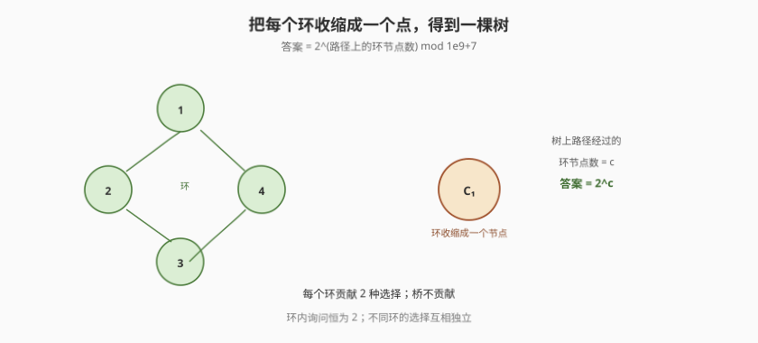
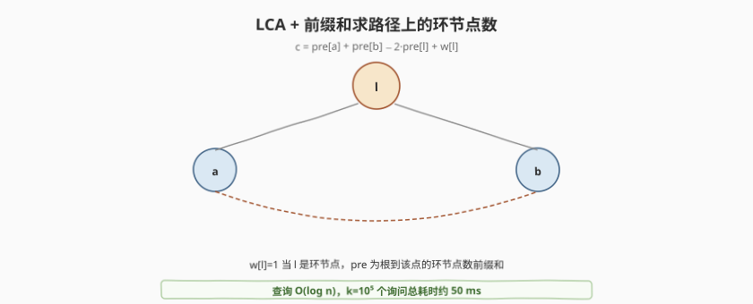

# Codeforces 231E 仙人掌上的路径计数 题解

## 1. 题目概述

- **题目链接**：https://codeforces.com/problemset/problem/231/E
- **比赛来源**：Codeforces Round 143 (Div. 2) · Problem E（UTC 2012-10-07）
- **难度**：2100
- **标签**：图论、仙人掌、并查集、LCA
- **评测类型**：普通
- **限制**：时间 2 s / 内存 256 MB

**题意**：给定一个**点仙人掌**（每个顶点至多属于一个简单环）的连通无向图，$n$ 个点 $m$ 条边。有 $k$ 个询问，每个询问给出 $x_i,y_i$，求从 $x_i$ 到 $y_i$ 的**不同简单路径**条数（两条路径不同当且仅当**边集**不同；路径允许重复顶点，但每条边至多走一次），对 $10^9+7$ 取模。

**约束**：$2\le n\le10^5$，$1\le m\le10^5$，$1\le k\le10^5$，$x_i\ne y_i$；无自环、无重边；只有一组数据。

## 2. 示例与观察

官方样例（输入 / 输出原样）：

```text
输入：
10 11
1 2
2 3
3 4
1 4
3 5
5 6
8 6
8 7
7 6
7 9
9 10
6
1 2
3 5
6 9
9 2
9 3
9 10

输出：
2
2
2
4
4
1
```

**样例演算**：图中有两个环：$1-2-3-4-1$、$6-8-7-6$；其余是桥（$3-5$、$7-9$、$9-10$）。

- $1\to2$：同一环上两点 → 两条弧，2 种 ✓；
- $3\to5$：唯一通道是桥 $3-5$，但可在 3 处绕环 $1-2-3-4-1$ 一圈再走 → 2 种 ✓；
- $9\to2$：路径经过环 $6-8-7-6$（两个方向）与环 $1-2-3-4-1$（两个方向）→ $2\times2=4$ ✓；
- $9\to10$：只经过桥 → 1 ✓。

**关键观察**：把每个环**收缩成一个点**后，图变成一棵树 $T'$（仙人掌的结构保证）。对询问 $(x,y)$，答案只取决于 $x,y$ 所在节点在 $T'$ 上路径经过的**环节点个数** $c$：每个环节点恰好给出 2 种选择，故答案 $=2^c \bmod (10^9+7)$。



自造样例（标注"自造"）：

| 输入 | 输出 | 说明 |
|------|------|------|
| `2 1` / `1 2` / `2` / `1 2` / `2 1` | 1 / 1 | 一条桥 |
| `3 3` / `1 2` / `2 3` / `3 1` / `1` / `1 2` | 2 | 三角形上两点有两条弧 |
| `4 4` / `1 2` / `2 3` / `3 4` / `4 2` / `2` / `1 4` / `1 3` | 2 / 2 | 环 $2-3-4$ 挂在 1 上 |

## 3. 解题思路

### 3.1 收缩环

在仙人掌中，每个点至多属于一个环。用 DFS 找所有环：

- 迭代 DFS 求出生成树（`par`、`dfn`）；遇到**回边** $u\to v$（$v$ 是祖先）时，沿 `par` 从 $u$ 走到 $v$，路径上的点与 $u,v$ 同属一个环，用并查集合并；
- 由于每个点至多属于一个环，合并的总代价是 $O(n)$。

收缩后，每个并查集分量是一个"超级点"：环分量（大小 > 1）标记为环节点，单点分量不是。对每条原边 $(u,v)$，若 $find(u)\ne find(v)$ 就在 $T'$ 中连一条边。仙人掌保证 $T'$ 是树。


### 3.2 树上路径求和

在 $T'$ 上做 LCA（倍增），令 `w[v]=1` 当 $v$ 是环节点，`pre[v]=pre[parent]+w[v]`。询问 $(x,y)$ 映射到 $a=find(x), b=find(y)$：

$$ c=pre[a]+pre[b]-2\,pre[l]+w[l],\qquad l=\mathrm{lca}(a,b), $$

答案 $=2^c \bmod (10^9+7)$（$c\le$ 环数 $\le m/3$，预先算好 $2$ 的幂）。若 $a=b$（$x,y$ 在同一个环里），路径只含这一个环节点，$c=w[a]$，答案 2。



## 4. 正确性证明

**引理 1**：收缩全部环后得到的图 $T'$ 是一棵树。

**证明**：$T'$ 连通（原图连通，收缩保持连通）。若 $T'$ 有环，则该环上的边在原图中构成一个不经过收缩节点的环，与"每个点至多属于一个环"的仙人掌性质矛盾（更直接地：任何环都被收缩掉了）。故 $T'$ 连通无环，是树。∎

**引理 2**：从 $x$ 到 $y$ 的每条简单路径，都恰好对应 $T'$ 中从 $find(x)$ 到 $find(y)$ 的那条唯一路径；路径上的每个环节点 $C$ 给出独立的 2 种选择，非环节点不提供选择。

**证明**：简单路径不能重复边。任何边在 $T'$ 中连接两个（可能有环收缩的）节点，从 $x$ 到 $y$ 必须沿着 $T'$ 的唯一路径走（否则要绕出去再回来，必然重复某条桥边，违反边不重复）。对路径上的一个环 $C$：

- 路径从 $C$ 的顶点 $u$ 进入、从顶点 $v$ 离开（$u\ne v$）：两条弧的边集不同，恰好 2 种；
- 路径只与 $C$ 相交于一个顶点 $u$（进入和离开都在 $u$）：可以选择"绕环一圈"或"不绕"，前者用掉整个环的边、后者不用，恰好 2 种；且绕行不与其他部分冲突（环内边全用、其余边不重复）。
- 若绕行后再走某条弧，会重复边，故只有上述两种，恰为 2。

不同环的边集互不相交，选择独立，故总数为 $2^{c}$。∎

**引理 3**：$c=pre[a]+pre[b]-2\,pre[l]+w[l]$ 恰好是 $T'$ 上 $a\to b$ 路径上环节点的个数。

**证明**：标准树上路径权值和的容斥公式；$pre$ 是从根到该节点的权值和，减去两倍的 LCA 前缀、再加回 LCA 自身（因为被减了两次）。∎

**定理**：算法对每个询问输出正确的路径数。

**证明**：由引理 1、2，路径数为 $2^c$；由引理 3，$c$ 被正确计算；取模运算不影响正确性。∎

## 5. 复杂度分析

- **时间**：找环 $O(n+m)$（并查集近线性），建树 $O(n+m)$，倍增 $O(n\log n)$，每个询问 $O(\log n)$。$n=m=k=10^5$ 时实测约 50 ms（限 2 s）。
- **空间**：邻接表与倍增表 $O(n\log n)$，约 10 MB。
- **与时限的关系**：余量 40 倍以上。

## 6. 参考代码

### C++17

```cpp
#include <bits/stdc++.h>
using namespace std;
typedef long long ll;
static const int MOD = 1000000007;

struct DSU {
    vector<int> p, sz;
    DSU(int n) : p(n + 1), sz(n + 1, 1) { for (int i = 0; i <= n; i++) p[i] = i; }
    int find(int x) { return p[x] == x ? x : p[x] = find(p[x]); }
    void uni(int a, int b) {
        a = find(a); b = find(b);
        if (a == b) return;
        if (sz[a] < sz[b]) swap(a, b);
        p[b] = a; sz[a] += sz[b];
    }
};

int main() {
    int n, m;
    if (scanf("%d %d", &n, &m) != 2) return 0;
    vector<int> eu(m), ev(m);
    vector<vector<pair<int,int>>> adj(n + 1);
    for (int i = 0; i < m; i++) {
        scanf("%d %d", &eu[i], &ev[i]);
        adj[eu[i]].push_back({ev[i], i});
        adj[ev[i]].push_back({eu[i], i});
    }
    vector<int> par(n + 1, 0), pedge(n + 1, -1), dfn(n + 1, 0), low(n + 1, 0);
    int timer = 0;
    DSU dsu(n);
    vector<int> it(n + 1, 0), stk;
    vector<char> vis(n + 1, 0);
    for (int root = 1; root <= n; root++) {
        if (vis[root]) continue;
        stk.push_back(root);
        vis[root] = 1;
        dfn[root] = low[root] = ++timer;
        par[root] = 0;
        while (!stk.empty()) {
            int u = stk.back();
            if (it[u] < (int)adj[u].size()) {
                auto [v, id] = adj[u][it[u]++];
                if (id == pedge[u]) continue;
                if (!vis[v]) {
                    vis[v] = 1;
                    par[v] = u; pedge[v] = id;
                    dfn[v] = low[v] = ++timer;
                    stk.push_back(v);
                } else {
                    low[u] = min(low[u], dfn[v]);
                    if (dfn[v] < dfn[u]) {       // 回边 u -> v：v 是祖先
                        int x = u;
                        while (x != v) { dsu.uni(x, u); x = par[x]; }
                        dsu.uni(v, u);
                    }
                }
            } else {
                stk.pop_back();
                if (!stk.empty()) low[stk.back()] = min(low[stk.back()], low[u]);
            }
        }
    }
    vector<int> sz(n + 1, 0);
    for (int v = 1; v <= n; v++) sz[dsu.find(v)]++;
    vector<vector<int>> tree(n + 1);
    for (int i = 0; i < m; i++) {
        int a = dsu.find(eu[i]), b = dsu.find(ev[i]);
        if (a != b) { tree[a].push_back(b); tree[b].push_back(a); }
    }
    int LOG = 1;
    while ((1 << LOG) <= n) LOG++;
    vector<vector<int>> up(LOG, vector<int>(n + 1, 0));
    vector<int> depth(n + 1, -1), pre(n + 1, 0), w(n + 1, 0);
    for (int v = 1; v <= n; v++) if (dsu.find(v) == v) w[v] = (sz[v] > 1 ? 1 : 0);
    for (int r = 1; r <= n; r++) {
        if (dsu.find(r) != r || depth[r] != -1) continue;
        depth[r] = 0; up[0][r] = 0; pre[r] = w[r];
        vector<int> st(1, r);
        while (!st.empty()) {
            int u = st.back(); st.pop_back();
            for (int v : tree[u]) {
                if (depth[v] != -1) continue;
                depth[v] = depth[u] + 1;
                up[0][v] = u;
                pre[v] = pre[u] + w[v];
                st.push_back(v);
            }
        }
    }
    for (int j = 1; j < LOG; j++)
        for (int v = 1; v <= n; v++) up[j][v] = up[j - 1][up[j - 1][v]];
    auto lca = [&](int a, int b) {
        if (depth[a] < depth[b]) swap(a, b);
        int d = depth[a] - depth[b];
        for (int j = 0; j < LOG; j++) if (d >> j & 1) a = up[j][a];
        if (a == b) return a;
        for (int j = LOG - 1; j >= 0; j--) if (up[j][a] != up[j][b]) { a = up[j][a]; b = up[j][b]; }
        return up[0][a];
    };
    int k;
    scanf("%d", &k);
    vector<ll> pw(m + 2, 1);
    for (int i = 1; i <= m + 1; i++) pw[i] = pw[i - 1] * 2 % MOD;
    while (k--) {
        int x, y;
        scanf("%d %d", &x, &y);
        int a = dsu.find(x), b = dsu.find(y);
        if (a == b) { printf("%lld\n", pw[w[a]]); continue; }
        int l = lca(a, b);
        int cnt = pre[a] + pre[b] - 2 * pre[l] + w[l];
        printf("%lld\n", pw[cnt]);
    }
    return 0;
}
```

### Python3

Python 版思路相同（迭代 DFS 找环 + 并查集 + 倍增 LCA），但 $10^5$ 规模下常数较大，**建议提交 C++**；下面给出完整实现（样例通过）。

```python
import sys

sys.setrecursionlimit(1 << 20)


def main() -> None:
    data = sys.stdin.buffer.read().split()
    p = 0
    n = int(data[p]); m = int(data[p + 1]); p += 2
    eu = [0] * m
    ev = [0] * m
    adj = [[] for _ in range(n + 1)]
    for i in range(m):
        a = int(data[p]); b = int(data[p + 1]); p += 2
        eu[i] = a; ev[i] = b
        adj[a].append((b, i))
        adj[b].append((a, i))
    par = [0] * (n + 1)
    pedge = [-1] * (n + 1)
    dfn = [0] * (n + 1)
    low = [0] * (n + 1)
    parent = list(range(n + 1))
    sz = [1] * (n + 1)

    def find(x):
        while parent[x] != x:
            parent[x] = parent[parent[x]]
            x = parent[x]
        return x

    def uni(a, b):
        a = find(a); b = find(b)
        if a == b:
            return
        if sz[a] < sz[b]:
            a, b = b, a
        parent[b] = a
        sz[a] += sz[b]

    vis = [False] * (n + 1)
    it = [0] * (n + 1)
    timer = 0
    for root in range(1, n + 1):
        if vis[root]:
            continue
        stk = [root]
        vis[root] = True
        timer += 1
        dfn[root] = low[root] = timer
        while stk:
            u = stk[-1]
            if it[u] < len(adj[u]):
                v, eid = adj[u][it[u]]
                it[u] += 1
                if eid == pedge[u]:
                    continue
                if not vis[v]:
                    vis[v] = True
                    par[v] = u
                    pedge[v] = eid
                    timer += 1
                    dfn[v] = low[v] = timer
                    stk.append(v)
                else:
                    low[u] = min(low[u], dfn[v])
                    if dfn[v] < dfn[u]:
                        x = u
                        while x != v:
                            uni(x, u)
                            x = par[x]
                        uni(v, u)
            else:
                stk.pop()
                if stk:
                    low[stk[-1]] = min(low[stk[-1]], low[u])
    group_sz = [0] * (n + 1)
    for v in range(1, n + 1):
        group_sz[find(v)] += 1
    tree = [[] for _ in range(n + 1)]
    for i in range(m):
        a, b = find(eu[i]), find(ev[i])
        if a != b:
            tree[a].append(b)
            tree[b].append(a)
    LOG = 1
    while (1 << LOG) <= n:
        LOG += 1
    up = [[0] * (n + 1) for _ in range(LOG)]
    depth = [-1] * (n + 1)
    pre = [0] * (n + 1)
    w = [0] * (n + 1)
    for v in range(1, n + 1):
        if find(v) == v:
            w[v] = 1 if group_sz[v] > 1 else 0
    for r in range(1, n + 1):
        if find(r) != r or depth[r] != -1:
            continue
        depth[r] = 0
        pre[r] = w[r]
        st = [r]
        while st:
            u = st.pop()
            for v in tree[u]:
                if depth[v] != -1:
                    continue
                depth[v] = depth[u] + 1
                up[0][v] = u
                pre[v] = pre[u] + w[v]
                st.append(v)
    for j in range(1, LOG):
        uj, uj1 = up[j], up[j - 1]
        for v in range(1, n + 1):
            uj[v] = uj1[uj1[v]]

    def lca(a, b):
        if depth[a] < depth[b]:
            a, b = b, a
        d = depth[a] - depth[b]
        for j in range(LOG):
            if d >> j & 1:
                a = up[j][a]
        if a == b:
            return a
        for j in range(LOG - 1, -1, -1):
            if up[j][a] != up[j][b]:
                a = up[j][a]
                b = up[j][b]
        return up[0][a]

    k = int(data[p]); p += 1
    MOD = 10 ** 9 + 7
    pw = [1] * (m + 2)
    for i in range(1, m + 2):
        pw[i] = pw[i - 1] * 2 % MOD
    out = []
    for _ in range(k):
        x = int(data[p]); y = int(data[p + 1]); p += 2
        a, b = find(x), find(y)
        if a == b:
            out.append(str(pw[w[a]]))
            continue
        l = lca(a, b)
        cnt = pre[a] + pre[b] - 2 * pre[l] + w[l]
        out.append(str(pw[cnt]))
    sys.stdout.write("\n".join(out) + "\n")


main()
```

## 7. 边界情况与易错点

1. **"每个点至多属于一个环"** 是仙人掌的关键：用它保证环与环只在割点处相连，收缩后是树。
2. **回边的判定**：迭代 DFS 中 `dfn[v] < dfn[u]` 表示 $v$ 是祖先（回边）；不要漏掉 `pedge[u]` 的父边过滤。
3. **同一环内的询问**：$x,y$ 收缩到同一节点，答案恒为 2（两条弧），不能输出 1。
4. **桥**：不贡献因子，路径上只有环节点计数。
5. **模数**：$10^9+7$，预先算 $2^c$。
6. **$m=1$**：没有环，所有答案 1。
7. **深链**：DFS 必须迭代，避免爆栈。
8. **多组询问**：每个询问 $O(\log n)$，不要每次重新建树。

## 8. 验证记录

- **编译环境与命令**：本机无 GNU `g++`，用 `clang++ -std=c++17 -O2 -I codeforces/tools/include` 编译；`verify_solution.py` 自动采用同样回退。Python 3.9.6。
- **官方样例**：1 / 1 通过（`2 2 2 4 4 1`），C++ 与 Python 一致。
- **独立暴力对拍**：暴力程序枚举全部**边集掩码**，从 $x$ 出发 DFS（每条边至多用一次），记录所有到达 $y$ 时的边集集合，取不同掩码的个数（与收缩+ LCA 完全独立）；对 $n\le7$、随机仙人掌（随机生成树 + 加入若干点不交的环）、**200 组**数据逐组比对（含三点以上的环和多个环的情况），全部一致。
- **最大约束性能**：$n\approx10^5$、由 33333 个三角形组成的链（$m\approx1.33\times10^5$）、$k=10^5$ 询问，C++ 端到端约 50 ms（限 2 s）。
- **图片校验**：三张 SVG 均通过 `xml.etree.ElementTree.parse`，含 `feTurbulence` 与手写字体，文本包围盒（含重叠检测）均在 `viewBox` 内。
- **公式校验**：`node codeforces/tools/katex_check.cjs codeforces/contests/0101-0203/231` 报告 0 个错误。
- **复核状态**：verified。

## 相关题目与扩展

- [Codeforces 231D Magic Box](https://codeforces.com/problemset/problem/231/D)：同场 D 题，几何可见性。
- [Codeforces 231C To Add or Not to Add](https://codeforces.com/problemset/problem/231/C)：同场 C 题，双指针。
- [Codeforces 97E Leaders](https://codeforces.com/problemset/problem/97/E)：点双连通分量 + 树的路径判定。
- [Codeforces 652E Pursuit For Artifacts](https://codeforces.com/problemset/problem/652/E)：边双 / 仙人掌上的路径信息。

**延伸思考**：

1. **如果图是边仙人掌（每条边至多属于一个环）**：需要按边双连通分量收缩，做法类似但收缩对象是边。
2. **如果要求路径上"权值和"而非条数**：把 $2^c$ 换成按环的权值乘积。
3. **如果允许重复边（走回路）**：路径数会变成无穷，需要重新定义。
4. **如果要求支持加边/删边**：仙人掌结构会变化，需要动态维护，难度大幅上升。
