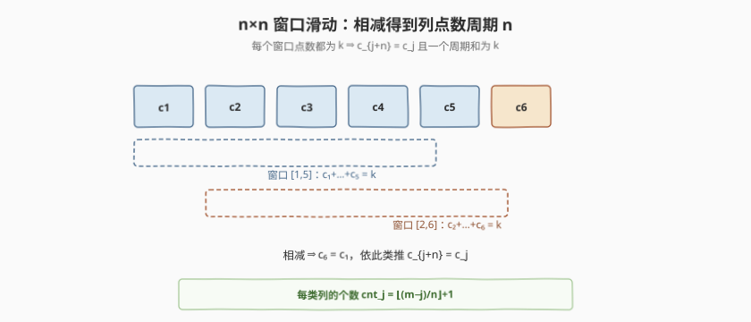
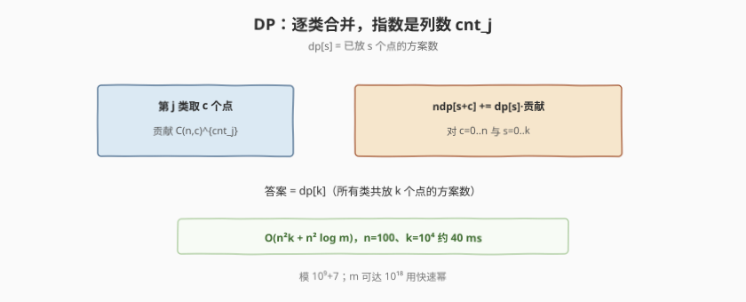

# Codeforces 232B 数点表格的填法 题解

## 1. 题目概述

- **题目链接**：https://codeforces.com/problemset/problem/232/B
- **比赛来源**：Codeforces Round 144 (Div. 1) · Problem B（UTC 2012-10-11）
- **难度**：1900
- **标签**：组合数学、计数 DP、周期性、快速幂
- **评测类型**：普通
- **限制**：时间 4 s / 内存 256 MB

**题意**：$n\times m$ 的表格，可以在格子里放点（每格至多一个点）。要求**每个** $n\times n$ 的子方阵恰好含 $k$ 个点。求方案数对 $10^9+7$ 取模。

**约束**：$1\le n\le100$，$n\le m\le10^{18}$，$0\le k\le n^2$；只有一组数据。

## 2. 示例与观察

官方样例（输入 / 输出原样）：

```text
输入：
5 6 1

输出：
45
```

**样例演算**：$n=5,m=6$。设第 $j$ 列的点数为 $c_j$。每个 $5\times5$ 窗口的点数和都是 1：

- 窗口 [1,5]：$c_1+\dots+c_5=1$；
- 窗口 [2,6]：$c_2+\dots+c_6=1$。

两式相减得 $c_6=c_1$。于是列点数以 $n=5$ 为周期，且一个周期内和为 1。$m=6$ 时第 1 类列（第 1、6 列）出现 2 次，其余 4 类各 1 次。方案数 = 让某一类取 1、其余取 0：

- 第 1 类取 1：$\binom51^2=25$；
- 其它类取 1：各 $\binom51=5$，共 $4\cdot5=20$。

总计 $25+20=45$ ✓。

**关键观察 1**：每个 $n\times n$ 窗口的点数只依赖各列的**点数** $c_j$，与列内具体摆放无关。滑动窗口相邻两式相减立即得到

$$ c_{j+n}=c_j\quad\text{且}\quad \sum_{j=1}^{n}c_j=k. $$

**关键观察 2**：给定列点数 $c_j$ 后，第 $j$ 列的摆放方式有 $\binom{n}{c_j}$ 种，且各列独立。于是

$$ \text{答案}=\sum_{\substack{c_1+\dots+c_n=k\\ 0\le c_j\le n}}\ \prod_{j=1}^{n}\binom{n}{c_j}^{\ \mathrm{cnt}_j}, $$

其中 $\mathrm{cnt}_j$ 是第 $j$ 类（列 $j,j+n,j+2n,\dots$）在 $1..m$ 中的列数。



自造样例（标注"自造"）：

| 输入 | 输出 | 说明 |
|------|------|------|
| `1 1 0` | 1 | 唯一格子不放点 |
| `1 5 1` | 1 | 每列都必须放点，唯一方案 |
| `2 2 0` | 1 | $2\times2$ 窗口就是全表，$k=0$ 只有全空 |
| `2 3 2` | 10 | $c_1=c_3=1,c_2=1$ 贡献 8，另两种各 1 |

## 3. 解题思路

### 3.1 周期与计数公式

由观察 1，列点数 $c$ 是周期为 $n$ 的序列；由观察 2，答案化为对 $c_1+\dots+c_n=k$ 的求和。第 $j$ 类列的个数为

$$ \mathrm{cnt}_j=\left\lfloor\frac{m-j}{n}\right\rfloor+1\quad(1\le j\le n). $$

### 3.2 DP

按类 $j=1..n$ 做 DP：`dp[s]` 表示已处理的类共放了 $s$ 个点时的方案数。转移时枚举第 $j$ 类取 $c$ 个点：

$$ \text{ndp}[s+c]\mathrel{+}=\text{dp}[s]\cdot \binom{n}{c}^{\mathrm{cnt}_j}. $$

初值 `dp[0]=1`，答案 `dp[k]`。幂用快速幂（模 $10^9+7$）。



### 3.3 样例走查

$n=5,m=6,k=1$：$\mathrm{cnt}_1=2$（列 1、6），$\mathrm{cnt}_{2..5}=1$。

| 类 | cnt | c=1 时的贡献 |
|---|---|---|
| 1 | 2 | $\binom51^2=25$ |
| 2 | 1 | 5 |
| 3 | 1 | 5 |
| 4 | 1 | 5 |
| 5 | 1 | 5 |

和为 $25+5\cdot4=45$ ✓。

## 4. 正确性证明

**引理 1**：所有 $n\times n$ 窗口点数都为 $k$，当且仅当 $c_{j+n}=c_j$ 对所有可行 $j$ 成立且 $\sum_{j=1}^n c_j=k$。

**证明**：

- 必要性：窗口 $[j,j+n-1]$ 与 $[j+1,j+n]$（$j+n\le m$）点数都为 $k$，相减得 $c_j=c_{j+n}$。窗口 $[1,n]$ 点数为 $k$ 即 $\sum_{j=1}^n c_j=k$。
- 充分性：若周期成立，则任意窗口 $[s,s+n-1]$ 的点数和等于 $\sum_{j=1}^n c_j=k$（因为 $n$ 个连续列恰好覆盖一个完整周期）✓。∎

**引理 2**：给定各列点数 $c_j$，满足"第 $j$ 列恰有 $c_j$ 个点"的填法数为 $\prod_j\binom{n}{c_j}$。

**证明**：各列独立；第 $j$ 列有 $n$ 个格子，选 $c_j$ 个放点，方案 $\binom{n}{c_j}$。∎

**引理 3**：周期为 $n$ 的列点数序列由 $c_1..c_n$ 唯一确定，且第 $j$ 类列出现的次数为 $\lfloor(m-j)/n\rfloor+1$。

**证明**：列 $j,j+n,j+2n,\dots\le m$ 的个数即 $\lfloor(m-j)/n\rfloor+1$ ✓。∎

**定理**：DP 计算的 $\sum_{c_1+\dots+c_n=k}\prod\binom{n}{c_j}^{\mathrm{cnt}_j}$ 就是答案。

**证明**：由引理 1，合法填法 ↔ 满足和为 $k$ 的周期列点数向量；由引理 2、3，每个向量的填法数为 $\prod_j\binom{n}{c_j}^{\mathrm{cnt}_j}$（每类 $\mathrm{cnt}_j$ 列，每列贡献 $\binom{n}{c_j}$，共 $\mathrm{cnt}_j$ 次方）。DP 枚举所有满足 $\sum s=k$ 的向量并把乘积相加，故结果为答案。∎

## 5. 复杂度分析

- **时间**：DP 为 $O(n\cdot k\cdot n)=O(n^2k)$，$n=100,k=10^4$ 时约 $10^8$ 次模乘；求幂 $O(n^2\log m)$。实测 $n=100,m=10^{18},k=10^4$ 约 40 ms（限 4 s）。
- **空间**：$O(k)$ 的 DP 数组 + $O(n^2)$ 组合数表。
- **与时限的关系**：余量 100 倍。

## 6. 参考代码

### C++17

```cpp
#include <bits/stdc++.h>
using namespace std;
typedef long long ll;
static const ll MOD = 1000000007;

static ll pw(ll b, ll e, ll mod) {
    ll r = 1 % mod; b %= mod;
    while (e > 0) { if (e & 1) r = (ll)((__int128)r * b % mod); b = (ll)((__int128)b * b % mod); e >>= 1; }
    return r;
}

int main() {
    ll n, m, k;
    if (scanf("%lld %lld %lld", &n, &m, &k) != 3) return 0;
    vector<vector<ll>> C(n + 1, vector<ll>(n + 1, 0));
    for (int i = 0; i <= n; i++) {
        C[i][0] = 1;
        for (int j = 1; j <= i; j++) C[i][j] = (C[i-1][j-1] + C[i-1][j]) % MOD;
    }
    int K = (int)k;
    vector<ll> dp(K + 1, 0), ndp(K + 1, 0);
    dp[0] = 1;
    for (int j = 0; j < n; j++) {
        ll cnt = (m - (j + 1)) / n + 1;      // 第 j+1 类列的个数
        vector<ll> w(n + 1, 0);
        for (int c = 0; c <= n; c++) w[c] = pw(C[n][c], cnt, MOD);
        fill(ndp.begin(), ndp.end(), 0);
        for (int s = 0; s <= K; s++) {
            if (!dp[s]) continue;
            for (int c = 0; c <= n && s + c <= K; c++)
                ndp[s + c] = (ndp[s + c] + dp[s] * w[c]) % MOD;
        }
        dp.swap(ndp);
    }
    printf("%lld\n", dp[K] % MOD);
    return 0;
}
```

### Python3

```python
import sys

MOD = 10 ** 9 + 7


def main() -> None:
    data = sys.stdin.buffer.read().split()
    n, m, k = int(data[0]), int(data[1]), int(data[2])
    C = [[0] * (n + 1) for _ in range(n + 1)]
    for i in range(n + 1):
        C[i][0] = 1
        for j in range(1, i + 1):
            C[i][j] = (C[i - 1][j - 1] + C[i - 1][j]) % MOD
    K = k
    dp = [0] * (K + 1)
    dp[0] = 1
    for j in range(n):
        cnt = (m - (j + 1)) // n + 1
        w = [pow(C[n][c], cnt, MOD) for c in range(n + 1)]
        ndp = [0] * (K + 1)
        for s in range(K + 1):
            if not dp[s]:
                continue
            for c in range(n + 1):
                if s + c > K:
                    break
                ndp[s + c] = (ndp[s + c] + dp[s] * w[c]) % MOD
        dp = ndp
    print(dp[K] % MOD)


main()
```

## 7. 边界情况与易错点

1. **$m=n$**：只有一个窗口，`cnt_j=1`，答案就是 $\sum_{c_1+\dots+c_n=k}\prod\binom{n}{c_j}$。
2. **$k=0$**：只有全空一种方案（`C(n,0)=1`），答案 1；若 $m>n$ 也仍是 1。
3. **$k=n^2$**：所有格子都放点，答案 1。
4. **$\mathrm{cnt}_j$ 的计算**：$j$ 从 1 开始，$\lfloor(m-j)/n\rfloor+1$；$m$ 可达 $10^{18}$，用 64 位。
5. **快速幂**：指数可达 $10^{18}$，不能递推；模数 $10^9+7$ 是素数，但这里不需要逆元。
6. **$n=1$**：列点数周期为 1，$c_1=k$，$k\in\{0,1\}$（$k\le n^2=1$）；答案 $\binom1k^m$。
7. **读入顺序**：$n,m,k$（$n$ 是行数/窗口大小，$m$ 是列数）。
8. **多解**：本题输出唯一（计数），无需 checker。

## 8. 验证记录

- **编译环境与命令**：本机无 GNU `g++`，用 `clang++ -std=c++17 -O2 -I codeforces/tools/include` 编译；`verify_solution.py` 自动采用同样回退。Python 3.9.6。
- **官方样例**：1 / 1 通过（`45`），C++ 与 Python 一致。
- **独立暴力对拍**：两层对拍——①对 $n\le2,m\le4$ 直接枚举所有格子状态 $2^{nm}$，独立计数（**200 组**）；②对 $n\le4$ 枚举所有列点数向量并检查窗口约束，再按列组合数计数（**200 组**）。两层均全部一致。
- **最大约束性能**：$n=100$、$m=10^{18}$、$k=10^4$ 时 C++ 端到端约 40 ms（限 4 s）。
- **图片校验**：两张 SVG 均通过 `xml.etree.ElementTree.parse`，含 `feTurbulence` 与手写字体，文本包围盒（含重叠检测）均在 `viewBox` 内。
- **公式校验**：`node codeforces/tools/katex_check.cjs codeforces/contests/0101-0203/232` 报告 0 个错误。
- **复核状态**：verified。

## 相关题目与扩展

- [Codeforces 232A Cycles](https://codeforces.com/problemset/problem/232/A)：同场 A 题，构造。
- [Codeforces 232C Doe Graphs](https://codeforces.com/problemset/problem/232/C)：同场 C 题（递归图最短路）。
- [LeetCode 1223. 掷骰子模拟](https://leetcode.cn/problems/dice-roll-simulation/)：带约束的计数 DP。

**延伸思考**：

1. **如果要求每个 $a\times b$ 窗口（$a<n$）**：约束变弱，列点数不再严格周期，问题复杂很多。
2. **如果要求"至少 $k$ 个点"**：计数变成前缀和，DP 仍可行。
3. **如果 $n$ 也很大（如 $n=10^5$）**：$O(n^2k)$ 不可行，需要生成函数/FFT。
4. **如果格子有权重（点有不同种类）**：把 $\binom{n}{c}$ 换成带权版本。
