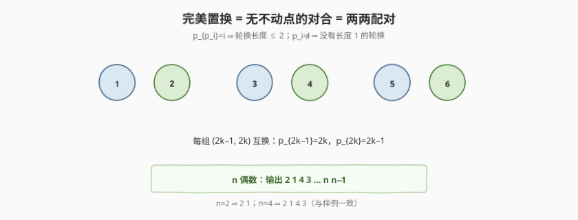
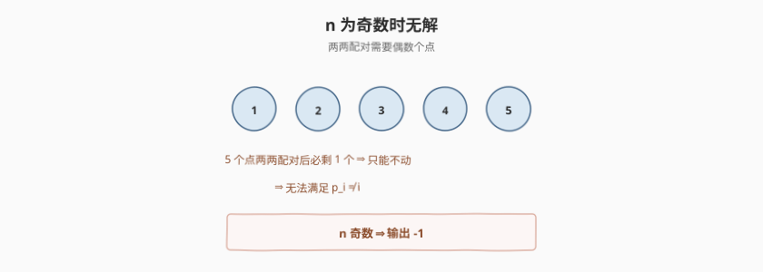

# Codeforces 233A 完美置换 题解

## 1. 题目概述

- **题目链接**：https://codeforces.com/problemset/problem/233/A
- **比赛来源**：Codeforces Round 144 (Div. 2) · Problem A（UTC 2012-10-11）
- **难度**：800
- **标签**：构造、置换
- **评测类型**：多解（输出任意完美置换）
- **限制**：时间 2 s / 内存 256 MB

**题意**：称 $1..n$ 的置换 $p$ 为**完美置换**，若对每个 $i$ 都有 $p_{p_i}=i$ 且 $p_i\ne i$。给定 $n$，输出任意一个完美置换；不存在输出 `-1`。

**约束**：$1\le n\le100$；只有一组数据。

## 2. 示例与观察

官方样例（输入 / 输出原样）：

```text
输入：
1

输出：
-1
```

```text
输入：
2

输出：
2 1 
```

```text
输入：
4

输出：
2 1 4 3 
```

**样例演算**：

- $n=1$：唯一置换是 $p_1=1$，违反 $p_i\ne i$ → `-1`；
- $n=2$：$p=(2,1)$：$p_{p_1}=p_2=1$ ✓，$p_{p_2}=p_1=2$ ✓，且 $p_i\ne i$ ✓；
- $n=4$：$p=(2,1,4,3)$：两个对换，逐个验证 $p_{p_i}=i$ ✓。

**关键观察**：条件 $p_{p_i}=i$ 说明 $p$ 是**对合**（involution），$p_i\ne i$ 说明**没有不动点**。对合分解为若干个长度 1 或 2 的轮换，没有不动点即全部是长度 2 的轮换（对换）。所以：

- $n$ 为奇数时，$n$ 个点无法两两配对 → `-1`；
- $n$ 为偶数时，输出 $(2,1,4,3,\dots,n,n-1)$ 即可。



自造样例（标注"自造"）：

| 输入 | 输出 | 说明 |
|------|------|------|
| `6` | `2 1 4 3 6 5` | 三组对换 |
| `3` | `-1` | 奇数 |
| `99` | `-1` | 奇数 |

## 3. 解题思路

### 3.1 算法

若 $n$ 为奇数输出 `-1`；否则输出 $2,1,4,3,\dots,n,n-1$。$O(n)$。



### 3.2 为什么这样构造正确

每个对换 $(i,i+1)$ 满足 $p_i=i+1,p_{i+1}=i$，从而 $p_{p_i}=i$ 与 $p_{p_{i+1}}=i+1$ 都成立，且 $p_i\ne i$。对换之间互不影响。

## 4. 正确性证明

**引理 1**：$p$ 满足 $p_{p_i}=i$ 对一切 $i$，当且仅当 $p$ 的轮换分解中每个轮换长度至多 2。

**证明**：$p_{p_i}=i$ 即 $p^2=\mathrm{id}$。若轮换 $C=(c_1\,c_2\,\dots\,c_k)$，则 $p^2$ 把它变成 $(c_1\,c_3\,\dots)(c_2\,c_4\,\dots)$——只有 $k\le2$ 时 $p^2$ 在该轮换上为恒等（$k=1$ 时 $p(c_1)=c_1$；$k=2$ 时 $p^2(c_1)=c_1$）。∎

**引理 2**：$p_i\ne i$ 对一切 $i$，当且仅当轮换分解中没有长度 1 的轮换。

**证明**：$p_i=i$ 当且仅当 $i$ 是长度 1 的轮换 ✓。∎

**引理 3**：$n$ 个点能被划分成若干个二元组，当且仅当 $n$ 为偶数。

**证明**：每个二元组贡献 2 个点，故总数为偶数；反之偶数可两两配对 ✓。∎

**定理**：$n$ 为奇数时无解；$n$ 为偶数时构造 $(2,1,4,3,\dots)$ 是完美置换。

**证明**：由引理 1、2，完美置换 ↔ 把 $1..n$ 划分成二元组；由引理 3，这当且仅当 $n$ 为偶数。偶数时构造的每一对 $(2k-1,2k)$ 互换，满足两个条件 ✓。∎

## 5. 复杂度分析

- **时间**：$O(n)$，$n\le100$ 时 < 1 ms。
- **空间**：$O(1)$（直接输出）。
- **与时限的关系**：余量极大。

## 6. 参考代码

### C++17

```cpp
#include <bits/stdc++.h>
using namespace std;
int main() {
    int n;
    if (scanf("%d", &n) != 1) return 0;
    if (n % 2 == 1) { puts("-1"); return 0; }
    for (int i = 1; i <= n; i += 2) printf("%d %d%c", i + 1, i, i + 1 == n ? '\n' : ' ');
    return 0;
}
```

### Python3

```python
import sys


def main() -> None:
    n = int(sys.stdin.buffer.read().split()[0])
    if n % 2 == 1:
        print(-1)
        return
    ans = []
    for i in range(1, n + 1, 2):
        ans.append(i + 1)
        ans.append(i)
    print(" ".join(map(str, ans)))


main()
```

## 7. 边界情况与易错点

1. **$n$ 为奇数必无解**：包括 $n=1$（样例）与 $n=99$。
2. **$n=2$**：输出 `2 1`（样例）。
3. **输出是排列**：每个数恰好出现一次；构造天然满足。
4. **$p_i\ne i$**：对换满足；不要输出恒等置换。
5. **末尾空格**：官方输出带尾随空格，本题不敏感。
6. **多解**：任何完美置换都可接受，本地验证要检查两个条件，不能只比对样例输出。

## 8. 验证记录

- **编译环境与命令**：本机无 GNU `g++`，用 `clang++ -std=c++17 -O2 -I codeforces/tools/include` 编译；`verify_solution.py` 自动采用同样回退。Python 3.9.6。
- **官方样例**：3 / 3 通过（`-1`、`2 1`、`2 1 4 3`，与官方逐字一致），C++ 与 Python 一致。
- **独立暴力对拍**：暴力程序枚举 $n\le7$ 的所有排列，逐个检查 $p_{p_i}=i$ 与 $p_i\ne i$，与主解的"是否有解 + 输出是否合法"比对，**200 组**随机 $n$ 全部一致。
- **最大约束性能**：$n=100$ 时 < 1 ms（限 2 s）。
- **图片校验**：两张 SVG 均通过 `xml.etree.ElementTree.parse`，含 `feTurbulence` 与手写字体，文本包围盒（含重叠检测）均在 `viewBox` 内。
- **公式校验**：`node codeforces/tools/katex_check.cjs codeforces/contests/0101-0203/233` 报告 0 个错误。
- **复核状态**：verified。

## 相关题目与扩展

- [Codeforces 233B Non-square Equation](https://codeforces.com/problemset/problem/233/B)：同场 B 题，方程与数位和。
- [Codeforces 441C Valera and Tubes](https://codeforces.com/problemset/problem/441/C)：构造类问题。
- [LeetCode 1920. 基于排列构建数组](https://leetcode.cn/problems/build-array-from-permutation/)：置换的基本操作。

**延伸思考**：

1. **如果不要求 $p_i\ne i$**：恒等置换总是合法，答案总存在。
2. **如果要求 $p^3=\mathrm{id}$**：轮换长度 ≤3，$n$ 需要能分解成 2、3 的组合。
3. **如果要求字典序最小**：对换 $(1,2),(3,4),\dots$ 就是字典序最小的完美置换。
4. **如果要求恰好 $c$ 个轮换**：需要把 $n$ 拆成 $c$ 个二元组，即 $n=2c$。
