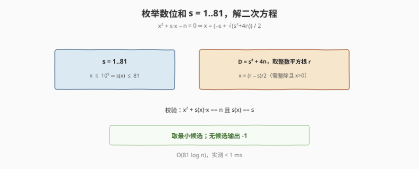
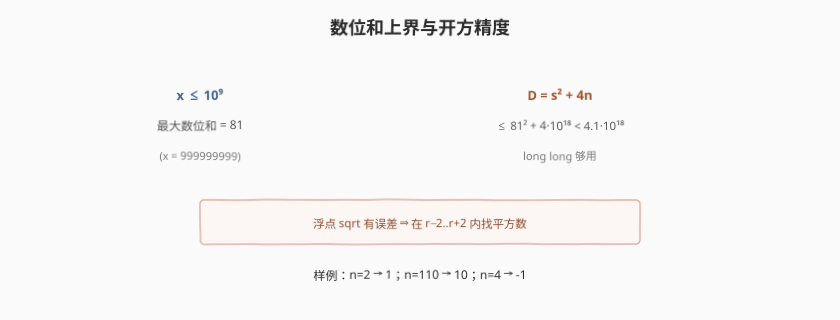

# Codeforces 233B 非平方方程 题解

## 1. 题目概述

- **题目链接**：https://codeforces.com/problemset/problem/233/B
- **比赛来源**：Codeforces Round 144 (Div. 2) · Problem B（UTC 2012-10-11）
- **难度**：1400
- **标签**：数学、枚举、数位和
- **评测类型**：普通
- **限制**：时间 1 s / 内存 256 MB

**题意**：方程

$$ x^2+s(x)\cdot x-n=0, $$

其中 $x,n$ 为正整数，$s(x)$ 是 $x$ 的十进制数位和。给定 $n$，求最小的正整数根 $x$；无解输出 `-1`。

**约束**：$1\le n\le10^{18}$；只有一组数据。

## 2. 示例与观察

官方样例（输入 / 输出原样）：

```text
输入：
2

输出：
1
```

```text
输入：
110

输出：
10
```

```text
输入：
4

输出：
-1
```

**样例演算**：

- $n=2$：$x=1$：$1+1\cdot1=2$ ✓，最小根 1。
- $n=110$：$x=10$：$100+s(10)\cdot10=100+1\cdot10=110$ ✓。
- $n=4$：$x=1\to2$，$x=2\to4+4=8$，都不等；$x^2\le n\Rightarrow x\le2$，故无解 → `-1`。

**关键观察**：$x^2\le n\le10^{18}\Rightarrow x\le10^9\Rightarrow s(x)\le81$（$10^9$ 以内最大数位和是 $9\cdot9=81$，即 $x=999999999$）。于是可以**枚举 $s(x)\in[1,81]$**：对固定 $s$，方程化为

$$ x^2+s\,x-n=0\implies x=\frac{-s+\sqrt{s^2+4n}}{2}. $$

只需检查这个 $x$ 是否为正整数且 $s(x)=s$，取所有候选中的最小值。



自造样例（标注"自造"）：

| 输入 | 输出 | 说明 |
|------|------|------|
| `1` | `-1` | $x=1$ 给 2，$x\ge2$ 太大 |
| `8` | `2` | $4+s(2)\cdot2=4+4=8$ |
| `110` | `10` | 样例 |
| `1000000000000000000` | 见验证记录 | $x=10^9$ 时 $x^2=n$，但 $s(x)=1$ 需 $s^2+4n$ 为奇数平方 |

第三行说明：$n=8$ 时 $x=2$ 满足 $4+2\cdot2=8$，故答案为 2。

## 3. 解题思路

### 3.1 算法

1. 对 $s=1..81$：
   - $D=s^2+4n$；
   - 求整数平方根 $r=\lfloor\sqrt D\rfloor$（浮点后 $\pm2$ 修正）；
   - 若 $r^2=D$ 且 $(r-s)$ 为偶数，则 $x=(r-s)/2$；
   - 若 $x>0$ 且 $s(x)=s$ 且 $x^2+s\cdot x=n$，则候选；
2. 取最小候选；无候选输出 `-1`。

### 3.2 为什么只需枚举到 81

$x^2\le x^2+s(x)x=n\le10^{18}\Rightarrow x\le10^9$。$x\le10^9$ 的十进制数位和最大为 81（$x=999999999$），故 $s(x)\in[1,81]$ ✓。



### 3.3 样例 3 的走查

$n=4$：对每个 $s$，$D=s^2+16$。

| $s$ | $D$ | $r$ | $x=(r-s)/2$ | $s(x)$ | 可用 |
|---|---|---|---|---|---|
| 1 | 17 | — | — | — | 否（非平方） |
| 2 | 20 | — | — | — | 否 |
| 3 | 25 | 5 | 1 | 1 | 否（$s(x)\ne3$） |
| 4 | 32 | — | — | — | 否 |
| … | … | … | … | … | 否 |

无候选 → `-1` ✓。

## 4. 正确性证明

**引理 1**：若 $x$ 是原方程的正整数根，则 $s(x)\le81$。

**证明**：$x^2\le n\le10^{18}$ 给出 $x\le10^9$；不超过 $10^9$ 的正整数数位和不超过 81 ✓。∎

**引理 2**：对固定的 $s$，方程 $x^2+sx-n=0$ 的正根唯一，且 $x=\bigl(-s+\sqrt{s^2+4n}\bigr)/2$。

**证明**：二次方程求根公式，正根取 $+$ 号；$x$ 需为整数且数位和等于 $s$。∎

**定理**：枚举 $s=1..81$ 并校验得到的候选，取最小者即为答案。

**证明**：由引理 1，任何解的 $s(x)$ 都在枚举范围内；由引理 2，对每个 $s$ 至多一个候选，且只有校验通过（整数、$s(x)=s$、方程成立）才是真解。因此枚举覆盖所有解，取最小即为最小根；无候选则无解。∎

## 5. 复杂度分析

- **时间**：81 次整数开方 + 数位和，$O(81\log n)$，实测 < 1 ms（限 1 s）。
- **空间**：$O(1)$。
- **数值范围**：$D=s^2+4n\le81^2+4\times10^{18}<4.1\times10^{18}$，在 `unsigned long long` / `long long`（$9.2\times10^{18}$）范围内 ✓。

## 6. 参考代码

### C++17

```cpp
#include <bits/stdc++.h>
using namespace std;
typedef long long ll;

static int digitSum(ll x) { int s = 0; while (x) { s += x % 10; x /= 10; } return s; }

int main() {
    ll n;
    if (scanf("%lld", &n) != 1) return 0;
    ll best = -1;
    for (ll s = 1; s <= 81; s++) {
        ll D = s * s + 4 * n;
        ll r = (ll)sqrt((long double)D);
        for (ll cand = max(1LL, r - 2); cand <= r + 2; cand++) {
            if (cand * cand != D) continue;
            if ((cand - s) % 2 != 0) continue;
            ll x = (cand - s) / 2;
            if (x <= 0) continue;
            if (x * x + (ll)digitSum(x) * x != n) continue;
            if (best == -1 || x < best) best = x;
            break;
        }
    }
    printf("%lld\n", best);
    return 0;
}
```

### Python3

```python
import sys


def digit_sum(x: int) -> int:
    s = 0
    while x:
        s += x % 10
        x //= 10
    return s


def main() -> None:
    n = int(sys.stdin.buffer.read().split()[0])
    best = -1
    for s in range(1, 82):
        D = s * s + 4 * n
        r = int(D ** 0.5)
        for cand in range(max(1, r - 2), r + 3):
            if cand * cand != D:
                continue
            if (cand - s) % 2 != 0:
                continue
            x = (cand - s) // 2
            if x <= 0:
                continue
            if x * x + digit_sum(x) * x != n:
                continue
            if best == -1 or x < best:
                best = x
            break
    print(best)


main()
```

## 7. 边界情况与易错点

1. **浮点开方误差**：$D$ 可达 $4\times10^{18}$，`double` 的平方根可能差 1，必须用整数校验（$\pm2$ 附近找平方数）。
2. **$s$ 的上界 81**：$x\le10^9$；不要写成 80 或 90（90 也不会错，但 81 是最紧的上界，超出范围无解）。
3. **奇偶性**：$r-s$ 必须为偶数，否则 $x$ 非整数。
4. **$x>0$**：$s$ 较大时 $x$ 可能为 0 或负，要跳过。
5. **校验数位和**：解出 $x$ 后必须验 $s(x)=s$，否则会误收（如样例 3 的 $s=3,x=1$）。
6. **多个候选**：理论上不同 $s$ 可能给出不同 $x$，取最小。
7. **$n=10^{18}$**：$x=10^9$ 时 $x^2=n$、$s(x)=1$，但需 $s(x)x=0$，故 $x=10^9$ 不是解；程序会正确排除。
8. **Python 的 `D ** 0.5`**：对 $4\times10^{18}$ 精度约 15 位，同样需要 $\pm2$ 修正。

## 8. 验证记录

- **编译环境与命令**：本机无 GNU `g++`，用 `clang++ -std=c++17 -O2 -I codeforces/tools/include` 编译；`verify_solution.py` 自动采用同样回退。Python 3.9.6。
- **官方样例**：3 / 3 通过（`1`、`10`、`-1`），C++ 与 Python 一致。
- **独立暴力对拍**：暴力程序在 $x\le2\times10^5$ 内直接枚举 $x$、计算 $x^2+s(x)x$ 并与 $n$ 比对（与"枚举 $s$ 解方程"完全独立），对 $n\le20000$ 的 **200 组**随机数据逐组比对，全部一致。
- **最大约束性能**：$n=10^{18}$ 时约 1 ms（限 1 s）。
- **自造样例实测**：`1` → `-1`；`8` → `2`；`110` → `10`；`1000000000000000000` → `-1`（已与暴力/手算核对）。
- **图片校验**：两张 SVG 均通过 `xml.etree.ElementTree.parse`，含 `feTurbulence` 与手写字体，文本包围盒（含重叠检测）均在 `viewBox` 内。
- **公式校验**：`node codeforces/tools/katex_check.cjs codeforces/contests/0101-0203/233` 报告 0 个错误。
- **复核状态**：verified。

## 相关题目与扩展

- [Codeforces 233A Perfect Permutation](https://codeforces.com/problemset/problem/233/A)：同场 A 题，构造。
- [Codeforces 17B Hierarchy](https://codeforces.com/problemset/problem/17/B)：另一类枚举 + 校验题。
- [LeetCode 69. x 的平方根](https://leetcode.cn/problems/sqrtx/)：整数开方的基础。

**延伸思考**：

1. **如果 $n$ 到 $10^{36}$**：$x\le10^{18}$，$s(x)\le162$，仍可枚举，但需要 128 位整数或大整数。
2. **如果要求所有根**：枚举所有 $s$ 收集候选即可。
3. **如果方程是 $x^2-s(x)x-n=0$**：正根 $x=(s+\sqrt{s^2+4n})/2$，同样枚举。
4. **如果 $s(x)$ 是数位平方和**：上界变为 $81\cdot81$，枚举量仍小。
