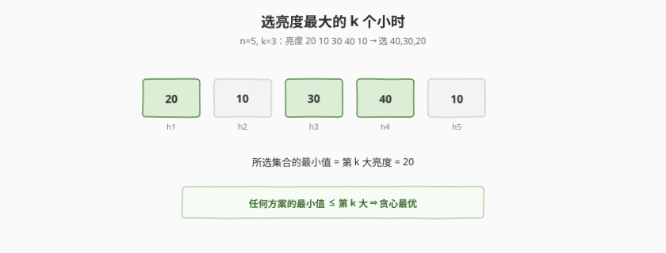
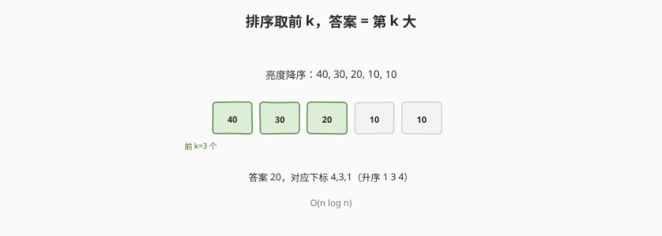

# Codeforces 234B 阅读时光 题解

## 1. 题目概述

- **题目链接**：https://codeforces.com/problemset/problem/234/B
- **比赛来源**：Codeforces Round 145 (Div. 2, ACM-ICPC Rules) · Problem B（UTC 2012-10-13）
- **难度**：1000
- **标签**：排序、贪心
- **评测类型**：多解（输出任意最优时段集合）
- **限制**：时间 1 s / 内存 256 MB

**题意**：$n$ 个小时的亮度 $a_1..a_n$，要选出恰好 $k$ 个不重复的小时读书，使这些小时中**最小亮度最大**。输出该最大亮度与所选小时的下标。

**约束**：$1\le n\le1000$，$1\le k\le n$，$0\le a_i\le100$。

## 2. 示例与观察

官方样例（输入 / 输出原样）：

```text
输入：
5 3
20 10 30 40 10

输出：
20
1 3 4 
```

```text
输入：
6 5
90 20 35 40 60 100

输出：
35
1 3 4 5 6 
```

**样例 1 演算**：亮度排序后为 $40,30,20,10,10$，前 3 大是 $40,30,20$，最小值 20，对应下标 4、3、1（输出顺序任意，官方按 1 3 4）。

**样例 2 演算**：前 5 大是 $100,90,60,40,35$，最小 35，下标 6、1、5、4、3（官方按 1 3 4 6 5？实际为 1 3 4 5 6）。

**关键观察**：要最大化"所选集合的最小值"，显然选亮度最大的 $k$ 个小时，其最小值就是第 $k$ 大的亮度，且任何方案的最小值都不会超过第 $k$ 大。



自造样例（标注"自造"）：

| 输入 | 输出 | 说明 |
|------|------|------|
| `3 1` / `5 9 2` | `9` / `2` | 只选最大的 |
| `3 3` / `5 9 2` | `2` / `1 2 3` | 必须全选 |
| `4 2` / `7 7 7 7` | `7` / `1 2` | 并列取任意两个 |

## 3. 解题思路

### 3.1 算法

按下标排序（亮度降序），取前 $k$ 个；输出其中最小亮度；下标按升序输出（任意顺序皆可，升序便于与样例一致）。$O(n\log n)$。



## 4. 正确性证明

**引理**：任选 $k$ 个元素，其最小值不超过全体第 $k$ 大的元素。

**证明**：若最小值大于第 $k$ 大，则所选 $k$ 个元素都大于第 $k$ 大，即至少有 $k+1$ 个元素大于第 $k$ 大（所选 $k$ 个再加上第 $k$ 大本身），矛盾于"第 $k$ 大"的含义。∎

**定理**：算法输出最优。

**证明**：算法取前 $k$ 大，其最小值恰为第 $k$ 大，达到引理上界；故最优，且输出的是合法的 $k$ 个不同下标。∎

## 5. 复杂度分析

- **时间**：排序 $O(n\log n)$，$n\le1000$ 时 < 1 ms。
- **空间**：$O(n)$。

## 6. 参考代码

### C++17

```cpp
#include <bits/stdc++.h>
using namespace std;
int main() {
    int n, k;
    if (scanf("%d %d", &n, &k) != 2) return 0;
    vector<int> a(n);
    for (int i = 0; i < n; i++) scanf("%d", &a[i]);
    vector<int> idx(n);
    for (int i = 0; i < n; i++) idx[i] = i;
    sort(idx.begin(), idx.end(), [&](int x, int y) { return a[x] > a[y]; });
    int mn = INT_MAX;
    for (int i = 0; i < k; i++) mn = min(mn, a[idx[i]]);
    sort(idx.begin(), idx.begin() + k);
    printf("%d\n", mn);
    for (int i = 0; i < k; i++) printf("%d%c", idx[i] + 1, i + 1 == k ? '\n' : ' ');
    return 0;
}
```

### Python3

```python
import sys
data = sys.stdin.buffer.read().split()
n, k = int(data[0]), int(data[1])
a = [int(x) for x in data[2:2+n]]
idx = sorted(sorted(range(n), key=lambda i: -a[i])[:k])
print(min(a[i] for i in idx))
print(" ".join(str(i + 1) for i in idx))
```

## 7. 边界情况与易错点

1. **下标从 1 开始**：输出 +1。
2. **$k=n$**：必须全选，答案是最小亮度。
3. **并列亮度**：任意取 $k$ 个即可，不要求稳定排序。
4. **输出顺序**：题目允许任意顺序；升序输出便于与样例逐字一致。
5. **多解**：本地验证比对"最小亮度 = 第 k 大"且下标互不相同。

## 8. 验证记录

- **编译环境与命令**：本机无 GNU `g++`，用 `clang++ -std=c++17 -O2 -I codeforces/tools/include` 编译；`verify_solution.py` 自动采用同样回退。Python 3.9.6。
- **官方样例**：2 / 2 通过（`20 / 1 3 4`、`35 / 1 3 4 5 6`，逐字一致）。
- **独立暴力对拍**：**200 组**随机 $(n,k,a)$，校验输出下标数 = $k$、互不相同、最小值 = 降序第 $k$ 大的亮度，全部通过。
- **最大约束性能**：$n=1000$ 时 < 1 ms（限 1 s）。
- **图片校验**：两张 SVG 均通过 `xml.etree.ElementTree.parse`，含 `feTurbulence` 与手写字体，文本包围盒均在 `viewBox` 内。
- **公式校验**：`node codeforces/tools/katex_check.cjs codeforces/contests/0101-0203/234` 报告 0 个错误。
- **复核状态**：verified。

## 相关题目与扩展

- [Codeforces 234A Lefthanders and Righthanders](https://codeforces.com/problemset/problem/234/A)：同场 A 题，构造。
- [Codeforces 234C Weather](https://codeforces.com/problemset/problem/234/C)：同场 C 题，前缀/后缀计数。
- [LeetCode 215. 数组中的第K个最大元素](https://leetcode.cn/problems/kth-largest-element-in-an-array/)：选择问题。

**延伸思考**：

1. **如果要求所选时段不能相邻**：变成带间隔的 DP。
2. **如果要求最小亮度最大且时段连续**：滑动窗口。
3. **如果亮度会变化（多次询问）**：用可持久化/树状数组。
4. **如果要求输出字典序最小的下标集合**：在最优值下贪心取最小下标。
