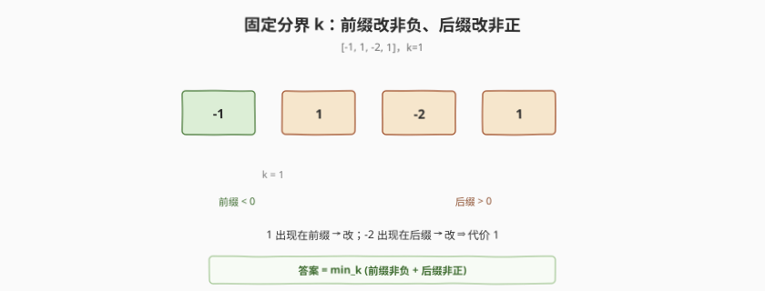
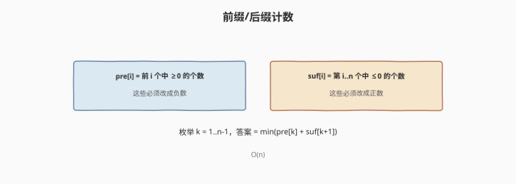

# Codeforces 234C 天气的分界 题解

## 1. 题目概述

- **题目链接**：https://codeforces.com/problemset/problem/234/C
- **比赛来源**：Codeforces Round 145 (Div. 2, ACM-ICPC Rules) · Problem C（UTC 2012-10-13）
- **难度**：1300
- **标签**：前缀和、枚举
- **评测类型**：普通
- **限制**：时间 1 s / 内存 256 MB

**题意**：给定 $n$ 天温度 $t_i$。允许修改若干天的温度（改成任意整数），使得存在 $1\le k<n$ 满足 $t_1..t_k<0$ 且 $t_{k+1}..t_n>0$（不能为 0）。求最少修改天数。

**约束**：$2\le n\le10^5$，$|t_i|\le10^9$。

## 2. 示例与观察

官方样例（输入 / 输出原样）：

```text
输入：
4
-1 1 -2 1

输出：
1
```

```text
输入：
5
0 -1 1 2 -5

输出：
2
```

**样例 1 演算**：取 $k=1$：需要 $t_1<0$ ✓；$t_2..t_4>0$：$1,-2,1$ 中 $-2$ 要改 → 1 次。取 $k=3$：$[-1,1,-2]$ 中 1 要改，$[1]$ ✓ → 1 次。答案 1。

**样例 2 演算**：取 $k=2$：$[0,-1]$ 中 0 要改；$[1,2,-5]$ 中 $-5$ 要改 → 2 次。其它 $k$ 不低于 2 → 答案 2。

**关键观察**：对固定 $k$，代价是"前缀中 $\ge0$ 的个数" + "后缀中 $\le0$ 的个数"（都要改掉），两者分别用前缀/后缀计数 $O(1)$ 得到。枚举 $k=1..n-1$ 取最小。



自造样例（标注"自造"）：

| 输入 | 输出 | 说明 |
|------|------|------|
| `2` / `-1 1` | 0 | 已满足 |
| `2` / `1 -1` | 2 | 两天都得改 |
| `3` / `-1 -2 -3` | 1 | $k=2$ 时最后一天改成正 |

## 3. 解题思路



预处理 `pre[i]` = 前 $i$ 天中 $\ge0$ 的天数，`suf[i]` = 第 $i..n$ 天中 $\le0$ 的天数。答案 $=\min_{k=1}^{n-1}\bigl(pre[k]+suf[k+1]\bigr)$。

## 4. 正确性证明

**引理**：固定分界 $k$ 时，最少修改次数为 $pre[k]+suf[k+1]$。

**证明**：要使 $t_1..t_k<0$，其中每个 $\ge0$ 的位置都必须改（改一次即可，改成 $-1$）；要使 $t_{k+1}..t_n>0$，其中每个 $\le0$ 的位置都必须改。两段不相交，故下界为两者之和，且逐点修改可达到。∎

**定理**：枚举所有 $k$ 取最小即最优。

**证明**：任何合法方案对应某个分界 $k$，其代价由引理给出下界且可达；枚举取最小即为全局最优。∎

## 5. 复杂度分析

- **时间**：$O(n)$，$n=10^5$ 时约 10 ms（限 1 s）。
- **空间**：$O(n)$。

## 6. 参考代码

### C++17

```cpp
#include <bits/stdc++.h>
using namespace std;
int main() {
    int n;
    if (scanf("%d", &n) != 1) return 0;
    vector<int> t(n);
    for (int i = 0; i < n; i++) scanf("%d", &t[i]);
    vector<int> pre(n + 1, 0), suf(n + 1, 0);
    for (int i = 0; i < n; i++) pre[i + 1] = pre[i] + (t[i] >= 0 ? 1 : 0);
    for (int i = n - 1; i >= 0; i--) suf[i] = suf[i + 1] + (t[i] <= 0 ? 1 : 0);
    int ans = INT_MAX;
    for (int k = 1; k < n; k++) ans = min(ans, pre[k] + suf[k]);
    printf("%d\n", ans);
    return 0;
}
```

### Python3

```python
import sys
data = sys.stdin.buffer.read().split()
n = int(data[0])
t = [int(x) for x in data[1:1+n]]
pre = [0] * (n + 1)
for i in range(n):
    pre[i + 1] = pre[i] + (1 if t[i] >= 0 else 0)
suf = [0] * (n + 1)
for i in range(n - 1, -1, -1):
    suf[i] = suf[i + 1] + (1 if t[i] <= 0 else 0)
print(min(pre[k] + suf[k] for k in range(1, n)))
```

## 7. 边界情况与易错点

1. **0 不能出现**：前缀要求 $<0$（所以 0 要改），后缀要求 $>0$（0 也要改）；条件用 $\ge0$ 与 $\le0$。
2. **$k$ 的范围**：$1\le k\le n-1$，两段都非空。
3. **答案上界**：至多 $n$，`int` 够。
4. **$n=2$**：只有一个 $k$。
5. **输入可能含 0**：按上面的条件统计。

## 8. 验证记录

- **编译环境与命令**：本机无 GNU `g++`，用 `clang++ -std=c++17 -O2 -I codeforces/tools/include` 编译；`verify_solution.py` 自动采用同样回退。Python 3.9.6。
- **官方样例**：2 / 2 通过（`1`、`2`）。
- **独立暴力对拍**：暴力对每个 $k$ 直接双重循环统计（不用前缀数组），**200 组**随机小数据全部一致。
- **最大约束性能**：$n=10^5$ 随机数据约 10 ms（限 1 s）。
- **图片校验**：两张 SVG 均通过 `xml.etree.ElementTree.parse`，含 `feTurbulence` 与手写字体，文本包围盒均在 `viewBox` 内。
- **公式校验**：`node codeforces/tools/katex_check.cjs codeforces/contests/0101-0203/234` 报告 0 个错误。
- **复核状态**：verified。

## 相关题目与扩展

- [Codeforces 234B Reading](https://codeforces.com/problemset/problem/234/B)：同场 B 题，排序。
- [Codeforces 234D Cinema](https://codeforces.com/problemset/problem/234/D)：同场 D 题，区间化分类。
- [LeetCode 926. 将字符串翻转到单调递增](https://leetcode.cn/problems/flip-string-to-monotone-increasing/)：前后缀计数同型题。

**延伸思考**：

1. **如果允许"先正后负"**：把条件反过来即可。
2. **如果要求两段都至少 2 天**：$k$ 的范围改成 $[2,n-2]$。
3. **如果允许 0**：条件改用 $\le0$ 与 $\ge0$。
4. **如果修改有代价**：变成加权版本，仍可前后缀。
