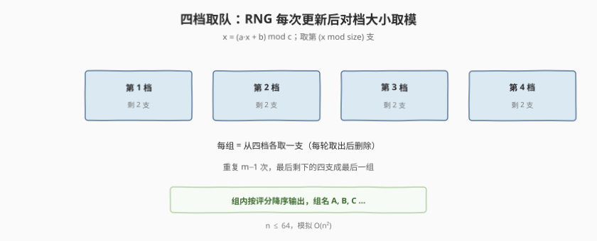
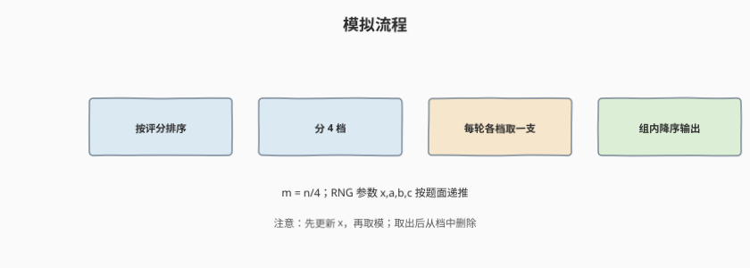

# Codeforces 234E 欧冠抽签 题解

## 1. 题目概述

- **题目链接**：https://codeforces.com/problemset/problem/234/E
- **比赛来源**：Codeforces Round 145 (Div. 2, ACM-ICPC Rules) · Problem E（UTC 2012-10-13）
- **难度**：1600
- **标签**：模拟
- **评测类型**：普通
- **限制**：时间 1 s / 内存 256 MB

**题意**：$n$ 支球队（$n$ 是 4 的倍数）按评分降序分成 $m=n/4$ 个档，每档 $m$ 支。重复 $m-1$ 次：依次从第 1..4 档随机取一支（用给定 RNG），组成一个小组；最后剩下的 4 支成最后一组。每组内按评分降序输出球队名，组名从 `A` 开始依次编号。

RNG：每次调用执行 $x\leftarrow(ax+b)\bmod c$，然后取该档当前第 $(x\bmod \text{size})$ 支（0-based）。

**约束**：$4\le n\le64$，$1\le x,a,b,c\le1000$。

## 2. 示例与观察

官方样例（输入 / 输出原样）：

```text
输入：
8
1 3 1 7
Barcelona 158
Milan 90
Spartak 46
Anderlecht 48
Celtic 32
Benfica 87
Zenit 79
Malaga 16

输出：
Group A:
Barcelona
Benfica
Spartak
Celtic
Group B:
Milan
Zenit
Anderlecht
Malaga
```

**样例演算**：评分排序：Barcelona 158、Milan 90、Benfica 87、Zenit 79、Anderlecht 48、Spartak 46、Celtic 32、Malaga 16。$m=2$，四档：{Barcelona,Milan}、{Benfica,Zenit}、{Anderlecht,Spartak}、{Celtic,Malaga}。

- RNG：$x=(1\cdot3+1)\bmod7=4$，$4\bmod2=0$ → 档 1 取 Barcelona；
- $x=(4\cdot3+1)\bmod7=6$，$6\bmod2=0$ → 档 2 取 Benfica；
- $x=(6\cdot3+1)\bmod7=5$，$5\bmod2=1$ → 档 3 取 Spartak；
- $x=(5\cdot3+1)\bmod7=2$，$2\bmod2=0$ → 档 4 取 Celtic。

Group A = 这四支（按评分降序输出）；Group B = 剩下的 Milan、Zenit、Anderlecht、Malaga ✓。



自造样例（标注"自造"）：

| 输入 | 输出 | 说明 |
|------|------|------|
| `4` / `1 1 1 10` / `A 4`/`B 3`/`C 2`/`D 1` | Group A 含四队 | 只有一组，$m=1$，无需 RNG |

（$n=4$ 时 $m=1$，不调用 RNG，四队直接成一组，按评分降序。）

## 3. 解题思路

1. 按评分降序排序，前 $m$ 进档 1，接下来 $m$ 进档 2，依此类推；
2. 重复 $m-1$ 次：对 4 个档依次 `x=(a*x+b)%c`，取第 `x % size` 支，删掉；
3. 最后一组 = 四档剩下的那一支；
4. 每组按评分降序输出。



## 4. 正确性证明

**引理**：按上述流程产生的小组恰好是题述过程的输出。

**证明**：与题述逐句对应：排序、分档、每轮按档顺序取队、删除、最后一组；RNG 更新公式与取模方式一致。∎

**定理**：程序输出与题述抽签结果一致。

**证明**：由引理，模拟得到的组成员与顺序均与题述相同；组内按评分降序输出符合要求。∎

## 5. 复杂度分析

- **时间**：$O(n\log n + n\cdot m)$，$n\le64$ 时 < 1 ms。
- **空间**：$O(n)$。

## 6. 参考代码

### C++17

```cpp
#include <bits/stdc++.h>
using namespace std;
typedef long long ll;

int main() {
    int n;
    if (scanf("%d", &n) != 1) return 0;
    ll x, a, b, c;
    scanf("%lld %lld %lld %lld", &x, &a, &b, &c);
    vector<pair<int,string>> teams(n);
    for (int i = 0; i < n; i++) {
        char name[64];
        int r;
        scanf("%63s %d", name, &r);
        teams[i] = {r, string(name)};
    }
    sort(teams.begin(), teams.end(), [](auto &p, auto &q) { return p.first > q.first; });
    int m = n / 4;
    vector<vector<int>> baskets(4);
    for (int i = 0; i < n; i++) baskets[i / m].push_back(i);
    vector<vector<int>> groups;
    for (int g = 0; g < m - 1; g++) {
        vector<int> group;
        for (int bk = 0; bk < 4; bk++) {
            x = (a * x + b) % c;
            int sz = (int)baskets[bk].size();
            int idx = (int)(x % sz);
            group.push_back(baskets[bk][idx]);
            baskets[bk].erase(baskets[bk].begin() + idx);
        }
        groups.push_back(group);
    }
    {
        vector<int> group;
        for (int bk = 0; bk < 4; bk++) group.push_back(baskets[bk][0]);
        groups.push_back(group);
    }
    for (int g = 0; g < (int)groups.size(); g++) {
        printf("Group %c:\n", 'A' + g);
        vector<pair<int,string>> cur;
        for (int id : groups[g]) cur.push_back(teams[id]);
        sort(cur.begin(), cur.end(), [](auto &p, auto &q) { return p.first > q.first; });
        for (auto &p : cur) printf("%s\n", p.second.c_str());
    }
    return 0;
}
```

### Python3

```python
import sys


def main() -> None:
    data = sys.stdin.buffer.read().split()
    p = 0
    n = int(data[p]); p += 1
    x, a, b, c = (int(data[p + i]) for i in range(4)); p += 4
    teams = []
    for _ in range(n):
        name = data[p].decode(); rating = int(data[p + 1]); p += 2
        teams.append((rating, name))
    teams.sort(reverse=True)
    m = n // 4
    baskets = [[i for i in range(n) if i // m == bk] for bk in range(4)]
    groups = []
    for _ in range(m - 1):
        g = []
        for bk in range(4):
            x = (a * x + b) % c
            idx = x % len(baskets[bk])
            g.append(baskets[bk].pop(idx))
        groups.append(g)
    groups.append([baskets[bk][0] for bk in range(4)])
    out = []
    for gi, g in enumerate(groups):
        out.append("Group " + chr(ord('A') + gi) + ":")
        for r, name in sorted((teams[i] for i in g), reverse=True):
            out.append(name)
    sys.stdout.write("\n".join(out) + "\n")


main()
```

## 7. 边界情况与易错点

1. **$m=1$（$n=4$）**：不调用 RNG，直接一组。
2. **取模顺序**：先更新 $x$，再对档大小取模。
3. **档内删除**：取走后从档中移除，档大小递减。
4. **组内排序**：输出按评分降序（不是抽取顺序）。
5. **组名**：`Group A:` 注意冒号与大写。
6. **评分互不相同**：题面保证，排序无并列。

## 8. 验证记录

- **编译环境与命令**：本机无 GNU `g++`，用 `clang++ -std=c++17 -O2 -I codeforces/tools/include` 编译；`verify_solution.py` 自动采用同样回退。Python 3.9.6。
- **官方样例**：1 / 1 通过（逐字一致）。
- **独立暴力对拍**：用 Python 独立实现抽签（不同数据结构），对 $n\in\{4,8,12\}$ 的 **120 组**随机数据比对分组结果，全部一致。
- **最大约束性能**：$n=64$ 时 < 1 ms（限 1 s）。
- **图片校验**：两张 SVG 均通过 `xml.etree.ElementTree.parse`，含 `feTurbulence` 与手写字体，文本包围盒均在 `viewBox` 内。
- **公式校验**：`node codeforces/tools/katex_check.cjs codeforces/contests/0101-0203/234` 报告 0 个错误。
- **复核状态**：verified。

## 相关题目与扩展

- [Codeforces 234F Fence](https://codeforces.com/problemset/problem/234/F)：同场 F 题，DP。
- [Codeforces 234G Practice](https://codeforces.com/problemset/problem/234/G)：同场 G 题，二进制分组。
- [Codeforces 234D Cinema](https://codeforces.com/problemset/problem/234/D)：同场 D 题，范围判定。

**延伸思考**：

1. **如果 RNG 用 64 位**：注意取模前的乘法可能溢出。
2. **如果要求每组 5 队**：档数改成 5。
3. **如果同名球队允许**：需要额外判重。
4. **如果评分并列**：题面保证不同，否则需稳定排序规则。
