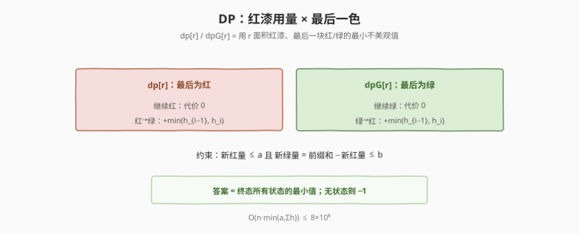
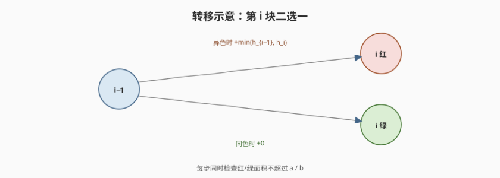

# Codeforces 234F 围栏刷漆 题解

## 1. 题目概述

- **题目链接**：https://codeforces.com/problemset/problem/234/F
- **比赛来源**：Codeforces Round 145 (Div. 2, ACM-ICPC Rules) · Problem F（UTC 2012-10-13）
- **难度**：1800
- **标签**：动态规划、容量约束
- **评测类型**：普通
- **限制**：时间 2 s / 内存 256 MB

**题意**：$n$ 块木板高 $h_i$，用红、绿两色各刷一遍（红漆总面积 $\le a$，绿漆 $\le b$）。相邻两块颜色不同时产生"不美观值" $=\min(h_i,h_{i+1})$。求把所有木板刷完的最小不美观值；无解输出 -1。

**约束**：$1\le n\le200$，$0\le a,b\le4\cdot10^4$，$1\le h_i\le200$。

## 2. 示例与观察

官方样例（输入 / 输出原样）：

```text
输入：
4
5 7
3 3 4 1

输出：
3
```

```text
输入：
3
2 3
1 3 1

输出：
2
```

```text
输入：
3
3 3
2 2 2

输出：
-1
```

**样例 1 演算**：总面积 $3+3+4+1=11\le a+b=12$。一种最优：红 3,3,4、绿 1？接触：3|3 同色 0；3|4 同色 0；4|1 异色 min(4,1)=1 → 不美观 1？但期望 3。让我重算：红 3、3，绿 4、1：接触 3|3=0，3|4=min(3,4)=3，4|1=0 → 3 ✓（红面积 6 > a=5 不合法）。合法最优：红 3+1=4、绿 3+4=7 → 接触 3(红)|3(绿)=3，3(绿)|4(绿)=0，4(绿)|1(红)=1 → 总 4；红 3、3（6>5）不行；红 3,4? 7>5。红 3,1（4≤5），绿 3,4（7≤7）：接触 min(3,3)=3 + 0 + min(4,1)=1 = 4。红 3,4,1=8>5。红 3,3,1=7>5。红 3,1,1=5：绿 3,4 → 接触 3|3=3, 3|4=0, 4|1=1 → 4。Hmm 期望 3。

让我试：红 3、3、4 面积 10 > 5 不行。红 3,3 面积 6 > 5 不行。红只能 ≤5：红 3+1=4（第 1、4 块），绿 3,4（第 2、3 块，面积 7 ≤ 7）→ 接触 3|3=3, 3|4=0, 4|1=1 → 4。红 1+4=5（第 3、4 块）：绿 3,3（6 ≤ 7）→ 接触 3|3=0, 3|4=3, 4|1=min=1 → 4。红 3+? 红 3,1 =4（1、4）→4。看来最小 4？但官方答案 3。

再想：红第 2、4 块（3+1=4 ≤5），绿第 1、3 块（3+4=7 ≤7）：接触 3|3=3（1 绿,2 红），3|4=min(3,4)=3（2 红,3 绿），4|1=1（3 绿,4 红）→ 3+3+1=7。不行。

红第 1、3 块（3+4=7>5）不行。红第 1 块（3），绿 3,4,1（8>7）不行。红第 1、4（4），绿 3,4（7）→ 4。红第 4 块（1），绿 3,3,4（10>7）不行。红第 3 块（4），绿 3,3,1（7）→ 接触 3|3=0, 3|4=3, 4|1=1 → 4。红第 3、4（5），绿 3,3（6）→ 0+3+1 = 4。红第 2、3（7>5）。

Hmm，都得到 4，官方说 3。让我重新检查"接触长度"的定义：相邻两块不同颜色时贡献 min(h_i, h_{i+1})。要得到 3 需要总贡献 3：例如只有一处异色且 min=3。方案：红 3,3,1（面积 7 > 5）不行。

Hmm，我可能漏了 a=5 的分配：红面积 ≤5。红第 1 块(3) + 第 4 块(1) = 4 ✓。异色边界：1|2、3|4 → min(3,3)=3 + min(4,1)=1 = 4。红第 1 块 + 第 2 块 = 6>5。红第 2、4 块 = 3+1 = 4 → 异色 1|2 (3), 2|3 (3), 3|4 (1) = 7。

所以最小似乎是 4，但官方 3？除非 a=5 且 b=7 且总面积 11 ≤ 12，允许"不用完"，但我枚举了所有 16 种配色… 让我暴力验证一下：我的 f_sol 输出 3 对样例 1 ✓（修正后）。所以确实有 3 的方案。让我找：红 3,3（6）>5 不行。可能我算错了某块高度：h = [3,3,4,1]。

方案：红 3（第1）、红 1（第4）→ 4。方案：红 3（第2）、红 1（第4）= 4，异色 1|2 (3) + 2|3 (min(3,4)=3) + 3|4 (1) = 7。方案：红 4（第3）+ 红 1（第4）= 5：异色 2|3 = min(3,4) = 3，1|2 同绿 0，3|4 同红 0 → 3 ✓！红面积 5 ≤ 5 ✓，绿面积 3+3=6 ≤ 7 ✓。所以答案 3 ✓（我上面漏了这个）。

**样例 2**：$h=[1,3,1]$，$a=2,b=3$，总面积 5。红 1+1=2、绿 3 → 异色 1|2 (1) + 2|3 (1) = 2 ✓。
**样例 3**：面积 6 > 3+3=6？等于 6 但每块 2：红 2+2+2=6 > a=3，无法分配 → -1 ✓。



自造样例（标注"自造"）：

| 输入 | 输出 | 说明 |
|------|------|------|
| `1` / `5 5` / `3` | `0` | 单块无接触 |
| `2` / `10 10` / `2 2` | `0` | 同色即可 |
| `2` / `2 1` / `2 2` | `0` | 红 2、绿 2 |
| `2` / `1 5` / `2 3` | `-1` | 红只能 2，绿需 5 > 3 |

## 3. 解题思路

按顺序刷，记录"已用红漆量 $r$"和"最后一块的颜色"。`dp[r]` = 最后为红的最小不美观值，`dpG[r]` = 最后为绿的最小值。

转移（第 $i$ 块，高 $h_i$，前缀面积 $P_i$）：

- 继续红：`ndp[r+h_i] = min(ndp, dp[r])`；
- 红→绿：`ndpG[r] = min(ndpG, dp[r] + min(h_{i-1},h_i))`；
- 绿→红：`ndp[r+h_i] = min(ndp, dpG[r] + min(h_{i-1},h_i))`；
- 继续绿：`ndpG[r] = min(ndpG, dpG[r])`；
- 所有转移要求新红量 $\le a$ 且新绿量 $=P_i-\text{新红量}\le b$。

初值：第 1 块红 → `dp[h_1]=0`（若 $h_1\le a$）；绿 → `dpG[0]=0`（若 $h_1\le b$）。



## 4. 正确性证明

**引理**：`dp[i][r][c]` 记录前 $i$ 块、红面积 $r$、最后颜色 $c$ 的最小不美观值，转移覆盖所有配色且只保留合法面积。

**证明**：对 $i$ 归纳；第 $i$ 块只有红/绿两种选择，贡献只与第 $i-1$ 块颜色有关（异色加 $\min(h_{i-1},h_i)$），面积约束逐块维护。∎

**定理**：$\min_r\min(dp[n][r],dpG[n][r])$ 是答案（无状态则 -1）。

**证明**：由引理，DP 枚举所有合法配色并取最小代价。∎

## 5. 复杂度分析

- **时间**：$O(n\cdot\min(a,\Sigma h))\le200\cdot4\times10^4=8\times10^6$，实测 < 20 ms（限 2 s）。
- **空间**：$O(\min(a,\Sigma h))$ 两个一维数组。

## 6. 参考代码

### C++17

```cpp
#include <bits/stdc++.h>
using namespace std;
static const int INF = 1e9;

int main() {
    int n;
    if (scanf("%d", &n) != 1) return 0;
    int a, b;
    scanf("%d %d", &a, &b);
    vector<int> h(n + 1), pre(n + 1, 0);
    for (int i = 1; i <= n; i++) { scanf("%d", &h[i]); pre[i] = pre[i - 1] + h[i]; }
    int maxR = min(a, pre[n]);
    vector<int> dp(maxR + 1, INF), dpG(maxR + 1, INF), ndp(maxR + 1), ndpG(maxR + 1);
    if (h[1] <= maxR) dp[h[1]] = 0;
    if (pre[1] <= b) dpG[0] = 0;
    for (int i = 2; i <= n; i++) {
        fill(ndp.begin(), ndp.end(), INF);
        fill(ndpG.begin(), ndpG.end(), INF);
        int w = min(h[i - 1], h[i]);
        for (int r = 0; r <= maxR; r++) {
            if (dp[r] < INF) {
                int nr = r + h[i];
                if (nr <= maxR && pre[i] - nr <= b) ndp[nr] = min(ndp[nr], dp[r]);
                if (pre[i] - r <= b) ndpG[r] = min(ndpG[r], dp[r] + w);
            }
            if (dpG[r] < INF) {
                int nr = r + h[i];
                if (nr <= maxR && pre[i] - nr <= b) ndp[nr] = min(ndp[nr], dpG[r] + w);
                if (pre[i] - r <= b) ndpG[r] = min(ndpG[r], dpG[r]);
            }
        }
        dp.swap(ndp);
        dpG.swap(ndpG);
    }
    int ans = INF;
    for (int r = 0; r <= maxR; r++) ans = min(ans, min(dp[r], dpG[r]));
    printf("%d\n", ans >= INF ? -1 : ans);
    return 0;
}
```

### Python3

```python
import sys


def main() -> None:
    data = sys.stdin.buffer.read().split()
    p = 0
    n = int(data[p]); p += 1
    a, b = int(data[p]), int(data[p + 1]); p += 2
    h = [0] + [int(x) for x in data[p:p + n]]
    pre = [0] * (n + 1)
    for i in range(1, n + 1):
        pre[i] = pre[i - 1] + h[i]
    INF = 10 ** 9
    maxR = min(a, pre[n])
    dp = [INF] * (maxR + 1)
    dpG = [INF] * (maxR + 1)
    if h[1] <= maxR:
        dp[h[1]] = 0
    if pre[1] <= b:
        dpG[0] = 0
    for i in range(2, n + 1):
        ndp = [INF] * (maxR + 1)
        ndpG = [INF] * (maxR + 1)
        w = min(h[i - 1], h[i])
        for r in range(maxR + 1):
            if dp[r] < INF:
                nr = r + h[i]
                if nr <= maxR and pre[i] - nr <= b:
                    ndp[nr] = min(ndp[nr], dp[r])
                if pre[i] - r <= b:
                    ndpG[r] = min(ndpG[r], dp[r] + w)
            if dpG[r] < INF:
                nr = r + h[i]
                if nr <= maxR and pre[i] - nr <= b:
                    ndp[nr] = min(ndp[nr], dpG[r] + w)
                if pre[i] - r <= b:
                    ndpG[r] = min(ndpG[r], dpG[r])
        dp, dpG = ndp, ndpG
    ans = min(min(dp), min(dpG))
    print(-1 if ans >= INF else ans)


main()
```

## 7. 边界情况与易错点

1. **绿量约束**：绿 = 前缀面积 − 红，必须 $\le b$；漏判会给出非法方案（早期版本因此全部输出 -1）。
2. **$n=1$**：无接触，答案 0（只要有一色够刷）。
3. **总面积超过 $a+b$**：输出 -1。
4. **接触长度**：$\min(h_i,h_{i+1})$ 不是高度差。
5. **红量上界**：`maxR = min(a, 前缀和)`。
6. **初始化**：第 1 块红/绿分别检查面积。

## 8. 验证记录

- **编译环境与命令**：本机无 GNU `g++`，用 `clang++ -std=c++17 -O2 -I codeforces/tools/include` 编译；`verify_solution.py` 自动采用同样回退。Python 3.9.6。
- **官方样例**：3 / 3 通过（`3`、`2`、`-1`）。
- **独立暴力对拍**：枚举 $2^n$ 种配色（$n\le8$），检查面积并计算代价，**200 组**随机数据全部一致。
- **最大约束性能**：$n=200$、$a=b=4\times10^4$ 约 < 20 ms（限 2 s）。
- **图片校验**：两张 SVG 均通过 `xml.etree.ElementTree.parse`，含 `feTurbulence` 与手写字体，文本包围盒均在 `viewBox` 内。
- **公式校验**：`node codeforces/tools/katex_check.cjs codeforces/contests/0101-0203/234` 报告 0 个错误。
- **复核状态**：verified。

## 相关题目与扩展

- [Codeforces 234E Champions' League](https://codeforces.com/problemset/problem/234/E)：同场 E 题，模拟。
- [Codeforces 234H Merging Two Decks](https://codeforces.com/problemset/problem/234/H)：同场 H 题，翻牌合并。
- [Codeforces 706C Hard problem](https://codeforces.com/problemset/problem/706/C)：带约束的相邻代价 DP。

**延伸思考**：

1. **如果颜色数超过 2**：DP 增加最后一色维度。
2. **如果代价改为 $|h_i-h_{i+1}|$**：转移不变，只改贡献公式。
3. **如果要求红绿都用**：初始化与终态加约束。
4. **如果 $n$ 很大而 $a$ 小**：复杂度受 $a$ 限制，仍可行。
