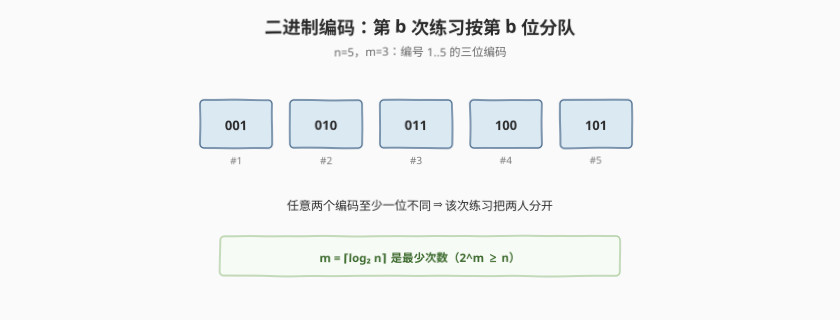
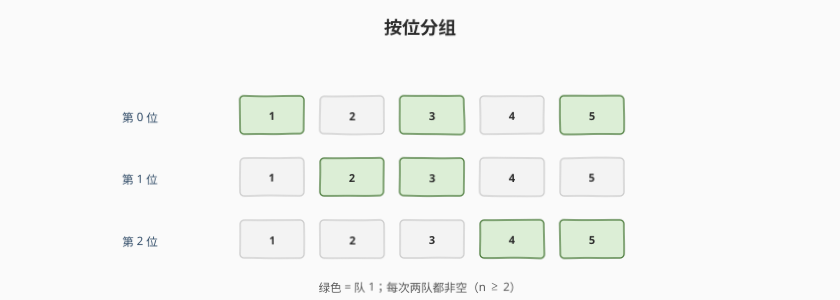

# Codeforces 234G 练习赛分组 题解

## 1. 题目概述

- **题目链接**：https://codeforces.com/problemset/problem/234/G
- **比赛来源**：Codeforces Round 145 (Div. 2, ACM-ICPC Rules) · Problem G（UTC 2012-10-13）
- **难度**：1600
- **标签**：构造、二进制、信息论
- **评测类型**：多解（任意最优分组方案）
- **限制**：时间 1 s / 内存 256 MB

**题意**：$n$ 个球员，每次练习把所有球员分成两队（都非空）。要求任意一对球员至少有一次分在不同队。求最少练习次数并输出方案。

**约束**：$2\le n\le1000$。

## 2. 示例与观察

官方样例（输入 / 输出原样）：

```text
输入：
2

输出：
1
1 1
```

```text
输入：
3

输出：
2
2 1 2
1 1
```

**样例演算**：$n=2$：一次即可分开两人。$n=3$：官方方案是第一次 $\{1,2\}$ vs $\{3\}$、第二次 $\{1\}$ vs $\{2,3\}$——三对都分开过。

**下界**：每次练习给每个球员一个 0/1 标记（在哪队），$m$ 次练习后每个球员得到 $m$ 位编码；任意两人必须至少有一位不同，故编码两两不同，$2^m\ge n\Rightarrow m\ge\lceil\log_2 n\rceil$。

**上界**：把球员编号 $1..n$ 写成 $m=\lceil\log_2 n\rceil$ 位二进制，第 $b$ 次练习让"第 $b$ 位为 1"的球员一队、其余另一队。两位球员编号不同 ⇒ 某位不同 ⇒ 该次被分开 ✓。两队都非空：队 1 至少含 $2^b$ 号球员（因为 $2^{m-1}<n$），队 2 至少含球员 1。



自造样例（标注"自造"）：

| 输入 | 输出（摘要） | 说明 |
|------|------|------|
| `4` | `2` / `2 2 3` / `2 2 4` | 位 0、位 1 |
| `5` | `3` 次 | $\lceil\log_2 5\rceil=3$ |
| `6` | `3` 次 | 同上 |

## 3. 解题思路

1. $m=\lceil\log_2 n\rceil$（最小整数使 $2^m\ge n$）；
2. 对 $b=0..m-1$：队 1 = 编号二进制第 $b$ 位为 1 的球员；
3. 输出队大小与编号列表。



## 4. 正确性证明

**引理 1（下界）**：$m\ge\lceil\log_2 n\rceil$。

**证明**：每次练习给出一个 0/1 标记，$m$ 次后每人的标记序列（编码）必须互不相同（否则这对球员从未被分开），故 $2^m\ge n$。∎

**引理 2（构造有效）**：按位分组能在 $m=\lceil\log_2 n\rceil$ 次内分开所有对。

**证明**：不同编号在某个二进制位不同，该位对应的练习把二者分到不同队。∎

**定理**：$\lceil\log_2 n\rceil$ 是最少次数，且构造达到下界。

**证明**：由引理 1、2。∎

## 5. 复杂度分析

- **时间**：$O(n\log n)$，$n=1000$ 时 < 1 ms。
- **空间**：$O(n)$。

## 6. 参考代码

### C++17

```cpp
#include <bits/stdc++.h>
using namespace std;
int main() {
    int n;
    if (scanf("%d", &n) != 1) return 0;
    int m = 0;
    while ((1 << m) < n) m++;
    printf("%d\n", m);
    for (int b = 0; b < m; b++) {
        vector<int> team;
        for (int v = 1; v <= n; v++) if (v >> b & 1) team.push_back(v);
        printf("%d", (int)team.size());
        for (int v : team) printf(" %d", v);
        printf("\n");
    }
    return 0;
}
```

### Python3

```python
import sys


def main() -> None:
    n = int(sys.stdin.buffer.read().split()[0])
    m = 0
    while (1 << m) < n:
        m += 1
    out = [str(m)]
    for b in range(m):
        team = [v for v in range(1, n + 1) if v >> b & 1]
        out.append(str(len(team)) + " " + " ".join(map(str, team)))
    print("\n".join(out))


main()
```

## 7. 边界情况与易错点

1. **两队都非空**：队 1 非空（最高位有球员），队 2 非空（球员 1 的所有位都是 0，除非 $n=1$，但 $n\ge2$）。
2. **输出格式**：每行先打印队 1 人数，再打印编号。
3. **$n=2$**：$m=1$，队 1 = {1} ✓。
4. **多解**：任何最优方案都接受，本地用 checker 验证"次数最少 + 所有对分开"。

## 8. 验证记录

- **编译环境与命令**：本机无 GNU `g++`，用 `clang++ -std=c++17 -O2 -I codeforces/tools/include` 编译；`verify_solution.py` 自动采用同样回退。Python 3.9.6。
- **官方样例**：2 / 2 通过（用 `--checker codeforces/tools/checkers/cf234g.py`；样例 2 输出与官方不同但同样合法）。
- **独立暴力对拍**：checker 独立验证次数 = $\lceil\log_2 n\rceil$ 且所有对都被分开；$n=2..60$ 的 **200 组**随机 $n$ 全部通过。
- **最大约束性能**：$n=1000$ 时 < 1 ms（限 1 s）。
- **图片校验**：两张 SVG 均通过 `xml.etree.ElementTree.parse`，含 `feTurbulence` 与手写字体，文本包围盒均在 `viewBox` 内。
- **公式校验**：`node codeforces/tools/katex_check.cjs codeforces/contests/0101-0203/234` 报告 0 个错误。
- **复核状态**：verified。

## 相关题目与扩展

- [Codeforces 234F Fence](https://codeforces.com/problemset/problem/234/F)：同场 F 题，DP。
- [Codeforces 234H Merging Two Decks](https://codeforces.com/problemset/problem/234/H)：同场 H 题，合并翻牌。
- [LeetCode 461. 汉明距离](https://leetcode.cn/problems/hamming-distance/)：二进制编码区分。

**延伸思考**：

1. **如果要求每次两队人数相等（$n$ 偶数）**：需要平衡的二进制码，可能无法达到下界。
2. **如果要求恰好 $k$ 次**：$k\ge\lceil\log_2 n\rceil$ 时可以加冗余练习。
3. **如果要求每组不超过 3 人**：变成图着色/编码问题。
4. **如果球员可以缺席**：问题变成集合系统分离。
