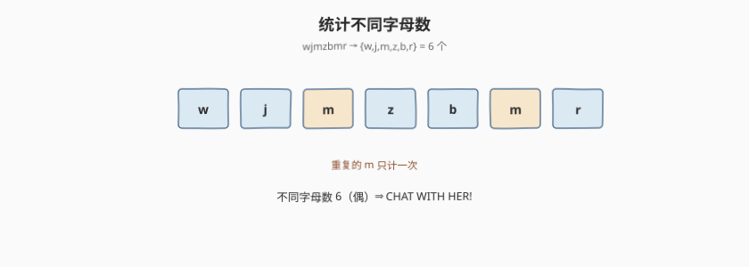

# Codeforces 236A 男孩还是女孩 题解

## 1. 题目概述

- **题目链接**：https://codeforces.com/problemset/problem/236/A
- **比赛来源**：Codeforces Round 146 (Div. 2) · Problem A（UTC 2012-10-20）
- **难度**：800
- **标签**：字符串、计数
- **评测类型**：普通
- **限制**：时间 1 s / 内存 256 MB

**题意**：给定用户名（小写字母），统计不同字母个数：奇数输出 `IGNORE HIM!`，偶数输出 `CHAT WITH HER!`。

**约束**：长度 $\le100$。

## 2. 示例与观察

官方样例（输入 / 输出原样）：

```text
输入：
wjmzbmr

输出：
CHAT WITH HER!
```

```text
输入：
xiaodao

输出：
IGNORE HIM!
```

```text
输入：
sevenkplus

输出：
CHAT WITH HER!
```

**样例演算**：`wjmzbmr` 的不同字母 $\{w,j,m,z,b,r\}$ 共 6 个（偶数）→ `CHAT WITH HER!` ✓；`xiaodao` 为 $\{x,i,a,o,d\}$ 共 5 个（奇数）→ `IGNORE HIM!` ✓；`sevenkplus` 共 $\{s,e,v,n,k,p,l,u\}$ 8 个 → `CHAT WITH HER!` ✓。

**关键观察**：用 26 长度的桶标记出现与否，统计不同字母数，按奇偶输出。



自造样例（标注"自造"）：

| 输入 | 输出 | 说明 |
|------|------|------|
| `a` | IGNORE HIM! | 1 个（奇） |
| `aa` | IGNORE HIM! | 1 个（奇） |
| `ab` | CHAT WITH HER! | 2 个（偶） |

## 3. 解题思路


遍历字符串，用桶去重计数，输出对应句子。

## 4. 正确性证明

**引理**：桶中标记为 1 的字母个数等于字符串的不同字母数。

**证明**：每个不同字母首次出现时计数加 1，之后不再增加。∎

**定理**：按该计数奇偶输出正确。

**证明**：题目规则即"不同字母数为奇 → 男（IGNORE HIM!），偶 → 女（CHAT WITH HER!）"，由引理计数正确。∎

## 5. 复杂度分析

- **时间**：$O(|s|)$，长度 $\le100$。
- **空间**：$O(1)$（26 个桶）。

## 6. 参考代码

### C++17

```cpp
#include <bits/stdc++.h>
using namespace std;
int main() {
    char s[128];
    if (scanf("%127s", s) != 1) return 0;
    int cnt[26] = {0}, d = 0;
    for (int i = 0; s[i]; i++) if (cnt[s[i] - 'a']++ == 0) d++;
    puts(d % 2 ? "IGNORE HIM!" : "CHAT WITH HER!");
    return 0;
}
```

### Python3

```python
import sys
s = sys.stdin.read().strip()
d = len(set(s))
print("IGNORE HIM!" if d % 2 else "CHAT WITH HER!")
```

## 7. 边界情况与易错点

1. **全相同字母**：$d=1$（奇）→ `IGNORE HIM!`。
2. **输出大小写与感叹号**：`IGNORE HIM!` / `CHAT WITH HER!`。
3. **读入**：单行字符串，用 `strip` 去换行。
4. **只看不同字母数**，不是长度。

## 8. 验证记录

- **编译环境与命令**：本机无 GNU `g++`，用 `clang++ -std=c++17 -O2 -I codeforces/tools/include` 编译；`verify_solution.py` 自动采用同样回退。Python 3.9.6。
- **官方样例**：3 / 3 通过。
- **独立暴力对拍**：**200 组**随机小写串，用集合独立计数比对，全部一致。
- **最大约束性能**：长度 100 时 < 1 ms（限 1 s）。
- **图片校验**：两张 SVG 均通过 `xml.etree.ElementTree.parse`，含 `feTurbulence` 与手写字体，文本包围盒均在 `viewBox` 内。
- **公式校验**：`node codeforces/tools/katex_check.cjs codeforces/contests/0101-0203/236` 报告 0 个错误。
- **复核状态**：verified。

## 相关题目与扩展

- [Codeforces 236B Easy Number Challenge](https://codeforces.com/problemset/problem/236/B)：同场 B 题，约数计数。
- [LeetCode 387. 字符串中的第一个唯一字符](https://leetcode.cn/problems/first-unique-character-in-a-string/)：字符计数。

**延伸思考**：

1. **如果大小写都算不同字母**：桶扩到 52。
2. **如果要求输出每个字母出现次数**：直接输出桶。
3. **如果长度到 $10^6$**：仍是 $O(n)$。
