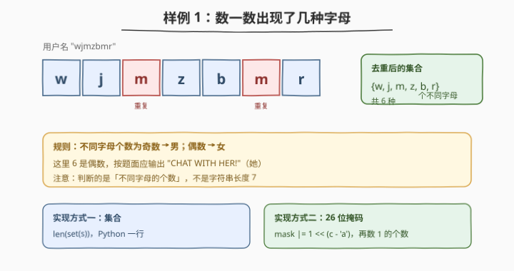
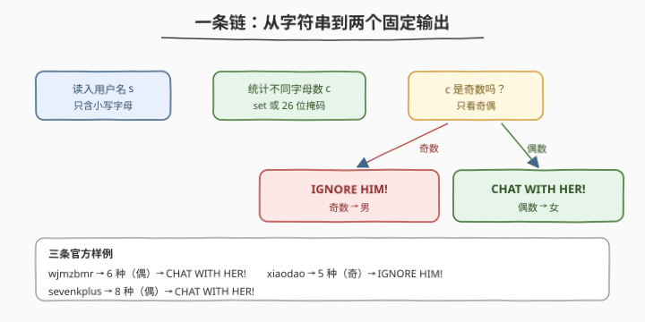

# Codeforces 236A 男孩还是女孩 题解

## 1. 题目概述

- **题目链接**：https://codeforces.com/problemset/problem/236/A
- **比赛来源**：Codeforces Round 146 (Div. 2) · Problem A（UTC 2012-10-21）
- **难度**：800
- **标签**：字符串、集合、位运算、实现
- **评测类型**：普通
- **限制**：时间 1 s / 内存 256 MB

**题意**：主人公想用一个简单规则判断论坛用户的性别：若用户名中**不同字符的个数**是奇数，则判为男性；否则判为女性。给定一个只含小写字母的用户名（长度不超过 100），按该规则输出：

- 女性：`CHAT WITH HER!`
- 男性：`IGNORE HIM!`

**约束**：

- $|s| \le 100$：规模极小，$O(|s|^2)$ 的「对每个字符往前找重复」都能轻松通过，$O(|s|)$ 的集合/位掩码更是绰绰有余。
- 字符集只有 26 个小写字母：可以用一个 26 位的整数掩码记录「出现过哪些字母」，空间 $O(1)$。
- 输出是**逐字符固定**的两个字符串（含大写字母与感叹号），不能写成 `chat with her!` 或漏掉 `!`，否则按 WA 处理。

## 2. 示例与观察

官方样例一：

```text
输入：
wjmzbmr

输出：
CHAT WITH HER!
```

官方样例二：

```text
输入：
xiaodao

输出：
IGNORE HIM!
```

官方样例三：

```text
输入：
sevenkplus

输出：
CHAT WITH HER!
```

**样例演算**：

| 用户名 | 出现过的不同字母 | 个数 | 奇偶 | 输出 |
|--------|------------------|------|------|------|
| `wjmzbmr` | w, j, m, z, b, r | 6 | 偶 | `CHAT WITH HER!` |
| `xiaodao` | x, i, a, o, d | 5 | 奇 | `IGNORE HIM!` |
| `sevenkplus` | s, e, v, n, k, p, l, u | 8 | 偶 | `CHAT WITH HER!` |

注意 `wjmzbmr` 长度为 7（奇数），但答案是女性——判断的是**不同字母的个数**（6），而不是字符串长度。这是本题最容易踩的坑。`sevenkplus` 里 s 和 e 都出现了两次，去重后是 8 个字母。

自造样例（标注「自造」）：

| 输入 | 输出 | 说明 |
|------|------|------|
| `a` | `IGNORE HIM!` | 1 种，奇数 |
| `ab` | `CHAT WITH HER!` | 2 种，偶数 |
| `aaaa` | `IGNORE HIM!` | 只有 1 种，与长度无关 |
| `abcdefghijklmnopqrstuvwxyz` | `CHAT WITH HER!` | 26 种，偶数 |
| `abcdefghijklmnopqrstuvwxy` | `IGNORE HIM!` | 25 种，奇数 |

**观察**：答案只取决于「不同字母个数的奇偶性」。所以既不需要保留集合内容，也不需要知道具体有多少种，只要在数完后判断奇偶即可。

## 3. 解题思路

### 3.1 朴素做法与瓶颈

最直接的做法：对每个位置 $i$，向前扫描 $0 \le j < i$ 看是否出现过相同字符，没出现过就计数加一。复杂度 $O(|s|^2)$。在 $|s| \le 100$ 时最多约 $10^4$ 次比较，1 s 内毫无压力，但写法稍繁且容易写错边界。

另一种朴素写法是把字符排序后数「相邻不同的段数」。这需要 $O(|s| \log |s|)$，同样能过，而且不依赖任何数据结构。

### 3.2 核心观察：去重后数个数



「不同字符的个数」就是集合 $S = \{s_i\}$ 的大小。因为字母表只有 26 个，可以：

- 用 `std::set<char>` 或 Python 的 `set`，插入后取 `size`；
- 用一个 26 位整数 `mask`，对每个字符执行 `mask |= 1 << (c - 'a')`，最后数 `mask` 中 1 的个数。

位掩码版本把「去重」变成了「或运算」，天然幂等，且空间只有 4 字节，是本题最紧凑的写法。

### 3.3 算法流程



1. 读入用户名 $s$；
2. `mask ← 0`；对 $s$ 的每个字符 $c$：`mask |= 1 << (c - 'a')`；
3. `cnt ← popcount(mask)`；
4. 若 `cnt` 为奇数输出 `IGNORE HIM!`，否则输出 `CHAT WITH HER!`。

Python 版直接用 `len(set(s))` 取个数，再判断奇偶，可读性更好，效果完全一样。

### 3.4 样例走查：`wjmzbmr`

| 字符 | 掩码新增的位 | popcount |
|------|--------------|----------|
| w | bit 22 | 1 |
| j | bit 9 | 2 |
| m | bit 12 | 3 |
| z | bit 25 | 4 |
| b | bit 1 | 5 |
| m | 已存在，无变化 | 5 |
| r | bit 17 | 6 |

最终 `popcount = 6`，偶数 → 输出 `CHAT WITH HER!`，与官方一致。

## 4. 正确性证明

**引理 1**：算法结束时 `mask` 的第 $k$ 位为 1 当且仅当字母表中第 $k$ 个字母在 $s$ 中出现过。

**证明**：对字符串长度归纳。初始 `mask = 0`，没有字母出现。每读入一个字符 $c$，`mask |= 1 << (c - 'a')` 只把 $c$ 对应的那一位设为 1，其他位不变；已经出现过的字母再次出现时，该位本来就是 1，或运算后仍是 1。因此结束时恰好是「出现过的字母集合」的特征位。∎

**引理 2**：`popcount(mask)` 等于 $s$ 中不同字符的个数。

**证明**：由引理 1，`mask` 中每个为 1 的位对应一个出现过的字母，且不同字母对应不同位，所以 1 的个数就是不同字母的个数。∎

**定理**：算法的输出与题面规则一致。

**证明**：由引理 2，`cnt` 就是题面所说的「不同字符的数量」。题面规定该数为奇数时判男性、偶数时判女性，算法正是在 `cnt` 为奇数时输出 `IGNORE HIM!`、偶数时输出 `CHAT WITH HER!`，与规则逐字一致。∎

## 5. 复杂度分析

- **时间**：$O(|s|)$，每个字符一次位移和一次或运算；$|s| \le 100$ 时是几百次基本操作，1 s 时限的余量在百万倍量级。
- **空间**：$O(1)$（一个 32 位整数），不需要额外数组；Python 的 `set` 最多 26 个元素。
- **实测**：最大长度（100 字符、26 种字母与 1 种字母两种极端）下 C++ 端到端约 2.2 ms（几乎全是进程启动），Python 约 19 ms。

## 6. 参考代码

### C++17

```cpp
#include <bits/stdc++.h>
using namespace std;

int main() {
    ios::sync_with_stdio(false);
    cin.tie(nullptr);

    string s;
    if (!(cin >> s)) return 0;
    int mask = 0;                          // 26 个二进制位记录出现过哪些字母
    for (char c : s) mask |= 1 << (c - 'a');
    int distinct = __builtin_popcount(mask);
    cout << (distinct % 2 ? "IGNORE HIM!" : "CHAT WITH HER!") << '\n';
    return 0;
}
```

### Python3

```python
import sys


def main() -> None:
    s = sys.stdin.buffer.read().strip().decode()
    if not s:
        return
    distinct = len(set(s))
    sys.stdout.write("IGNORE HIM!\n" if distinct % 2 else "CHAT WITH HER!\n")


main()
```

两份代码都只用标准库，可原样提交。输出字符串必须与题面完全一致（含大小写和感叹号）。

## 7. 边界情况与易错点

1. **长度为 1**：只有 1 种字符，是奇数 → 输出 `IGNORE HIM!`。不要把「1 种」当成特殊情况处理成 0 或 2。
2. **全部字符相同**（如 `aaaa`）：不同字母数是 1（奇数），输出 `IGNORE HIM!`；不能按长度 4（偶数）去判断。
3. **26 种字母全出现**：个数 26 是偶数 → `CHAT WITH HER!`；而 25 种是奇数 → `IGNORE HIM!`。这是「个数」与「长度」在极端处容易混淆的地方。
4. **输出字符串必须逐字一致**：`CHAT WITH HER!` 与 `IGNORE HIM!` 都是大写加感叹号；写成 `Chat with her!`、漏掉 `!`、或把空格写成全角都会 WA。
5. **只含小写字母**：题面保证输入是小写英文字母，不需要处理大写；若用 `tolower` 之类的转换反而可能引入无关分支。
6. **末尾换行**：输出一行后要换行（`'\n'`），不要用 `endl` 刷缓冲（本题无所谓，但习惯上如此）。
7. **位掩码的位数**：$c - 'a'$ 的范围是 $0 \sim 25$，`1 << 25` 在 `int` 内安全；若误写成 `1 << (c - 'A')` 会越界（大写字母输入时才会踩到）。
8. **空输入**：题面保证非空；若实现里用 `read().strip()`，要防止空串时 `set()` 为空导致除零或误判（本代码对空串直接返回，不会输出错误答案）。

## 8. 验证记录

- **编译环境与命令**：本机无 GNU `g++`，用 `clang++ -std=c++17 -O2 -I codeforces/tools/include`（本地 `bits/stdc++.h` 兼容头）编译；Python 3.9.6。
  - `python3 codeforces/tools/verify_solution.py codeforces/contests/0101-0203/236/A_男孩还是女孩.md` → `CF236A: samples 3 / C++ 编译 OK, 样例 3/3 / Python 语法 OK, 样例 3/3`
  - `python3 codeforces/tools/check_samples.py --only 0101-0203/236`、`python3 codeforces/tools/check.py codeforces/contests/0101-0203/236`、`node codeforces/tools/katex_check.cjs codeforces/contests/0101-0203/236` 均 0 问题。
- **官方样例**：3 / 3 通过，C++ 与 Python 输出一致。
- **额外测试与随机对拍**：另写独立暴力（把字符串排序后数「相邻不同的段数」，不用集合也不用位掩码），与 C++、Python 逐组比对 **260 组**随机数据（长度 $1 \sim 30$，字母表大小随机取 1 / 2 / 3 / 5 / 26），全部一致；并覆盖长度为 1、全同字符、26 种字母等边界。
- **最大约束性能**：长度 100 的两种极端输入（100 个相同字母、26 种字母循环）下，C++ 端到端约 2.2 ms，Python 约 19 ms（均含进程启动），相对 1 s 时限余量极大。
- **图片校验**：`cf236a_distinct.svg`、`cf236a_parity.svg` 均通过 `xml.etree.ElementTree.parse`，含 `feTurbulence` 抖动滤镜与手写字体，逐字符估算包围盒未越出 `viewBox`。
- **公式校验**：`node codeforces/tools/katex_check.cjs codeforces/contests/0101-0203/236` 对该篇 0 错误。
- **复核状态**：verified（样例、对拍、性能、图片、公式全部实跑通过）。

## 相关题目与扩展

- [Codeforces 236B Easy Number Challenge](https://codeforces.com/problemset/problem/236/B)：同场 B 题，数论 + 筛法，是本题的下一档难度。
- [Codeforces 237A Free Cash](https://codeforces.com/problemset/problem/237/A)：同样是「一次扫描 + 计数取极值」的实现题。
- [Codeforces 71A Way Too Long Words](https://codeforces.com/problemset/problem/71/A)：最基础的字符串实现题，练输出的严格格式。
- [Codeforces 112A Petya and Strings](https://codeforces.com/problemset/problem/112/A)：字符串比较，注意大小写与字典序。
- [LeetCode 387. 字符串中的第一个唯一字符](https://leetcode.cn/problems/first-unique-character-in-a-string/)：用计数数组统计字符出现次数，与本题的「集合/掩码去重」互为补充。

**延伸思考**：

1. **如果规则改成「不同字母个数是否为质数」**：只需把奇偶判断换成素数判断，26 以内直接打表即可；这说明「先算出去重后的数量」是问题的核心，后续判定可以任意替换。
2. **如果字符集扩大到全部 ASCII**：26 位掩码就不够用了，应改用 `bool[128]` 或哈希集合；位掩码的适用范围由字符集大小决定。
3. **如果要求统计每个字母出现次数**：位掩码就不够了，需要 `int cnt[26]` 数组；本题只问「种数」，所以能用更省的方式。
4. **如果输入长度放大到 $10^7$**：$O(|s|)$ 仍是正解，但要注意 I/O 效率；此时一个 26 位掩码比 `set` 快得多，也是本题位运算写法真正的价值所在。
