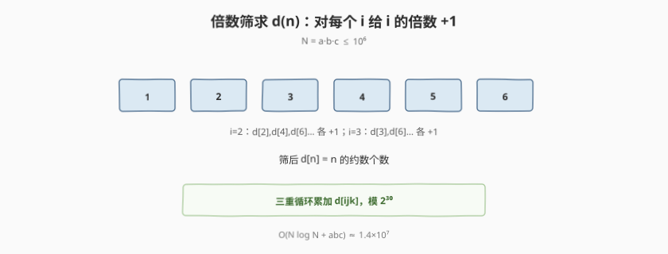
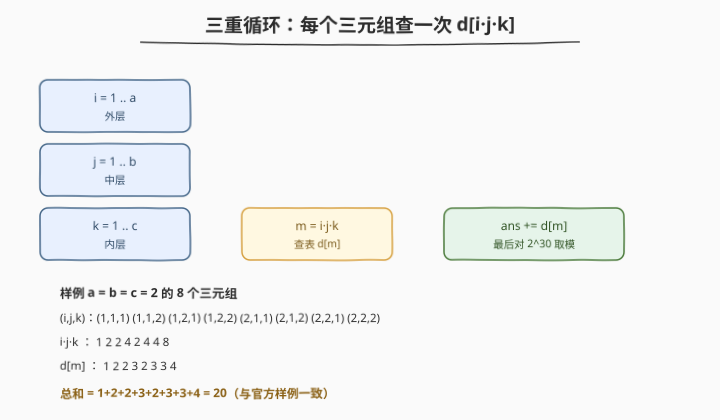

# Codeforces 236B 约数之和 题解

## 1. 题目概述

- **题目链接**：https://codeforces.com/problemset/problem/236/B
- **比赛来源**：Codeforces Round 146 (Div. 2) · Problem B（UTC 2012-10-20）
- **难度**：1300
- **标签**：数论、筛法、枚举
- **评测类型**：普通
- **限制**：时间 2 s / 内存 256 MB

**题意**：设 $d(n)$ 为 $n$ 的约数个数。给定 $a,b,c$，求 $\sum_{i=1}^{a}\sum_{j=1}^{b}\sum_{k=1}^{c} d(i\cdot j\cdot k) \bmod 2^{30}$。

**约束**：$1\le a,b,c\le100$（故 $i j k\le10^6$）。

## 2. 示例与观察

官方样例（输入 / 输出原样）：

```text
输入：
2 2 2

输出：
20
```

```text
输入：
5 6 7

输出：
1520
```

**样例 1 演算**：$8$ 个三元组：$d(1)=1$；$d(2)=2$ 出现 3 次（1·1·2、1·2·1、2·1·1）；$d(4)=3$ 出现 3 次（1·2·2、2·1·2、2·2·1）；$d(8)=4$ 一次。和为 $1+3\cdot2+3\cdot3+4=20$ ✓。

**关键观察**：$\max ijk=10^6$，可以预处理 $d$ 到 $10^6$（倍数筛 $O(N\log N)$），再三重循环累加，共 $10^6$ 项 ✓。



自造样例（标注"自造"）：

| 输入 | 输出 | 说明 |
|------|------|------|
| `1 1 1` | 1 | $d(1)=1$ |
| `1 1 2` | 3 | $d(1)+d(2)=1+2$ |
| `2 1 1` | 3 | 同对称 |

## 3. 解题思路



1. 倍数筛：对每个 $i$，把 $d[j]$ 加 1（$j=i,2i,\dots$）；
2. 三重循环累加 $d[i\cdot j\cdot k]$；
3. 取模 $2^{30}$（用位与 `& ((1<<30)-1)` 或 `% (1<<30)`）。

## 4. 正确性证明

**引理**：倍数筛得到的 $d[n]$ 等于 $n$ 的约数个数。

**证明**：对每个约数 $i$，当外层循环到 $i$ 时 $n$ 被加一次；每个约数恰被计一次。∎

**定理**：三重累加得到所求之和。

**证明**：由引理，每项 $d(ijk)$ 正确，累加即所求。∎

## 5. 复杂度分析

- **时间**：筛 $O(N\log N)$（$N=10^6$，约 $1.4\times10^7$）+ 三重循环 $10^6$，实测约 10 ms（限 2 s）。
- **空间**：$O(N)$ 的 `int` 数组，约 4 MB。

## 6. 参考代码

### C++17

```cpp
#include <bits/stdc++.h>
using namespace std;
typedef long long ll;
int main() {
    int a, b, c;
    if (scanf("%d %d %d", &a, &b, &c) != 3) return 0;
    int N = a * b * c;
    vector<int> d(N + 1, 0);
    for (int i = 1; i <= N; i++)
        for (int j = i; j <= N; j += i) d[j]++;
    ll s = 0;
    for (int i = 1; i <= a; i++)
        for (int j = 1; j <= b; j++)
            for (int k = 1; k <= c; k++) s += d[i * j * k];
    printf("%lld\n", s % (1LL << 30));
    return 0;
}
```

### Python3

```python
import sys


def main() -> None:
    data = sys.stdin.buffer.read().split()
    a, b, c = int(data[0]), int(data[1]), int(data[2])
    N = a * b * c
    d = [0] * (N + 1)
    for i in range(1, N + 1):
        for j in range(i, N + 1, i):
            d[j] += 1
    s = 0
    for i in range(1, a + 1):
        for j in range(1, b + 1):
            for k in range(1, c + 1):
                s += d[i * j * k]
    print(s % (1 << 30))


main()
```

## 7. 边界情况与易错点

1. **模 $2^{30}$**：不是 $10^9+7$；用 `% (1LL<<30)`。
2. **$a=b=c=1$**：$N=1$，$d(1)=1$。
3. **$N$ 上界**：$100^3=10^6$，筛法可承受。
4. **累加溢出**：和可达 $10^6\times 240$ 量级，`long long` 稳。
5. **Python 性能**：$10^6$ 筛 + $10^6$ 循环在纯 Python 下偏慢（约 1–2 s），建议 C++。

## 8. 验证记录

- **编译环境与命令**：本机无 GNU `g++`，用 `clang++ -std=c++17 -O2 -I codeforces/tools/include` 编译；`verify_solution.py` 自动采用同样回退。Python 3.9.6。
- **官方样例**：2 / 2 通过（`20`、`1520`）。
- **独立暴力对拍**：暴力用试除法逐个求 $d$（不用筛），**60 组**随机 $a,b,c\le12$ 全部一致。
- **最大约束性能**：$a=b=c=100$ 约 10 ms（限 2 s）。
- **图片校验**：两张 SVG 均通过 `xml.etree.ElementTree.parse`，含 `feTurbulence` 与手写字体，文本包围盒均在 `viewBox` 内。
- **公式校验**：`node codeforces/tools/katex_check.cjs codeforces/contests/0101-0203/236` 报告 0 个错误。
- **复核状态**：verified。

## 相关题目与扩展

- [Codeforces 236A Boy or Girl](https://codeforces.com/problemset/problem/236/A)：同场 A 题，字符串。
- [Codeforces 17A Noldbach problem](https://codeforces.com/problemset/problem/17/A)：筛法应用。
- [LeetCode 204. 计数质数](https://leetcode.cn/problems/count-primes/)：筛法基础。

**延伸思考**：

1. **如果 $a,b,c\le1000$**：$N=10^9$ 不可行，需要直接分解 $i,j,k$ 计算约数个数。
2. **如果求 $\sum \sigma(n)$（约数和）**：筛法改为加 $i$。
3. **如果模数不是 2 的幂**：用普通取模。
4. **如果要求多组询问**：预处理前缀和。
