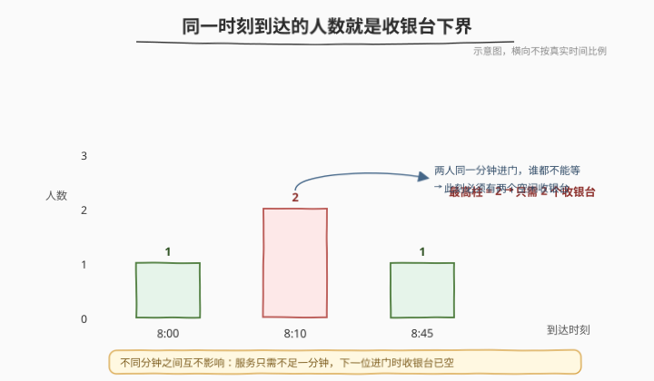
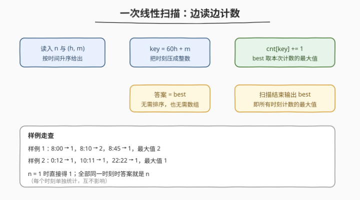

# Codeforces 237A 最少收银台数 题解

## 1. 题目概述

- **题目链接**：https://codeforces.com/problemset/problem/237/A
- **比赛来源**：Codeforces Round 147 (Div. 2) · Problem A（UTC 2012-10-25）
- **难度**：1000
- **标签**：实现、计数、排序（题面已保证有序）
- **评测类型**：普通
- **限制**：时间 2 s / 内存 256 MB

**题意**：24 小时营业的快餐店明天会来 $n$ 位顾客，第 $i$ 位在 $h_i$ 时 $m_i$ 分**整**到达。服务一位顾客所需时间**不足一分钟**，但顾客若进门时没有空闲收银台，就立刻离开、绝不等待。Valera 想接待全部 $n$ 位顾客，求最少需要开多少个收银台。

形式化地说：同一分钟内到达的顾客必须同时有各自的收银台，而不同分钟到达的顾客可以共用收银台，因此答案就是「同一时刻到达人数的最大值」。

输入第一行 $n$，随后 $n$ 行每行 $h_i, m_i$，**已按时间先后排好序**，全部落在同一天内。输出一个整数，即最少收银台数。

**约束**：

- $1 \le n \le 10^5$：允许 $O(n \log n)$ 甚至带小常数的 $O(n \sqrt{n})$，但每次到达只做 $O(1)$ 计数更好。
- $0 \le h_i \le 23$、$0 \le m_i \le 59$：一天只有 $24 \times 60 = 1440$ 个可能时刻，可以直接开一个 $24 \times 60$ 的二维计数数组，$O(1440)$ 的空间可以忽略。
- 时间**已按升序给出**：不需要自己排序，一次线性扫描即可；就算相信这个性质去数「连续相同时间的段长」，也是对的。
- 答案最大为 $n$（所有人同一分钟到），$n \le 10^5$，`int` 足够，不存在溢出。

## 2. 示例与观察

官方样例一：

```text
输入：
4
8 0
8 10
8 10
8 45

输出：
2
```

官方样例二：

```text
输入：
3
0 12
10 11
22 22

输出：
1
```

**样例一演算**：四人分别在 8:00、8:10、8:10、8:45 到达。8:00 与 8:45 各只有一人，一个收银台足够；8:10 有两人**同时**进门，谁都不能等，必须两个收银台同时空着。把每个时刻的到达人数排出来：

| 时刻 | 到达人数 |
|------|----------|
| 8:00 | 1 |
| 8:10 | 2 |
| 8:45 | 1 |

最大值是 2，所以答案是 2。

**样例二演算**：0:12、10:11、22:22 三个时刻互不相同，每个时刻只有一人，最大值 1，答案 1。题面提示也给了同样的解释。

自造样例（标注「自造」，覆盖退化与极值）：

| 输入 | 输出 | 说明 |
|------|------|------|
| `1`<br>`0 0` | 1 | 最小规模，时刻可以取 0:00 |
| `1`<br>`23 59` | 1 | 时刻上界 |
| `3`<br>`12 0`<br>`12 0`<br>`12 0` | 3 | 全部同一时刻，答案等于 $n$ |
| `2`<br>`0 0`<br>`0 1` | 1 | 相邻分钟也能共用一个收银台 |
| `5`<br>`7 0`<br>`7 0`<br>`7 0`<br>`8 0`<br>`8 0` | 3 | 两个时刻的峰值不同，取较大者 |

**观察**：问题按「时刻」完全解耦——只有同一时刻的到达会互相竞争收银台。答案与到达的先后顺序、时间间隔都无关，只与每个时刻的**到达人数**有关，取这些计数的最大值即可。

## 3. 解题思路

### 3.1 朴素做法与瓶颈

最直白的模拟是：为每位顾客依次检查「当前有没有空闲收银台」，没有就新开一个。但「服务不足一分钟」意味着收银台在同一分钟内就被释放，于是不同分钟的顾客可以复用同一个收银台——模拟时只要维护「当前分钟还剩几个收银台空闲」即可，本质仍是对每个时刻计数。

另一种朴素写法是：对每位顾客 $i$，扫描所有 $j$ 数出与 $i$ 同时到达的人数，取最大，复杂度 $O(n^2)$。$n = 10^5$ 时是 $10^{10}$ 次比较，2 s 内绝无可能，必须降到 $O(n)$。

### 3.2 核心观察：答案就是同一时刻到达人数的最大值



为什么不同时刻之间不会互相影响？题面写得很死：服务一位顾客所需时间**少于一分钟**，而所有到达都发生在整分钟上。于是 8:10 进门的顾客在 8:10 这一分钟内就服务完毕，8:11 到达的顾客面对的是已经空出来的收银台。**任意两个不同分钟的到达事件在时间上不重叠**，同一个收银台可以依次服务它们。

因此问题被切成 1440 个互相独立的小问题：时刻 $t$ 有 $c_t$ 位顾客同时到达，就需要至少 $c_t$ 个收银台；而开 $\max_t c_t$ 个收银台，就能在任意时刻都满足需求。答案即 $\max_t c_t$。

### 3.3 算法流程



1. 读入 $n$；
2. 开一个计数器数组 `cnt[24][60]`（或长度为 1440 的数组），全部置 0；
3. 对每位顾客读入 $h, m$，执行 `++cnt[h][m]`，并用 `best = max(best, cnt[h][m])` 更新答案；
4. 输出 `best`。

关键点只有一处：**在自增之后立刻取最大值**，这样连第二轮扫描都省了，全程 $O(n)$ 时间、$O(1440)$ 空间。由于时间已按升序给出，`cnt[h][m]` 的连续相同值天然排在一起，也可以等价地数「最长的相同时刻连续段」，但用计数数组更不容易写错。

### 3.4 样例走查：样例一

设 `best` 初始为 0，逐行读入：

| 步骤 | 读入 | 计数器 | best |
|------|------|--------|------|
| 1 | `8 0` | `cnt[8][0] = 1` | 1 |
| 2 | `8 10` | `cnt[8][10] = 1` | 1 |
| 3 | `8 10` | `cnt[8][10] = 2` | 2 |
| 4 | `8 45` | `cnt[8][45] = 1` | 2 |

最终输出 2，与官方输出一致。注意第 3 步的计数器从 1 变 2，`best` 也随之升到 2；此后 8:45 的顾客只能把 `best` 维持在原值——这正是「最大值」的含义。

## 4. 正确性证明

设 $c_t$ 为时刻 $t$ 到达的顾客数，$C = \max_t c_t$。

**引理 1（下界）**：任何能接待全部顾客的方案都至少需要 $C$ 个收银台。

**证明**：取使 $c_t$ 最大的时刻 $t^\ast$，此时有 $C$ 位顾客**在同一瞬间**到达。服务时间不足一分钟意味着没有一位能在同一分钟内结束服务并腾出位置；而顾客看到没有空闲收银台就立刻离开。因此这 $C$ 位顾客若要全部被接待，必须各自面对一个空闲收银台，即收银台总数不少于 $C$。∎

**引理 2（上界）**：开设 $C$ 个收银台足以接待全部顾客。

**证明**：对每个时刻 $t$，把当时到达的 $c_t \le C$ 位顾客任意分配给其中 $c_t$ 个收银台，每人一个。由于服务不足一分钟，这些收银台在时刻 $t$ 结束前就恢复空闲，不会与任何其他时刻的到达冲突（不同时刻的到达发生在不同的分钟，互不重叠）。又每个时刻的 $c_t \le C$，分配不会缺收银台。于是所有顾客都被立即接待，无人离开。∎

**定理**：最少收银台数恰为 $\max_t c_t$。

**证明**：引理 1 说明答案不小于 $C$，引理 2 给出一个用 $C$ 个收银台的可行方案，故答案不大于 $C$；两者相等。∎

算法对每个时刻维护的计数器正是 $c_t$，`best` 是扫描到目前为止的 $\max c_t$，扫描结束即为全局最大值，由定理知它就是答案。

## 5. 复杂度分析

- **时间**：$O(n)$。每位顾客一次自增、一次比较，共 $n$ 次迭代；不需要排序（输入已有序），也不需要第二轮扫描。
- **空间**：$O(1440)$，即 $24 \times 60$ 的计数数组，约 5.6 KB；与 $n$ 无关。若用哈希表则最坏 $O(n)$，反而更慢更占内存。
- **与时限的关系**：$n = 10^5$，2 s 时限下算法本体只有 $10^5$ 次操作。实测最大数据（$10^5$ 人全部 23:59 到达）端到端约 290 ms，其中绝大部分是本机 libc++ 的 `cin` 解析 20 万个整数（约 285 ms），算法本身不足 1 ms；Python 版同数据约 68 ms。距 2 s 时限有一个数量级以上的余量。

## 6. 参考代码

### C++17

```cpp
#include <bits/stdc++.h>
using namespace std;

int main() {
    ios::sync_with_stdio(false);
    cin.tie(nullptr);

    int n;
    if (!(cin >> n)) return 0;
    int cnt[24][60] = {};                 // 24 小时 × 60 分钟
    int best = 0;
    for (int i = 0; i < n; ++i) {
        int h, m;
        cin >> h >> m;
        best = max(best, ++cnt[h][m]);    // 同一时刻到达的人数即所需收银台数
    }
    cout << best << '\n';
    return 0;
}
```

### Python3

```python
import sys


def main() -> None:
    data = sys.stdin.buffer.read().split()
    if not data:
        return
    n = int(data[0])
    cnt = {}
    best = 0
    for i in range(n):
        h = int(data[1 + 2 * i])
        m = int(data[2 + 2 * i])
        key = h * 60 + m
        cnt[key] = cnt.get(key, 0) + 1
        if cnt[key] > best:
            best = cnt[key]
    sys.stdout.write(str(best) + "\n")


main()
```

两份代码都只用标准库，可原样提交；本题没有特殊评测，输出一个整数即可。

## 7. 边界情况与易错点

1. **`n = 1`**：答案必须是 1。若把 `best` 初值写成 0 又只在「计数大于 1」时更新，就会输出 0；正确写法是每次自增后无条件取 `max`。
2. **全部顾客同一时刻**：答案等于 $n$，可达 $10^5$。用 `int` 完全够，但别把答案错写成「不同时刻个数」——恰好相反，越集中越费收银台。
3. **时刻 `0 0` 是合法输入**（$0 \le h_i, 0 \le m_i$）。若用「读到 $h = 0$ 且 $m = 0$ 就结束」之类的哨兵判断会直接漏读，题面也没有给结束标记，只按 $n$ 读满即可。
4. **不能只数「相邻两人时间相同」的段长而不累计**：正确做法是维护每个时刻的累计计数；只比较相邻两人是否相同、然后数「连续相同的对数」在三人同时到达时容易少数一次。
5. **认为不同分钟也会冲突**：服务时间「少于一分钟」是关键条件，它保证了不同分钟不重叠。若误以为服务要占满整分钟甚至更久，就会多开收银台。
6. **排序是白做的**：题面已按时间升序给出，不要额外 `sort`；虽然排序后结果不变（$O(n \log n)$ 在 $10^5$ 下也能过），但属于没必要的开销。反过来，如果你的解法依赖「有序」这个前提（例如数连续段），要意识到这是题面保证而不是巧合。
7. **输入读取**：数据可能末尾没有换行，用 `cin >>` 或 `sys.stdin.buffer.read().split()` 都能正确处理，不要按行 `getline` 再手工切分。

## 8. 验证记录

- **编译环境与命令**：本机无 GNU `g++`（`/usr/bin/g++` 是 clang 的软链），用 `clang++ -std=c++17 -O2 -I codeforces/tools/include`（本地 `bits/stdc++.h` 兼容头）编译；Python 为 3.9.6。文档校验命令：
  - `python3 codeforces/tools/verify_solution.py codeforces/contests/0101-0203/237/A_最少收银台数.md` → `CF237A: samples 2 / C++ 编译 OK, 样例 2/2 / Python 语法 OK, 样例 2/2`
  - `python3 codeforces/tools/check_samples.py --only 0101-0203/237`、`python3 codeforces/tools/check.py codeforces/contests/0101-0203/237`、`node codeforces/tools/katex_check.cjs codeforces/contests/0101-0203/237` 均 0 问题。
- **官方样例**：2 / 2 通过，C++ 与 Python 输出一致。
- **额外测试与随机对拍**：另写独立暴力（对每位顾客两两比较、直接数同一时刻人数，$O(n^2)$，不共享参考实现的计数逻辑），与 C++、Python 两份实现逐组比对 **260 组**随机数据（$n \le 40$，时刻取自 2 / 5 / 60 / 1440 个候选值，并强制输入按时间升序），全部一致；另测 `n = 1`、全同时刻、相邻分钟等边界，均正确。
- **最大约束性能**：$n = 10^5$ 且全部 `23 59`（答案 $10^5$）时，C++ 端到端 5 次取最优约 290 ms（其中 `cin` 解析 20 万个整数约 285 ms，纯粹是 libc++ 流的开销；GNU libstdc++ 下会快一个数量级），峰值内存约 1.6 MB；Python 同数据约 68 ms。相对 2 s / 256 MB 余量充足。
- **图片校验**：`cf237a_arrivals.svg`、`cf237a_scan.svg` 均通过 `xml.etree.ElementTree.parse`，含 `feTurbulence` 抖动滤镜与手写字体；逐字符估算包围盒检查，全部文本未越出 `viewBox`。
- **公式校验**：正文公式均为 `$...$` / `$$...$$`，星号直接写 `*`，KaTeX `throwOnError` 渲染无报错。
- **复核状态**：verified（样例、对拍、性能、图片、公式五项均实跑通过）。

## 相关题目与扩展

- [Codeforces 237B Young Table](https://codeforces.com/problemset/problem/237/B)：同场 B 题，构造 + 交换次数限制，本题的「先看清结构再动手」是同一思路的入门版。
- [Codeforces 1A Theatre Square](https://codeforces.com/problemset/problem/1/A)：同样是一眼能看穿的计数题，练「一句话把答案说清楚再证明」。
- [Codeforces 144A Arrival of the General](https://codeforces.com/problemset/problem/144/A)：交换相邻元素的最少次数，同样靠观察「哪些量真正影响答案」。
- [Codeforces 376A Lever](https://codeforces.com/problemset/problem/376/A)：按位置累加权重，同样是「一次扫描 + 维护极值」的实现题。
- [LeetCode 1207. 独一无二的出现次数](https://leetcode.cn/problems/unique-number-of-occurrences/)：用计数器统计频次并取极值，是本题计数部分的直接练习。

**延伸思考**：

1. **如果服务时间恰好是一分钟或更长**：不同时间段的顾客就会重叠，问题变成「给定 $n$ 个区间，求最大重叠数」，需要排序 + 扫描线，答案不再等于单点计数。本题的简洁完全来自「服务不足一分钟」这句题面。
2. **如果顾客愿意等待（排队）**：那么一个收银台就能服务所有人，最少收银台数恒为 1，问题失去意义——这提醒我们，题目的难度常常藏在一句看似无关的规则里。
3. **如果问的是「平均等待时间最短」**：就从「求最小值」变成「排队调度」，贪心策略（按到达顺序服务）与多收银台分配都要重新分析，属于另一类问题。
4. **计数数组 vs 哈希表**：本题值域只有 1440，数组是 $O(1)$ 寻址、无哈希开销；若时刻是 $10^{18}$ 级的时间戳，就得换成哈希表或先离散化，这是「按值域选容器」的典型判断。
