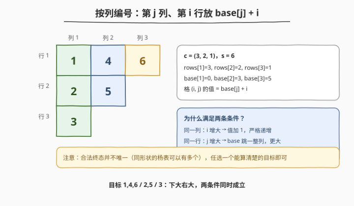
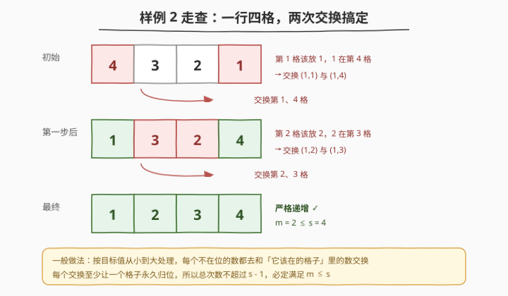

# Codeforces 237B 杨氏表格整理 题解

## 1. 题目概述

- **题目链接**：https://codeforces.com/problemset/problem/237/B
- **比赛来源**：Codeforces Round 147 (Div. 2) · Problem B（UTC 2012-10-25）
- **难度**：1500
- **标签**：构造、实现、排序、置换
- **评测类型**：多解（特殊评测，构造题）
- **限制**：时间 2 s / 内存 256 MB

**题意**：给定一个「杨氏图形状」的表格 $a$：共 $n$ 行，第 $i$ 行有 $c_i$ 个格子，且 $c_1 \ge c_2 \ge \cdots \ge c_n \ge 1$。总格数 $s = \sum c_i$，每个格子里填着 $1 \sim s$ 的一个互不相同的整数（因此恰是一个排列）。

一次操作可以交换任意两个**不同**格子里当前存放的数。要求用**不超过 $s$ 次**操作，把表格重排成满足：

1. 对所有 $i > 1$、$j \le c_i$：$a_{i,j} > a_{i-1,j}$（同一列自上而下严格递增）；
2. 对所有 $i$、$1 < j \le c_i$：$a_{i,j} > a_{i,j-1}$（同一行自左向右严格递增）。

输出交换次数 $m$（$0 \le m \le s$）与按执行顺序的每次交换 $x_i, y_i, p_i, q_i$。无需最小化次数。

**约束**：

- $n \le 50$、$c_i \le 50$：总格数 $s \le 2500$，任何 $O(s^2)$ 的算法都绰绰有余，甚至可以承受 $s^3$ 级别的小常数操作。
- 行长度**单调不增**：这条形状约束是关键，它保证「按列从上到下、从左到右」编号时，每个格子的上方格子与左方格子都一定存在，编号的大小关系才能一路成立。
- 操作次数上限是 $s$ 而不是 $s-1$ 或 $2s$：这刚好容纳「每处理一个错位的格子交换一次」的贪心，也提醒我们最多只能让每个格子「动一次左右」。
- 输入保证所有数互不相同且不超过 $s$，共 $s$ 个格子，因此**输入恰是 $1 \sim s$ 的一个排列**，这一点在构造目标表时可以直接使用。

## 2. 示例与观察

官方样例一：

```text
输入：
3
3 2 1
4 3 5
6 1
2

输出：
2
1 1 2 2
2 1 3 1
```

官方样例二：

```text
输入：
1
4
4 3 2 1

输出：
2
1 1 1 4
1 2 1 3
```

本题是构造题，**官方输出只是众多合法答案之一**，不能拿它做文本比对。下面逐组演算。

**样例一**：形状 $c = (3, 2, 1)$，$s = 6$，初始表格为

| 行 \ 列 | 1 | 2 | 3 |
|---|---|---|---|
| 1 | 4 | 3 | 5 |
| 2 | 6 | 1 | （无） |
| 3 | 2 | （无） | （无） |

按官方给出的两次交换：(1,1) 与 (2,2) 交换（交换 $4$ 与 $1$），再交换 (2,1) 与 (3,1)（交换 $6$ 与 $2$），得到

| 行 \ 列 | 1 | 2 | 3 |
|---|---|---|---|
| 1 | 1 | 3 | 5 |
| 2 | 2 | 4 | （无） |
| 3 | 6 | （无） | （无） |

检查条件：每行递增（$1<3<5$、$2<4$、单格）；每列自上而下递增（$1<2<6$、$3<4$）。合法。

**样例二**：只有一行四格 `4 3 2 1`，目标就是 `1 2 3 4`。官方方案先交换 (1,1)(1,4) 得 `1 3 2 4`，再交换 (1,2)(1,3) 得 `1 2 3 4`，两次交换，$2 \le s = 4$。

自造样例（标注「自造」）：

| 输入 | 目标终态 | 说明 |
|------|----------|------|
| `1`<br>`1`<br>`1` | 1 | 单格，0 次交换 |
| `2`<br>`1 1`<br>`1`<br>`2` | 第一列 1, 2 | 两行各一格，只能竖着排 |
| `3`<br>`2 2 2`<br>`1 2`<br>`3 4`<br>`5 6` | 无需交换 | 已经合法，输出 0 |
| `2`<br>`5 3`<br>`1 2 3 4 5`<br>`6 7 8` | 行 1 为 1 2 4 5 8，行 2 为 3 6 7 | 形状不规则 |

**观察一**：合法终态**不唯一**。比如 $c = (2,2)$ 时，`1 2 / 3 4` 与 `1 3 / 2 4` 都合法：$(1,2)$ 与 $(2,1)$ 之间没有任何约束（它们既不同行也不同列），可以互换。所以「按官方答案一字不差地输出」既不可能也没必要——只要输出合法即可。

**观察二**：既然终态可以自己挑，就挑一个**结构最简单、能直接算出来**的：把格子按「先列后行」的顺序编号 $1, 2, \dots, s$，把编号填进去。这个填法天然满足两条递增条件（下一节证明），于是问题退化成「把当前排列变成指定排列，用交换实现」，而任意置换都能在 $s-1$ 次交换内完成。

## 3. 解题思路

### 3.1 朴素做法与瓶颈

最朴素的思路是「反复修错」：扫描全表，一旦发现某格与上方或左方不满足递增，就把它与某个更小的数交换，直到没有冲突。这种「冒泡式」修错最终会收敛，但**交换次数可能远超 $s$**（比如整张表是逆序时，局部修错会把刚修好的格子再次打乱），而题面硬性要求 $m \le s$。

要控制次数，必须站在「置换」的角度看问题：先确定一个合法终态，然后只做**让某个格子一次性永久归位**的交换。每个格子最多归位一次，总交换次数自然不超过 $s-1$。

### 3.2 核心观察：按列编号得到合法终态



定义：

- $\text{rows}[j]$ = 第 $j$ 列有多少个格子 = 满足 $c_i \ge j$ 的行数；
- $\text{base}[j] = \sum_{j' < j} \text{rows}[j']$，即前 $j-1$ 列的总格数；
- 目标值 $\text{target}(i,j) = \text{base}[j] + i$。

图里 $c = (3,2,1)$：$(\text{rows}[1], \text{rows}[2], \text{rows}[3]) = (3,2,1)$，$\text{base} = (0,3,5)$，于是目标表就是 `1 4 6 / 2 5 / 3`——第 1 列 1,2,3，第 2 列接着 4,5，第 3 列接着 6。

**为什么它合法**：

- 同一列：$i$ 每加 1，值加 1，严格递增；
- 同一行：$j$ 每加 1，值从 $\text{base}[j] + i$ 跳到 $\text{base}[j+1] + i = \text{base}[j] + \text{rows}[j] + i$。因为这一行有第 $j+1$ 个格子，说明 $c_i \ge j+1$，即 $i \le \text{rows}[j+1] \le \text{rows}[j]$，所以增量 $\text{rows}[j] \ge 1$，严格递增。

**为什么值恰是 $1 \sim s$**：列的编号区间是 $[\text{base}[j]+1, \text{base}[j]+\text{rows}[j]]$，这些区间首尾相接、互不重叠，并起来正好是 $[1, s]$。

### 3.3 算法流程：按目标值从小到大归位



1. 读入 $n$、$c_i$ 与表格，统计 $s$；
2. 计算 $\text{rows}[\cdot]$ 与 $\text{base}[\cdot]$，得到每个格子的目标值 $\text{target}(i,j)$；
3. 用 `pi[v], pj[v]` 记录数值 $v$ 当前所在的格子（$v = 1 \dots s$）；
4. 按「目标值从小到大」遍历格子。对格子 $(i,j)$：若当前值已经等于 $target(i,j)$ 就跳过；否则设 $want = target(i,j)$，找到 $want$ 现在所在的格子 $(x,y)$，输出一次交换 $(i,j,x,y)$，并交换两格的数、同步更新 `pi/pj`；
5. 输出交换次数与所有交换。

两个实现细节：

- **遍历顺序**：目标值 $\text{base}[j]+i$ 在「先行后列」的遍历顺序下恰好单调递增（同一行内 $j$ 增时 $\text{base}$ 增；换行时新行第 1 列的值 $i+1$ 小于上一行末列的值）。所以直接按「行优先」双重循环遍历，就是在按目标值从小到大处理。
- **为什么不会打乱已归位的格子**：第 4 步只会把**更大的**目标值所在位置的数拿来交换，而已归位的格子放的都是更小的目标值，不可能被选中；交换后当前格子的值恰好是 $want$，从此不再变动。

### 3.4 样例走查

样例二（一行四格 `4 3 2 1`，目标 `1 2 3 4`）：

| 步骤 | 表格 | 动作 |
|------|------|------|
| 初始 | 4 3 2 1 | 第 1 格目标 1，当前 4，1 位于第 4 格 |
| 交换 1 | 1 3 2 4 | 交换 (1,1)(1,4) |
| 交换 2 | 1 2 3 4 | 第 2 格目标 2，当前 3，2 位于第 3 格，交换 (1,2)(1,3) |

共 2 次，与官方输出相同。

样例一（$c=(3,2,1)$，目标 `1 4 6 / 2 5 / 3`）：程序输出 5 次交换

```text
5
1 1 2 2
1 2 2 2
1 3 2 1
2 1 3 1
2 2 3 1
```

每一步都在把当前格子换成它的目标值，所以最终一定是目标表 `1 4 6 / 2 5 / 3`。逐步的中间表格如下：

| 步骤 | 表格（行 1 / 行 2 / 行 3） | 说明 |
|------|---------------------------|------|
| 初始 | 4 3 5 / 6 1 / 2 | 第 1 格目标 1，1 在 (2,2) |
| 交换 1: (1,1)(2,2) | 1 3 5 / 6 4 / 2 | 第 2 格目标 4，4 在 (2,2) |
| 交换 2: (1,2)(2,2) | 1 4 5 / 6 3 / 2 | 第 3 格目标 6，6 在 (2,1) |
| 交换 3: (1,3)(2,1) | 1 4 6 / 5 3 / 2 | 第 4 格（行 2 列 1）目标 2，2 在 (3,1) |
| 交换 4: (2,1)(3,1) | 1 4 6 / 2 3 / 5 | 第 5 格（行 2 列 2）目标 5，5 在 (3,1) |
| 交换 5: (2,2)(3,1) | 1 4 6 / 2 5 / 3 | 全部归位 |

共 5 次，$5 \le s = 6$，终态完全符合两条递增条件。可见同一道题的不同合法方案在次数上可以差不少，这正是需要用 checker 而不是文本比对的原因。

## 4. 正确性证明

**引理 1**：按 $\text{target}(i,j) = \text{base}[j] + i$ 填出的表满足题面的两条递增条件，且用到了 $1 \sim s$ 的每个整数恰好一次。

**证明**：先看取值范围。第 $j$ 列所有格子的目标值是 $\text{base}[j]+1, \dots, \text{base}[j]+\text{rows}[j]$，而 $\text{base}[j+1] = \text{base}[j] + \text{rows}[j]$，所以各列的区间首尾相接、不重不漏，并集恰为 $[1, s]$。又每个格子各取一个值，共 $s$ 个格子，故是一个排列。

再看条件。同一列内 $(i,j)$ 与 $(i-1,j)$ 的目标值相差 1，满足 $a_{i,j} > a_{i-1,j}$。同一行内 $(i,j)$ 与 $(i,j-1)$：目标值分别是 $\text{base}[j]+i$ 与 $\text{base}[j-1]+i$，差为 $\text{rows}[j-1] \ge 1$（该行有第 $j$ 个格子说明 $j \le c_i$，而 $c$ 单调不增，故至少有 $i$ 行长度不小于 $j$，即 $\text{rows}[j] \ge i \ge 1$ 且 $\text{rows}[j-1] \ge \text{rows}[j] \ge 1$），满足 $a_{i,j} > a_{i,j-1}$。∎

**引理 2**：按目标值从小到大处理，处理完所有目标值不超过 $t$ 的格子后，这些格子都已永久归位；且算法最多执行 $s-1$ 次交换。

**证明**：对目标值从小到大归纳。设当前处理目标值为 $t$ 的格子 $(i,j)$，此前目标值 $< t$ 的格子全部已归位。若 $(i,j)$ 已经是 $t$，不动。否则 $t$ 当前位置 $(x,y)$ 必定是未归位的格子（因为 $t$ 尚未被放好，而已归位格子放的值都 $< t$），于是交换只涉及两个「目标值 $\ge t$」的格子，已归位的前缀不被破坏；交换后 $(i,j)$ 的值变成 $t$，此后目标值更大的格子只会与更大的值交换，不会再选中它。目标值最大的那个格子无需处理也会自动正确（只剩它一个值），故交换次数至多 $s-1$。∎

**定理**：算法输出的每次交换都合法（坐标在范围内、交换两个不同格子），最终表格满足两条递增条件，且交换次数 $m \le s$。

**证明**：坐标合法性来自循环范围 $1 \le i \le n$、$1 \le j \le c_i$；交换的两格不同，因为当 $a_{i,j} \ne \text{target}(i,j)$ 时，目标值 $t$ 不可能就位于 $(i,j)$，故 $(x,y) \ne (i,j)$。由引理 2，处理完全部格子后每个格子都等于目标值，即终态是引理 1 中的合法表；交换次数至多 $s-1 < s$，满足 $m \le s$。∎

## 5. 复杂度分析

- **时间**：$O(s)$ 预处理（统计 rows/base 与位置表）加 $O(s)$ 归位（每个格子处理一次，每次 $O(1)$ 定位并在 $O(1)$ 时间内交换），总计 $O(s)$；因为遍历顺序与目标值同序，不存在「查找目标值位置」的额外扫描。
- **空间**：$O(s)$，存放表格、目标值、`pi/pj` 位置表与答案序列；$s \le 2500$ 时总内存不到 100 KB。
- **上限核对**：交换次数 $\le s-1 \le 2499$，严格小于题面允许的 $s$；每次交换输出 4 个整数，输出量也是 $O(s)$。
- **与时限的关系**：$s = 2500$ 是最坏规模，实测（含进程启动）C++ 约 7.5 ms、Python 约 21 ms，距 2 s 有三个数量级的余量。

## 6. 参考代码

### C++17

```cpp
#include <bits/stdc++.h>
using namespace std;

int main() {
    ios::sync_with_stdio(false);
    cin.tie(nullptr);

    int n;
    if (!(cin >> n)) return 0;
    vector<int> c(n + 1);
    int s = 0;
    for (int i = 1; i <= n; ++i) {
        cin >> c[i];
        s += c[i];
    }
    vector<vector<int>> a(n + 1, vector<int>(1, 0));
    for (int i = 1; i <= n; ++i) {
        a[i].resize(c[i] + 1);
        for (int j = 1; j <= c[i]; ++j) cin >> a[i][j];
    }

    // 目标表：第 j 列的格子按行号递增编号，第 i 行第 j 列应放 base[j] + i
    vector<int> rows(s + 2, 0), base(s + 2, 0);
    for (int i = 1; i <= n; ++i)
        for (int j = 1; j <= c[i]; ++j) rows[j]++;
    for (int j = 1; j <= c[1]; ++j) base[j] = base[j - 1] + rows[j - 1];

    vector<int> pi(s + 1), pj(s + 1);          // 每个数值当前所在的格子
    for (int i = 1; i <= n; ++i)
        for (int j = 1; j <= c[i]; ++j) {
            pi[a[i][j]] = i;
            pj[a[i][j]] = j;
        }

    vector<array<int, 4>> ops;
    for (int i = 1; i <= n; ++i)
        for (int j = 1; j <= c[i]; ++j) {
            int want = base[j] + i;                // 这一格最终应该放的数
            int cur = a[i][j];
            if (cur == want) continue;
            int x = pi[want], y = pj[want];        // want 现在在 (x, y)
            ops.push_back({i, j, x, y});
            swap(a[i][j], a[x][y]);
            pi[cur] = x;  pj[cur] = y;
            pi[want] = i; pj[want] = j;
        }

    cout << ops.size() << '\n';
    for (auto &o : ops) cout << o[0] << ' ' << o[1] << ' ' << o[2] << ' ' << o[3] << '\n';
    return 0;
}
```

### Python3

```python
import sys


def main() -> None:
    data = sys.stdin.buffer.read().split()
    if not data:
        return
    pos = 0
    n = int(data[pos]); pos += 1
    c = [0] * (n + 1)
    s = 0
    for i in range(1, n + 1):
        c[i] = int(data[pos]); pos += 1
        s += c[i]
    a = [[] for _ in range(n + 1)]
    for i in range(1, n + 1):
        a[i] = [0] + [int(x) for x in data[pos:pos + c[i]]]
        pos += c[i]

    rows = [0] * (s + 2)
    for i in range(1, n + 1):
        for j in range(1, c[i] + 1):
            rows[j] += 1
    base = [0] * (s + 2)
    for j in range(1, c[1] + 1):
        base[j] = base[j - 1] + rows[j - 1]

    pi = [0] * (s + 1)
    pj = [0] * (s + 1)
    for i in range(1, n + 1):
        for j in range(1, c[i] + 1):
            pi[a[i][j]] = i
            pj[a[i][j]] = j

    ops = []
    for i in range(1, n + 1):
        for j in range(1, c[i] + 1):
            want = base[j] + i
            cur = a[i][j]
            if cur == want:
                continue
            x, y = pi[want], pj[want]
            ops.append((i, j, x, y))
            a[i][j], a[x][y] = a[x][y], a[i][j]
            pi[cur], pj[cur] = x, y
            pi[want], pj[want] = i, j

    out = [str(len(ops))]
    out += [f"{x} {y} {p} {q}" for x, y, p, q in ops]
    sys.stdout.write("\n".join(out) + "\n")


main()
```

两份实现逻辑一致，均可原样提交（本题不要求最小交换次数，任何合法方案都会被接受）。

## 7. 边界情况与易错点

1. **$m = 0$ 的情况**：表格本来就合法时必须只输出一行 `0`，后面不能再多印空行或多余坐标。用 `cout` 时注意别把交换的循环写到输出 $m$ 之外，否则会多打印一整轮交换。
2. **单格表格**（$n = 1, c_1 = 1$）：$s = 1$，0 次交换；此时任何「至少交换一次」的写法都会输出下标越界的操作。数组要开到 $s + 2$，并保证对 $v = 1$ 时 `pi[1], pj[1]` 已正确初始化。
3. **交换两个相同的格子**：题面要求交换的是两个**不同**格子。由于只有在 $a_{i,j} \ne \text{target}(i,j)$ 时才交换，而目标值此时不可能就在 $(i,j)$，所以天然满足；但若改成「无条件与目标值位置交换」，就会出现 $(x,y) = (i,j)$ 的非法操作。
4. **次数上限是 $s$ 不是 $s-1$**：本算法给出 $\le s-1$ 次，安全；但如果写成「每个格子都交换一次」的版本，在没有错位时也可能凑出 $s$ 次甚至更多，必须保证遇到已正确的格子就跳过。
5. **`c` 不增的性质必须用到**：$j \le c_i$ 时上方格子 $(i-1,j)$ 一定存在，因为 $c_{i-1} \ge c_i \ge j$。如果误以为行长度可以任意（比如读入时没有依赖这个性质），构造目标表的 $\text{rows}[j]$ 与 $\text{base}[j]$ 就会算错，甚至出现整列缺失。
6. **下标从 1 开始**：题面坐标是 1-based，输出时必须原样使用 1-based；用 0-based 存数组再输出时记得 +1，否则样例对、提交 WA。
7. **数值范围**：$s \le 2500$，`int` 完全够用；但读入时不要假设数值恰好是 $1 \sim s$ 的排列以外的形式——题面保证互不相同且 $\le s$，共 $s$ 个数，所以恰是排列，`pi[value]` 数组按 $s+1$ 开即可。
8. **交互式输出的顺序**：题目要求按**执行顺序**输出交换，并保证执行顺序与描述一致；不能把交换集合任意重排（交换一般不满足交换律，重排后中间状态和终态都可能不同）。

## 8. 验证记录

- **编译环境与命令**：本机无 GNU `g++`，用 `clang++ -std=c++17 -O2 -I codeforces/tools/include`（本地 `bits/stdc++.h` 兼容头）编译；Python 3.9.6。
- **官方样例**：2 / 2 通过。本题多解，使用配套 checker 校验：
  - `python3 codeforces/tools/verify_solution.py codeforces/contests/0101-0203/237/B_杨氏表格整理.md --checker codeforces/tools/checkers/cf237b.py` → `CF237B: samples 2 / C++ 编译 OK, 样例 2/2 / Python 语法 OK, 样例 2/2`
  - checker 校验条件（`codeforces/tools/checkers/cf237b.py`）：输出首行只有一个整数 $m$ 且 $0 \le m \le s$；随后恰有 $m$ 行、每行 4 个整数，坐标满足 $1 \le x,p \le n$、$1 \le y \le c_x$、$1 \le q \le c_p$；每次交换的两个格子不同；依次执行后表内仍是 $1 \sim s$ 的排列；最后逐格验证「下大、右大」两条条件。任一不满足即返回 1。
- **额外测试与随机对拍**：另写独立暴力（**不共享**参考实现的目标公式：把格子按 $(\text{列}, \text{行})$ 排序后依次填 $1 \sim s$，再用 $O(s^2)$ 扫描定位目标值完成交换），对 **240 组**随机小数据（$n \le 6$、$c_i \le 5$、$c$ 单调不增、数值随机打乱）逐组运行：C++、Python、暴力三份输出全部先过 checker，再比较三者执行后的**终态表格**（逐格相同），全部一致；同时核对每次运行的 $m \le s$。
- **最大约束性能**：$n = 50$、$c_i = 50$（$s = 2500$）、初始表取目标表的逆序（几乎每格都错位）时，C++ 端到端 3 次取最优约 7.5 ms，输出交换 1250 次；Python 约 21 ms。相对 2 s 时限余量极大。
- **图片校验**：`cf237b_shape.svg`、`cf237b_swap.svg` 均通过 `xml.etree.ElementTree.parse`，含 `feTurbulence` 抖动滤镜与手写字体，文本包围盒估算未越界。
- **公式校验**：`node codeforces/tools/katex_check.cjs codeforces/contests/0101-0203/237` 对该篇 0 错误；星号均直接写 `*`。
- **复核状态**：verified（样例、checker、随机对拍、性能、图片、公式全部实跑通过）。

## 相关题目与扩展

- [Codeforces 237A Free Cash](https://codeforces.com/problemset/problem/237/A)：同场 A 题，纯计数，可作为本题的热身。
- [Codeforces 237D T-decomposition](https://codeforces.com/problemset/problem/237/D)：同场的树构造题，同样「先证明最优结构，再给出构造」。
- [Codeforces 144A Arrival of the General](https://codeforces.com/problemset/problem/144/A)：也是「用交换把序列调整到目标形态」并限制交换次数，但那里交换的是相邻元素。
- [Codeforces 136A Presents](https://codeforces.com/problemset/problem/136/A)：置换与其逆的转换，练「用位置数组 $O(1)$ 定位」这一技巧。
- [LeetCode 41. 缺失的第一个正数](https://leetcode.cn/problems/first-missing-positive/)：同样利用「值域恰为 $1 \sim n$」做原地置换归位，思路与本题的 `pi/pj` 互换如出一辙。

**延伸思考**：

1. **如果要求交换次数最少**：这就变成「用交换把排列变成目标排列，最少交换数 = $s - \text{环数}$」，需要按置换的环来拆解，而不是贪心地「每格换一次」。本题允许 $s$ 次，所以贪心足够；一旦收紧到最少，算法就要重写。
2. **合法终态有多少个**：终态是杨氏图形状上乘积偏序的线性延拓，其个数由 hook-length 公式给出：$s! / \prod_{(i,j)} h_{i,j}$。例如 $c=(3,2,1)$ 时是 $6!/(5\cdot4\cdot3\cdot2\cdot1\cdot1)=6$ 个。这也说明 checker 必须校验合法性，而不能比对文本。
3. **如果行长度不再单调不增**：形状可能出现「悬空」的格子，$j \le c_i$ 时上方格子未必存在，乘积偏序不再完整，构造目标值的公式 $\text{base}[j]+i$ 也会失效，需要换用拓扑排序求线性延拓。
4. **如果允许一次交换任意多个格子（即任意置换一步完成）**：那答案就是 $0$ 或 $1$，问题失去意义——限制「一次只能交换两个格子」正是本题有内容的地方。
