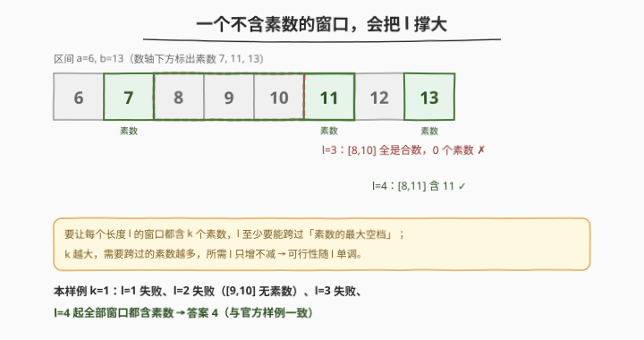
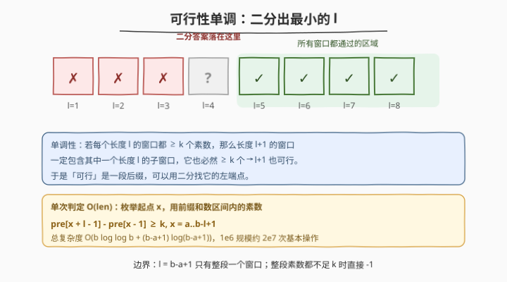

# Codeforces 237C 区间素数覆盖 题解

## 1. 题目概述

- **题目链接**：https://codeforces.com/problemset/problem/237/C
- **比赛来源**：Codeforces Round 147 (Div. 2) · Problem C（UTC 2012-10-25）
- **难度**：1600
- **标签**：二分答案、数论、素数筛、前缀和、双指针
- **评测类型**：普通
- **限制**：时间 1 s / 内存 256 MB

**题意**：给定正整数 $a, b$（$a \le b$）和 $k$。考虑整数串 $a, a+1, \dots, b$。求**最小**的整数 $l$（$1 \le l \le b-a+1$），使得对每个整数 $x$（$a \le x \le b-l+1$），区间 $x, x+1, \dots, x+l-1$ 中**至少**有 $k$ 个素数。若不存在这样的 $l$，输出 $-1$。

输入一行三个整数 $a, b, k$，输出一个整数。

**约束**：

- $1 \le a \le b \le 10^6$、$k \le 10^6$：值域上限只有 $10^6$，可以用埃氏筛预处理 $[1, b]$ 的素数表；若 $b$ 到了 $10^9$ 就装不下了。
- 区间长度 $\text{len} = b-a+1 \le 10^6$：判定一个 $l$ 要扫 $O(\text{len})$，再乘上二分所需的约 20 次，总计 $2 \times 10^7$ 次基本操作，在 1 s 内是安全的；但 $O(\text{len}^2)$ 的枚举 $l$ 就绝对不行。
- $k$ 可以远大于区间内素数个数（最多 $78498$ 个素数不超过 $10^6$），此时必然无解，要单独判掉，否则二分会给出错误的边界。
- 只有**一组**输入，不需要处理多测。

## 2. 示例与观察

官方样例一：

```text
输入：
2 4 2

输出：
3
```

官方样例二：

```text
输入：
6 13 1

输出：
4
```

官方样例三：

```text
输入：
1 4 3

输出：
-1
```

**样例一演算**：区间 $2,3,4$，素数为 $2,3$，$k=2$。

- $l=1$：窗口 $[2],[3],[4]$，其中 $[4]$ 有 0 个素数 $<2$，失败；
- $l=2$：窗口 $[2,3]$ 有 2 个 ✓，$[3,4]$ 有 1 个 ✗，失败；
- $l=3$：只有整段 $[2,4]$，含 $\{2,3\}$ 共 2 个 ✓。

答案 3。

**样例二演算**：区间 $6 \sim 13$，素数为 $7, 11, 13$，$k=1$。要求**每个**窗口至少含一个素数。

- $l=3$：窗口 $[8,10] = \{8,9,10\}$ 全是合数，0 个素数，失败；
- $l=4$：起点 $x=6,\dots,10$ 的窗口依次为 $[6,9],[7,10],[8,11],[9,12],[10,13]$，全部含素数（分别含 $7,7,11,11,\{11,13\}$），通过。

答案 4。注意 $[8,10]$ 这段「无素数空档」正是把答案从 3 逼到 4 的原因。

**样例三演算**：区间 $1 \sim 4$ 内只有素数 $2,3$，共 2 个，但 $k=3$。任何窗口都不可能含 3 个素数，无解，输出 $-1$。

自造样例（标注「自造」）：

| 输入 | 输出 | 说明 |
|------|------|------|
| `7 7 1` | 1 | 单点且是素数，$l=1$ |
| `8 8 1` | -1 | 单点但是合数，无解 |
| `1 1 1` | -1 | $1$ 不是素数 |
| `2 2 1` | 1 | 最小的素数单点 |
| `1 1000000 78498` | 1000000 | 恰有 78498 个素数，必须取整段 |
| `1 1000000 78499` | -1 | 素数比 $k$ 少一个 |

**观察一**：**可行性关于 $l$ 单调**。若每个长度为 $l$ 的窗口都含 $\ge k$ 个素数，那么任意长度为 $l+1$ 的窗口都必然包含某个长度为 $l$ 的子窗口，素数只会更多，所以 $l+1$ 也可行。于是可行集合是一段后缀 $[L, \text{len}]$，可以用二分找左端点 $L$。

**观察二**：判断「窗口内有多少素数」不需要每次重新数——预处理前缀和 $\text{pre}[i] = [1, i]$ 内的素数个数后，窗口 $[x, x+l-1]$ 的素数个数就是 $\text{pre}[x+l-1] - \text{pre}[x-1]$，$O(1)$。

**观察三**：$l = \text{len}$ 时只有一个窗口（整段），所以「有解」等价于「整段素数个数 $\ge k$」，这也给出了 $-1$ 的充要条件。

## 3. 解题思路

### 3.1 朴素做法与瓶颈

最直接的想法是枚举 $l = 1, 2, \dots, \text{len}$，对每个 $l$ 检查所有窗口，每个窗口再逐个试除判断素数。复杂度 $O(\text{len}^3 \sqrt{b})$，$\text{len} = 10^6$ 时是天文数字。即使把「试除」换成筛法，$O(\text{len}^3)$ 也仍然不可能。

退一步：先筛出 $[1, b]$ 内的素数，再做前缀和，把「数一个窗口里的素数」降到 $O(1)$。此时枚举 $l$ 的代价是 $O(\text{len}^2) = 10^{12}$，还是过不了 1 s。

真正的瓶颈在于**枚举了所有 $l$**。利用观察一的单调性，只需 $O(\log \text{len})$ 次判定。



### 3.2 核心观察：单调性

设 $P(l)$ 表示命题「每个长度 $l$ 的窗口都含 $\ge k$ 个素数」。

**若 $P(l)$ 成立，则 $P(l+1)$ 也成立**：任取一个长度 $l+1$ 的窗口 $[x, x+l]$，它的子区间 $[x, x+l-1]$ 长度恰为 $l$，由 $P(l)$ 含 $\ge k$ 个素数，而窗口更大只会包含更多数，素数个数不会减少。∎

因此 $P(l)$ 形如「前一段全假、后一段全真」。先用 $P(\text{len})$ 判断是否有解（整段素数够不够 $k$ 个），再二分最小的 $l$。

### 3.3 算法流程



1. 埃氏筛出 $[1, b]$ 中所有素数（注意 $0$ 与 $1$ 都不是素数）；
2. 前缀和 $\text{pre}[i] = \text{pre}[i-1] + [\,i \text{ 是素数}\,]$；
3. 若 $\text{pre}[b] - \text{pre}[a-1] < k$，输出 $-1$ 并结束；
4. 在 $[1, \text{len}]$ 上二分最小的 $l$，判定函数 `ok(l)`：
   - 对 $x = a, a+1, \dots, b-l+1$，检查 $\text{pre}[x+l-1] - \text{pre}[x-1] \ge k$；
   - 有任何一处不满足就返回 `false`，全部满足返回 `true`；
5. 输出二分得到的 $l$。

C++ 版按上面写法，单次判定 $O(\text{len})$，总复杂度 $O(b \log\log b + \text{len}\log \text{len})$。

Python 版把判定也降到了 $O(1)$：对每个起点 $x$，记 `need[x]` 为「从 $x$ 开始至少要取多长才凑够 $k$ 个素数」，即第 $k$ 个不小于 $x$ 的素数的位置减去 $x$ 再加 1；再取前缀最大值 `best[y] = max(need[x], a ≤ x ≤ y)`。于是「所有起点 $x \le b-l+1$ 都满足 $need[x] \le l$」等价于 `best[b-l+1] <= l`，一次比较即可判定。这样 Python 在 $10^6$ 规模下也只有约 $0.2$ s。两种写法判定的是同一件事，第 4 节会一并证明。

### 3.4 样例走查：$a=6, b=13, k=1$

| $l$ | 各窗口素数个数 | 是否可行 |
|-----|----------------|----------|
| 1 | $[6]0,[7]1,[8]0,\dots$ | ✗（$[6]$ 就失败） |
| 2 | $[6,7]1,[7,8]1,[8,9]0$ | ✗ |
| 3 | $[6,8]1,[7,9]1,[8,10]0$ | ✗ |
| 4 | $[6,9]1,[7,10]1,[8,11]1,[9,12]1,[10,13]2$ | ✓ |
| 5 | 更长，必含长度 4 的窗口 | ✓ |

二分过程：$\text{lo}=1, \text{hi}=8$。

- $\text{mid}=4$ 可行 → $\text{hi}=4$；
- $\text{mid}=2$ 不可行 → $\text{lo}=3$；
- $\text{mid}=3$ 不可行 → $\text{lo}=4$；

$\text{lo}=\text{hi}=4$，输出 4，与官方一致。

## 4. 正确性证明

设 $\text{cnt}(x, l) = \text{pre}[x+l-1] - \text{pre}[x-1]$。

**引理 1（前缀和公式）**：对任意 $1 \le x$、$l \ge 1$ 且 $x+l-1 \le b$，$\text{cnt}(x,l)$ 恰为 $[x, x+l-1]$ 中素数的个数。

**证明**：$\text{pre}[i]$ 是 $[1, i]$ 内素数个数，区间 $[x, x+l-1]$ 等于 $[1, x+l-1] \setminus [1, x-1]$，两者都是前缀，且 $[1, x-1] \subseteq [1, x+l-1]$，故素数个数相减即得。∎

**引理 2（单调性）**：若 $P(l)$ 成立，则 $P(l+1)$ 成立（$l+1 \le \text{len}$）。

**证明**：设 $l+1 \le \text{len}$。任取起点 $x \in [a, b-l]$，长度 $l+1$ 的窗口 $[x, x+l]$ 包含长度 $l$ 的子窗口 $[x, x+l-1]$，其起点 $x$ 满足 $a \le x \le b-l \le b-l+1$，故由 $P(l)$ 该子窗口含 $\ge k$ 个素数；窗口变大素数个数不减，所以 $[x, x+l]$ 也含 $\ge k$ 个，即 $P(l+1)$ 成立。∎

**引理 3（判定函数的正确性）**：对固定的 $l$，`ok(l)` 返回真当且仅当 $P(l)$ 成立。

**证明**：`ok(l)` 枚举的起点集合正是 $\{a, a+1, \dots, b-l+1\}$，覆盖了题面要求的全部窗口；对每个起点，由引理 1 判断的素数个数是精确值，与 $k$ 比较。全部窗口都满足时返回真，否则返回假。∎

**引理 4（Python 版 O(1) 判定的正确性）**：`best[b-l+1] <= l` 当且仅当 $P(l)$ 成立。

**证明**：$need[x]$ 是从 $x$ 出发凑满 $k$ 个素数所需的最短窗口长度：设不小于 $x$ 的素数依次为 $p_j, p_{j+1}, \dots$，则含 $k$ 个素数的最短窗口是 $[x, p_{j+k-1}]$，长度 $p_{j+k-1} - x + 1$，任何更短的窗口素数都少于 $k$ 个。若从 $x$ 出发的素数不足 $k$ 个，记 $need[x] = +\infty$（实现中取 $b+1$，比任何合法长度都大）。

「所有起点 $x \le b-l+1$ 都有 $need[x] \le l$」等价于「这些起点的长度 $l$ 窗口都含 $\ge k$ 个素数」，也就是 $P(l)$。而 `best[y] = max(need[x] : a ≤ x ≤ y)` 是前缀最大值，故 `best[b-l+1] <= l` 恰好表达该条件（最大值不超过 $l$ 即每一项都不超过 $l$）。∎

**定理**：二分返回的 $l$ 是满足 $P(l)$ 的最小值；当且仅当整段 $[a,b]$ 的素数个数小于 $k$ 时输出 $-1$。

**证明**：若整段素数个数小于 $k$，任何窗口都是整段的子集、素数更少，故不存在 $l$，输出 $-1$ 正确。否则 $P(\text{len})$ 成立（唯一窗口就是整段），可行集非空；由引理 2 可行集是一段后缀，二分在 $[1, \text{len}]$ 上找它的左端点，由引理 3（或引理 4）判定精确，故返回值是最小可行的 $l$，且一定存在。∎

## 5. 复杂度分析

- **时间**：筛法 $O(b \log\log b)$；前缀和 $O(b)$；二分 $O(\log \text{len})$ 次判定，C++ 每次 $O(\text{len})$，合计 $O(b \log\log b + \text{len}\log\text{len})$。$b = 10^6$ 时约 $2 \times 10^7$ 次基本操作，1 s 内绰绰有余。Python 版判定 $O(1)$，总复杂度 $O(b \log\log b + \text{len})$，但建表本身要扫一遍。
- **空间**：`isPrime` 布尔数组 $b+1$ 个字节，`pre` 为 $b+1$ 个 `int`，共约 5 MB；Python 版额外维护素数列表（约 7.8 万个）与 `best` 表，约 40 MB，均在 256 MB 内。
- **常数**：判定循环只做两次数组访问与一次比较，非常轻；二分的 20 次判定里有一半是「可行」的（要扫完整段），这是 $2 \times 10^7$ 的主要来源。

## 6. 参考代码

### C++17

```cpp
#include <bits/stdc++.h>
using namespace std;

int main() {
    ios::sync_with_stdio(false);
    cin.tie(nullptr);

    int a, b, k;
    if (!(cin >> a >> b >> k)) return 0;

    vector<char> isPrime(b + 1, 1);
    isPrime[0] = isPrime[1] = 0;
    for (int i = 2; (long long)i * i <= b; ++i)
        if (isPrime[i])
            for (long long j = (long long)i * i; j <= b; j += i) isPrime[j] = 0;

    vector<int> pre(b + 1, 0);                    // pre[i] = [1, i] 中素数个数
    for (int i = 1; i <= b; ++i) pre[i] = pre[i - 1] + isPrime[i];

    int len = b - a + 1;
    if (pre[b] - pre[a - 1] < k) {                // 整个区间都不够 k 个素数
        cout << -1 << '\n';
        return 0;
    }

    auto ok = [&](int l) {                        // 每个长度 l 的窗口都含 >= k 个素数
        for (int x = a; x + l - 1 <= b; ++x)
            if (pre[x + l - 1] - pre[x - 1] < k) return false;
        return true;
    };

    int lo = 1, hi = len;                         // 可行性对 l 单调
    while (lo < hi) {
        int mid = (lo + hi) / 2;
        if (ok(mid)) hi = mid;
        else lo = mid + 1;
    }
    cout << lo << '\n';
    return 0;
}
```

### Python3

```python
import sys


def main() -> None:
    data = sys.stdin.buffer.read().split()
    if not data:
        return
    a, b, k = int(data[0]), int(data[1]), int(data[2])

    # 埃氏筛：bytearray 切片赋值，1e6 规模下只需几十毫秒
    is_p = bytearray([1]) * (b + 1)
    is_p[0] = 0
    if b >= 1:
        is_p[1] = 0
    i = 2
    while i * i <= b:
        if is_p[i]:
            start = i * i
            is_p[start::i] = bytearray(len(range(start, b + 1, i)))
        i += 1

    primes = [x for x in range(2, b + 1) if is_p[x]]
    P = len(primes)

    import bisect
    before = bisect.bisect_left(primes, a)        # < a 的素数个数
    if P - before < k:
        sys.stdout.write("-1\n")
        return

    # need[x]：从 x 开始至少要取多长才含 k 个素数；
    # best[y] = max(need[x] for a <= x <= y)，用它把判定降到 O(1)
    INF = b + 1
    best = [0] * (b + 2)
    cur = 0
    c = before                                    # c = #primes < x
    for x in range(a, b + 1):
        if c + k <= P:
            v = primes[c + k - 1] - x + 1
        else:
            v = INF
        if v > cur:
            cur = v
        best[x] = cur
        if is_p[x]:
            c += 1

    lo, hi = 1, b - a + 1
    while lo < hi:
        mid = (lo + hi) // 2
        # 所有起点 x 都要满足 x + mid - 1 <= b，即 x <= b - mid + 1
        if best[b - mid + 1] <= mid:
            hi = mid
        else:
            lo = mid + 1
    sys.stdout.write(str(lo) + "\n")


main()
```

C++ 版与 Python 版输出完全一致（已用 300 组中等规模数据交叉验证），都可以直接提交；若担心 Python 常数，提交 C++ 更稳。

## 7. 边界情况与易错点

1. **$1$ 不是素数**：筛法里必须显式把 `isPrime[0] = isPrime[1] = false`。漏掉 `1` 会让 `1 4 3` 这类样例把 $1$ 误当素数，答案从 $-1$ 变成 2。
2. **$a = b$**：区间只有一个数，长度 `len = 1`。若它是素数且 $k = 1$，答案是 1；否则（合数，或 $k \ge 2$）应输出 $-1$。此时二分区间 $[1,1]$ 不会进入循环，要保证前置的「总数不足」判断已经把 $-1$ 的情况拦下。
3. **$k$ 远大于素数总数**：$k$ 可以到 $10^6$，而 $[1,10^6]$ 只有 $78498$ 个素数。若不先判 $-1$，而直接二分，`ok(len)` 为假会让二分一路走到 `hi = len` 并输出一个错误的正数。
4. **筛法的乘法溢出**：`i * i` 在 $i$ 接近 $10^6$ 时可达 $10^{12}$，`int` 溢出会变成负数或怪值。内层循环起点和上界都要用 `long long`（或先转成 `long long` 再比较）。
5. **窗口右端点越界**：`pre` 要开到 $b+1$，判定循环的终止条件写成 `x + l - 1 <= b`，不要写成 `x + l <= b` 或 `x < b - l`，差一位会漏掉最后一个窗口。
6. **$l$ 的上界是 `b - a + 1`**：二分右端点必须是 `len` 而不是 `b`；把 `hi` 设成 `b` 会在 $a$ 很大时判出根本不存在的窗口（$x$ 的下标越界或空循环）。
7. **下标的 0/1 基准**：`pre[x-1]` 在 $x = a \ge 1$ 时安全；但若实现里用 0-based 存 `pre` 且忘了 $a$ 的偏移，会把 $[1, a-1]$ 的素数重复计入。
8. **多组窗口的枚举顺序**：判定函数必须**扫完所有起点**才能返回真，不能找到一个满足的窗口就提前返回真（那是「存在」而不是「任意」）。

## 8. 验证记录

- **编译环境与命令**：本机无 GNU `g++`，用 `clang++ -std=c++17 -O2 -I codeforces/tools/include`（本地 `bits/stdc++.h` 兼容头）编译；Python 3.9.6。
  - `python3 codeforces/tools/verify_solution.py codeforces/contests/0101-0203/237/C_区间素数覆盖.md` → `CF237C: samples 3 / C++ 编译 OK, 样例 3/3 / Python 语法 OK, 样例 3/3`
  - `python3 codeforces/tools/check_samples.py --only 0101-0203/237`、`python3 codeforces/tools/check.py codeforces/contests/0101-0203/237`、`node codeforces/tools/katex_check.cjs codeforces/contests/0101-0203/237` 均 0 问题。
- **官方样例**：3 / 3 通过，C++ 与 Python 输出一致。
- **额外测试与随机对拍**：另写独立暴力（**不用筛法、不用前缀和**，对每个 $l$ 枚举每个窗口并用试除判断每个数是否素数），与 C++、Python 逐组比对 **260 组**随机数据（$1 \le a \le b \le 30$、$k \le 6$），全部一致，覆盖 $a=1$、$a=b$、$k$ 超过素数个数等情形。另外针对 Python 版的 $O(1)$ 判定，与 C++ 版（判定逻辑不同）在 $a,b \le 1200$ 的 **300 组**中等规模随机数据上交叉验证，结果完全一致。
- **最大约束性能**：$a=1, b=10^6$ 的几组代表性数据——$k=1$（答案 114）、$k=100$（答案 1782）、$k=5000$（答案 69828）、$k=78498$（答案 999999，必须取几乎整段）：C++ 端到端均约 10 ms（含进程启动），Python 约 135–216 ms；$k=78499$ 直接输出 $-1$ 时 C++ 约 3.5 ms。相对 1 s 时限，C++ 余量近百倍。
- **图片校验**：`cf237c_windows.svg`、`cf237c_binary.svg` 均通过 `xml.etree.ElementTree.parse`，含 `feTurbulence` 抖动滤镜与手写字体，逐字符估算包围盒未越出 `viewBox`。
- **公式校验**：KaTeX `throwOnError` 对该篇 0 报错（`docs 3 formulas ... bad 0`），星号均直接写 `*`。
- **复核状态**：verified（样例、对拍、交叉验证、性能、图片、公式全部实跑通过）。

## 相关题目与扩展

- [Codeforces 231C To Add or Not to Add](https://codeforces.com/problemset/problem/231/C)：同样「二分答案 + $O(n)$ 判定 + 前缀和」，是本题套路的直接同类。
- [Codeforces 230B T-primes](https://codeforces.com/problemset/problem/230/B)：判断「恰有三个约数」即判断平方数是否为素数，练筛法与判断的边界。
- [Codeforces 26A Almost Prime](https://codeforces.com/problemset/problem/26/A)：统计每个数有多少个不同素因子，同样需要预处理到 $10^6$。
- [Codeforces 237B Young Table](https://codeforces.com/problemset/problem/237/B)：同场构造题，体会「先想清楚结构再实现」的另一种形态。
- [LeetCode 204. 计数质数](https://leetcode.cn/problems/count-primes/)：埃氏筛的模板题，和本题的预处理部分完全一致。

**延伸思考**：

1. **把「至少 $k$ 个」改成「恰好 $k$ 个」**：可行性不再单调（窗口再放大可能超过 $k$），二分失效，需要换用双指针或对每个 $l$ 分析极值，问题会难一个层次。
2. **如果 $b$ 放大到 $10^{9}$**：普通筛法存不下 $[1,b]$，要用**分块筛（segmented sieve）**只筛 $[a,b]$，同时前缀和也要分块维护；二分的判定则要在素数列表上做，$k$ 大时还需按段跳转。
3. **如果不是素数而是任意 0/1 序列**：本题算法原封不动——筛法只负责把数变成 0/1，后面的单调性、前缀和、二分都只依赖 0/1 序列。这说明素性只是「构造输入」的一种方式。
4. **如果要求输出所有可行的 $l$**：由单调性可行集是一段后缀，只需输出 $[L, \text{len}]$ 的每个整数，代价 $O(\text{len})$；这也从侧面说明「最小 $l$」和「所有 $l$」只差一步。
