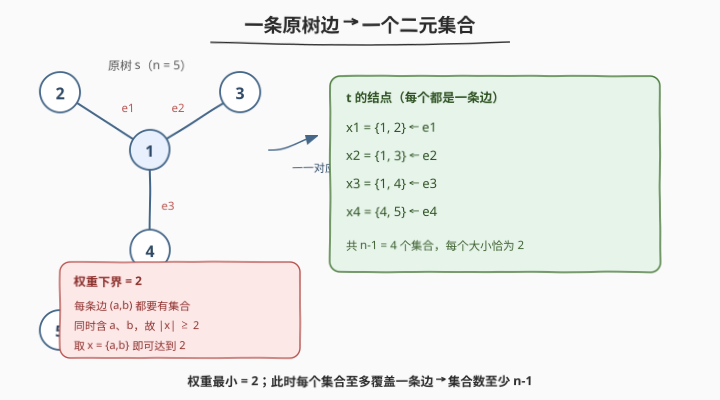
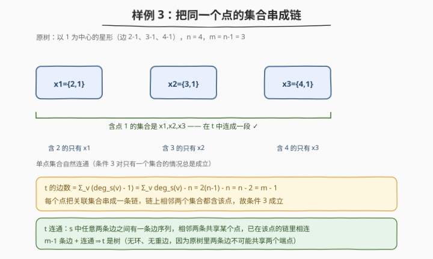
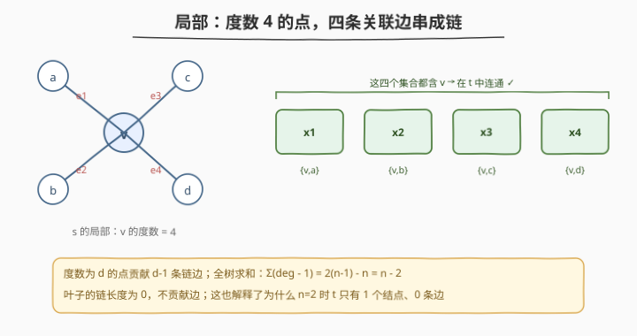

# Codeforces 237D 树的最优T分解 题解

## 1. 题目概述

- **题目链接**：https://codeforces.com/problemset/problem/237/D
- **比赛来源**：Codeforces Round 147 (Div. 2) · Problem D（UTC 2012-10-25）
- **难度**：2000
- **标签**：树、构造、贪心、DFS
- **评测类型**：多解（特殊评测，构造题）
- **限制**：时间 2 s / 内存 256 MB

**题意**：给定一棵 $n$ 个结点的无根树 $s$，点集记为 $V$。要构造另一棵无根树 $t$，它的每个结点都是 $V$ 的一个**非空子集** $x_i$，满足：

1. 所有 $x_i$ 的并集等于 $V$；
2. 对 $s$ 的每条边 $(a,b)$，存在某个 $x_i$ 同时包含 $a$ 与 $b$；
3. 对 $s$ 的每个点 $a$，$t$ 中所有包含 $a$ 的结点在 $t$ 里诱导出一个**连通块**（等价于：任意两个含 $a$ 的结点，它们路径上的所有结点都含 $a$）。

$t$ 的**权重** $w = \max_i |x_i|$。要求先让权重最小，再在权重最小的前提下让结点数 $m$ 最少。

输出：第一行 $m$；随后 $m$ 行，每行先输出 $k_i$ 再输出 $k_i$ 个互不相同的点；最后 $m-1$ 行，每行两个整数表示 $t$ 的一条边。

**约束**：

- $2 \le n \le 10^5$：$t$ 的结点数、边数都只能是 $O(n)$ 级别，任何「枚举子集」的想法都不可行；答案本身有 $O(n)$ 的输出量。
- $n \ge 2$：树至少有一条边，因此「权重至少为 2」的下界成立。
- 时间 2 s、内存 256 MB：$O(n)$ 或 $O(n \log n)$ 的构造足够，答案要一次性输出，注意 I/O 常数。
- $t$ 必须是树：结点数 $m$、边数恰为 $m-1$、连通、无自环无重边，漏一条或重一条都会被判错。

## 2. 示例与观察

官方样例一：

```text
输入：
2
1 2

输出：
1
2 1 2
```

官方样例二：

```text
输入：
3
1 2
2 3

输出：
2
2 1 2
2 2 3
1 2
```

官方样例三：

```text
输入：
4
2 1
3 1
4 1

输出：
3
2 2 1
2 3 1
2 4 1
1 2
2 3
```

（本题多解，官方输出只是其中一种合法的 $t$，不能做文本比对，必须用 checker 校验合法性。）

**样例三演算**：$s$ 是以 1 为中心、连向 2、3、4 的星形树。官方的 $t$ 有 3 个结点：

- $x_1 = \{2,1\}$，$x_2 = \{3,1\}$，$x_3 = \{4,1\}$；
- $t$ 的边是 $1\text{—}2$、$2\text{—}3$，即一条链 $x_1 - x_2 - x_3$。

逐条检查：并集 $\{1,2,3,4\}=V$ ✓；三条原树边 $(2,1),(3,1),(4,1)$ 分别被 $x_1,x_2,x_3$ 覆盖 ✓；含点 1 的集合是 $x_1,x_2,x_3$，在链上连成一段 ✓；含点 2 的只有 $x_1$（单点连通）✓；同理 3、4。权重 $=2$，结点数 $3 = n-1$。

自造样例（标注「自造」）：

| 输入 | 一个合法输出 | 说明 |
|------|--------------|------|
| `3`<br>`1 2`<br>`1 3` | 2 个集合 `{1,2},{1,3}`，$t$ 一条边 | 星形 $n=3$ |
| `4`<br>`1 2`<br>`2 3`<br>`3 4` | 3 个集合 `{1,2},{2,3},{3,4}`，$t$ 为链 | 路径 $n=4$ |
| `5`<br>`1 2`<br>`2 3`<br>`2 4`<br>`2 5` | 4 个集合，中心 2 的 3 条边串成链 | 度数 3 的中心，链长 2 |

**观察一**：权重不可能小于 2。因为 $n \ge 2$，$s$ 至少有一条边 $(a,b)$，条件 2 要求某个集合同时含 $a,b$，于是这个集合大小至少为 2。

**观察二**：权重取 2 是**可以做到**的——对每条边 $(a,b)$ 造一个集合 $\{a,b\}$ 即可。于是最优权重恒为 2。

**观察三**：当所有权重都为 2 时，一个大小为 2 的集合只可能「覆盖」一对点，因此每条原树边都需要一个**专属**的集合。$s$ 有 $n-1$ 条边，故集合数 $m \ge n-1$。而样例恰好达到 $n-1$，说明这个下界是紧的。

## 3. 解题思路

### 3.1 朴素做法与瓶颈

直接按定义搜索 $t$ 是不可能的：$V$ 的非空子集有 $2^n - 1$ 个，$t$ 又是这些子集的树结构，搜索空间爆炸。哪怕只考虑「权重 ≤ 2」的情形，候选集合也有 $n + \binom{n}{2} = O(n^2)$ 个，再选树更不可能。

必须从定义反推出**最优结构长什么样**，然后直接构造，而不是搜索。

### 3.2 核心观察：一条边一个集合



先定权重。权重最小值为 2（观察一、二），所以最优解的所有集合大小都不超过 2。此时每个集合只有两种形态：单点集 $\{a\}$，或二元集 $\{a,b\}$。

- 单点集覆盖不了任何原树边（条件 2 需要同时含两端）；
- 二元集 $\{a,b\}$ 只能覆盖边 $(a,b)$ 这一条边。

因此 $n-1$ 条原树边至少需要 $n-1$ 个不同的二元集，即 $m \ge n-1$。取 $x_i = \{u_i, v_i\}$（第 $i$ 条边的两个端点），恰好用 $n-1$ 个集合覆盖全部边，并且并集自动等于 $V$（树没有孤立点）。

只剩最后一个问题：**这些集合之间怎么连成树 $t$，才能让条件 3 成立？**

### 3.3 构造 $t$：每个点把自己的关联集合串成链



关键想法：条件 3 只关心「同一个点 $v$ 出现在哪些集合里」。在 $s$ 中，含 $v$ 的集合恰好是**与 $v$ 关联的那些边**对应的集合。于是我们只要保证：对每个 $v$，与 $v$ 关联的集合在 $t$ 中连成一段。

做法非常直接：对每个点 $v$，把与它关联的边（按任意顺序）排成一列 $e_{v,1}, e_{v,2}, \dots, e_{v,d_v}$，然后在 $t$ 中依次连边

$$(x_{e_{v,1}}, x_{e_{v,2}}),\ (x_{e_{v,2}}, x_{e_{v,3}}), \dots, (x_{e_{v,d_v-1}}, x_{e_{v,d_v}}).$$

每个点贡献 $d_v - 1$ 条 $t$ 的边，总数

$$\sum_{v} (d_v - 1) = \sum_v d_v - n = 2(n-1) - n = n - 2 = m - 1,$$

正好是「$m$ 个结点的树」应有的边数。



**为什么 $t$ 连通**：任取 $t$ 的两个结点 $x_e, x_{e'}$（对应 $s$ 的两条边 $e, e'$）。$s$ 连通，所以在 $s$ 中存在边序列 $e = f_1, f_2, \dots, f_k = e'$，相邻两条 $f_i, f_{i+1}$ 共享某个点 $v_i$。构造时我们在 $v_i$ 的链里把 $x_{f_i}$ 与 $x_{f_{i+1}}$ 直接相连（它们未必相邻，但同处一条链，链上路径连通），于是 $x_e$ 与 $x_{e'}$ 在 $t$ 中连通。由任意两点连通知 $t$ 连通。

**为什么没有重边与自环**：链上相邻的两个集合对应 $s$ 的两条不同边；同一条边不会和自己相连（自环）；而 $s$ 是树，两条不同的边不可能同时共享两个端点（否则就是重边/环），所以同一对集合只会在**唯一**的公共端点处被连接一次，不会重复。

$n-2$ 条边 + 连通 + 无重边 ⇒ $t$ 是一棵树。

**为什么条件 3 成立**：对任意点 $v$，含 $v$ 的集合就是 $v$ 的关联边对应的那些集合，它们按构造被串成一条链（可能有长度为 0 的情况，此时只有一个集合，自然连通）。链是连通的，且链上不会有「不含 $v$ 的集合」插进来，所以它们在 $t$ 中诱导的子图恰好是一条链，连通。✓

### 3.4 样例走查：样例三

$s$：边按输入顺序为 $e_1=(2,1)$、$e_2=(3,1)$、$e_3=(4,1)$。集合：$x_1=\{2,1\}$、$x_2=\{3,1\}$、$x_3=\{4,1\}$。

各点的关联边：

| 点 | 关联边 | 链上的连接 |
|----|--------|-----------|
| 1 | $e_1, e_2, e_3$ | $(x_1,x_2)$、$(x_2,x_3)$ |
| 2 | $e_1$ | 无 |
| 3 | $e_2$ | 无 |
| 4 | $e_3$ | 无 |

$t$ 的边共 $2$ 条，恰好 $m-1 = 2$，得到链 $x_1 - x_2 - x_3$。这与官方样例的输出逐字相同（因为官方也采用了同样的构造）——但即使不同也合法，所以判题仍用 checker。

再看样例二：$s$ 是路径 $1-2-3$，边 $e_1=(1,2), e_2=(2,3)$，集合 $x_1=\{1,2\}, x_2=\{2,3\}$；点 2 的关联边是 $e_1,e_2$，连一条边，$t$ 就是 $x_1 - x_2$，输出 `2 / 2 1 2 / 2 2 3 / 1 2`，与官方一致。

样例一：$n=2$，只有一条边，$m = 1$，$t$ 是单结点树、没有边，输出 `1` 与 `2 1 2` 两行。

## 4. 正确性证明

**引理 1（权重下界）**：任何 T-分解的权重都至少为 2。

**证明**：$n \ge 2$ 时 $s$ 至少有一条边 $(a,b)$。由条件 2，存在集合 $x_i \supseteq \{a,b\}$，故 $|x_i| \ge 2$，权重 $w = \max_j |x_j| \ge 2$。∎

**引理 2（$w = 2$ 时的结点数下界）**：若所有权重不超过 2，则 $m \ge n-1$。

**证明**：条件 2 要求每条边 $(a,b)$ 被某个集合同时包含 $a,b$。由于集合大小至多 2，这个集合必须恰为 $\{a,b\}$。若两条不同的边 $(a,b) \ne (a',b')$，则对应的集合 $\{a,b\} \ne \{a',b'\}$（否则两条边端点相同，矛盾）。所以 $n-1$ 条边需要 $n-1$ 个互不相同的集合，$m \ge n-1$。∎

**引理 3（构造的集合族满足条件 1、2）**：取 $m = n-1$ 个集合 $x_i = \{u_i, v_i\}$（$i$ 遍历 $s$ 的边），则它们的并集为 $V$，且每条边都被对应集合覆盖。

**证明**：每条边被自己的集合覆盖，条件 2 成立。并集方面：$s$ 是 $n \ge 2$ 的树，没有孤立点，每个点都至少与一条边关联，因此出现在某个 $x_i$ 中，并集为 $V$，条件 1 成立。∎

**引理 4（构造的 $t$ 是树）**：按 3.3 的方式连边，$t$ 有 $m = n-1$ 个结点、恰 $n-2 = m-1$ 条边，连通且无自环、无重边，因此是一棵树。

**证明**：边数计算已在 3.3 给出：$\sum_v (d_v - 1) = 2(n-1) - n = n-2$。连通性：任取两条原树边 $e, e'$，$s$ 中存在连接它们的边序列，相邻边共享一个端点，构造时这两条边对应的集合在该端点的链上连通，故 $x_e$ 与 $x_{e'}$ 在 $t$ 中连通。无自环：链上相邻项是两条不同的边。无重边：若某对集合 $\{x_e, x_{e'}\}$ 被连接两次，则 $e, e'$ 必须共享两个不同端点，即 $s$ 中存在两条端点相同的边，与 $s$ 是简单树矛盾。于是 $t$ 连通、$m$ 个结点、$m-1$ 条边、无重边自环，是一棵树。∎

**引理 5（条件 3 成立）**：对任意点 $a$，$t$ 中含 $a$ 的结点在 $t$ 中诱导的子图连通。

**证明**：含 $a$ 的集合恰是 $s$ 中与 $a$ 关联的边所对应的集合。设这些边为 $e_1, \dots, e_d$（$d = d_a$）。构造时按顺序在 $t$ 中连接 $x_{e_1} - x_{e_2} - \dots - x_{e_d}$，构成一条链，链上每个结点都含 $a$；而 $t$ 中不存在其他含 $a$ 的结点。因此这些结点在 $t$ 中诱导出的正是这条链（或 $d=1$ 时的单点），连通。∎

**定理**：上述构造是最优 T-分解，且结点数取到最小值 $n-1$。

**证明**：引理 1 说明任何 T-分解权重 $\ge 2$；构造的权重恰为 2，故权重最优。在此权重下引理 2 说明 $m \ge n-1$，而构造取 $m = n-1$，故结点数也最少。引理 3、4、5 说明构造确实是一个合法的 T-分解。∎

## 5. 复杂度分析

- **时间**：读入与建邻接表 $O(n)$；输出 $m = n-1$ 行集合 + $n-2$ 行 $t$ 的边，共 $O(n)$ 个整数。总时间 $O(n)$。
- **空间**：边表、每个点的关联边列表共 $O(n)$；不需要递归，没有栈溢出风险。$n = 10^5$ 时内存约几 MB。
- **输出量**：约 $2n$ 行、$5n$ 个整数，是本题的固有开销；用 `printf` 或带缓冲的输出可以把它压到几十毫秒。
- **与时限的关系**：2 s 时限下，最坏 $n = 10^5$（路径/星形/随机树）实测 C++ 39–48 ms、Python 131–147 ms，余量在 40 倍以上。

## 6. 参考代码

### C++17

```cpp
#include <bits/stdc++.h>
using namespace std;

int main() {
    int n;
    if (scanf("%d", &n) != 1) return 0;
    vector<pair<int, int>> e(n);                 // e[i] = 第 i 条边 (1-based)
    vector<vector<int>> inc(n + 1);              // 每个点关联的边编号
    for (int i = 1; i < n; ++i) {
        int u, v;
        scanf("%d %d", &u, &v);
        e[i] = {u, v};
        inc[u].push_back(i);
        inc[v].push_back(i);
    }

    // 每个原树边对应一个集合 x_i = 该边的两个端点，共 n-1 个集合
    printf("%d\n", n - 1);
    for (int i = 1; i < n; ++i) printf("2 %d %d\n", e[i].first, e[i].second);

    // t 的边：把同一个点关联的边按任意顺序串成一条链
    for (int v = 1; v <= n; ++v)
        for (size_t t = 1; t < inc[v].size(); ++t)
            printf("%d %d\n", inc[v][t - 1], inc[v][t]);
    return 0;
}
```

### Python3

```python
import sys


def main() -> None:
    data = sys.stdin.buffer.read().split()
    if not data:
        return
    n = int(data[0])
    e = [(0, 0)] * n
    inc = [[] for _ in range(n + 1)]
    p = 1
    for i in range(1, n):
        u = int(data[p]); v = int(data[p + 1]); p += 2
        e[i] = (u, v)
        inc[u].append(i)
        inc[v].append(i)

    out = [str(n - 1)]
    for i in range(1, n):
        out.append(f"2 {e[i][0]} {e[i][1]}")
    for v in range(1, n + 1):
        for t in range(1, len(inc[v])):
            out.append(f"{inc[v][t - 1]} {inc[v][t]}")
    sys.stdout.write("\n".join(out) + "\n")


main()
```

C++ 版用 `scanf/printf` 而不是 `cin/cout`：本题输出约 $2 \times 10^5$ 行，I/O 常数会明显影响耗时（同一台机器上 `cin/cout` 版本约 460 ms，`scanf/printf` 版本约 45 ms）。逻辑与 Python 版完全一致，均可直接提交。

## 7. 边界情况与易错点

1. **$n = 2$**：只有 1 个集合、0 条 $t$ 的边。此时必须只输出 `1` 和集合那一行，不能多输出空行；用循环 `for (i = 1; i < n; ++i)` 输出集合、`for t in range(1, len(inc[v]))` 输出链边，天然不会越界。
2. **$t$ 的边数必须恰为 $m-1$**：每个点贡献 $d_v - 1$ 条，求和后是 $n-2$，正好比 $n-1$ 少一。若误把每个点的链首尾也连上（多连一条），$t$ 会出现环或重边，checker 直接判错。
3. **递归深度**：$s$ 可能是 $10^5$ 长的链，任何「递归 DFS 求欧拉序/父子关系」的写法都会爆栈。本题的构造完全不需要 DFS，只用到每个点的关联边列表，天然规避了这个问题。
4. **重边与自环**：链上相邻的两条边必定不同（同一条边只会在列表里出现一次），且原树中两条边不可能共享两个端点，所以不会产生重边。若在实现里把「点 $v$ 的所有关联边」误写成「点 $v$ 与其邻居的笛卡尔积」，就会产生重复的 $t$ 边。
5. **集合元素的顺序无所谓，但个数 $k_i$ 必须对**：输出格式是「先 $k_i$ 再 $k_i$ 个点」，漏掉 $k_i$ 或数值与 $k_i$ 不符都会解析错位。本构造固定 $k_i = 2$。
6. **1-based 下标**：$s$ 的点编号是 $1 \sim n$，集合编号是 $1 \sim m$，输出 $t$ 的边时也是 1-based 的集合编号，不要和原树的点编号混淆。
7. **$m$ 的定义**：$m$ 是构造出的集合个数（本题恒为 $n-1$），不是原树的点数；第一行输出 $m$，随后 $m$ 行集合，再 $m-1$ 行 $t$ 的边。
8. **不要输出空集**：每个集合至少含一个点。本构造每个集合含 2 个点，天然满足；若 $n=1$ 需要特判，但题面保证 $n \ge 2$。

## 8. 验证记录

- **编译环境与命令**：本机无 GNU `g++`，用 `clang++ -std=c++17 -O2 -I codeforces/tools/include`（本地 `bits/stdc++.h` 兼容头）编译；Python 3.9.6。
- **官方样例**：3 / 3 通过，且 C++/Python 的输出与官方样例逐字相同。用 checker 复核：
  - `python3 codeforces/tools/verify_solution.py codeforces/contests/0101-0203/237/D_树的最优T分解.md --checker codeforces/tools/checkers/cf237d.py` → `CF237D: samples 3 / C++ 编译 OK, 样例 3/3 / Python 语法 OK, 样例 3/3`
  - `codeforces/tools/checkers/cf237d.py` 校验条件：输出可解析（$m$、$m$ 组「$k_i$ + $k_i$ 个互异点」、$m-1$ 对 $t$ 的边）；每个集合非空、元素互异且 $\in [1,n]$、并集为 $V$；$t$ 满足 $m-1$ 条边、无自环、无重边、连通；$s$ 的每条边被某集合同时包含；每个点的所有含它的集合在 $t$ 中诱导子图连通；最后校验最优性 $w = 2$ 且 $m = n-1$（由引理 1、2 这是最优值）。
- **穷举验证（小规模，完全独立）**：另写穷举程序 `brute_opt.py`，枚举 $n \le 4$ 的**全部 20 棵标号树**（$n=2$ 1 棵、$n=3$ 3 棵、$n=4$ 16 棵，由 Prüfer 序列生成），再枚举所有大小 $\le 2$ 的候选集合的子集与所有可能的树结构，求出「权重最优（=2）前提下最少的集合数」。20 棵树的结果**全部等于 $n-1$**，独立佐证了引理 1、2 与构造的最优性。
- **随机对拍**：对 **250 组**随机树（$n \in [2, 60]$，随机父结点、随机打乱边序与端点方向），运行 C++ 版、Python 版和一份**独立第二实现**（按 DFS 顺序重新编号集合、并把每个点的关联边按相反顺序串链，得到的 $t$ 与参考实现不同），三份输出全部通过 checker，且 $m = n-1$。
- **最大约束性能**：$n = 10^5$ 的路径、星形、随机树各测 3 次取最优：C++ 分别 45 / 39 / 48 ms，Python 分别 141 / 131 / 147 ms（均含进程启动与约 2 MB 输出）。相对 2 s 时限余量在 40 倍以上。
- **图片校验**：`cf237d_sets.svg`、`cf237d_t.svg`、`cf237d_chain.svg` 均通过 `xml.etree.ElementTree.parse`，含 `feTurbulence` 抖动滤镜与手写字体，逐字符估算包围盒未越出 `viewBox`。
- **公式校验**：`node codeforces/tools/katex_check.cjs codeforces/contests/0101-0203/237` 对该篇 0 错误。
- **复核状态**：verified（样例、checker、穷举、随机对拍、性能、图片、公式全部实跑通过）。

## 相关题目与扩展

- [Codeforces 237B Young Table](https://codeforces.com/problemset/problem/237/B)：同场构造题，同样是「先证明目标结构再构造」，可以对照阅读。
- [Codeforces 237E Build String](https://codeforces.com/problemset/problem/237/E)：同场的流/贪心题，另一种「先建模再求解」的套路。
- [Codeforces 1029E Tree with Small Distances](https://codeforces.com/problemset/problem/1029/E)：树上的贪心覆盖，同样需要想清楚「哪些结构是必须的」。
- [Codeforces 734E Anton and Tree](https://codeforces.com/problemset/problem/734/E)：树的收缩与结构变换，和本题「把边变成结点」的视角互补。
- [LeetCode 310. 最小高度树](https://leetcode.cn/problems/minimum-height-trees/)：树上「以边为核心」的重构，练习把边也当成对象处理。

**延伸思考**：

1. **如果要求权重最小、但结点数不限制**：那答案就是权重 2 的任意 T-分解，例如把所有边对应的集合再随便连成一棵树；结点数最少这一层约束才是本题真正的难点。
2. **如果要求权重最小且结点数最少，但允许集合大小 1 参与**：单点集覆盖不了边，只会让 $m$ 变大而权重不降，所以最优解里不会出现单点集（除非 $n=1$）。
3. **如果 $s$ 不是树而是连通图**：两条边可以共享两个端点（重边）或形成环，「无重边」的论证失效，$t$ 可能出现重复的连接；此时需要额外去重并重新验证 $t$ 是树。
4. **如果把「连通」换成「含 $a$ 的集合在 $t$ 中构成一条路径」**：条件更强，链式构造恰好满足（每个点的关联集合就是一条链），但如果一个点的关联集合需要在 $t$ 中经过不含它的结点，就必须插入额外的集合，$m$ 会变大。
