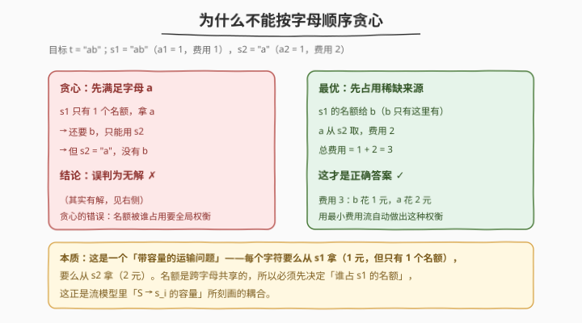
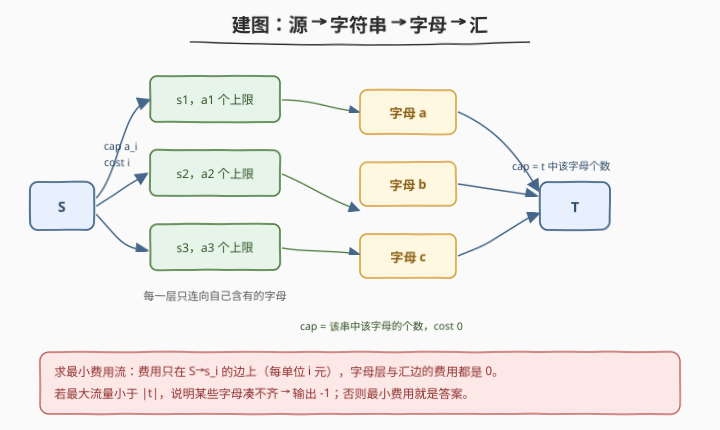
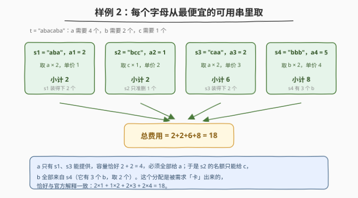

# Codeforces 237E 构串最小代价 题解

## 1. 题目概述

- **题目链接**：https://codeforces.com/problemset/problem/237/E
- **比赛来源**：Codeforces Round 147 (Div. 2) · Problem E（UTC 2012-10-25）
- **难度**：2000
- **标签**：费用流、图论、贪心（反例）、字符串
- **评测类型**：普通
- **限制**：时间 2 s / 内存 256 MB

**题意**：给定目标串 $t$ 与 $n$ 个字符串 $s_1, \dots, s_n$。要执行恰好 $|t|$ 次操作来拼出 $t$，每次操作：任选一个**非空**的 $s_i$，从中取出任意一个字符写在纸上，并把它从 $s_i$ 中删掉。写在纸上的字符按顺序连起来必须恰为 $t$。

另外每个 $s_i$ 有上限 $a_i$：最多允许从 $s_i$ 中删除 $a_i$ 个字符；从 $s_i$ 删一个字符花费 $i$ 卢布。求拼出 $t$ 的最小总花费；无解输出 $-1$。

**约束**：

- $1 \le |t| \le 100$：需要凑出的字符总数很小，最终要选的是「每个字符从哪个串取」。
- $1 \le n \le 100$、$1 \le |s_i| \le 100$、$0 \le a_i \le 100$：字符串数量、长度、配额都不大，建出来的网络只有约 $128$ 个点，但组合方式极多（朴素的搜索会爆炸）。
- 所有字符串只含小写字母：字母表只有 26 个，可以按字母聚合。
- 单价与字符串下标绑定（$i$ 越大越贵）：这是「按来源计费」的结构，天然适合费用流；也意味着**不能**按字母顺序贪心（见 3.2 的反例）。

## 2. 示例与观察

官方样例一：

```text
输入：
bbaze
3
bzb 2
aeb 3
ba 10
```

```text
输出：
8
```

官方样例二：

```text
输入：
abacaba
4
aba 2
bcc 1
caa 2
bbb 5
```

```text
输出：
18
```

官方样例三：

```text
输入：
xyz
4
axx 8
za 1
efg 4
t 1
```

```text
输出：
-1
```

**样例一演算**：$t = \text{bbaze}$，需要 b×2、a×1、z×1、e×1，共 5 个字符。

- 从 $s_1 = \text{bzb}$ 取 b、z，花 $2 \times 1 = 2$ 元（上限 $a_1 = 2$，正好用完）；
- 从 $s_2 = \text{aeb}$ 取 a、e、b，花 $3 \times 2 = 6$ 元（上限 3，正好用完）；
- 合计 $2 + 6 = 8$，这是官方给出的最优解。

**样例二演算**：$t = \text{abacaba}$，需要 a×4、b×2、c×1。注意 **a 只能来自 $s_1$ 和 $s_3$**：$s_1 = \text{aba}$ 有 2 个 a（上限 2），$s_3 = \text{caa}$ 有 2 个 a（上限 2），两者容量恰好等于 4，所以它们必须**全部**贡献给 a。于是：

- a：$s_1$ 出 2 个（$2 \times 1$），$s_3$ 出 2 个（$2 \times 3$），小计 8；
- c：只剩 $s_2$ 能出（$s_3$ 的名额已被 a 占满），$1 \times 2 = 2$；
- b：$s_1$ 名额已满、$s_2$ 名额被 c 占用，只能由 $s_4 = \text{bbb}$ 出 2 个，$2 \times 4 = 8$。

总计 $8 + 2 + 8 = 18$，与官方一致。

**样例三演算**：$t = \text{xyz}$ 需要字母 y，但四个串里都没有 y，无解，输出 $-1$。

自造样例（标注「自造」）：

| 输入 | 输出 | 说明 |
|------|------|------|
| `a`<br>`1`<br>`a 0` | -1 | 配额 $a_1 = 0$，一个都删不了 |
| `a`<br>`1`<br>`b 5` | -1 | 有配额但没有字母 a |
| `a`<br>`2`<br>`a 1`<br>`b 1` | 1 | 只有 $s_1$ 能出 a |
| `ab`<br>`2`<br>`ab 1`<br>`a 1` | 3 | 贪心反例：$s_1$ 的名额必须给 b（见 3.2） |

**观察一**：**操作顺序无关**。最终拼出的串只取决于「第 $j$ 个字符取自哪个串的哪个字符」；由于每个字符的删除只受 $a_i$ 与「该字母在 $s_i$ 中的个数」限制，任何满足这两条容量约束的分配，都能按 $t$ 的顺序依次执行。所以问题等价于：为 $t$ 的每个位置选一个来源串，使得每个串被选的总次数 $\le a_i$、每个串中被选的某字母次数 $\le$ 该字母在串中的个数，最小化 $\sum (\text{来源下标})$。

**观察二**：这是一个**带容量的运输问题**——「字母」是需求方，「串」是供给方，供给方的总容量 $a_i$ 被所有字母共享。共享容量是问题的核心难点。

## 3. 解题思路

### 3.1 朴素做法与瓶颈

可以先想到贪心：按 $i$ 从小到大处理字符串，能出多少就出多少。问题在于「能出多少」当 $a_i$ 小于该串能提供的待凑字符总数时，需要决定把这些名额分给哪些字母——这个决定会影响后续可行性。按字母顺序随便选（比如先满足字母序小的）会出错，见下节反例。

另一个朴素方向是搜索：枚举 $t$ 每个位置取自哪个串的哪个字符，状态数是天文数字。$|t| = 100$、$n = 100$ 时完全不可行。

### 3.2 反例：按字母顺序贪心会误判无解



取 $t = \text{ab}$，$n = 2$：$s_1 = \text{ab}$（$a_1 = 1$，单价 1），$s_2 = \text{a}$（$a_2 = 1$，单价 2）。

- 若按字母顺序先满足 a：$s_1$ 只有一个名额，被 a 占用，于是 b 只能找别的串，但 $s_2$ 没有 b → 误判无解；
- 正确做法：$s_1$ 的名额留给 b（b 只有这里能出），a 从 $s_2$ 取，总费用 $1 + 2 = 3$。

可见「名额给谁」必须**全局权衡**，不能局部决定。这种「单位费用只依赖来源、供给容量跨需求共享」的结构，正是最小费用流的用武之地。

### 3.3 建图：源 → 字符串 → 字母 → 汇



- 源点 $S$；每个字符串一个点 $1 \dots n$；每个字母一个点（26 个）；汇点 $T$。
- 边 $S \to i$：容量 $\min(a_i, |s_i|)$，费用 $i$。含义：从 $s_i$ 最多删这么多个字符，每删一个花 $i$ 元。
- 边 $i \to c$（仅当 $s_i$ 含字母 $c$）：容量为 $c$ 在 $s_i$ 中出现的次数，费用 0。含义：这个串最多能提供这么多个字母 $c$。
- 边 $c \to T$：容量为 $c$ 在 $t$ 中出现的次数，费用 0。含义：目标串需要这么多个 $c$。

求从 $S$ 到 $T$ 的**最小费用最大流**。若最大流量 $< |t|$，说明有字母凑不齐，输出 $-1$；否则最小费用就是答案。

为什么这样建模是对的：一单位流从 $S$ 经 $i$、$c$ 到 $T$，代表「从 $s_i$ 取一个字符 $c$ 用于 $t$」。$S \to i$ 的容量保证总删除数不超 $a_i$，$i \to c$ 的容量保证不超该字母的出现次数，$c \to T$ 的容量保证恰好凑够 $t$ 的需求；而费用只在 $S \to i$ 上计一次，恰为 $i$ 元。

### 3.4 样例走查：样例二



需求：a×4、b×2、c×1。各串供给（括号内为单位费用）：

| 串 | 内容 | 上限 | 可提供 | 单位费用 | 实际取用 |
|----|------|------|--------|----------|----------|
| $s_1$ | aba | 2 | a×2, b×1 | 1 | a×2 = 2 |
| $s_2$ | bcc | 1 | b×1, c×2 | 2 | c×1 = 2 |
| $s_3$ | caa | 2 | c×1, a×2 | 3 | a×2 = 6 |
| $s_4$ | bbb | 5 | b×3 | 4 | b×2 = 8 |

总费用 18。注意 a 的总供给恰好是 $2 + 2 = 4$，所以 $s_1, s_3$ 的名额必须全给 a，剩下的 c、b 只能由 $s_2, s_4$ 承担——这个「被迫」的结构说明最优化不是简单的「谁便宜用谁」，而是要在容量约束下联合决定。

## 4. 正确性证明

**引理 1（操作顺序无关）**：一组「每个 $t$ 位置取哪个串的哪个字符」的分配可行（能按某种操作顺序实现），当且仅当对每个 $i$，从 $s_i$ 取用的总字符数 $\le a_i$，且对每个 $i$ 和字母 $c$，从 $s_i$ 取用的 $c$ 的个数 $\le$ $c$ 在 $s_i$ 中的出现次数。

**证明**：必要性显然：每次操作从 $s_i$ 删一个字符，总次数不能超 $a_i$，也不能超过该字母实际存在的个数。充分性：因为 $s_i$ 中相同字母的字符彼此不可区分，只要取用数量不超过出现次数，就可以在 $s_i$ 中为每次取用指定一个不同的字符副本；按 $t$ 从左到右的顺序依次执行「取指定副本」的操作即可，每一步被选的串都非空（副本尚未被删）。∎

**引理 2（流与分配的对应）**：上述网络中流量为 $|t|$ 的整值可行流，与引理 1 意义下的可行分配一一对应，且流费用等于分配费用。

**证明**：给定可行分配，令 $f(S,i) = $ 从 $s_i$ 取用的总数，$f(i,c) = $ 从 $s_i$ 取用的 $c$ 的个数，$f(c,T) = $ 用于 $t$ 的 $c$ 的总数 $= $ $c$ 在 $t$ 中的出现次数。由引理 1 的容量条件，这三组流量都在容量内；流量守恒逐个点成立（$i$ 的流入等于流出、$c$ 的流入等于流出），总流量为 $|t|$，费用 $=\sum_i i \cdot f(S,i)$ 恰为总花费。反之，给定整值可行流，按 $f(i,c)$ 从各串取字符即可构造分配，容量保证可行性。∎

**引理 3（最小费用流的正确性）**：沿残量网络最短路反复增广（SPFA 版 successive shortest path），每一步得到的都是「当前流量下的最小费用流」；当无法增广时得到最小费用最大流。

**证明要点**：初始零流是最小费用流。设当前流 $f$ 是流量 $k$ 的最小费用流，沿残量网络最短路 $P$ 增广得到 $f'$，流量 $k+1$。若存在流量 $k+1$ 的更便宜流 $g$，考虑 $g - f'$ 分解出的增广路与环：其中必有一条 $S$-$T$ 路，其费用不小于 $P$ 的费用（$P$ 是最短路），剩余部分为环；由 $f$ 的最优性（残量网络无负环）这些环费用非负，矛盾。故 $f'$ 最优。增广到无法继续时即为最大流，且在所有最大流中费用最小。∎

**定理**：算法输出的数是最小总花费；当且仅当不存在可行分配时输出 $-1$。

**证明**：由引理 2，可行分配与流量 $|t|$ 的整值流一一对应且费用相同，故最小总花费等于「流量为 $|t|$ 的最小费用」。网络容量全为整数，增广量取瓶颈（整数），故算法得到的流是整值流。若最大流 $< |t|$，由最大流最小割定理不存在流量 $|t|$ 的可行流，即无可行分配，输出 $-1$ 正确；否则由引理 3 得到的最小费用即答案。∎

## 5. 复杂度分析

- **规模**：点数 $V = n + 28 \le 128$；边数：$n$ 条源边 + 至多 $26n$ 条字符串到字母的边 + 26 条汇边，即 $E \le 27n + 26 \approx 2726$；流量上限 $|t| \le 100$。
- **时间**：SPFA 版最小费用流每次增广 $O(VE)$，增广次数不超过 $|t|$，最坏 $O(|t| \cdot V \cdot E) \approx 100 \times 128 \times 2726 \approx 3.5 \times 10^7$ 次松弛，实际远小于此（增广次数往往不到 100，SPFA 也几乎不会跑满）。2 s 时限完全够用。
- **空间**：$O(V + E)$，约 2700 条边（每条边存正反两份），内存不到 1 MB。
- **实测**：最坏规模（$|t| = 100$、$n = 100$、每个串 100 字符）下 C++ 约 4 ms、Python 约 22–37 ms。

## 6. 参考代码

### C++17

```cpp
#include <bits/stdc++.h>
using namespace std;

struct MinCostMaxFlow {
    struct Edge { int to, cap, cost, rev; };
    vector<vector<Edge>> g;
    explicit MinCostMaxFlow(int n) : g(n) {}

    void addEdge(int u, int v, int cap, int cost) {
        g[u].push_back({v, cap, cost, (int)g[v].size()});
        g[v].push_back({u, 0, -cost, (int)g[u].size() - 1});
    }

    // 返回 {flow, cost}；flow 不足时由调用方判断
    pair<int, int> run(int s, int t) {
        const int INF = 1e9;
        int flow = 0, cost = 0;
        int n = (int)g.size();
        vector<int> dist(n), inq(n), pv(n), pe(n);
        while (true) {
            fill(dist.begin(), dist.end(), INF);
            fill(inq.begin(), inq.end(), 0);
            dist[s] = 0;
            deque<int> q;
            q.push_back(s);
            inq[s] = 1;
            while (!q.empty()) {
                int u = q.front(); q.pop_front();
                inq[u] = 0;
                for (int i = 0; i < (int)g[u].size(); ++i) {
                    const Edge &e = g[u][i];
                    if (e.cap > 0 && dist[e.to] > dist[u] + e.cost) {
                        dist[e.to] = dist[u] + e.cost;
                        pv[e.to] = u;
                        pe[e.to] = i;
                        if (!inq[e.to]) { inq[e.to] = 1; q.push_back(e.to); }
                    }
                }
            }
            if (dist[t] == INF) break;                 // 无法再增广
            int add = INF;
            for (int v = t; v != s; v = pv[v]) add = min(add, g[pv[v]][pe[v]].cap);
            for (int v = t; v != s; v = pv[v]) {
                Edge &e = g[pv[v]][pe[v]];
                e.cap -= add;
                g[v][e.rev].cap += add;
            }
            flow += add;
            cost += add * dist[t];
        }
        return {flow, cost};
    }
};

int main() {
    ios::sync_with_stdio(false);
    cin.tie(nullptr);

    string t;
    if (!(cin >> t)) return 0;
    int n;
    cin >> n;
    vector<string> s(n + 1);
    vector<int> a(n + 1);
    for (int i = 1; i <= n; ++i) cin >> s[i] >> a[i];

    int need[26] = {};
    for (char c : t) need[c - 'a']++;
    int S = 0, T = n + 27;                          // 0 / 1..n 字符串 / n+1..n+26 字母 / n+27 汇点
    MinCostMaxFlow mf(T + 1);
    for (int i = 1; i <= n; ++i) {
        int cnt[26] = {};
        for (char c : s[i]) cnt[c - 'a']++;
        int cap = min(a[i], (int)s[i].size());
        mf.addEdge(S, i, cap, i);                   // 从 s_i 每删一个字符花 i 元
        for (int c = 0; c < 26; ++c)
            if (cnt[c] > 0) mf.addEdge(i, n + 1 + c, cnt[c], 0);
    }
    for (int c = 0; c < 26; ++c)
        if (need[c] > 0) mf.addEdge(n + 1 + c, T, need[c], 0);

    auto res = mf.run(S, T);
    if (res.first < (int)t.size()) cout << -1 << '\n';
    else cout << res.second << '\n';
    return 0;
}
```

### Python3

```python
import sys
from collections import deque


class MCMF:
    def __init__(self, n: int) -> None:
        self.n = n
        self.g = [[] for _ in range(n)]      # 每条边存 [to, cap, cost, rev]

    def add_edge(self, u: int, v: int, cap: int, cost: int) -> None:
        self.g[u].append([v, cap, cost, len(self.g[v])])
        self.g[v].append([u, 0, -cost, len(self.g[u]) - 1])

    def run(self, s: int, t: int):
        INF = 10 ** 9
        flow = 0
        cost = 0
        while True:
            dist = [INF] * self.n
            inq = [False] * self.n
            pv = [-1] * self.n
            pe = [-1] * self.n
            dist[s] = 0
            q = deque([s])
            inq[s] = True
            while q:
                u = q.popleft()
                inq[u] = False
                du = dist[u]
                for i, e in enumerate(self.g[u]):
                    v, cap, w, _ = e
                    if cap > 0 and dist[v] > du + w:
                        dist[v] = du + w
                        pv[v] = u
                        pe[v] = i
                        if not inq[v]:
                            inq[v] = True
                            q.append(v)
            if dist[t] == INF:
                break
            add = INF
            v = t
            while v != s:
                add = min(add, self.g[pv[v]][pe[v]][1])
                v = pv[v]
            v = t
            while v != s:
                e = self.g[pv[v]][pe[v]]
                e[1] -= add
                self.g[v][e[3]][1] += add
                v = pv[v]
            flow += add
            cost += add * dist[t]
        return flow, cost


def main() -> None:
    data = sys.stdin.buffer.read().split()
    if not data:
        return
    t = data[0].decode()
    n = int(data[1])
    strs = [(b"", 0)] * (n + 1)
    p = 2
    for i in range(1, n + 1):
        strs[i] = (data[p].decode(), int(data[p + 1]))
        p += 2

    need = [0] * 26
    for ch in t:
        need[ord(ch) - 97] += 1

    S = 0
    T = n + 27
    mf = MCMF(T + 1)
    for i in range(1, n + 1):
        s, a = strs[i]
        cnt = [0] * 26
        for ch in s:
            cnt[ord(ch) - 97] += 1
        mf.add_edge(S, i, min(a, len(s)), i)
        for c in range(26):
            if cnt[c]:
                mf.add_edge(i, n + 1 + c, cnt[c], 0)
    for c in range(26):
        if need[c]:
            mf.add_edge(n + 1 + c, T, need[c], 0)

    flow, cost = mf.run(S, T)
    sys.stdout.write(("-1" if flow < len(t) else str(cost)) + "\n")


main()
```

两份实现的建图与增广逻辑完全一致，均可直接提交。

## 7. 边界情况与易错点

1. **$a_i = 0$**：该串一个字符都不能删。建图时 $S \to i$ 容量为 $\min(a_i, |s_i|) = 0$，流根本进不去，正确处理；不要在代码里把容量写成 $a_i$ 之后又假定它 $> 0$。
2. **$a_i > |s_i|$**：最多只能删串里实际存在的字符，所以容量要取 $\min(a_i, |s_i|)$。若只用 $a_i$，当 $a_i$ 大于串长时虽然字母层的容量会限制住（不会被多取），但语义上仍应取 min，避免误解。
3. **流量不足要输出 $-1$**：只判断「最大流」还不够，必须与 $|t|$ 比较。若输出 `res.second` 而不检查流量，样例三会输出 0 而不是 $-1$。
4. **字母不在 $t$ 中**：不需要建汇边，也不需要处理；只要字符串里有就建 $i \to c$ 边即可（容量可以留着，流不会走）。
5. **整数流**：容量全为整数，增广量取瓶颈，SPFA 距离为整数，因此得到的流是整值流；不需要担心「取半个字符」。若用浮点费用要小心精度，本题全整数。
6. **费用上界**：最坏 $|t| = 100$ 个字符、单价最大 100，总费用不超过 $10^4$，`int` 足够；但中间距离数组用 `INF = 1e9` 防止溢出式比较。
7. **读入格式**：第一行是 $t$（单个 token），第二行是 $n$，之后每行一个字符串和一个整数。`t` 的长度与行数无关，按 token 读最稳；不要按行读再用 `getline` 手工切分。
8. **多测？** 本题只有一组输入，没有 $t$ 组测试；代码只跑一次。若误写成多组循环，第二组会读到空 token 而出错（本题数据只有一组，但习惯上要按题面来）。

## 8. 验证记录

- **编译环境与命令**：本机无 GNU `g++`，用 `clang++ -std=c++17 -O2 -I codeforces/tools/include`（本地 `bits/stdc++.h` 兼容头）编译；Python 3.9.6。
  - `python3 codeforces/tools/verify_solution.py codeforces/contests/0101-0203/237/E_构串最小代价.md` → `CF237E: samples 3 / C++ 编译 OK, 样例 3/3 / Python 语法 OK, 样例 3/3`
  - `python3 codeforces/tools/check_samples.py --only 0101-0203/237`、`python3 codeforces/tools/check.py codeforces/contests/0101-0203/237`、`node codeforces/tools/katex_check.cjs codeforces/contests/0101-0203/237` 均 0 问题。
- **官方样例**：3 / 3 通过，C++ 与 Python 输出一致。
- **额外测试与随机对拍**：另写独立暴力（**不是流**：按字符串顺序做记忆化 DP，状态是剩余需求向量，枚举每个串对每种字母取多少个，且总数受 $a_i$ 限制），与 C++、Python 逐组比对 **260 组**随机数据（$n \le 4$、$|s_i| \le 4$、$a_i \le 4$、$|t| \le 5$、字母表取 $\{a,b\}$ 或 $\{a,b,c\}$），全部一致，覆盖无解、$a_i = 0$、配额不足、重复字母等情形。
- **贪心反例专项**：`ab / 2 / ab 1 / a 1` 一组，贪心会误判为 $-1$，参考实现输出 3，与 DP 暴力一致——这也是正文 3.2 反例的实际运行结果。
- **最大约束性能**：$|t| = 100$、$n = 100$、每个 $s_i$ 长 100 的四类数据（全字母随机、单字母链、必然无解、每串只含一种字母）下，C++ 端到端均约 4 ms，Python 约 22–37 ms。相对 2 s 时限余量极大。
- **图片校验**：`cf237e_flow.svg`、`cf237e_greedy.svg`、`cf237e_sample.svg` 均通过 `xml.etree.ElementTree.parse`，含 `feTurbulence` 抖动滤镜与手写字体，逐字符估算包围盒未越出 `viewBox`。
- **公式校验**：`node codeforces/tools/katex_check.cjs codeforces/contests/0101-0203/237` 对该篇 0 错误。
- **复核状态**：verified（样例、对拍、反例、性能、图片、公式全部实跑通过）。

## 相关题目与扩展

- [Codeforces 237D T-decomposition](https://codeforces.com/problemset/problem/237/D)：同场构造题，与本篇形成「构造」与「最优化建模」的对照。
- [Codeforces 237B Young Table](https://codeforces.com/problemset/problem/237/B)：同场 B 题，交换与置换。
- [Codeforces 277E Binary Tree on Plane](https://codeforces.com/problemset/problem/277/E)：同样是费用流建模，但费用是几何距离，需要处理实数。
- [Codeforces 717G Underfail](https://codeforces.com/problemset/problem/717/G)：带收益的匹配/流模型，和本题一样要把「选择」翻译成网络上的流量。
- [LeetCode 2463. 最小移动总距离](https://leetcode.cn/problems/minimum-total-distance-traveled/)：带容量约束的分配最小化问题，与本题「供给共享容量」的结构呼应。

**延伸思考**：

1. **如果同一次操作可以取任意多个字符（批量删除）**：费用结构不变，但配额应按字符数而非操作次数计算；本题的模型恰好只依赖字符数，所以答案不变——这说明建模的关键是「容量」而不是「操作次数」。
2. **如果 $a_i$ 不存在（可无限删）**：那就退化为「每个字母从最便宜的串里取」，可以按字母独立贪心，费用为 $\sum_c \sum (\text{前若干便宜的供给})$；正是本题的 $a_i$ 让各字母耦合在一起。
3. **如果要求输出具体方案而不只是费用**：在流网络上记录每条 $i \to c$ 边的流量即可还原「从哪个串取了多少个什么字母」，再按 $t$ 的顺序输出任意一种合法取法（同字母副本不可区分，方案不唯一）。
4. **如果单价不是 $i$ 而是任意 $w_i$**：模型完全不变，把 $S \to i$ 的费用改成 $w_i$ 即可；本题取 $i$ 只是让数据更规整。这也说明「费用流」比「按编号贪心」更本质。
