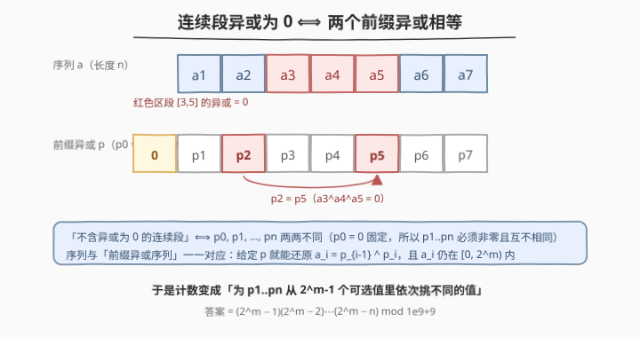
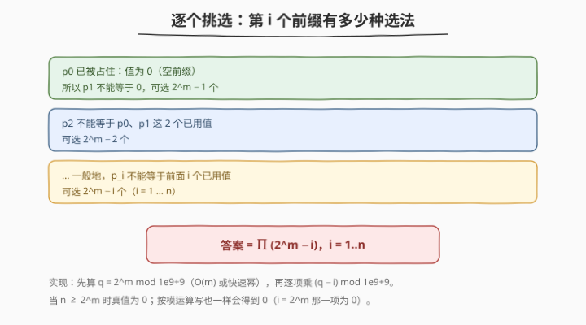

# Codeforces 238A 非羊毛序列计数 题解

## 1. 题目概述

- **题目链接**：https://codeforces.com/problemset/problem/238/A
- **比赛来源**：Codeforces Round 148 (Div. 1) · Problem A（UTC 2012-11-04）
- **难度**：1300
- **标签**：组合数学、异或、前缀和
- **评测类型**：普通
- **限制**：时间 1 s / 内存 256 MB

**题意**：一个长度为 $n$ 的非负整数序列 $a_1, \dots, a_n$ 称为「羊毛序列」，当且仅当存在 $1 \le l \le r \le n$ 使 $a_l \oplus a_{l+1} \oplus \cdots \oplus a_r = 0$（即存在异或和为 0 的连续子段）。求由 $0 \sim 2^m - 1$ 之间的整数构成的、长度 $n$ 的序列中，**不是**羊毛序列的序列个数，对 $10^9 + 9$ 取模。

输入一行两个整数 $n, m$；输出一个整数。

**约束**：

- $1 \le n, m \le 10^5$：$2^m$ 巨大（最多约 $10^{30103}$），绝不能真正计算，只能在模意义下处理；$n$ 只有 $10^5$，允许 $O(n)$ 甚至 $O(n \log n)$。
- 每个元素只有 $2^m$ 种取值：计数应该从「有多少个位置可选多少种值」的组合角度出发，而不是枚举序列。
- 答案对 $10^9 + 9$ 取模（注意不是常见的 $10^9 + 7$），乘法要用 64 位。
- 若 $n \ge 2^m$，由抽屉原理不存在非羊毛序列，答案应为 0；公式要能自动给出 0。

## 2. 示例与观察

官方样例：

```text
输入：
3 2

输出：
6
```

**样例演算**：$m = 2$ 时元素取自 $\{0, 1, 2, 3\}$，长度 3 的序列共 $4^3 = 64$ 个。题面 `hint` 直接列出了 6 个非羊毛序列：$(1,3,1)$、$(1,2,1)$、$(2,1,2)$、$(2,3,2)$、$(3,1,3)$、$(3,2,3)$。注意它们都**不含 0**，且相邻两项不同、首尾相同——先记住这个形状，稍后用前缀异或解释。

自造样例（标注「自造」）：

| 输入 | 输出 | 说明 |
|------|------|------|
| `1 1` | 1 | 长度为 1，只有 `1` 不是羊毛序列（`0` 本身异或为 0） |
| `1 2` | 3 | 长度为 1，`1,2,3` 都行 |
| `2 1` | 0 | 元素只有 0、1，长度 2 必有一段异或为 0 |
| `2 2` | 6 | $(2^2-1)(2^2-2) = 3 \times 2$ |
| `3 2` | 6 | 官方样例 |
| `100000 100000` | （模意义下的数） | 最大规模 |

**观察一**：定义前缀异或 $p_0 = 0$、$p_i = a_1 \oplus \cdots \oplus a_i$。则

$$a_l \oplus \cdots \oplus a_r = p_r \oplus p_{l-1},$$

所以「存在异或为 0 的连续段」等价于「存在 $0 \le i < j \le n$ 使 $p_i = p_j$」。也就是说，**序列不是羊毛序列 ⟺ $p_0, p_1, \dots, p_n$ 两两不同**。

**观察二**：$p_0 = 0$ 是固定的，因此 $p_1, \dots, p_n$ 必须是 $2^m - 1$ 个非零值中互不相同的 $n$ 个。并且「序列」与「前缀异或序列」是一一对应的：给定 $p_0, \dots, p_n$ 就能还原 $a_i = p_{i-1} \oplus p_i$，而两个 $[0, 2^m)$ 内的数异或仍在 $[0, 2^m)$ 内，所以还原出的 $a_i$ 自动合法。

于是计数问题变成：给 $p_1, \dots, p_n$ 依次从 $2^m - 1$ 个非零值中挑互不相同的值，有多少种挑法？

## 3. 解题思路

### 3.1 朴素做法与瓶颈

直接枚举所有 $ (2^m)^n $ 个序列当然不可能（$m, n$ 都是 $10^5$）。退一步，用「总序列数减去含零异或段的序列数」也不可行：容斥需要枚举所有可能的零异或段，状态爆炸。

必须利用「异或为 0 的连续段」在前缀异或上的等价刻画，把问题转化为「互不相同」的计数。

### 3.2 核心观察：前缀异或两两不同



设 $p_0 = 0$、$p_i = a_1 \oplus \cdots \oplus a_i$。由异或的消去律，

$$a_l \oplus \cdots \oplus a_r = p_r \oplus p_{l-1},$$

于是 $a_l \oplus \cdots \oplus a_r = 0 \iff p_r = p_{l-1}$。取 $i = l-1 < j = r$，就得到「存在 $i < j$ 使 $p_i = p_j$」，即前缀异或序列中有重复值。

反之，若 $p_i = p_j$（$i < j$），则 $a_{i+1} \oplus \cdots \oplus a_j = 0$，是羊毛序列。因此

$$\text{非羊毛序列} \iff p_0, p_1, \dots, p_n \text{ 两两不同}.$$

由于 $p_0 = 0$ 已占用一个值，$p_1, \dots, p_n$ 只能从剩下的 $2^m - 1$ 个值里选，并且两两不同、也不等于 0。

### 3.3 计数：逐个位置做乘法



按顺序决定 $p_1, p_2, \dots, p_n$：

- $p_1$ 不能是 0，有 $2^m - 1$ 种；
- $p_2$ 不能是 $p_0, p_1$，有 $2^m - 2$ 种；
- …
- $p_i$ 不能是前 $i$ 个已用值，有 $2^m - i$ 种。

各步选择互不影响（前面选了什么只影响「已用值的个数」，不影响可选值的数量），所以总数是

$$\text{ans} = \prod_{i=1}^{n} \left(2^m - i\right) \bmod (10^9 + 9).$$

实现时先算出 $q = 2^m \bmod (10^9+9)$（循环 $m$ 次乘 2，或快速幂），再逐项乘 $(q - i) \bmod (10^9+9)$，遇到负数加模数即可。

### 3.4 样例走查：$n = 3, m = 2$

$2^m = 4$，$q = 4$：

| 步骤 | 因子 | 累计 |
|------|------|------|
| $p_1$ | $4 - 1 = 3$ | 3 |
| $p_2$ | $4 - 2 = 2$ | 6 |
| $p_3$ | $4 - 3 = 1$ | 6 |

答案 6，与官方一致。题面列出的 6 个序列恰好对应 6 组前缀异或：以 $(1,3,1)$ 为例，$p = (0, 1, 2, 3)$；以 $(3,1,3)$ 为例，$p = (0, 3, 2, 1)$。这些 $p$ 都是 $\{0,1,2,3\}$ 的排列，自然两两不同。

## 4. 正确性证明

**引理 1（前缀异或刻画）**：$a_l \oplus \cdots \oplus a_r = 0$ 当且仅当 $p_{l-1} = p_r$。

**证明**：$p_r = p_{l-1} \oplus a_l \oplus \cdots \oplus a_r$，两边同时异或 $p_{l-1}$ 得 $p_r \oplus p_{l-1} = a_l \oplus \cdots \oplus a_r$（利用 $x \oplus x = 0$ 与结合律）。于是左边为 0 当且仅当右边为 0。∎

**引理 2（双射）**：长度为 $n$、取值于 $[0, 2^m)$ 的序列与「$p_0 = 0$ 且 $p_1, \dots, p_n \in [0, 2^m)$」的序列一一对应。

**证明**：给定 $a$ 可由 $p_i = p_{i-1} \oplus a_i$ 唯一确定 $p$；给定 $p$ 可由 $a_i = p_{i-1} \oplus p_i$ 唯一确定 $a$，且两个小于 $2^m$ 的非负整数异或仍小于 $2^m$（按位异或不会产生更高位）。两个方向的映射互逆。∎

**引理 3（计数公式）**：满足 $p_0, \dots, p_n$ 两两不同的 $p$ 序列共有 $\prod_{i=1}^{n}(2^m - i)$ 个。

**证明**：对 $i$ 归纳。选 $p_1$ 时已用值集合为 $\{0\}$，有 $2^m - 1$ 种；假设 $p_1, \dots, p_{i-1}$ 已选好且互不相同，则已用值有 $i$ 个（含 $p_0$），$p_i$ 只要避开它们即可，有 $2^m - i$ 种。乘法原理给出总数。∎

**定理**：答案等于 $\prod_{i=1}^{n}(2^m - i) \bmod (10^9+9)$。

**证明**：由引理 1，「非羊毛」等价于所有前缀异或两两不同；由引理 2，序列与非羊毛前缀序列一一对应；由引理 3，这样的前缀序列有 $\prod (2^m-i)$ 个。故非羊毛序列数就是该乘积，取模不改变余数。∎

## 5. 复杂度分析

- **时间**：$O(n + m)$，其中 $O(m)$ 用于算 $2^m \bmod p$（逐次乘 2），$O(n)$ 用于累乘 $n$ 个因子。$n, m \le 10^5$，1 s 绰绰有余。
- **空间**：$O(1)$，只要几个 64 位整数，不需要数组。
- **数值范围**：模数约 $10^9$，两个模内数相乘约 $10^{18}$，恰好落在 `long long`（$9.2 \times 10^{18}$）内；Python 大整数天然安全。
- **与时限的关系**：实测 $n = m = 10^5$ 时 C++ 端到端约 2.9 ms（含进程启动），算法本体是 $2 \times 10^5$ 次乘加，远小于 1 s。

## 6. 参考代码

### C++17

```cpp
#include <bits/stdc++.h>
using namespace std;

int main() {
    ios::sync_with_stdio(false);
    cin.tie(nullptr);

    long long n, m;
    if (!(cin >> n >> m)) return 0;
    const long long MOD = 1000000009LL;
    long long q = 1;                              // q = 2^m mod MOD
    for (long long e = 0; e < m; ++e) q = q * 2 % MOD;
    long long ans = 1;
    for (long long i = 1; i <= n; ++i) {
        long long f = (q - i) % MOD;              // 第 i 个前缀异或的选择数：2^m - i
        if (f < 0) f += MOD;
        ans = ans * f % MOD;
    }
    cout << ans << '\n';
    return 0;
}
```

### Python3

```python
import sys


def main() -> None:
    data = sys.stdin.buffer.read().split()
    if not data:
        return
    n, m = int(data[0]), int(data[1])
    MOD = 1000000009
    q = pow(2, m, MOD)                 # 2^m mod MOD
    ans = 1
    for i in range(1, n + 1):
        ans = ans * ((q - i) % MOD) % MOD
    sys.stdout.write(str(ans) + "\n")


main()
```

两份代码都只用标准库，可原样提交。

## 7. 边界情况与易错点

1. **$n \ge 2^m$**：真值为 0。公式中 $i = 2^m$ 那一项为 0（模意义下 $q - 2^m \equiv 0$），乘积自动为 0；但如果把循环写成 `i < n` 就会漏掉这一项，得到错误的非零值。
2. **$m = 1$ 且 $n \ge 2$**：元素只有 0、1，而前缀异或只能取 0 或 1 两个值，$p_0, \dots, p_n$ 共 $n+1 \ge 3$ 个位置不可能两两不同，所以答案必为 0；公式中 $2^m - 2 = 0$ 也正好给出 0。例如 $(0,1)$ 的前缀是 $(0,0,1)$，$p_0 = p_1$ 说明 $a_1 = 0$ 自身就是零异或段，因此它其实是羊毛序列。
3. **负数取模**：$q - i$ 可能为负（例如 $2^m \bmod p < i$），C++ 的 `%` 会给出负数，必须 `+MOD`；Python 的 `%` 已经返回非负，直接乘即可。
4. **模数写错**：本题是 $10^9 + 9$ 而不是 $10^9 + 7$。
5. **`int` 溢出**：`q * f` 可达 $10^{18}$ 量级，必须用 `long long`；`int` 相乘会溢出。
6. **`2^m` 直接算**：$m$ 可达 $10^5$，不能真的算 $2^m$（会溢出），必须在模意义下累乘或快速幂。注意「$2^m \bmod p$」再与 $i$ 相减是合法的：$(2^m - i) \bmod p = (q - i) \bmod p$。
7. **$n = 1$**：答案为 $2^m - 1$，即「非零元素个数」——长度为 1 的序列只有取 0 才是羊毛序列。
8. **取模与真实计数的关系**：某个因子在模意义下为 0 并不代表真实计数为 0（例如 $2^m \equiv i \pmod p$），但模运算的结果依然正确，不要因此加特判。

## 8. 验证记录

- **编译环境与命令**：本机无 GNU `g++`，用 `clang++ -std=c++17 -O2 -I codeforces/tools/include`（本地 `bits/stdc++.h` 兼容头）编译；Python 3.9.6。
  - `python3 codeforces/tools/verify_solution.py codeforces/contests/0101-0203/238/A_非羊毛序列计数.md` → `CF238A: samples 1 / C++ 编译 OK, 样例 1/1 / Python 语法 OK, 样例 1/1`
  - `python3 codeforces/tools/check_samples.py --only 0101-0203/238`、`python3 codeforces/tools/check.py codeforces/contests/0101-0203/238`、`node codeforces/tools/katex_check.cjs codeforces/contests/0101-0203/238` 均 0 问题。
- **官方样例**：1 / 1 通过（`3 2` → `6`）。
- **额外测试与随机对拍**：另写独立暴力——枚举所有 $n$ 长度、取值 $[0,2^m)$ 的序列，直接三重循环检查每个连续段异或是否为 0。对 $1 \le n \le 4$、$1 \le m \le 3$ 的全部 12 组参数以及 200 组随机参数（同范围）与公式比对，**全部一致**（共 212 组）。
- **最大约束性能**：$n = m = 10^5$ 时 C++ 端到端约 2.9 ms；$n = 10^5, m = 1$ 时输出 0，约 2.6 ms。相对 1 s 时限余量极大。
- **图片校验**：`cf238a_prefix.svg`、`cf238a_product.svg` 均通过 `xml.etree.ElementTree.parse`，含 `feTurbulence` 抖动滤镜与手写字体，逐字符估算包围盒未越出 `viewBox`。
- **公式校验**：`node codeforces/tools/katex_check.cjs codeforces/contests/0101-0203/238` 对该篇 0 错误。
- **复核状态**：verified（样例、对拍、性能、图片、公式全部实跑通过）。

## 相关题目与扩展

- [Codeforces 238B Boring Partition](https://codeforces.com/problemset/problem/238/B)：同场 B 题，排序 + 两种结构的最优性证明。
- [Codeforces 238C World Eater Brothers](https://codeforces.com/problemset/problem/238/C)：同场 C 题，树上的换根 DP。
- [Codeforces 1109A Sasha and a Bit of Relax](https://codeforces.com/problemset/problem/1109/A)：同样用「前缀异或相等」数区间，是本题思路的直接应用。
- [Codeforces 665E Beautiful Subarrays](https://codeforces.com/problemset/problem/665/E)：统计异或和不小于 $k$ 的子段，用 01 字典树配合前缀异或。
- [LeetCode 1442. 形成两个异或相等数组的三元组数目](https://leetcode.cn/problems/count-triplets-that-can-form-two-arrays-of-equal-xor/)：前缀异或相等的计数题，可与本题对照。

**延伸思考**：

1. **如果问的是「含零异或段的序列数」**：答案是 $(2^m)^n - \prod (2^m - i)$，用总数减法即可，但取模时要注意负号。
2. **如果要求每个零异或段长度不小于 $k$**：前缀刻画不再够用，需要记录最近 $k$ 个前缀值的集合，问题变成状压/容斥，难度大幅上升。
3. **如果元素取值改成 $[1, 2^m]$（不含 0）**：前缀异或的取值范围仍是 $[0, 2^m)$，但 $a_i \ne 0$ 增加了「相邻前缀不同」这一约束，计数要用「从 $2^m-1$ 个非零差值中选」的链式乘法，结果变成 $(2^m-1)(2^m-2)^{n-1}$ 之类的形式——值得自己推一遍。
4. **为什么 $m$ 可以到 $10^5$ 但 $n$ 也只有 $10^5$**：因为公式只依赖 $n$ 次乘法；若 $n$ 也到 $10^{18}$，则需要用「下降幂」与快速幂/多项式技巧加速，是另一类问题。
