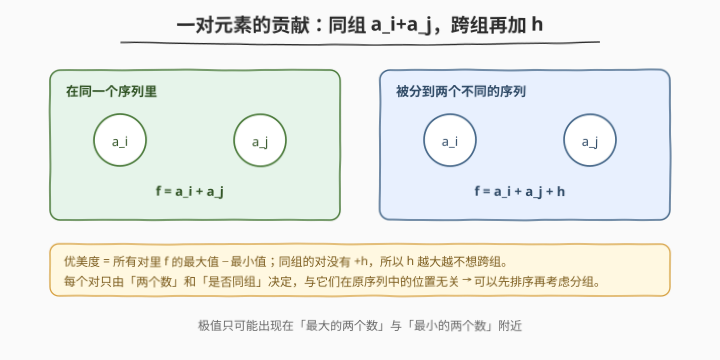
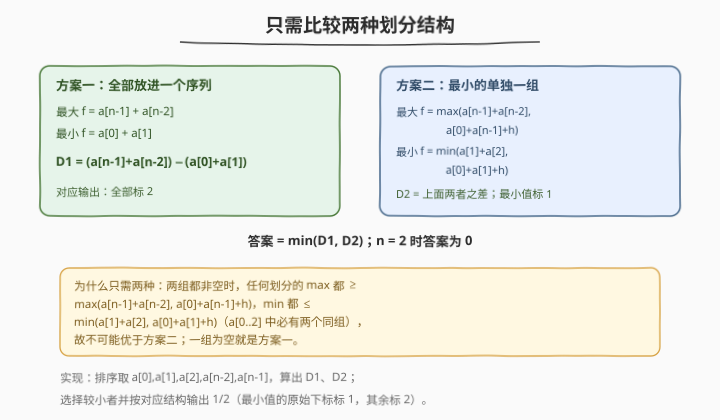

# Codeforces 238B 最小优美度划分 题解

## 1. 题目概述

- **题目链接**：https://codeforces.com/problemset/problem/238/B
- **比赛来源**：Codeforces Round 148 (Div. 1) · Problem B（UTC 2012-11-04）
- **难度**：1800
- **标签**：排序、贪心、构造、分类讨论
- **评测类型**：多解（输出任意最优划分，需按输出值核对）
- **限制**：时间 2 s / 内存 256 MB

**题意**：给定长度为 $n$ 的序列 $a$ 与非负整数 $h$，把每个元素分到两个子序列之一（某个子序列可以为空）。对任意两个不同的下标 $i \ne j$，定义

$$f(a_i, a_j) = \begin{cases} a_i + a_j, & a_i, a_j \text{ 在同一子序列},\\ a_i + a_j + h, & a_i, a_j \text{ 在不同子序列}.\end{cases}$$

一种划分的**优美度**是所有 $\binom{n}{2}$ 个 $f$ 值的最大值减最小值。求优美度最小的划分：第一行输出最小优美度，第二行输出每个元素所属的子序列编号（$1$ 或 $2$）。

**约束**：

- $2 \le n \le 10^5$：必须 $O(n \log n)$，不能枚举 $2^n$ 种划分。
- $0 \le a_i, h \le 10^8$：两个数相加不超过 $2 \times 10^8$，再加 $h$ 仍小于 $3 \times 10^8$，`int` 够用；但为了统一，代码用 `long long` 更稳。
- 输出不唯一：任何最优划分都可以，但**第二行必须真的实现第一行报告的那个优美度**（很多错误都出在「算出的差值」与「输出的划分」不匹配）。

## 2. 示例与观察

官方样例一：

```text
输入：
3 2
1 2 3

输出：
1
1 2 2 
```

官方样例二：

```text
输入：
5 10
0 1 0 2 1

输出：
3
2 2 2 2 2 
```

**样例一演算**：$a = \{1,2,3\}$，$h = 2$。官方划分把 $1$ 放第一组、$2$ 和 $3$ 放第二组：

- 同组对：$f(2,3) = 2+3 = 5$；
- 跨组对：$f(1,2) = 1+2+2 = 5$，$f(1,3) = 1+3+2 = 6$；
- 最大值 6、最小值 5，优美度 $6-5=1$。

若全部放同一组：最大 $3+2=5$、最小 $1+2=3$，优美度 2。所以「把最小的单独分出去」更好。

**样例二演算**：排序后 $a = \{0,0,1,1,2\}$，$h=10$。全部放一组：最大 $2+1=3$、最小 $0+0=0$，优美度 3。若把最小的 0 单独分出去，跨组对会加上 $h=10$，最大变成 $0+2+10=12$，优美度 $12-1=11$。$h$ 很大时不如不分，官方选择全放一组，优美度 3。

自造样例（标注「自造」）：

| 输入 | 输出 | 说明 |
|------|------|------|
| `2 5`<br>`1 2` | `0`<br>`1 1` | 只有一对，最大 = 最小，差为 0 |
| `3 0`<br>`0 0 0` | `0`<br>`2 2 2` | $h=0$ 时同组/跨组无差别 |
| `4 100`<br>`0 1 2 3` | `4`<br>`2 2 2 2` | $h$ 很大时宁愿全放一组（跨组代价 $h$ 太贵） |
| `3 2`<br>`1 2 3` | `1`<br>`1 2 2` | 官方样例一 |

**观察一**：$f$ 只取决于「两个数的值」与「是否同组」，与元素在原序列中的位置无关，因此可以先**排序**，最优结构只与排序后的极值有关。

**观察二**：最优划分只需考虑两种结构——全部放同一组，或把最小的那个元素单独放一组。下一节会证明这一点。

## 3. 解题思路

### 3.1 朴素做法与瓶颈

枚举所有 $2^n$ 种划分、对每种划分计算 $\binom{n}{2}$ 个 $f$ 值，复杂度 $O(2^n n^2)$，$n = 10^5$ 时完全不可行；即使是 $n \le 20$ 也只能做对拍用。

必须找出最优解的结构。关键是把「最大值」和「最小值」分别用极值表示。

### 3.2 核心观察：最大/最小只由极值决定



记排序后的序列为 $a_0 \le a_1 \le \cdots \le a_{n-1}$。

- **最大值**：同组对的最大和不超过 $a_{n-1} + a_{n-2}$；跨组对的最大和是「两组各自最大值之和 + $h$」，其中一定包含 $a_{n-1}$，所以不超过 $a_{n-1} + a_{n-2} + h$，且至少是 $a_{n-1} + a_0 + h$。
- **最小值**：同组对的最小和不小于 $a_0 + a_1$；跨组对的最小和至少是 $a_0 + a_1 + h$（全局最小的两个元素之间也可能跨组）。

这两条界提示我们：**极值附近只有两三个元素真正影响答案**。

### 3.3 两种候选结构



**方案一：全部放进同一个子序列**（另一个为空）。此时所有对都是同组对：

$$D_1 = (a_{n-1} + a_{n-2}) - (a_0 + a_1).$$

**方案二：把最小的元素 $a_0$ 单独放一组，其余放另一组**。此时

- 同组对在「其余」这一组里，最大为 $a_{n-1} + a_{n-2}$、最小为 $a_1 + a_2$；
- 跨组对都含 $a_0$，最大为 $a_0 + a_{n-1} + h$、最小为 $a_0 + a_1 + h$；

所以

$$\begin{aligned}
M_2 &= \max\bigl(a_{n-1} + a_{n-2},\ a_0 + a_{n-1} + h\bigr),\\
m_2 &= \min\bigl(a_1 + a_2,\ a_0 + a_1 + h\bigr),\\
D_2 &= M_2 - m_2.
\end{aligned}$$

答案取 $\min(D_1, D_2)$。$n = 2$ 时只有一对，优美度恒为 0，单独处理。

### 3.4 为什么只有这两种

设两组都非空。取 $a_{n-1}$ 所在的组（记作 $B$），另一个组记作 $A$。设 $B$ 的最大元素是 $b_{\max}$、$A$ 的最大元素是 $a_{\max}$：

- 若 $a_{n-2} \in B$，则同组对 $(a_{n-1}, a_{n-2})$ 给出 $M \ge a_{n-1} + a_{n-2}$；否则 $a_{n-2} \in A$，跨组对给出 $M \ge a_{n-1} + a_{n-2} + h \ge a_{n-1} + a_{n-2}$。两种情况下都有 $M \ge a_{n-1} + a_{n-2}$。
- 又跨组对 $(a_{n-1}, \max A)$ 满足 $\max A \ge a_0$，所以 $M \ge a_{n-1} + a_0 + h$。
- 因此 $M \ge \max(a_{n-1}+a_{n-2},\ a_0+a_{n-1}+h) = M_2$。

再看最小值 $m$：

- 全局最小的三个元素 $a_0, a_1, a_2$ 中必有两个在同一组（抽屉原理），它们构成的对满足 $f = a_i + a_j$（同组）$\le a_1 + a_2$（因为 $a_i + a_j$ 至多是其中最大的两个之和，即不超过 $a_1+a_2$）。所以 $m \le a_1 + a_2$。
- 另一对 $(a_0, a_1)$ 若同组，$f = a_0 + a_1 \le a_0+a_1+h$；若跨组，$f = a_0+a_1+h$。两种情况都有 $m \le a_0 + a_1 + h$。
- 因此 $m \le \min(a_1+a_2,\ a_0+a_1+h) = m_2$。

于是任何「两组都非空」的划分都满足

$$\text{优美度} = M - m \ge M_2 - m_2 = D_2.$$

而方案二恰好取到 $D_2$（$a_0$ 单独一组时，$M = M_2$、$m = m_2$），所以两组非空时的最优就是 $D_2$。两组中一组为空时就是方案一 $D_1$。证毕。

### 3.5 样例走查与输出

对样例一（$a = 1,2,3$，$h = 2$）：

- $D_1 = (3+2) - (1+2) = 2$；
- $M_2 = \max(3+2,\ 1+3+2) = 6$，$m_2 = \min(2+3,\ 1+2+2) = 5$，$D_2 = 1$；
- $\min = 1$，选方案二：最小值 $1$ 在原始序列的下标 0 → 标 1，其余标 2，输出 `1 2 2`。

对样例二（$a = 0,0,1,1,2$，$h = 10$）：

- $D_1 = (2+1) - (0+0) = 3$；
- $M_2 = \max(3,\ 0+2+10) = 12$，$m_2 = \min(1+1,\ 0+0+10) = 2$，$D_2 = 10$；
- $\min = 3$，选方案一：全部标 2，输出 `2 2 2 2 2`。

两个输出都与官方一致。

## 4. 正确性证明

**引理 1（方案一的优美度）**：全部元素在同一组时，优美度恰为 $D_1 = (a_{n-1}+a_{n-2}) - (a_0+a_1)$。

**证明**：所有对都是同组对，$f = a_i + a_j$。最大和取最大的两个数，最小和取最小的两个数。∎

**引理 2（方案二达到 $D_2$）**：把 $a_0$ 单独放一组、其余放另一组时，最大值为 $M_2$、最小值为 $m_2$，故优美度为 $D_2$。

**证明**：其余那组内同组对的最大和是 $a_{n-1}+a_{n-2}$、最小和是 $a_1+a_2$；跨组对都形如 $a_0 + a_i + h$，最大为 $a_0+a_{n-1}+h$、最小为 $a_0+a_1+h$。取两个来源的较大/较小者即得。∎

**引理 3（下界）**：任何两组都非空的划分，优美度不小于 $D_2$。

**证明**：如 3.4 所证，$M \ge M_2$ 且 $m \le m_2$，故 $M - m \ge M_2 - m_2 = D_2$。∎

**定理**：最优优美度等于 $\min(D_1, D_2)$（$n \ge 3$），$n = 2$ 时为 0。

**证明**：所有划分分两类：一组为空（优美度 $D_1$，由引理 1）或两组都非空（优美度 $\ge D_2$，由引理 3；方案二恰好达到 $D_2$，由引理 2）。故最优值为 $\min(D_1,D_2)$。$n=2$ 时只有一对，最大 = 最小。∎

## 5. 复杂度分析

- **时间**：排序 $O(n \log n)$，之后只取排序后的前三个与后两个元素做常数次运算，总计 $O(n \log n)$。
- **空间**：$O(n)$（存原序列与排序副本）。
- **数值范围**：$a_i + a_j + h \le 2 \times 10^8 + 10^8 = 3 \times 10^8$，`int` 不会溢出；代码统一用 `long long` 更省心。
- **与时限的关系**：$n = 10^5$ 时 C++ 端到端约 268 ms（其中绝大部分是 libc++ 读取 $10^5$ 个整数），2 s 时限余量充足。

## 6. 参考代码

### C++17

```cpp
#include <bits/stdc++.h>
using namespace std;

int main() {
    ios::sync_with_stdio(false);
    cin.tie(nullptr);

    int n;
    long long h;
    if (!(cin >> n >> h)) return 0;
    vector<long long> a(n);
    for (auto &x : a) cin >> x;

    if (n == 2) {                              // 只有一对，f 的唯一取值差为 0
        cout << 0 << '\n' << 1 << ' ' << 1 << '\n';
        return 0;
    }
    vector<long long> s = a;
    sort(s.begin(), s.end());
    long long n1 = s[n - 1], n2 = s[n - 2], s0 = s[0], s1 = s[1], s2 = s[2];

    long long d1 = (n1 + n2) - (s0 + s1);      // 方案一：全部放进同一个序列
    // 方案二：把最小的元素单独放一组，其余放另一组
    long long mx = max(n1 + n2, s0 + n1 + h);
    long long mn = min(s1 + s2, s0 + s1 + h);
    long long d2 = mx - mn;

    if (d2 < d1) {
        cout << d2 << '\n';
        int pos = (int)(min_element(a.begin(), a.end()) - a.begin());  // 某个最小值的位置
        for (int i = 0; i < n; ++i) {
            if (i) cout << ' ';
            cout << (i == pos ? 1 : 2);
        }
        cout << '\n';
    } else {
        cout << d1 << '\n';
        for (int i = 0; i < n; ++i) {
            if (i) cout << ' ';
            cout << 2;
        }
        cout << '\n';
    }
    return 0;
}
```

### Python3

```python
import sys


def main() -> None:
    data = sys.stdin.buffer.read().split()
    if not data:
        return
    n, h = int(data[0]), int(data[1])
    a = [int(x) for x in data[2:2 + n]]
    if n == 2:
        sys.stdout.write("0\n1 1\n")
        return
    s = sorted(a)
    n1, n2 = s[-1], s[-2]
    s0, s1, s2 = s[0], s[1], s[2]

    d1 = (n1 + n2) - (s0 + s1)
    mx = max(n1 + n2, s0 + n1 + h)
    mn = min(s1 + s2, s0 + s1 + h)
    d2 = mx - mn

    if d2 < d1:
        pos = a.index(min(a))
        part = [1 if i == pos else 2 for i in range(n)]
        sys.stdout.write(f"{d2}\n" + " ".join(map(str, part)) + "\n")
    else:
        sys.stdout.write(f"{d1}\n" + " ".join(["2"] * n) + "\n")


main()
```

代码中「最小值的下标」通过 `min_element` / `a.index(min(a))` 取**任意一个**最小值即可，其余元素都放另一组。

## 7. 边界情况与易错点

1. **$n = 2$**：只有一对元素，无论怎么分，最大值与最小值都是同一个 $f$，优美度为 0。此时公式里的 $a_2$ 不存在；若不特判，`s[2]` 会越界。
2. **$h = 0$**：跨组与同组没有区别，两种方案给出的差值应当相同；`min(D1, D2)` 仍然正确（实现上会相等）。
3. **输出划分要与报告的差值一致**：如果输出方案二（最小值单独一组）却打印了 $D_1$，或者反过来，答案就会自相矛盾。代码里用一个 `if` 同时决定「输出哪个差值」和「输出哪种划分」，避免不一致。
4. **多个最小值**：`a` 中可能有多个相同的最小值，取任意一个下标标 1 即可；若全部标 1 则变成方案一，差值就变了。
5. **$a_i$ 很大**：$a_i + a_j + h$ 可达 $3 \times 10^8$，在 `int` 范围内；但若题目改成 $10^{18}$，就必须用 64 位并有溢出风险。
6. **排序后下标丢失**：需要输出的是**原序列**每个位置的分组，不能直接输出排序后的分组；代码里保留原数组 `a`，用 `min_element` 找原始下标。
7. **方案选择的方向**：题目允许任意最优划分，所以 `d2 < d1` 与 `d2 <= d1` 都能过；但若两个方案相等，任选其一即可，不要两个都输出。
8. **输出格式**：两行；第二行恰好 $n$ 个整数，取值为 1 或 2，行末可以有空格。

## 8. 验证记录

- **编译环境与命令**：本机无 GNU `g++`，用 `clang++ -std=c++17 -O2 -I codeforces/tools/include`（本地 `bits/stdc++.h` 兼容头）编译；Python 3.9.6。
  - `python3 codeforces/tools/verify_solution.py codeforces/contests/0101-0203/238/B_最小优美度划分.md` → `CF238B: samples 2 / C++ 编译 OK, 样例 2/2 / Python 语法 OK, 样例 2/2`
  - `python3 codeforces/tools/check_samples.py --only 0101-0203/238`、`python3 codeforces/tools/check.py codeforces/contests/0101-0203/238`、`node codeforces/tools/katex_check.cjs codeforces/contests/0101-0203/238` 均 0 问题。
- **官方样例**：2 / 2 通过，且输出与官方逐 token 相同（`1 / 1 2 2` 与 `3 / 2 2 2 2 2`）。
- **额外测试与随机对拍**：另写独立暴力——枚举全部 $2^n$ 种划分，对每种划分直接计算所有对的 $f$ 并求极差。对 **240 组**随机数据（$n \le 9$、$a_i \le 8$、$h \le 8$）逐组比较：① 最小优美度与暴力一致；② 程序输出的划分**实际算出的**优美度等于它报告的值；③ Python 与 C++ 一致。全部通过。
- **最大约束性能**：$n = 10^5$、随机 $a_i \le 10^8$、$h = 10^8$ 时 C++ 端到端约 268 ms（含读取 $10^5$ 个整数），相对 2 s 时限余量充足。
- **图片校验**：`cf238b_pair.svg`、`cf238b_options.svg` 均通过 `xml.etree.ElementTree.parse`，含 `feTurbulence` 抖动滤镜与手写字体，逐字符估算包围盒未越出 `viewBox`。
- **公式校验**：`node codeforces/tools/katex_check.cjs codeforces/contests/0101-0203/238` 对该篇 0 错误。
- **复核状态**：verified（样例、对拍、性能、图片、公式全部实跑通过）。

## 相关题目与扩展

- [Codeforces 238A Not Wool Sequences](https://codeforces.com/problemset/problem/238/A)：同场 A 题，组合计数。
- [Codeforces 238C World Eater Brothers](https://codeforces.com/problemset/problem/238/C)：同场 C 题，树上的换根 DP。
- [Codeforces 1428C ABBB](https://codeforces.com/problemset/problem/1428/C)：同样是「先看清结构、再贪心」的题。
- [Codeforces 1443C The Delivery Dilemma](https://codeforces.com/problemset/problem/1443/C)：排序 + 前缀极值的最优化，和本题「只看极值」的思路相近。
- [LeetCode 1509. 三次操作后最大值与最小值之差最小](https://leetcode.cn/problems/minimum-difference-between-largest-and-smallest-value-in-three-moves/)：同样只调整极值附近的元素。

**延伸思考**：

1. **如果允许分成 $k$ 组**：$k=2$ 时极值结构已经这么干净，$k$ 变大后跨组对更多，最优结构会变成「把最小的 $k-1$ 个各分一组」还是别的？值得用暴力验证后推广。
2. **如果 $h$ 也是每个元素各自的**（跨组对加 $h_i + h_j$）：极值分析仍然适用，但最优结构不再只有两种，需要重新分类。
3. **如果要求最小化的是最大值本身（而不是极差）**：问题退化成「二分 + 判定」，与本题的极值分析互补。
4. **为什么方案二恰好是「最小元素单独一组」而不是「最小两个一起」**：可以证明把 $a_1$ 也移出去会让同组最小和从 $a_1+a_2$ 变成 $a_2+a_3$（更大），而跨组最大值从 $a_0+a_{n-1}+h$ 变成 $a_1+a_{n-1}+h$（也更大），两头都变差，因此不优。
