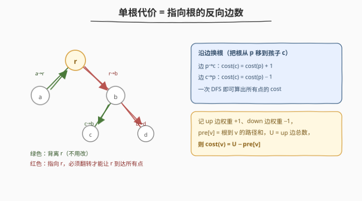
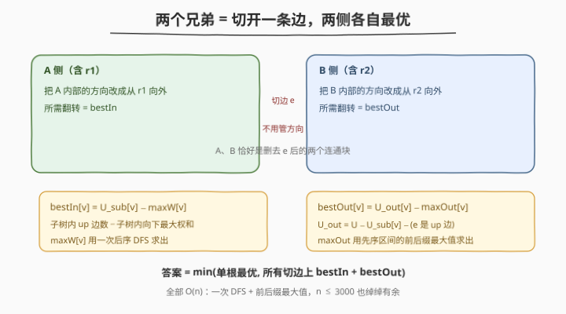

# Codeforces 238C 两兄弟治天下 题解

## 1. 题目概述

- **题目链接**：https://codeforces.com/problemset/problem/238/C
- **比赛来源**：Codeforces Round 148 (Div. 1) · Problem C（UTC 2012-11-04）
- **难度**：2100
- **标签**：树、换根 DP、贪心
- **评测类型**：普通
- **限制**：时间 2 s / 内存 256 MB

**题意**：有 $n$ 个国家，由 $n-1$ 条**有向**道路连成一棵无向意义上的树。两兄弟各选一个国家建立统治，一个人能控制从自己的国家出发、沿有向道路可达的所有国家。要求所有国家至少被其中一人控制，可以改变一些道路的方向，求最少改变多少条。

输入 $n$ 与 $n-1$ 条有向边 $a_i \to b_i$，输出最少修改的边数。

**约束**：

- $n \le 3000$：$O(n^2)$ 完全可以接受（枚举切边、每次 $O(n)$ 求两侧最优），这也是本题的预期复杂度；本解给出 $O(n)$ 的换根 DP。
- 图是树：任意两点间路径唯一，因此「某个根能到达所有点」等价于「所有边都从根指向外」，这使代价可以精确计算。
- 答案最大为 $n-1$，`int` 足够。
- 允许只用**一个**兄弟（「至多两个」）：单根也是一种合法方案。

## 2. 示例与观察

官方样例一：

```text
输入：
4
2 1
3 1
4 1

输出：
1
```

官方样例二：

```text
输入：
5
2 1
2 3
4 3
4 5

输出：
0
```

**样例一演算**：这是以 1 为中心、边 $2\to1, 3\to1, 4\to1$ 的星形。若只用一个根：

- 根取 1：三条边都指向 1，需要全翻成 $1\to2,1\to3,1\to4$，代价 3；
- 根取 2：$2\to1$ 已朝外；$3\to1,4\to1$ 都指向 1，而 2 的视角下 1 是孩子，这两条边是「指向根」的，需要翻，代价 2。

若用两个根（例如 2 和 3）：让 2 统治 $\{2,1\}$（$2\to1$ 不用改），让 3 统治 $\{3,1,4\}$：$3\to1$ 对根 3 是朝外的，不用改；$4\to1$ 对根 3 是「指向根」的，翻成 $1\to4$，于是 3 能到 1、1 能到 4。只翻了 1 条边，答案为 1。

**样例二演算**：路径 $1-2-3-4-5$，边为 $2\to1, 2\to3, 4\to3, 4\to5$。取根 2 与根 4：

- 从 2 出发：$2\to1$ ✓、$2\to3$ ✓，能到 $\{1,2,3\}$；
- 从 4 出发：$4\to5$ ✓、$4\to3$ ✓，能到 $\{3,4,5\}$。

所有国家都被覆盖，一条边都不用改，答案 0。

自造样例（标注「自造」）：

| 输入 | 输出 | 说明 |
|------|------|------|
| `1` | 0 | 只有一个国家，不需要任何道路 |
| `2`<br>`1 2` | 0 | 根取 1 即可 |
| `2`<br>`2 1` | 0 | 根取 2 即可（单根就能覆盖） |
| `3`<br>`2 1`<br>`3 1` | 1 | 星形：根 2 或 3 都需翻 1 条 |
| `4`<br>`1 2`<br>`2 3`<br>`3 4` | 0 | 一条向外的链，根取 1 |

**观察一**：固定一个根 $r$，要让 $r$ 控制所有国家，每条边最终都必须**背离** $r$（因为每个点到 $r$ 的路径唯一，路径上的边方向被唯一确定）。所以单根代价就是「当前指向 $r$ 的边数」，等于 $n-1$ 减去「已经背离 $r$ 的边数」。

**观察二**：两个根的最优方案，等价于**切开一条边**，两侧各选一个最优的根，把各自那侧的边都改成向外。因此问题化为：对每条切边，求两侧连通块内「最小代价根」的代价之和，再与单根最优取最小值。

## 3. 解题思路

### 3.1 朴素做法与瓶颈

对每个根 $r$ 都做一次 DFS 统计「指向 $r$ 的边数」，可以 $O(n^2)$ 求出单根最优。两个根的组合若暴力枚举 $(r_2, r_2)$ 的每一对再检查，是 $O(n^3)$；即使用「切边 + 每次 $O(n)$ 求两侧」，也是 $O(n^2)$，在 $n \le 3000$ 时约 $9 \times 10^6$，可以过。

不过换根 DP 能把两边的最小代价都压到 $O(1)$ 查询，总复杂度 $O(n)$，写起来也不复杂，本篇就用这个做法。

### 3.2 核心观察：单根代价与换根



把树随便定一个根（取 1）。对每条边，按它相对根 1 的方向分类：

- **down 边**：从父结点指向子结点；
- **up 边**：从子结点指向父结点。

设 $U$ 为 up 边的总数。对任意点 $r$，定义

$$\text{pre}[r] = \sum_{\text{根}1 \to r \text{ 的路径}} w(e),\qquad w(e) = \begin{cases} +1, & e \text{ 是 up 边},\\ -1, & e \text{ 是 down 边}.\end{cases}$$

**关键公式**：$\text{cost}(r) = U - \text{pre}[r]$，其中 $\text{cost}(r)$ 是把所有边改成背离 $r$ 所需的翻转数。

为什么？一条 down 边对根 1 是背离的（不花代价）；当根移动到它的子结点一侧时，它就变成「指向根」的边，代价 $+1$。一条 up 边对根 1 是指向根的（代价 1）；根移动到它的子结点一侧后，它变成背离的，代价 $-1$。沿路径累加正好是 $\text{pre}$，而根在 1 时 $\text{cost}(1) = U$。所以单根最优就是 $U - \max_r \text{pre}[r]$。

这也给出了换根的递推：$\text{cost}(c) = \text{cost}(p) + 1$（边 $p \to c$）或 $-1$（边 $c \to p$）。

### 3.3 两个根：切边分解



设两兄弟的根为 $r_1, r_2$。若两人控制范围不重叠地覆盖全树，则存在一条边 $e$，删去后树分成 $A, B$ 两部分，$r_1$ 只需负责 $A$、$r_2$ 只需负责 $B$。于是总代价为

$$\text{bestIn}(e) + \text{bestOut}(e),$$

其中 $\text{bestIn}$ 是 $A$（子树侧）内最小代价根、$\text{bestOut}$ 是 $B$（补集侧）内最小代价根。答案取所有切边的最小值，再与单根最优比较。

下面给出两部分的 $O(1)$ 计算方法。

**子树侧**：对结点 $c$（$c \ne 1$），$A = \text{subtree}(c)$。记 $U_{\text{sub}}[c]$ 为子树内 up 边数、$W(c \to r)$ 为从 $c$ 向下走到 $r$ 的权值和（up 边 $+1$、down 边 $-1$）。与全树同理，

$$\text{cost}_A(r) = U_{\text{sub}}[c] - W(c \to r),$$

所以

$$\text{bestIn}[c] = U_{\text{sub}}[c] - \max_{r \in A} W(c \to r).$$

记 $\text{maxW}[c] = \max(0, \max_{\text{孩子 } x}(w(c,x) + \text{maxW}[x]))$，一次后序 DFS 即可求出。

**补集侧**：$B = V \setminus \text{subtree}(c)$，它包含根 1 且是连通的。对 $r \in B$，从 1 到 $r$ 的路径不经过 $c$ 的子树，故

$$\text{cost}_B(r) = U_{\text{out}}[c] - \text{pre}[r],\qquad U_{\text{out}}[c] = U - U_{\text{sub}}[c] - [\,e \text{ 是 up 边}\,].$$

于是

$$\text{bestOut}[c] = U_{\text{out}}[c] - \max_{r \in B}\text{pre}[r].$$

子树在先序 DFS 序中是一段连续区间，所以 $\max_{r \in B}\text{pre}[r]$ 就是「区间外」的最大值，用先序序列上的前缀最大值与后缀最大值 $O(1)$ 得到。

### 3.4 算法流程

1. 读入树，存每条边的方向（相对输入方向）；
2. 以 1 为根做**迭代** DFS，得到先序 `order`、父结点 `parent`、`up[c]`（边是否 $c \to parent$）、子树大小；
3. 后序计算 `Usub[c]` 与 `maxW[c]`；
4. 先序计算 `pre[c]`；
5. 在 `order` 上做 `pre` 的前缀最大值、后缀最大值；
6. 单根答案 $= U - \max \text{pre}$；
7. 对每个 $c \ne 1$：用区间 $[\text{tin}[c], \text{tin}[c]+\text{sz}[c]-1]$ 外的最大 `pre` 求 `bestOut`，与 `bestIn` 相加，更新答案；
8. 输出答案（$n=1$ 时为 0）。

### 3.5 样例走查：样例一

以 1 为根：三条边 $2\to1, 3\to1, 4\to1$ 全是 up 边，$U = 3$。`pre`：$\text{pre}[1]=0$、$\text{pre}[2]=\text{pre}[3]=\text{pre}[4]=1$。

- 单根：$3 - \max(0,1,1,1) = 2$；
- 切边 $(1,2)$：$A=\{2\}$，`Usub[2]=0`、`maxW[2]=0` → `bestIn=0`；$B=\{1,3,4\}$，$U_{\text{out}} = 3-0-1 = 2$，$\max_{B}\text{pre}=1$ → `bestOut=1`。合计 1；
- 其余切边对称，也得到 1。

答案 $\min(2, 1) = 1$，与官方一致。

## 4. 正确性证明

**引理 1（单根代价）**：把所有边改成背离 $r$ 所需的最小翻转数，等于当前「指向 $r$」的边数 $\text{cost}(r)$。

**证明**：必要性：若某条边在 $r$ 的视角下指向 $r$（即从孩子指向父），则它在 $r$ 到该孩子子树内任意点的路径上，若保持原向，则从 $r$ 无法走出这条边，故必须翻转。充分性：把所有边改成背离 $r$，则对任意点 $v$，路径 $r \to v$ 上每条边都指向前进方向，$r$ 可达 $v$。所以代价恰好是指向 $r$ 的边数。∎

**引理 2（cost 公式）**：对任意 $r$，$\text{cost}(r) = U - \text{pre}[r]$。

**证明**：沿根 1 到 $r$ 的路径逐条边移动根。初始 $\text{cost}(1)=U$（根为 1 时，所有 up 边都指向根）。根从父 $p$ 移到子 $c$ 跨过边 $e$：若 $e$ 是 down 边（$p \to c$），翻转前它背离 $p$、翻转后指向 $c$，代价变化 $-w(e) = -(-1) = +1$；若 $e$ 是 up 边（$c \to p$），它原来指向 $p$、翻转后背离 $c$，代价变化 $-w(e) = -(+1) = -1$。其余边的相对朝向不变，所以

$$\text{cost}(r) = U + \sum_{e \in \text{path}} \bigl(-w(e)\bigr) = U - \text{pre}[r]. \qquad \blacksquare$$

**引理 3（子树侧最小代价）**：对 $A=\text{subtree}(c)$，$\min_{r \in A}\text{cost}_A(r) = U_{\text{sub}}[c] - \text{maxW}[c]$。

**证明**：在子树 $A$ 内部重复引理 2 的推导：以 $c$ 为「局部根」时 $\text{cost}_A(c) = U_{\text{sub}}[c]$，沿路径向 $r$ 移动时每经过 up 边代价 $-1$、down 边 $+1$，即 $\text{cost}_A(r) = U_{\text{sub}}[c] - W(c \to r)$。取最小值即 $U_{\text{sub}}[c] - \max_r W(c \to r)$，而 $W(c \to c) = 0$，故最大值非负，正是 `maxW[c]`。∎

**引理 4（补集侧最小代价）**：$\min_{r \in B}\text{cost}_B(r) = U_{\text{out}}[c] - \max_{r \in B}\text{pre}[r]$。

**证明**：$B$ 连通且含根 1；对 $r \in B$，路径 $1 \to r$ 完全在 $B$ 内，故 $\text{pre}[r]$ 正是 $B$ 内部的路径权值和。套用引理 2（以 1 为局部根，$U$ 换成 $B$ 内 up 边数 $U_{\text{out}}$）即可。∎

**引理 5（切边分解的下界）**：设某个用两个根 $r_1, r_2$ 的方案翻了 $F$ 条边且覆盖全树。则存在一条边 $e$，使 $|F| \ge \text{bestIn}(e) + \text{bestOut}(e)$。

**证明**：令 $S_1$ 为翻转后从 $r_1$ 可达的点集。$S_1$ 是包含 $r_1$ 的连通子树。若 $S_1 = V$，由引理 1，$|F| \ge \text{cost}(r_1) \ge$ 单根最优。否则：

1. 任取 $S_1$ 的一条边界边 $e=(u,v)$（$u \in S_1$，$v \notin S_1$）。若 $e$ 的方向是 $u \to v$，则 $v$ 可达，矛盾；故 $e$ 的方向是 $v \to u$，即所有边界边都指向 $S_1$ 内部。
2. 于是 $r_2 \notin S_1$（否则 $r_2$ 也被困在 $S_1$ 内），且 $V \setminus S_1$ 必须连通（否则 $r_2$ 无法跨过 $S_1$ 到达另一个分支，而跨过又出不去）。连通的两部分之间只有一条边，即 $e$。
3. 由于 $r_1$ 可达 $S_1$ 中所有点，$S_1$ 内每条边在最终状态都必须背离 $r_1$，故 $F$ 在 $S_1$ 内的翻转数 $\ge \text{cost}_{S_1}(r_1) \ge \text{bestIn}$；同理 $r_2$ 可达 $V \setminus S_1$ 中所有点（路径不能穿过 $S_1$），故其内翻转数 $\ge \text{bestOut}$。再加上 $e$ 自身可能的翻转，$|F| \ge \text{bestIn}+\text{bestOut}$。∎

**定理**：答案为 $\min\bigl(\text{单根最优},\ \min_{e}(\text{bestIn}(e)+\text{bestOut}(e))\bigr)$。

**证明**：上界：对任意切边，把两侧分别改成以各自最优点为根的向外树，翻转数恰为 $\text{bestIn}+\text{bestOut}$，且覆盖全树；单根方案同理。下界：任一方案若单根能覆盖，由引理 1 不小于单根最优；否则由引理 5 不小于某条切边的两侧和。两者相等。∎

## 5. 复杂度分析

- **时间**：每个阶段都是线性 DFS：建树、后序 DP、先序前缀、前后缀最大值、枚举切边，总计 $O(n)$。
- **空间**：邻接表 $O(n)$，DP 数组 $O(n)$。
- **与时限的关系**：$n = 3000$ 时 C++ 端到端约 13 ms、Python 约 26 ms（含进程启动）；即使 $n$ 放大到 $3 \times 10^5$ 也是线性，余量极大。
- **对比**：暴力的 $O(n^2)$ 做法（枚举切边、两侧各 $O(n)$ 求最优）在 $n=3000$ 时约 $10^7$ 次操作，也能过；本解在此基础上又省了一个维度。

## 6. 参考代码

### C++17

```cpp
#include <bits/stdc++.h>
using namespace std;

int main() {
    ios::sync_with_stdio(false);
    cin.tie(nullptr);

    int n;
    if (!(cin >> n)) return 0;
    if (n == 1) { cout << 0 << '\n'; return 0; }

    vector<vector<pair<int, int>>> g(n + 1);   // (邻居, 边是否 u->v)
    for (int i = 0; i < n - 1; ++i) {
        int a, b;
        cin >> a >> b;
        g[a].push_back({b, 1});                 // a -> b
        g[b].push_back({a, 0});                 // 反向：b -> a 为 false
    }

    // 以 1 为根做 DFS（栈），得到先序、父结点、子树大小
    vector<int> parent(n + 1, 0), up(n + 1, 0), tin(n + 1), sz(n + 1, 1), order;
    order.reserve(n);
    vector<int> st{1};
    parent[1] = 0;
    while (!st.empty()) {
        int u = st.back(); st.pop_back();
        tin[u] = (int)order.size();
        order.push_back(u);
        for (auto &e : g[u]) {
            int v = e.first, dirUV = e.second;
            if (v == parent[u]) continue;
            parent[v] = u;
            up[v] = (dirUV == 0);               // 边方向是 v -> u
            st.push_back(v);
        }
    }
    for (int i = n - 1; i > 0; --i) sz[parent[order[i]]] += sz[order[i]];

    // U_sub[v]：子树内“朝上”的边数；maxW[v]：从 v 向下走的最大权值和（up=+1, down=-1）
    vector<int> Usub(n + 1, 0), maxW(n + 1, 0);
    for (int i = n - 1; i >= 0; --i) {
        int v = order[i];
        for (auto &e : g[v]) {
            int c = e.first;
            if (parent[c] != v) continue;        // 只看孩子
            Usub[v] += Usub[c] + (up[c] ? 1 : 0);
            int w = up[c] ? 1 : -1;
            maxW[v] = max(maxW[v], w + maxW[c]);
        }
    }
    int U = Usub[1];

    // pre[v] = 根 1 到 v 路径上 (up=+1, down=-1) 的和
    vector<int> pre(n + 1, 0);
    for (int u : order) {
        for (auto &e : g[u]) {
            int c = e.first;
            if (parent[c] != u) continue;
            pre[c] = pre[u] + (up[c] ? 1 : -1);
        }
    }

    // 先序序列上 pre 的前缀/后缀最大值（子树对应连续区间）
    vector<int> prefMax(n), sufMax(n);
    for (int i = 0; i < n; ++i) {
        int v = order[i];
        prefMax[i] = (i == 0) ? pre[v] : max(prefMax[i - 1], pre[v]);
    }
    for (int i = n - 1; i >= 0; --i) {
        int v = order[i];
        sufMax[i] = (i == n - 1) ? pre[v] : max(sufMax[i + 1], pre[v]);
    }

    // 单根最优
    int best = U - prefMax[n - 1];
    // 双根：枚举切边（父 p - 子 c）
    for (int v : order) {
        if (v == 1) continue;
        int c = v;
        int bestIn = Usub[c] - maxW[c];
        int l = tin[c], r = tin[c] + sz[c] - 1;
        int maxOut = INT_MIN;
        if (l > 0) maxOut = max(maxOut, prefMax[l - 1]);
        if (r + 1 < n) maxOut = max(maxOut, sufMax[r + 1]);
        int Uout = U - Usub[c] - (up[c] ? 1 : 0);
        int bestOut = Uout - maxOut;
        best = min(best, bestIn + bestOut);
    }
    cout << best << '\n';
    return 0;
}
```

### Python3

```python
import sys


def main() -> None:
    data = sys.stdin.buffer.read().split()
    if not data:
        return
    n = int(data[0])
    if n == 1:
        sys.stdout.write("0\n")
        return
    g = [[] for _ in range(n + 1)]          # (邻居, 边是否 u->v)
    p = 1
    for _ in range(n - 1):
        a = int(data[p]); b = int(data[p + 1]); p += 2
        g[a].append((b, 1))
        g[b].append((a, 0))

    parent = [0] * (n + 1)
    up = [0] * (n + 1)
    tin = [0] * (n + 1)
    sz = [1] * (n + 1)
    order = []
    st = [1]
    while st:
        u = st.pop()
        tin[u] = len(order)
        order.append(u)
        for v, dir_uv in g[u]:
            if v == parent[u]:
                continue
            parent[v] = u
            up[v] = 1 if dir_uv == 0 else 0
            st.append(v)
    for i in range(n - 1, 0, -1):
        sz[parent[order[i]]] += sz[order[i]]

    Usub = [0] * (n + 1)
    maxW = [0] * (n + 1)
    for i in range(n - 1, -1, -1):
        v = order[i]
        for c, _ in g[v]:
            if parent[c] != v:
                continue
            Usub[v] += Usub[c] + up[c]
            w = 1 if up[c] else -1
            if w + maxW[c] > maxW[v]:
                maxW[v] = w + maxW[c]
    U = Usub[1]

    pre = [0] * (n + 1)
    for u in order:
        for c, _ in g[u]:
            if parent[c] != u:
                continue
            pre[c] = pre[u] + (1 if up[c] else -1)

    prefMax = [0] * n
    sufMax = [0] * n
    for i in range(n):
        v = order[i]
        prefMax[i] = pre[v] if i == 0 else max(prefMax[i - 1], pre[v])
    for i in range(n - 1, -1, -1):
        v = order[i]
        sufMax[i] = pre[v] if i == n - 1 else max(sufMax[i + 1], pre[v])

    best = U - prefMax[n - 1]
    for v in order:
        if v == 1:
            continue
        c = v
        bestIn = Usub[c] - maxW[c]
        l = tin[c]
        r = tin[c] + sz[c] - 1
        maxOut = -10 ** 9
        if l > 0:
            maxOut = max(maxOut, prefMax[l - 1])
        if r + 1 < n:
            maxOut = max(maxOut, sufMax[r + 1])
        Uout = U - Usub[c] - up[c]
        bestOut = Uout - maxOut
        if bestIn + bestOut < best:
            best = bestIn + bestOut
    sys.stdout.write(str(best) + "\n")


main()
```

实现全部用**迭代** DFS，避免 $n = 3000$（甚至更大）时递归爆栈。

## 7. 边界情况与易错点

1. **$n = 1$**：没有边，答案为 0；若代码去访问 `order[1]` 或枚举切边会越界。
2. **只用一个根**：题目说「至多两个」，所以必须把单根最优也纳入答案；只算切边在某些树上会偏大。
3. **`up` 的符号约定**：`up[c] = true` 表示边是 $c \to parent$。若把方向搞反，`pre`、`Usub` 全部符号错，答案会变成负数或错值。
4. **子树区间**：`tin[c] + sz[c] - 1` 才是子树在**先序**中的右端点；用后序或 BFS 序都不保证子树连续。
5. **补集最大值的前后缀边界**：区间为 $[l, r]$，当 $l = 0$ 时没有前缀、当 $r = n-1$ 时没有后缀，要分别判空（$c \ne 1$ 时两侧非空，但边界下标仍要防越界）。
6. **`U_out` 要减掉切边本身**：若切边是 up 边，它属于 $U$ 但不属于 $U_{\text{out}}$，写成 `U - Usub[c]` 会多算 1，导致 `bestOut` 偏大。
7. **递归深度**：$n = 3000$ 的链在 C++ 中递归也可能有栈风险（更别说更大数据），统一用显式栈。
8. **答案范围**：最多 $n-1$，`int` 足够；但 `pre` 可以为负，前缀最大值初始化要用足够小的数（C++ 用 `INT_MIN`）。

## 8. 验证记录

- **编译环境与命令**：本机无 GNU `g++`，用 `clang++ -std=c++17 -O2 -I codeforces/tools/include`（本地 `bits/stdc++.h` 兼容头）编译；Python 3.9.6。
  - `python3 codeforces/tools/verify_solution.py codeforces/contests/0101-0203/238/C_两兄弟治天下.md` → `CF238C: samples 2 / C++ 编译 OK, 样例 2/2 / Python 语法 OK, 样例 2/2`
  - `python3 codeforces/tools/check_samples.py --only 0101-0203/238`、`python3 codeforces/tools/check.py codeforces/contests/0101-0203/238`、`node codeforces/tools/katex_check.cjs codeforces/contests/0101-0203/238` 均 0 问题。
- **官方样例**：2 / 2 通过（`1`、`0`），C++ 与 Python 一致。
- **穷举对拍（小规模，完全独立）**：另写暴力——枚举所有 $2^{n-1}$ 种**边方向**，对每种方向再枚举「一个根」与「两个根」的所有组合，检查是否覆盖全部国家，取最少翻转数。对 **280 组**随机有向树（$n \le 10$，随机父结点、随机方向）与参考实现比对，全部一致。这同时验证了「两兄弟最优 = 切边分解」这一结构性结论。
- **中等规模交叉验证**：另写 $O(n^2)$ 的独立实现（枚举切边、两侧用 DFS 换根求最小代价），在 **150 组**随机树（$2 \le n \le 60$）上与 $O(n)$ 实现比对，全部一致。
- **最大约束性能**：$n = 3000$ 的路径、星形、随机树，C++ 端到端约 12–13 ms，Python 约 25–26 ms（均含进程启动），相对 2 s 时限余量极大。
- **图片校验**：`cf238c_cost.svg`、`cf238c_cut.svg` 均通过 `xml.etree.ElementTree.parse`，含 `feTurbulence` 抖动滤镜与手写字体，逐字符估算包围盒未越出 `viewBox`。
- **公式校验**：`node codeforces/tools/katex_check.cjs codeforces/contests/0101-0203/238` 对该篇 0 错误。
- **复核状态**：verified（样例、穷举对拍、交叉验证、性能、图片、公式全部实跑通过）。

## 相关题目与扩展

- [Codeforces 238A Not Wool Sequences](https://codeforces.com/problemset/problem/238/A)：同场 A 题，组合计数。
- [Codeforces 238B Boring Partition](https://codeforces.com/problemset/problem/238/B)：同场 B 题，排序 + 极值分析。
- [Codeforces 219D Choosing Capital for Treeland](https://codeforces.com/problemset/problem/219/D)：换根 DP 求「最少反转边数」的经典题，与本题单根部分是同一模型。
- [Codeforces 1324F Maximum White Subtree](https://codeforces.com/problemset/problem/1324/F)：换根 DP 的另一种形态。
- [LeetCode 834. 树中距离之和](https://leetcode.cn/problems/sum-of-distances-in-tree/)：换根 DP 的入门题。

**延伸思考**：

1. **如果有 $k$ 个兄弟**：最优解变成「在树上选 $k-1$ 条边切开，每块各选一个最优根」，是树上 $k$ 段划分 DP，复杂度 $O(nk)$。
2. **如果要求两个根必须相邻**：切边分解不再适用，需要额外枚举相邻根对的组合，可能退化到 $O(n^2)$。
3. **如果把「改变方向」换成「删除边」**：问题变成选最少删除的边使森林中每个连通块是外向树，可以用类似的切边 DP。
4. **如果图不是树而是 DAG**：单点可达集合不再是子树，切边分解失效，需要一般图上的最小费用流/支配集类算法，难度大幅上升。
