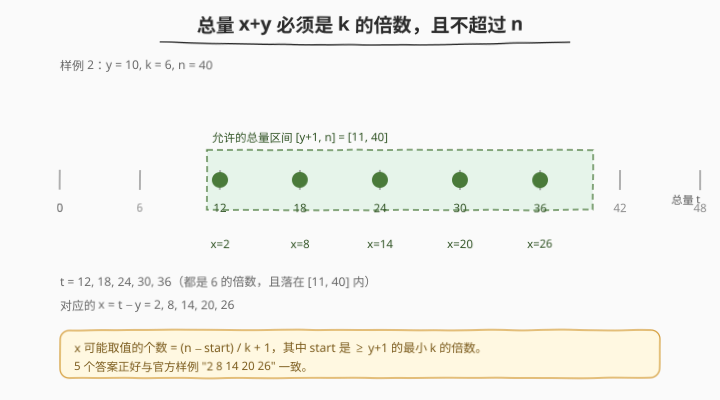
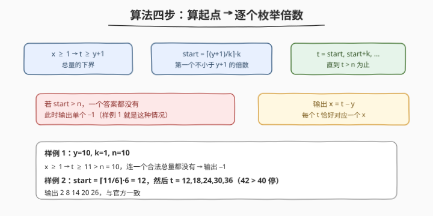

# Codeforces 239A 第一袋土豆数 题解

## 1. 题目概述

- **题目链接**：https://codeforces.com/problemset/problem/239/A
- **比赛来源**：Codeforces Round 148 (Div. 2) · Problem A（UTC 2012-11-04）
- **难度**：1200
- **标签**：数学、枚举、整除
- **评测类型**：普通
- **限制**：时间 1 s / 内存 256 MB

**题意**：Valera 有两个土豆袋，第二袋有 $y \ge 1$ 个土豆，第一袋有 $x \ge 1$ 个。第一袋丢了，但他记得两袋总数 $x + y$ **不超过** $n$，且**能被 $k$ 整除**。求第一袋可能的土豆数 $x$ 的所有取值，按升序、每个只输出一次；没有则输出 $-1$。

输入一行三个整数 $y, k, n$；输出所有可能的 $x$（空格分隔），或 $-1$。

**约束**：

- $1 \le y, k, n \le 10^9$：$x$ 本身可以接近 $10^9$，所以**不能**从 1 到 $n-y$ 枚举 $x$（那是 $10^9$ 次）。
- 答案的个数最多与 $\lfloor n/k \rfloor$ 同阶，题面用图片给出了一个额外约束（本质是保证输出规模可控，不超过 $10^5$ 量级）：任何解法都必须把答案打印出来，因此「枚举答案」是输出敏感的，复杂度不可能低于答案个数。
- 所有运算在 $10^9$ 量级，`int`（上限约 $2.1 \times 10^9$）勉强够，但 $y+1+k-1$ 这类中间量可能到 $2 \times 10^9$，稳妥起见用 64 位。

## 2. 示例与观察

官方样例一：

```text
输入：
10 1 10

输出：
-1
```

官方样例二：

```text
输入：
10 6 40

输出：
2 8 14 20 26
```

**样例一演算**：$y = 10$、$n = 10$，而 $x \ge 1$ 要求 $x + y \ge 11 > n$，一个合法的总量都没有，输出 $-1$。

**样例二演算**：$y = 10$、$k = 6$、$n = 40$。总量 $t = x + y$ 必须满足 $t \ge 11$、$t \le 40$、$6 \mid t$。$6$ 的倍数依次是 $0,6,12,18,24,30,36,42,\dots$，落在 $[11,40]$ 内的是 $12,18,24,30,36$，对应

$$x = t - y = 2,\ 8,\ 14,\ 20,\ 26,$$

正好 5 个，与官方输出一致。

自造样例（标注「自造」）：

| 输入 | 输出 | 说明 |
|------|------|------|
| `1 1 2` | 1 | $x = 1$，总量 2 |
| `1 1 1` | -1 | $x \ge 1$ 但 $x+y \ge 2 > n$ |
| `1 5 20` | 4 9 14 19 | 总量 5,10,15,20 |
| `5 5 10` | 5 | 总量 10，$x = 5$ |
| `1 1000000000 1000000000` | 999999999 | 总量取 $10^9$ |
| `7 3 7` | -1 | 总量至少 8，超过 $n$ |

**观察**：$x$ 的每个取值与「总量 $t = x+y$」一一对应，而 $t$ 的约束非常干净：$t \in [y+1, n]$ 且 $k \mid t$。所以直接枚举 $k$ 的倍数，而不要枚举 $x$。

## 3. 解题思路

### 3.1 朴素做法与瓶颈

最直接的做法是让 $x$ 从 1 枚举到 $n - y$，逐个检查 $(x+y) \bmod k = 0$。但 $n$ 可达 $10^9$，最坏要循环 $10^9$ 次，1 s 内不可能完成；而且绝大多数 $x$ 都会在取模后被淘汰，纯属浪费。

必须换一个角度：**让总量 $t = x+y$ 走「$k$ 的倍数」这条稀疏的路径**，每步跨 $k$，一步踩中一个答案。

### 3.2 核心观察：总量必须落在区间里的倍数上



把条件翻译成对 $t$ 的约束：

- $x \ge 1 \iff t \ge y + 1$；
- $x + y \le n \iff t \le n$；
- $k \mid (x+y) \iff k \mid t$。

于是 $t$ 的候选集合是 $\{t : y+1 \le t \le n,\ k \mid t\}$，每个 $t$ 对应唯一的 $x = t - y$。不同的 $t$ 给出不同的 $x$，所以答案既不重复也不会漏。

### 3.3 算法流程：从第一个倍数开始跳



1. 计算第一个不小于 $y+1$ 的 $k$ 的倍数：

$$\text{start} = \left\lceil \frac{y+1}{k} \right\rceil \cdot k = \frac{y + 1 + k - 1}{k} \cdot k;$$

2. 若 $\text{start} > n$，一个答案都没有，输出 $-1$；
3. 否则令 $t$ 依次取 $\text{start}, \text{start}+k, \text{start}+2k, \dots$，只要 $t \le n$ 就输出 $t - y$；
4. 输出时用空格分隔，末尾换行。

答案个数是

$$\left\lfloor \frac{n - \text{start}}{k} \right\rfloor + 1,$$

与输出规模同阶，无法更优。

### 3.4 样例走查：$y=10, k=6, n=40$

- $\text{start} = \lceil 11/6 \rceil \cdot 6 = 2 \cdot 6 = 12 \le 40$；
- 依次取 $t = 12, 18, 24, 30, 36$；
- 下一个 $t = 42 > 40$，停止；
- 输出 $12-10, 18-10, 24-10, 30-10, 36-10$，即 `2 8 14 20 26`。

再走一遍样例一：$y=10$、$k=1$、$n=10$，$\text{start} = \lceil 11/1 \rceil \cdot 1 = 11 > 10$，直接输出 $-1$。

## 4. 正确性证明

**引理 1（一一对应）**：$x \ge 1$ 且 $x + y \le n$ 且 $k \mid (x+y)$，当且仅当 $t = x+y$ 满足 $y+1 \le t \le n$ 且 $k \mid t$。并且 $t \mapsto x = t-y$ 是双射。

**证明**：$x \ge 1 \iff t = x+y \ge y+1$；$x+y \le n \iff t \le n$；整除条件直接搬运。给定 $t$ 唯一确定 $x$，给定 $x$ 唯一确定 $t$，两方向互逆。∎

**引理 2（start 是最小的合法倍数）**：$\text{start} = \lceil (y+1)/k \rceil \cdot k$ 是满足 $t \ge y+1$ 且 $k \mid t$ 的最小整数。

**证明**：$k$ 的倍数构成等差数列 $\dots, -k, 0, k, 2k, \dots$，不小于 $y+1$ 的最小项就是 $\lceil (y+1)/k \rceil \cdot k$。∎

**引理 3（枚举不漏不重）**：所有满足条件的 $t$ 恰好是 $\text{start}, \text{start}+k, \dots, \text{start} + mk$，其中 $m = \lfloor (n - \text{start})/k \rfloor$。

**证明**：由引理 2，合法的 $t$ 必是 $k$ 的倍数且 $\ge \text{start}$；又 $t \le n$，所以 $t = \text{start} + jk$ 且 $j \le (n-\text{start})/k$，即 $0 \le j \le m$。反过来这些 $t$ 都合法。∎

**定理**：算法输出恰好是全部可能的 $x$（升序、不重复），无解时输出 $-1$。

**证明**：由引理 1、3，算法枚举的 $t$ 与合法 $x$ 一一对应，$t$ 递增则 $x = t-y$ 递增，故升序且不重复。若 $\text{start} > n$，由引理 3 不存在合法 $t$，输出 $-1$ 正确。∎

## 5. 复杂度分析

- **时间**：$O(\text{ans})$，$\text{ans}$ 为答案个数，每次循环做一次减法与一次加法；这是输出敏感的最优复杂度（必须打印 $\text{ans}$ 个数）。
- **空间**：$O(1)$ 额外空间（逐个输出，不需要存数组）。
- **数值范围**：$y, k, n \le 10^9$，$\text{start}$ 可能到 $10^9 + k$ 量级，必须用 64 位；Python 无此问题。
- **与时限的关系**：最坏情况（约 $10^5$ 个答案）实测 C++ 端到端约 16 ms（含进程启动与输出），远小于 1 s。

## 6. 参考代码

### C++17

```cpp
#include <bits/stdc++.h>
using namespace std;

int main() {
    ios::sync_with_stdio(false);
    cin.tie(nullptr);

    long long y, k, n;
    if (!(cin >> y >> k >> n)) return 0;
    long long start = (y + 1 + k - 1) / k * k;   // 最小的 >= y+1 的 k 的倍数
    bool any = false;
    for (long long t = start; t <= n; t += k) {
        if (any) cout << ' ';
        cout << t - y;                            // x = t - y >= 1
        any = true;
    }
    if (!any) cout << -1;
    cout << '\n';
    return 0;
}
```

### Python3

```python
import sys


def main() -> None:
    data = sys.stdin.buffer.read().split()
    if not data:
        return
    y, k, n = int(data[0]), int(data[1]), int(data[2])
    start = (y + 1 + k - 1) // k * k    # 最小的 >= y+1 的 k 的倍数
    xs = list(range(start - y, n - y + 1, k))
    if not xs:
        sys.stdout.write("-1\n")
    else:
        sys.stdout.write(" ".join(map(str, xs)) + "\n")


main()
```

Python 版用 `range(start-y, n-y+1, k)` 直接生成等差数列，语义与循环完全一致。

## 7. 边界情况与易错点

1. **$x \ge 1$ 容易漏掉**：如果只从 $t = 0$ 开始找倍数，会输出 $x = 0$（当 $y$ 是 $k$ 的倍数且 $y \le n$ 时）。例如 `10 5 30` 的合法总量从 15 开始，答案是 `5 10 15 20`，而不是从 0 开始。
2. **$x + y \le n$ 是闭区间**：总量恰好等于 $n$ 时合法（对应 $x = n - y$），循环条件写 `t < n` 会漏掉最后一个答案。
3. **`start` 的取整方向**：`(y+1)/k*k`（向下取整再乘）在 $y+1$ 不是 $k$ 的倍数时得到的是小于 $y+1$ 的倍数，会多输出 $x = 0$ 或负数；必须用 `(y+1+k-1)/k*k`。
4. **`int` 溢出**：$y+1+k-1$ 最大约 $2 \times 10^9$，超过 `int` 上限 $2147483647$ 临界；用 `long long`。
5. **无解输出格式**：无解时只输出一行 `-1`，不要输出空行或多余的 $x$；有解时不要带前导/后缀空格（题目按 token 比较，但写干净更好）。
6. **答案个数与 $k$ 的关系**：$k$ 越大答案越少；当 $k > n$ 时，除了 $t = k$（若 $k \ge y+1$ 且 $k \le n$ 才行）之外基本无解，注意 `start` 可能直接跳过 $n$。
7. **$y = n$**：此时 $x + y \ge n+1 > n$，必然无解，输出 $-1$。
8. **重复输出**：$t$ 严格递增 $k$，$x = t-y$ 也严格递增，天然不会重复；若改用「枚举 $x$ 再判断」的写法则要注意别把同一个 $x$ 输出两次。

## 8. 验证记录

- **编译环境与命令**：本机无 GNU `g++`，用 `clang++ -std=c++17 -O2 -I codeforces/tools/include`（本地 `bits/stdc++.h` 兼容头）编译；Python 3.9.6。
  - `python3 codeforces/tools/verify_solution.py codeforces/contests/0101-0203/239/A_第一袋土豆数.md` → `CF239A: samples 2 / C++ 编译 OK, 样例 2/2 / Python 语法 OK, 样例 2/2`
  - `python3 codeforces/tools/check_samples.py --only 0101-0203/239`、`python3 codeforces/tools/check.py codeforces/contests/0101-0203/239`、`node codeforces/tools/katex_check.cjs codeforces/contests/0101-0203/239` 均 0 问题。
- **官方样例**：2 / 2 通过，C++ 与 Python 输出一致。
- **额外测试与随机对拍**：另写独立暴力（从 $x = 1$ 枚举到 $n-y$，逐个判断 $(x+y) \bmod k = 0$，不使用任何倍数公式），与 C++、Python 逐组比对 **240 组**随机数据（$y \le 30$、$k \le 12$、$n \le 60$），全部一致，覆盖无解、$y=n$、$k > n$、答案含 $x=1$ 等边界。
- **最大约束性能**：$y=1, k=9999, n=10^9$（答案 $10^5$ 个）时 C++ 端到端约 16 ms；$y=999999999, k=10^9, n=10^9$（无解）约 2 ms。
- **图片校验**：`cf239a_multiples.svg`、`cf239a_steps.svg` 均通过 `xml.etree.ElementTree.parse`，含 `feTurbulence` 抖动滤镜与手写字体，逐字符估算包围盒未越出 `viewBox`。
- **公式校验**：`node codeforces/tools/katex_check.cjs codeforces/contests/0101-0203/239` 对该篇 0 错误。
- **复核状态**：verified（样例、对拍、性能、图片、公式全部实跑通过）。

## 相关题目与扩展

- [Codeforces 239B Easy Tape Programming](https://codeforces.com/problemset/problem/239/B)：同场 B 题，按题意模拟一台小机器。
- [Codeforces 238A Not Wool Sequences](https://codeforces.com/problemset/problem/238/A)：同轮的 Div.1 A，组合计数。
- [Codeforces 1A Theatre Square](https://codeforces.com/problemset/problem/1/A)：同样用向上取整公式，可作为取整写法的对照。
- [Codeforces 71A Way Too Long Words](https://codeforces.com/problemset/problem/71/A)：最基础的实现题。
- [LeetCode 1103. 分糖果 II](https://leetcode.cn/problems/distribute-candies-to-people/)：等差数列与取整的简单应用。

**延伸思考**：

1. **如果要求输出所有可能的总量而不是 $x$**：答案就是同一串 $\text{start}, \text{start}+k, \dots$，少一步减法。
2. **如果要求 $x$ 是 $k$ 的倍数而不是 $x+y$**：条件变成 $k \mid x$ 且 $x \le n-y$，答案是 $k, 2k, \dots, \lfloor (n-y)/k \rfloor k$，同样是等差数列枚举。
3. **如果同时要求 $x$ 和 $y$ 都是 $k$ 的倍数**：需要 $y$ 本身是 $k$ 的倍数，否则无解；这是「同余约束」的简单版本，可推广到中国剩余定理。
4. **如果 $n$ 到 $10^{18}$ 且只问答案个数**：不需要枚举，直接用 $\lfloor n/k \rfloor - \lfloor y/k \rfloor$ 之类的差值公式 $O(1)$ 求出；本题要求输出每个值，所以才必须枚举。
