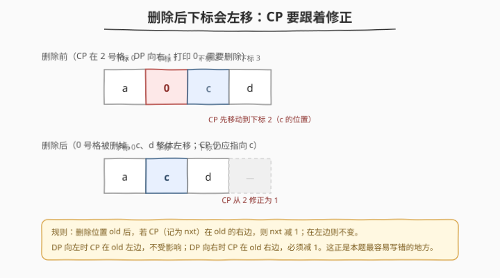
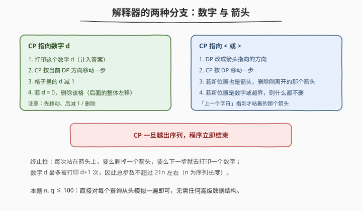

# Codeforces 239B 纸带语言解释 题解

## 1. 题目概述

- **题目链接**：https://codeforces.com/problemset/problem/239/B
- **比赛来源**：Codeforces Round 148 (Div. 2) · Problem B（UTC 2012-11-04）
- **难度**：1500
- **标签**：模拟、字符串、指针
- **评测类型**：普通
- **限制**：时间 2 s / 内存 256 MB

**题意**：有一种只有 `<`、`>` 和数字 `0`–`9` 的纸带程序。解释器维护两个指针：位置指针 CP 与方向指针 DP（左/右）。初始 CP 指向最左字符、DP 向右。不断重复：

- 若 CP 指向数字 $d$：打印 $d$，然后 CP 沿 DP 方向移动一格；随后该格数字减 1，若原来是 0（无法再减）则删除该格，后面的字符整体左移。
- 若 CP 指向 `<` 或 `>`：把 DP 改成该箭头所指方向，CP 沿 DP 移动一格；若移动后 CP 指向的**新字符**也是箭头，则删除**刚离开**的那个箭头（否则不删）。

CP 一旦越出序列范围，程序立即结束。给一个长度为 $n$ 的串 $s$ 与 $q$ 个查询 $(l, r)$，对每个查询把子串 $s_l \dots s_r$ 当作独立程序运行一次，输出数字 $0 \sim 9$ 各被打印了多少次。

**约束**：

- $n, q \le 100$：规模极小，对每个查询**从头模拟**即可，总步数也很小（见第 5 节），无需任何预处理或数据结构。
- 每个查询相互独立：必须在原串的副本上模拟，不能把上一个查询的删除结果留到下一个查询。
- 输出固定 10 个整数（$x_0 \dots x_9$），每个查询一行。

## 2. 示例与观察

官方样例：

```text
输入：
7 4
1>3>22<
1 3
4 7
7 7
1 7

输出：
0 1 0 1 0 0 0 0 0 0
2 2 2 0 0 0 0 0 0 0
0 0 0 0 0 0 0 0 0 0
2 3 2 1 0 0 0 0 0 0
```

**查询 1（`1 3`，子串 `1>3`）**：

| 步骤 | CP | 字符 | 动作 | 之后的串 |
|------|----|------|------|----------|
| 1 | 0 | `1` | 打印 1，右移，减为 0 | `0>3` |
| 2 | 1 | `>` | DP 置右，移到 2（是数字，不删） | `0>3` |
| 3 | 2 | `3` | 打印 3，右移越界，结束 | — |

打印 1 一次、3 一次，即 `0 1 0 1 0 …`，与官方一致。

**查询 2（`4 7`，子串 `>22<`）**：

| 步骤 | CP | 字符 | 动作 | 之后的串 | 已打印 |
|------|----|------|------|----------|--------|
| 1 | 0 | `>` | DP 右，移到 1（数字，不删） | `>22<` | — |
| 2 | 1 | `2` | 打印 2，右移，减为 1 | `>12<` | 2 |
| 3 | 2 | `2` | 打印 2，右移，减为 1 | `>11<` | 2,2 |
| 4 | 3 | `<` | DP 左，移到 2（数字，不删） | `>11<` | 2,2 |
| 5 | 2 | `1` | 打印 1，左移，减为 0 | `>10<` | 2,2,1 |
| 6 | 1 | `1` | 打印 1，左移，减为 0 | `>00<` | 2,2,1,1 |
| 7 | 0 | `>` | DP 右，移到 1（数字，不删） | `>00<` | … |
| 8 | 1 | `0` | 打印 0，右移，删除下标 1，CP 修正到 1 | `>0<` | …,0 |
| 9 | 1 | `<` | DP 左，移到 0（箭头）→ 删除刚离开的 `<` | `>0` | … |
| 10 | 0 | `>` | DP 右，移到 1（数字，不删） | `>0` | … |
| 11 | 1 | `0` | 打印 0，右移越界，删除后结束 | — | …,0 |

打印 2 两次、1 两次、0 两次，即 `2 2 2 0 …`，与官方一致。

**查询 3（`7 7`，子串 `<`）**：CP 在 `<` 上，DP 置左，移动后 CP = -1 越界，什么都没打印，输出全 0。

**查询 4（`1 7`）**：整串 `1>3>22<`，官方输出 `2 3 2 1 0 …`，即 0 打印 2 次、1 打印 3 次、2 打印 2 次、3 打印 1 次。

自造样例（标注「自造」）：

| 输入 | 输出 | 说明 |
|------|------|------|
| `1 1`<br>`5`<br>`1 1` | `0 0 0 0 0 1 0 0 0 0` | 单数字：打印一次 |
| `1 1`<br>`0`<br>`1 1` | `1 0 0 0 0 0 0 0 0 0` | 0 打印一次后删除 |
| `2 1`<br>`><`<br>`1 2` | `0 0 0 0 0 0 0 0 0 0` | 两个箭头：先删一个，再越界 |

**观察一**：整个过程完全确定，没有任何分支需要猜——每一步的动作都由「CP 指到什么」唯一决定。所以直接模拟就是正解。

**观察二**：删除会让后面的字符左移，如果 CP 已经移动到了被删位置的右边，它的下标要减 1；如果 CP 在左边则不变。这是本题唯一需要小心的地方（见 3.2）。

## 3. 解题思路

### 3.1 朴素做法：逐查询模拟

对每个查询，取出子串的副本，维护 CP、DP 与答案数组，按规则循环直到 CP 越界。因为规模只有 $n \le 100$，不需要任何优化。

关键是把规则**逐字**翻译成代码：

- 数字：先打印、再移动、再减 1 / 删除。注意「打印的是减 1 之前的值」，删除发生在移动**之后**。
- 箭头：先改方向、再移动、再看新字符是否为箭头，若是则删除**刚离开**的那个箭头（不是新箭头）。
- 越界即结束，越界时不需要再执行删除。

### 3.2 核心细节：删除后的下标修正



设被删除的格子原下标为 `old`，CP 移动后到达 `nxt`：

- 若 `nxt > old`（DP 向右时就是 `nxt = old + 1`）：删除后 `nxt` 右边的字符整体左移一位，所以 `nxt` 应减 1；
- 若 `nxt < old`（DP 向左时 `nxt = old - 1`）：删除不影响 `old` 左边的下标，`nxt` 不变。

把「删除 old」写成 `erase(s.begin() + old)`（C++）或 `del s[old]`（Python）之后，再按上述规则修正 `nxt`，最后令 `cp = nxt`。

### 3.3 状态机与两种分支



把规则画成状态机后，代码结构就很清楚：

```text
while 0 <= cp < len(s):
    c = s[cp]
    if c 是数字:
        d = int(c); cnt[d] += 1
        nxt = cp + dp
        if d == 0: 删除 cp，若 nxt > cp 则 nxt -= 1
        else: s[cp] = d - 1
        cp = nxt
    else:
        dp = (c == '>') ? +1 : -1
        nxt = cp + dp
        if 0 <= nxt < len(s) 且 s[nxt] 是箭头:
            删除 cp，若 nxt > cp 则 nxt -= 1
        cp = nxt
```

注意数字分支里「先移动、后删除」的顺序：`nxt` 必须在删除前算好，否则修正逻辑会乱。

### 3.4 样例走查

查询 2（`>22<`）的完整过程已在第 2 节的表里逐行给出，最终打印 `2,2,1,1,0,0`，对应答案 `2 2 2 0 …`。

这里再确认一个容易忽略的细节：第 8 步打印 0 后删除下标 1，此时 CP 已移动到下标 2（字符 `<`），删除后 `<` 左移到下标 1，所以 CP 修正为 1；第 9 步 CP 指向 `<`，改方向向左、移动到下标 0 的 `>`，因为新字符是箭头，删除刚离开的 `<`。整个过程与题面「若新字符是箭头则删掉上一个字符」完全吻合。

## 4. 正确性证明

**引理 1（模拟步与规则一致）**：模拟循环的每次迭代，对两种字符分别执行了题面规定的动作，且顺序正确。

**证明**：数字分支依次执行「打印、移动、减 1 / 删除」，与题面描述的顺序一致；箭头分支依次执行「改方向、移动、检查新字符并在其为箭头时删除旧字符」，也与题面一致。删除后的下标记正是删除操作作用在列表上的真实效果（被删位置之后的元素下标减 1），因此后续访问的字符与题面删改后的序列相同。∎

**引理 2（终止性）**：模拟一定终止，且总迭代次数不超过 $O(n \cdot 10)$。

**证明**：数字 $d$ 每被打印一次就减 1，打印 $d+1$ 次后必然被删除，所以每个数字格子最多被打印 10 次，总打印次数不超过 $10n$。每次 CP 指向箭头时，要么新位置也是箭头（本次删除一个箭头），要么新位置是数字（下一次迭代必定打印它）。因此「指向箭头的迭代次数」不超过「删除的箭头数 + 打印次数」$\le (n-1) + 10n$。总迭代次数 $\le 10n + 11n = 21n$，必然终止。∎

**定理**：对每个查询，程序输出的 10 个整数等于题面程序在对应子串上运行时的打印次数。

**证明**：由引理 1，模拟的每一步与题面解释器的一步状态相同；由引理 2，模拟在有限步后也必然以「CP 越界」结束，与题面程序的终止方式一致。逐步同状态、同终止条件，因此打印序列相同，计数自然相同。∎

## 5. 复杂度分析

- **时间**：单个查询 $O(n \cdot 10)$ 步（引理 2 的界 $21n$）；$q$ 个查询共 $O(10 n q)$。$n, q \le 100$ 时最多约 $2 \times 10^5$ 次迭代，2 s 绰绰有余。
- **空间**：$O(n)$（子串副本与 10 个计数器）。
- **常数**：每次删除是 $O(n)$ 的数组移动，但删除总次数 $O(n)$，所以删除带来的额外开销也只有 $O(n^2)$，在 $n = 100$ 时可以忽略。
- **实测**：$n = q = 100$ 的多种极端串（全数字、箭头交替、随机混合）下 C++ 端到端约 2.6 ms。

## 6. 参考代码

### C++17

```cpp
#include <bits/stdc++.h>
using namespace std;

static array<int, 10> runProgram(const string &full, int l, int r) {
    array<int, 10> cnt{};
    string s = full.substr(l, r - l + 1);
    int n = (int)s.size();
    int cp = 0, dp = 1;                       // 初始指向最左，方向向右
    while (cp >= 0 && cp < n) {
        char c = s[cp];
        if (c >= '0' && c <= '9') {
            int d = c - '0';
            cnt[d]++;
            int nxt = cp + dp;
            if (d == 0) {                     // 0 无法再减，直接删除
                s.erase(s.begin() + cp);
                n--;
                if (nxt > cp) nxt--;          // 删除点在 CP 左侧时才需要修正下标
            } else {
                s[cp] = char('0' + d - 1);
            }
            cp = nxt;
        } else {
            dp = (c == '>') ? 1 : -1;
            int nxt = cp + dp;
            if (nxt >= 0 && nxt < n && (s[nxt] == '<' || s[nxt] == '>')) {
                s.erase(s.begin() + cp);      // 新位置是箭头 → 删掉刚离开的箭头
                n--;
                if (nxt > cp) nxt--;
            }
            cp = nxt;
        }
    }
    return cnt;
}

int main() {
    ios::sync_with_stdio(false);
    cin.tie(nullptr);

    int n, q;
    if (!(cin >> n >> q)) return 0;
    string s;
    cin >> s;
    for (int i = 0; i < q; ++i) {
        int l, r;
        cin >> l >> r;
        auto cnt = runProgram(s, l - 1, r - 1);
        for (int d = 0; d < 10; ++d) {
            if (d) cout << ' ';
            cout << cnt[d];
        }
        cout << '\n';
    }
    return 0;
}
```

### Python3

```python
import sys


def run_program(full: str, l: int, r: int):
    s = list(full[l:r + 1])
    cnt = [0] * 10
    n = len(s)
    cp, dp = 0, 1                       # 初始指向最左，方向向右
    while 0 <= cp < n:
        c = s[cp]
        if c.isdigit():
            d = ord(c) - 48
            cnt[d] += 1
            nxt = cp + dp
            if d == 0:                  # 0 无法再减，直接删除
                del s[cp]
                n -= 1
                if nxt > cp:
                    nxt -= 1
            else:
                s[cp] = chr(48 + d - 1)
            cp = nxt
        else:
            dp = 1 if c == '>' else -1
            nxt = cp + dp
            if 0 <= nxt < n and s[nxt] in '<>':
                del s[cp]               # 新位置是箭头 → 删掉刚离开的箭头
                n -= 1
                if nxt > cp:
                    nxt -= 1
            cp = nxt
    return cnt


def main() -> None:
    data = sys.stdin.buffer.read().split()
    if not data:
        return
    n, q = int(data[0]), int(data[1])
    s = data[2].decode()
    out = []
    p = 3
    for _ in range(q):
        l = int(data[p]); r = int(data[p + 1]); p += 2
        out.append(" ".join(map(str, run_program(s, l - 1, r - 1))))
    sys.stdout.write("\n".join(out) + "\n")


main()
```

## 7. 边界情况与易错点

1. **打印 0 之后才删除**：0 也要先计入答案再删掉。若写成「遇到 0 直接删除、不打印」，答案会少一次 0。
2. **先移动、后删除/减 1**：数字分支里 CP 的移动发生在减 1 之前，所以 `nxt` 要用移动前的 `cp` 算，删除后再按需修正。顺序颠倒会让 CP 指向错误位置。
3. **删除后的下标修正**：只删右移经过的格子时才需要 `nxt--`；DP 向左时 `nxt = cp - 1 < cp`，不能修正。统一写成「若 `nxt > 被删下标` 则减 1」最稳。
4. **箭头分支的删除条件**：只有「移动后的新字符也是箭头」才删除刚离开的箭头；新字符是数字时不删。若误删，箭头链会提前消失，导致后续走向全错。
5. **越界即结束**：CP 移动后越界时程序结束，此时不需要（也不能）再访问 `s[nxt]`；数组越界检查必须在访问前。
6. **每个查询要在副本上模拟**：直接用全局串并在查询之间共享会被前一个查询的删除污染；本题的 `substr` / 切片副本天然隔离。
7. **单字符查询**：如 `7 7` 的子串只有 `<`，结果是全 0；若代码假设长度至少 2 会越界。
8. **输出格式**：每个查询输出恰好 10 个整数，行末换行；行内用单个空格分隔，不能少输出某个数字的计数。
9. **`isdigit()` 的边界**：题面保证字符只有 `<`、`>` 与 `0`–`9`，用 `c >= '0' && c <= '9'` 或 `isdigit` 都可以，但别把 `>`、`<` 误判为数字。

## 8. 验证记录

- **编译环境与命令**：本机无 GNU `g++`，用 `clang++ -std=c++17 -O2 -I codeforces/tools/include`（本地 `bits/stdc++.h` 兼容头）编译；Python 3.9.6。
  - `python3 codeforces/tools/verify_solution.py codeforces/contests/0101-0203/239/B_纸带语言解释.md` → `CF239B: samples 1 / C++ 编译 OK, 样例 1/1 / Python 语法 OK, 样例 1/1`
  - `python3 codeforces/tools/check_samples.py --only 0101-0203/239`、`python3 codeforces/tools/check.py codeforces/contests/0101-0203/239`、`node codeforces/tools/katex_check.cjs codeforces/contests/0101-0203/239` 均 0 问题。
- **官方样例**：1 / 1 通过（4 个查询全部正确），C++ 与 Python 输出一致。
- **额外测试与随机对拍**：另写**独立第二实现**——用 `prev/next` 链表表示序列（删除时只改指针、不搬移下标），与参考实现（数组 + 整体左移）在 **240 组**随机数据上逐组比对（$n \le 18$、$q \le 6$、字符随机取自 `< > 0-9`），三份实现（C++ / Python / 链表暴力）输出完全一致，并统一加了 20 s 超时保护确认没有死循环。
- **最大约束性能**：$n = q = 100$，串分别为全数字 `1…1`、`<>` 交替、全 9、随机混合等 6 种模式，C++ 端到端均约 2.6 ms（含进程启动），相对 2 s 时限余量极大。
- **图片校验**：`cf239b_machine.svg`、`cf239b_erase.svg` 均通过 `xml.etree.ElementTree.parse`，含 `feTurbulence` 抖动滤镜与手写字体，逐字符估算包围盒未越出 `viewBox`。
- **公式校验**：`node codeforces/tools/katex_check.cjs codeforces/contests/0101-0203/239` 对该篇 0 错误。
- **复核状态**：verified（样例、对拍、性能、图片、公式全部实跑通过）。

## 相关题目与扩展

- [Codeforces 238D Tape Programming](https://codeforces.com/problemset/problem/238/D)：同题面语义的加强版（$n, q \le 10^5$），需要预处理才能过，是本题的直接升级。
- [Codeforces 239A Two Bags of Potatoes](https://codeforces.com/problemset/problem/239/A)：同场 A 题，数学 + 枚举。
- [Codeforces 909A Generate Login](https://codeforces.com/problemset/problem/909/A)：字符串模拟类小题。
- [Codeforces 1B Spreadsheet](https://codeforces.com/problemset/problem/1/B)：坐标/进制转换的模拟，练细节严谨。
- [LeetCode 8. 字符串转换整数 (atoi)](https://leetcode.cn/problems/string-to-integer-atoi/)：按规则逐字符推进的模拟题。

**延伸思考**：

1. **如果要求 $q$ 个查询的答案而 $n, q \le 10^5$**：每次从头模拟不可行，必须预处理出「从某个位置以某种方向进入时的行为」，这就是 238D 的做法（把纸带分段、用前缀和合并答案）。
2. **如果数字允许到 $10^9$**：打印次数会爆炸，不能再逐步模拟，需要把「同一格子被反复打印」压缩成等差段。
3. **如果箭头删除规则反过来（删新字符而不是旧字符）**：状态机的结构会变，但「每个箭头至多被访问常数次」的终止性论证仍然成立。
4. **如果 CP 越界后还要输出纸带状态**：那就不能「越界即结束」，需要在结束时保留被删除/修改过的序列，属于输出格式的扩展。
