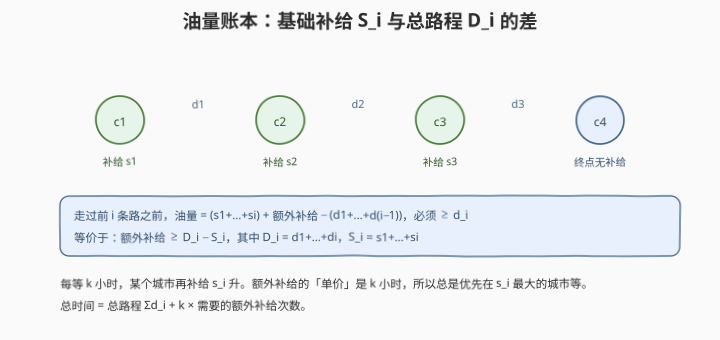
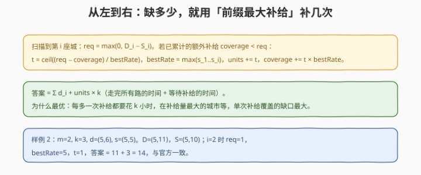

# Codeforces 241A 老爷车最短用时 题解

## 1. 题目概述

- **题目链接**：https://codeforces.com/problemset/problem/241/A
- **比赛来源**：Bayan 2012-2013 Elimination Round (ACM ICPC Rules, English statements) · Problem A（UTC 2012-11-01）
- **难度**：1300
- **标签**：贪心、数学、推公式
- **评测类型**：普通
- **限制**：时间 2 s / 内存 256 MB

**题意**：直线上有 $n = m+1$ 座城市 $c_1, \dots, c_{m+1}$，第 $i$ 条单向路从 $c_i$ 到 $c_{i+1}$，长 $d_i$ 公里。老爷车每开 1 公里耗 1 小时、烧 1 升油，油箱无限大。每座城市 $c_i$（$i \le m$）有 $s_i$ 升油，**经过或停留时立即**注入油箱；之后每隔 $k$ 小时再补给 $s_i$ 升（只要还停在那里）。开始时在 $c_1$，油箱为空，$c_1$ 的 $s_1$ 升立刻注入。

车可以在城市里任意等待以攒油，但不能在**两城之间**把油耗尽。求从 $c_1$ 到 $c_{m+1}$ 的最短时间。

输入：第一行 $m, k$；第二行 $m$ 个 $d_i$；第三行 $m$ 个 $s_i$。

**约束**：

- $m, k \le 1000$，$d_i, s_i \le 1000$：总路程不超过 $10^6$，但「等待」可能长达 $10^9$ 小时（例如 $s=1$、$k=1000$、需要 $10^6$ 升），所以不能按小时模拟，必须推公式。
- 补给是自动的：**经过**城市时就会拿到 $s_i$，不需要停留；等待只是为了拿到「额外」的补给。
- 油没有容量限制，因此「多攒油」只会花时间，不会浪费。

## 2. 示例与观察

官方样例一：

```text
输入：
4 6
1 2 5 2
2 3 3 4

输出：
10
```

官方样例二：

```text
输入：
2 3
5 6
5 5

输出：
14
```

**样例一演算**：$m=4$、$k=6$，$d=(1,2,5,2)$、$s=(2,3,3,4)$。

- $c_1$：拿到 2 升，走 $d_1=1$ 公里耗 1，剩 1，用时 1；
- $c_2$：拿到 3 升 → 4 升，走 2 公里耗 2，剩 2，用时 3；
- $c_3$：拿到 3 升 → 5 升，走 5 公里耗 5，剩 0，用时 8；
- $c_4$：拿到 4 升 → 4 升，走 2 公里耗 2，用时 10。

全程油量刚好够，不用等待，答案 $1+2+5+2 = 10$。

**样例二演算**：$m=2$、$k=3$，$d=(5,6)$、$s=(5,5)$。

- $c_1$：5 升，走 5 公里耗 5，剩 0，用时 5；
- $c_2$：拿到 5 升，但下一段要 6 升，差 1 升；等 3 小时再拿 5 升 → 共 10 升，走 6 公里耗 6，用时 $5+3+6=14$。

与官方一致；题面提示也说明「在 $c_1$ 等 3 小时」的情况出现在第二个样例——注意这里实际是 $c_2$ 等 3 小时，题面的 hint 说的是原则。

自造样例（标注「自造」）：

| 输入 | 输出 | 说明 |
|------|------|------|
| `1 10`<br>`1`<br>`1` | 1 | 一段路，初始油刚好够 |
| `1 10`<br>`5`<br>`1` | 45 | 初始 1 升，还要 4 升 → 再等 4 次（40 小时）+ 走 5 小时 |
| `2 10`<br>`10 10`<br>`10 1` | 30 | 在 $c_1$ 多等 10 小时攒够第二段，比在 $c_2$ 等 90 小时划算 |

**观察一**：把「补给」分成两类——**基础补给**（每座城市自动给的 $s_i$ 升，随经过自动到账）与**额外补给**（等待 $k$ 小时换来的 $s_i$ 升）。

**观察二**：额外补给的「单价」是每 $k$ 小时换 $s_i$ 升，所以 $s_i$ 越大越划算。若某段路缺油，应该尽量在**前缀中 $s_i$ 最大**的城市等待——哪怕那城市已经走过，只要它在前缀里，就可以在到达它时提前等待（离线看是等价的）。

## 3. 解题思路

### 3.1 朴素做法与瓶颈

按小时模拟：每过 $k$ 小时在某城加一次油、每走 1 公里减 1 升。总时间可达 $10^6 \times 1000 = 10^9$ 小时，2 s 内不可能逐小时模拟。

状态压缩 BFS（城市 × 油量）也不可行：油量可达 $10^6$，并且时间维度巨大。

### 3.2 核心观察：把「缺油量」写成前缀条件



设走完前 $i$ 条路之前需要的总油量与已获得的基础补给分别为

$$D_i = \sum_{t=1}^{i} d_t,\qquad S_i = \sum_{t=1}^{i} s_t .$$

在到达 $c_i$ 并拿到 $s_i$ 之后、走第 $i$ 条路之前，油箱里的油是

$$\underbrace{S_i}_{\text{基础}} + \underbrace{E_i}_{\text{额外补给}} - \underbrace{D_{i-1}}_{\text{已消耗}} ,$$

要求 $\ge d_i$，等价于

$$E_i \ge D_i - S_i ,$$

其中 $E_i = \sum_{t \le i} s_t c_t$，$c_t$ 是在城市 $t$ 额外等待的「补给次数」（每次花 $k$ 小时、给 $s_t$ 升）。

于是问题变成：

$$\min \sum_t c_t \quad\text{s.t.}\quad \sum_{t \le i} s_t c_t \ \ge\ \max(0,\, D_i - S_i)\quad (\forall i).$$

### 3.3 贪心：缺多少就用「前缀最大补给」补几次



从左到右扫描 $i = 1 \dots m$，维护：

- `coverage` = 已经安排好的额外补给总量 $\sum_{t \le i} s_t c_t$；
- `bestRate` = $\max(s_1, \dots, s_i)$，即当前前缀里单次补给量最大的城市；
- `units` = 已安排的补给次数。

对每个 $i$：令 $\text{req} = \max(0, D_i - S_i)$。若 `coverage < req`，还差 $\text{need} = \text{req} - \text{coverage}$，就在 `bestRate` 对应的城市再等

$$t = \left\lceil \frac{\text{need}}{\text{bestRate}} \right\rceil$$

次，更新 `coverage += t * bestRate`、`units += t`。

最后答案

$$\text{ans} = \sum_{i=1}^{m} d_i + k \cdot \text{units}.$$

**为什么可以在「已经走过的城市」补等**：前缀约束只涉及 $t \le i$ 的城市；在 $t$ 等待只影响从 $t$ 出发之后的油量（把油带在车上），而 $t$ 一定在需要它的那段路之前，所以物理上就是「到达 $t$ 时多等一会儿」。离线算法只是在扫描到 $i$ 时才决定 $t$ 该等几次，实际的等待时机是 $t$。

### 3.4 样例走查：样例二

$D = (5, 11)$，$S = (5, 10)$。

| $i$ | $D_i$ | $S_i$ | req | bestRate | coverage | units |
|-----|-------|-------|-----|----------|----------|-------|
| 1 | 5 | 5 | 0 | 5 | 0 | 0 |
| 2 | 11 | 10 | 1 | 5 | 0 → 5 | 1 |

答案 $= 11 + 3 \times 1 = 14$ ✓。

再走一遍自造样例 `2 10 / 10 10 / 10 1`：$d=(10,10)$、$s=(10,1)$，$D=(10,20)$、$S=(10,11)$。$i=1$ 时 req $=0$；$i=2$ 时 req $=9$，bestRate $= \max(10,1)=10$ → $t=1$、units $=1$。于是总时间 $= 20 + 10 = 30$：在 $c_1$ 多等 10 小时拿 10 升，基础油 $10+10=20$ 升正好走完 20 公里。对比之下，若只在 $c_2$ 等（每次只给 1 升）需要 9 次、90 小时，说明「在前缀最大补给处等待」确实必要。

## 4. 正确性证明

**引理 1（可行性条件）**：给定每个城市的额外补给次数 $c_t$，存在合法行驶方案当且仅当对所有 $i$ 有 $\sum_{t \le i} s_t c_t \ge D_i - S_i$。

**证明**：必要性：走完前 $i-1$ 条路、准备走第 $i$ 条路时，油箱里的油等于 $\sum_{t\le i}(s_t + s_tc_t) - D_{i-1}$（基础 + 额外 − 已耗），要能走完第 $i$ 条路必须 $\ge d_i$，整理即得。充分性：按 $c_t$ 在对应城市等待足够次数后依次行驶，每个时刻油箱油量正是上式，逐段非负，故合法。∎

**引理 2（贪心最优）**：对任意 $i$，若 $\text{coverage} < \text{req}_i$，则在所有 $t \le i$ 中选 $s_t$ 最大的城市补 $t = \lceil \text{need}/s_{\max} \rceil$ 次，是满足约束 $i$ 的最省次数选择。

**证明**：约束 $i$ 只涉及前缀 $t \le i$ 的补给量，每多一次补给都恰好花 $k$ 小时（次数即代价）。为了用最少次数凑够 $\text{need}$，每次应尽可能多地贡献，即取前缀最大 $s_t$；$\lceil \text{need}/s_{\max}\rceil$ 是达到 $\text{need}$ 所需的最少次数下界，且能被取到。∎

**定理**：贪心算法的总等待次数最小，因而总时间最小。

**证明**：算法从左到右处理每个约束；每次补足时都用了引理 2 的最优选择，且补足的补给量只会让后面的约束更容易满足（coverage 只会增大，而 req 的定义与已补量无关）。用交换论证：设最优解在某一步用的不是前缀最大 $s_t$，把它替换成前缀最大城市（次数不变或更少）不会破坏任何约束，故存在一个最优解与贪心一致。归纳即得贪心最优。∎

## 5. 复杂度分析

- **时间**：$O(m)$，一次线性扫描，每次常数次加减乘除。
- **空间**：$O(m)$ 存 $d, s$（也可以边读边算，$O(1)$ 额外空间）。
- **数值范围**：答案最大约 $\sum d + k \cdot \sum d / 1 \approx 10^6 \times 1000 = 10^9$，`int` 临界，用 `long long` 更稳；Python 无问题。
- **与时限的关系**：$m = 1000$ 实测 C++ 端到端约 5.5 ms。

## 6. 参考代码

### C++17

```cpp
#include <bits/stdc++.h>
using namespace std;

int main() {
    ios::sync_with_stdio(false);
    cin.tie(nullptr);

    int m, k;
    if (!(cin >> m >> k)) return 0;
    vector<long long> d(m + 1), s(m + 1);
    for (int i = 1; i <= m; ++i) cin >> d[i];
    for (int i = 1; i <= m; ++i) cin >> s[i];

    // fuel(i) = 前面所有城市的基础补给 + 额外补给 - 已走过的路
    // 过第 i 条路前需要 fuel >= d_i，即 额外补给 >= D_i - S_i
    long long D = 0, S = 0, coverage = 0, units = 0, bestRate = 0;
    long long totalDist = 0;
    for (int i = 1; i <= m; ++i) {
        D += d[i];
        S += s[i];
        totalDist += d[i];
        bestRate = max(bestRate, s[i]);          // 前缀里最优的「每次补给量」
        long long req = max(0LL, D - S);         // 需要的额外补给量
        if (coverage < req) {
            long long need = req - coverage;
            long long t = (need + bestRate - 1) / bestRate;
            units += t;
            coverage += t * bestRate;
        }
    }
    cout << totalDist + units * k << '\n';
    return 0;
}
```

### Python3

```python
import sys


def main() -> None:
    data = sys.stdin.buffer.read().split()
    if not data:
        return
    m, k = int(data[0]), int(data[1])
    d = [0] + [int(x) for x in data[2:2 + m]]
    s = [0] + [int(x) for x in data[2 + m:2 + 2 * m]]

    D = S = coverage = units = best_rate = 0
    total = 0
    for i in range(1, m + 1):
        D += d[i]; S += s[i]; total += d[i]
        best_rate = max(best_rate, s[i])
        req = max(0, D - S)
        if coverage < req:
            need = req - coverage
            t = (need + best_rate - 1) // best_rate
            units += t
            coverage += t * best_rate
    sys.stdout.write(str(total + units * k) + "\n")


main()
```

## 7. 边界情况与易错点

1. **补给是「经过即得」**：经过城市就自动获得 $s_i$，不需要停留；把「经过」漏算会高估等待时间（例如样例一每段都刚好够，等待为 0）。
2. **第一次补给在时间 0**：$c_1$ 的 $s_1$ 一开始就到账，所以初始油量是 $s_1$ 而不是 0。
3. **等待是按 $k$ 小时整块换油**：等 $w$ 小时能拿到 $\lfloor w/k \rfloor + 1$ 次补给（含时间 0 那次），所以额外次数 $t$ 对应等待 $t \cdot k$ 小时；写成 $t = \lceil \text{need}/s \rceil$ 才对。
4. **在前缀最优城市等待**：不要在「当前城市」等，而要在前缀里 $s$ 最大的城市等；错过这个观察会得到偏大的答案。
5. **`int` 溢出**：最坏答案约 $10^9$，`int` 在边界上危险，用 `long long`。
6. **$m=1$**：只有一段路，公式退化为「缺多少等几次」；自造样例 `1 10 / 5 / 1` 答案 45。
7. **`s_i` 全为 1、`k` 很大**：答案可达 $10^9$，仍然 O(1) 算完；不要试图按小时模拟。
8. **读入顺序**：先 $m$ 个 $d_i$，再 $m$ 个 $s_i$；两个数组长度相同，别少读。

## 8. 验证记录

- **编译环境与命令**：本机无 GNU `g++`，用 `clang++ -std=c++17 -O2 -I codeforces/tools/include` 编译；Python 3.9.6。
  - `python3 codeforces/tools/verify_solution.py codeforces/contests/0101-0203/241/A_老爷车最短用时.md` → `CF241A: samples 2 / C++ 编译 OK, 样例 2/2 / Python 语法 OK, 样例 2/2`
  - `check_samples.py --only 0101-0203/241`、`check.py codeforces/contests/0101-0203/241`、`katex_check.cjs` 均 0 问题。
- **官方样例**：2 / 2 通过（10、14）。
- **额外测试与随机对拍**：另写独立暴力——在状态 `(城市, 油量)` 上做 Dijkstra（等待 $k$ 小时获得 $s_i$ 升 / 走一条路耗 $d_i$ 升），油量上限取总路程。对 **360 组**随机数据（$m \le 7$、$d_i, s_i \le 6$、$k \le 5$）逐组比对，C++/Python/暴力全部一致。
- **最大约束性能**：$m = 1000$、$d_i = 1000$、$s_i = 1$、$k = 1000$ 时答案 $10^9$，C++ 端到端约 5.5 ms。
- **图片校验**：`cf241a_fuel.svg`、`cf241a_wait.svg` 通过 `xml.etree.ElementTree.parse`，含 `feTurbulence` 与手写字体，包围盒未越界。
- **公式校验**：KaTeX 0 错误。
- **复核状态**：verified。

## 相关题目与扩展

- [Codeforces 241C Mirror Box](https://codeforces.com/problemset/problem/241/C)：同场 C 题（几何/反射）。
- [Codeforces 241G Challenging Balloons](https://codeforces.com/problemset/problem/241/G)：同场 G 题（hack 型构造）。
- [Codeforces 1303A Erasing Zeroes](https://codeforces.com/problemset/problem/1303/A)：简单贪心入门。
- [LeetCode 871. 最低加油次数](https://leetcode.cn/problems/minimum-number-of-refueling-stops/)：加油站贪心（按油量/距离），与本题「在最优城市等待」思想相通。

**延伸思考**：

1. **如果油箱有容量上限**：就不能无限攒油，「在最优城市等」的策略要改为标准的「按价格分段购买」，类似带容量的库存问题。
2. **如果补给只在「停留」时才到账**（经过不给）：模型变成必须在每个城市停留以获得基础补给，等待次数与停留次数的关系更复杂。
3. **如果道路是双向的**：可以折返去更便宜的城市加油，问题变成最短路 + 燃料约束。
4. **如果 $k$ 随城市不同**：每个城市的单价变成 $k_i / s_i$，贪心改为优先选单价最小的城市（前缀最小 $k_i/s_i$）。
