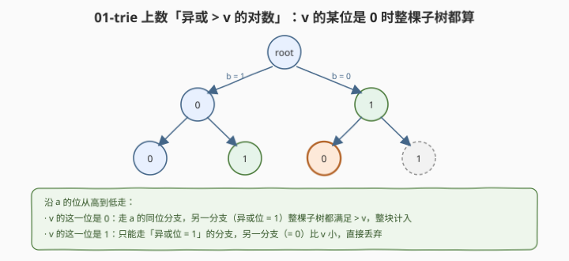
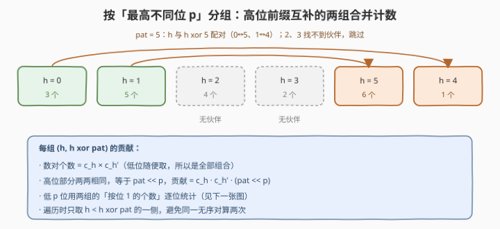
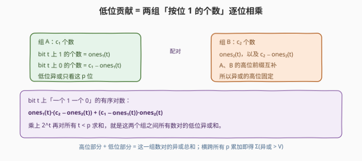

# Codeforces 241B 合照异或和最大 题解

## 1. 题目概述

- **题目链接**：https://codeforces.com/problemset/problem/241/B
- **比赛来源**：Bayan 2012-2013 Elimination Round (ACM ICPC Rules, English statements) · Problem B（UTC 2012-11-01）
- **难度**：2700
- **标签**：二分、位运算、01-trie、数学
- **评测类型**：普通
- **限制**：时间 6 s / 内存 256 MB

**题意**：有 $n$ 个朋友，第 $i$ 个的吸引力是 $a_i$。要拍 $m$ 张照片，每张恰好包含两个朋友，且任意两张照片的朋友对不同。第 $i,j$ 个朋友合照的吸引力是 $a_i \operatorname{xor} a_j$。求 $m$ 张照片吸引力之和的最大值，对 $10^9+7$ 取模。

**约束**：

- $n \le 5\times 10^4$：数对总数可达 $\binom{n}{2}\approx 1.25\times 10^9$，不能在数对上排序。
- $m \le \binom{n}{2}$：$m$ 本身也大到 $10^9$ 量级，必须用 `long long`。
- $0 \le a_i \le 10^9 < 2^{30}$：**30 位**二进制，$O(n\log^2 A)$ 级别的算法可行。
- 答案先精确求和再取模（和可达 $10^{18}$ 量级），不能边加边模掉计数。

## 2. 示例与观察

官方样例一：

```text
输入：
3 1
1 2 3

输出：
3
```

官方样例二：

```text
输入：
3 2
1 2 3

输出：
5
```

官方样例三：

```text
输入：
3 3
1 2 3

输出：
6
```

**样例演算**：三个朋友，三对异或分别是

$$1\operatorname{xor}2=3,\qquad 1\operatorname{xor}3=2,\qquad 2\operatorname{xor}3=1 .$$

按从大到小排好是 $3,2,1$。取 1 个得 $3$，取 2 个得 $5$，取 3 个得 $6$，与三组输出一致。

**观察一**：答案只取决于「最大的 $m$ 个异或值」，与是哪几对无关。于是只要能**按值**从大到小选，就不必真的把 $1.25\times10^9$ 个数对生成出来。

**观察二**：设第 $m$ 大的异或值（从 1 开始数）为 $V$，那么

$$\text{答案}=\sum_{\text{异或} > V}\big(a_i\operatorname{xor}a_j\big)\;+\;\big(m-\#\{\text{异或}>V\}\big)\cdot V .$$

因为所有大于 $V$ 的数对一定都在前 $m$ 大里；剩下还差几个，就用异或值恰好为 $V$ 的数对补齐，它们的贡献都是 $V$。

**观察三**：上式把问题拆成两半：① 求 $V$ 并数出「异或 $>V$」的对数；② 求这些数对的异或**和**。前者用 01-trie 就能在 $O(30n)$ 内完成一次查询，二分 $V$ 只要 30 次；后者需要额外一点技巧（见 3.3）。

## 3. 解题思路

### 3.1 朴素做法与瓶颈

- 生成全部 $\binom{n}{2}$ 个异或再排序：$1.25\times 10^9$ 个数，时间和内存都爆。
- 对每个元素贪心选「异或最大」的伙伴：只能取出前几个，无法保证整体最优（同一对数对不能被两张照片共用）。
- 用堆维护每个元素与其余元素的最大异或：仍然是 $O(n^2)$ 级别，且去重很麻烦。

真正的瓶颈是「第 $m$ 大」这个全局阈值：一旦知道阈值 $V$，剩下的事就只剩计数与求和。

### 3.2 求第 $m$ 大的异或值：01-trie + 二分



把 $n$ 个数插入一棵 30 层的 01-trie，每个节点记 `cnt` = 子树里的数字个数。对固定的 $a$ 和阈值 $v$，统计「有多少 $b$ 使 $a\operatorname{xor}b>v$」：

从高位往低位走 $v$ 与 $a$ 的对应位：

- 若 $v$ 这一位是 $0$：那么「异或这一位 $=1$」的所有 $b$（即 $a$ 这一位的相反分支）都满足 $>v$，把该子树的 `cnt` 整块加上；然后沿「异或位 $=0$」的分支继续走。
- 若 $v$ 这一位是 $1$：为了不落后于 $v$，必须让异或位 $=1$，只能沿相反分支继续走；同位的分支（异或位 $=0$）比 $v$ 小，整块丢弃。

走到底时异或恰好等于 $v$，不计入（要严格大于）。单次查询 $O(30)$，对所有 $a_i$ 求和得有序对数，除以 2 即无序对数，记作 $f(v)$。

$f(v)$ 关于 $v$ 单调不增，于是二分找

$$V=\min\{\,v: f(v)<m\,\}.$$

二分区间 $[-1,\ 2^{30}-1]$：左端点 $-1$ 对应 $f(-1)=\binom{n}{2}\ge m$，右端点对应 $f=0<m$，共 30 轮。此时 $V$ 正是第 $m$ 大的异或值：大于 $V$ 的数对不足 $m$ 个，而大于等于 $V$ 的够 $m$ 个。

### 3.3 求和：按「最高不同位」分组



关键是看清「异或 $>V$」的数对长什么样。对一对 $(a,b)$，令 $p$ 是它们异或值与 $V$ **最高不同的那一位**。要让它 $>V$，必须

$$V_p=0,\qquad (a\operatorname{xor}b)_p=1,\qquad \text{高于 }p\text{ 的位完全相同}.$$

于是在第 $p$ 位上，这对数的高位模式是固定的：

$$\text{pat}_p=(V\gg p)\mid 1,\qquad (a\gg p)\operatorname{xor}(b\gg p)=\text{pat}_p .$$

也就是说：按「高位前缀」$h=a\gg p$ 把数分组，则一个数对属于第 $p$ 组当且仅当它的两个数分别落在组 $h$ 和组 $h\operatorname{xor}\text{pat}_p$ 里。因为 $\text{pat}_p$ 的最低位是 1，$h\ne h\operatorname{xor}\text{pat}_p$，不会出现自己配自己；又因为 $p$ 是**最高**不同位，$p$ 唯一，所以不同的 $p$ 之间不重不漏。

遍历所有满足 $V_p=0$ 的 $p$，把「组 $h$ 与组 $h\operatorname{xor}\text{pat}_p$」的贡献加起来即可。为了不把同一无序对算两次，只处理 $h<h\operatorname{xor}\text{pat}_p$ 的一侧。



对固定的一对组 $(A,B)$：高位部分是定值 $\text{pat}_p\ll p$，共 $c_A\cdot c_B$ 对，贡献 $c_A c_B(\text{pat}_p\ll p)$。低位（第 $0..p-1$ 位）要逐位算：在第 $t$ 位上「一个 1 一个 0」的有序对数是

$$ones_A(t)\big(c_B-ones_B(t)\big)+\big(c_A-ones_A(t)\big)ones_B(t),$$

乘 $2^t$ 求和就是低位的总异或和。这里 $ones_A(t)$ 是组 $A$ 中第 $t$ 位为 1 的数字个数。

实现上：把数组排序后，$a\gg p$ 随 $a$ 单调，所以按 $a\gg p$ 分组就是排序数组上的连续段（跑一遍即可），伙伴组用二分查找键值定位。

### 3.4 样例走查

取样例 $a=(1,2,3)$、$m=2$：三对异或 $\{3,2,1\}$，第 2 大是 $V=2$。

- $f(2)=\#\{\text{异或}>2\}=1$（只有 3），$f(1)=2\ge 2$，所以 $V=2$ 正确。
- 求 $\sum_{\text{异或}>2}$：$V=2=(10)_2$，只有 $p=0$ 满足 $V_p=0$。此时 $\text{pat}_0=(2\gg0)\mid1=3$。
  - 按 $a\gg 0$ 分组：组 $1$（值 1）、组 $2$（值 2）、组 $3$（值 3），每组 1 个。
  - 组 $1$ 的伙伴是 $1\operatorname{xor}3=2$：存在，$1<2$，计入 $1\cdot1\cdot3=3$（这一对的异或正是 $1\operatorname{xor}2=3$）。
  - 组 $2$ 的伙伴是 $1$，但 $2>1$，跳过（避免重复）。
  - 组 $3$ 的伙伴是 $0$，不存在。
- 答案 $=3+(2-1)\cdot2=5$ ✓。

$m=3$ 时 $V=1$：$p=1,\dots,29$ 全部满足 $V_p=0$，$\text{pat}_p=1$。真正有伙伴的只有 $p=1$（此时组 $0$ 含 $\{1\}$，组 $1$ 含 $\{2,3\}$）：高位 $1\ll1=2$ 贡献 $1\cdot2\cdot2=4$；低位 $t=0$ 上 $ones_0=1$、$ones_1=1$，差位对 $=1\cdot(2-1)+0\cdot1=1$，贡献 $1$。合计 $5$，加上 $(3-2)\cdot1=1$ 得 $6$ ✓。

## 4. 正确性证明

**引理 1（阈值刻画）**：设 $V$ 是第 $m$ 大的异或值（$m\ge1$），则「所有异或 $>V$ 的数对」加上任意 $m-f(V)$ 个「异或 $=V$」的数对，恰好构成一个和最大的 $m$ 对数对集合。

**证明**：设 $S$ 为异或 $>V$ 的数对集合，$|S|=f(V)<m$。取任意 $m$ 对数对的集合 $T$：若 $T$ 含有一个异或 $<V$ 的对，则因为异或 $>V$ 的对只有 $f(V)<m$ 个，$T$ 必然漏掉某个异或 $\ge V$ 的对，把漏掉的对换进来不会让总和变小（换掉的值 $<V\le$ 换进的值），反复交换即得一个不含「异或 $<V$」的最优解，它必是 $S$ 加上若干个 $=V$ 的对。而所有 $=V$ 的对贡献相同，故引理成立。∎

**引理 2（trie 计数正确）**：上述走法对每个 $a$ 恰好统计了满足 $a\operatorname{xor}b>v$ 的 $b$ 的个数。

**证明**：把 $a\operatorname{xor}b>v$ 按「最高的不同位」分类。设最高不同位为 $q$，则必须 $(a\operatorname{xor}b)_q=1$、$v_q=0$，且高于 $q$ 的位两侧相同。算法在 $v$ 的位为 0 时把「异或位 $=1$」的整棵子树计入（这正好覆盖所有最高不同位为当前位的 $b$），然后沿「异或位 $=0$」的分支继续（这些 $b$ 在当前位与 $v$ 相同，最高不同位只会更低）；在 $v$ 的位为 1 时，异或位 $=0$ 的 $b$ 已经比 $v$ 小（最高不同位就在这里且异或位更小），整块丢弃，只沿异或位 $=1$ 的分支继续。每个 $b$ 恰好在它自己的最高不同位处被计入一次，走完全程仍未计入的满足异或 $=v$，不算。∎

**引理 3（分组不重不漏）**：对每个满足 $V_p=0$ 的 $p$，令 $G_p$ 为「最高不同位是 $p$ 且异或 $>V$」的数对集合，则 $G_p$ 互不相交，且 $\bigcup_{p:V_p=0}G_p=\{\text{异或}>V\}$。

**证明**：每个异或 $>V$ 的数对都有唯一的最高不同位 $p$，且该位必然满足 $V_p=0$（否则异或 $\le V$），故并集正确、两两不交。而「最高不同位是 $p$ 且高位模式为 $V$」等价于 $(a\gg p)\operatorname{xor}(b\gg p)=\text{pat}_p$，正好是「两个数分别落在组 $h$ 与组 $h\operatorname{xor}\text{pat}_p$」。∎

**定理**：算法输出的值等于「最大的 $m$ 个异或值之和」。

**证明**：由引理 2、二分单调性，算法求出的 $V$ 满足 $f(V)<m\le f(V-1)$，即 $V$ 是第 $m$ 大；由引理 3 与按位计数公式，`sumAbove` 精确等于 $\sum_{\text{异或}>V}$ 的异或和；再加上 $(m-f(V))\cdot V$，由引理 1 即为最优总和。最后取模不改变同余类。∎

## 5. 复杂度分析

- **时间**：建 trie $O(30n)$；二分 30 轮，每轮对所有元素查询一次 $O(30n)$，共 $O(30\cdot30n)=O(n\log^2 A)$；求和部分对每个 $p$（至多 30 个）做一次排序数组分组与逐位统计，$O(n\log A)$ 加每组二分 $O(\log n)$，总计 $O(n\log^2 A)$。取 $n=5\times10^4$、$\log A=30$，约 $10^8$ 次简单操作。
- **空间**：trie 至多 $30n+1$ 个节点，每个节点两个子指针 + 计数，约 $12$ MB；分组用的 `keys/starts/cnts/ones` 为 $O(n\log A)$ 但可逐层复用，峰值约 $6$ MB。
- **常数**：实测最坏 $n=5\times10^4$、$m=\binom{n}{2}$（此时所有层都要统计）约 $193$ ms，限时 $6$ s，余量超过 30 倍。

## 6. 参考代码

### C++17

```cpp
#include <bits/stdc++.h>
using namespace std;
static const int MOD = 1000000007;
static const int B = 30;

int main() {
    int n;
    long long m;
    if (scanf("%d %lld", &n, &m) != 2) return 0;
    vector<int> a(n);
    for (int i = 0; i < n; ++i) scanf("%d", &a[i]);
    if (m == 0) { printf("0\n"); return 0; }

    // 01-trie：节点数 <= n*30+1，cnt 为子树里的数字个数
    vector<array<int, 2>> ch(n * B + 2, {0, 0});
    vector<int> cnt(n * B + 2, 0);
    int nodes = 1;
    for (int x : a) {
        int u = 0;
        for (int b = B - 1; b >= 0; --b) {
            int bit = (x >> b) & 1;
            if (!ch[u][bit]) { ch[u][bit] = nodes; ch[nodes] = {0, 0}; cnt[nodes] = 0; ++nodes; }
            u = ch[u][bit];
            ++cnt[u];
        }
    }
    // 有序对数：所有 (i,j) 使 a[i] xor a[j] > v
    auto countGreater = [&](int v) -> long long {
        long long tot = 0;
        for (int x : a) {
            int u = 0;
            for (int b = B - 1; b >= 0; --b) {
                int vb = (v >> b) & 1, xb = (x >> b) & 1;
                if (vb == 0) {
                    tot += cnt[ch[u][xb ^ 1]];
                    u = ch[u][xb];
                } else {
                    u = ch[u][xb ^ 1];
                }
                if (!u) break;
            }
        }
        return tot;
    };
    // V = 第 m 大的异或值 = min{ v : #(xor > v) < m }
    long long lo = -1, hi = (1LL << B) - 1;
    while (hi - lo > 1) {
        long long mid = lo + (hi - lo) / 2;
        if (countGreater((int)mid) / 2 >= m) lo = mid; else hi = mid;
    }
    int V = (int)hi;
    long long cntAbove = countGreater(V) / 2;

    // sumAbove(V) = 所有 xor > V 的数对异或和
    sort(a.begin(), a.end());
    long long sumAbove = 0;
    vector<int> keys, starts, cnts;
    for (int p = 0; p < B; ++p) {
        if ((V >> p) & 1) continue;
        int pat = (V >> p) | 1;                 // 高位模式：>=p 的部分异或等于 pat
        keys.clear(); starts.clear(); cnts.clear();
        for (int i = 0; i < n;) {
            int j = i, k = a[i] >> p;
            while (j < n && (a[j] >> p) == k) ++j;
            keys.push_back(k); starts.push_back(i); cnts.push_back(j - i);
            i = j;
        }
        int G = (int)keys.size();
        vector<vector<int>> ones(G, vector<int>(p, 0));
        for (int g = 0; g < G; ++g)
            for (int idx = starts[g]; idx < starts[g] + cnts[g]; ++idx) {
                int x = a[idx];
                for (int t = 0; t < p; ++t) if ((x >> t) & 1) ++ones[g][t];
            }
        for (int g = 0; g < G; ++g) {
            int k2 = keys[g] ^ pat;
            int pos = (int)(lower_bound(keys.begin(), keys.end(), k2) - keys.begin());
            if (pos == G || keys[pos] != k2) continue;
            if (keys[g] > k2) continue;         // 无序对只算一次
            long long c1 = cnts[g], c2 = cnts[pos];
            long long hp = ((long long)pat << p) % MOD;
            sumAbove = (sumAbove + (c1 % MOD) * (c2 % MOD) % MOD * hp) % MOD;
            for (int t = 0; t < p; ++t) {
                long long diff = (long long)ones[g][t] * (c2 - ones[pos][t]) +
                                 (c1 - ones[g][t]) * (long long)ones[pos][t];
                sumAbove = (sumAbove + (diff % MOD) * ((1LL << t) % MOD)) % MOD;
            }
        }
    }
    long long ans = (sumAbove + ((m - cntAbove) % MOD) * (V % MOD)) % MOD;
    printf("%lld\n", ans);
    return 0;
}
```

### Python3

```python
import sys
from array import array

MOD = 1000000007
B = 30


def main() -> None:
    data = sys.stdin.buffer.read().split()
    if not data:
        return
    n, m = int(data[0]), int(data[1])
    a = [int(x) for x in data[2:2 + n]]
    if m == 0:
        print(0)
        return

    size = n * B + 2
    ch0 = array('i', [0]) * size
    ch1 = array('i', [0]) * size
    cnt = array('i', [0]) * size
    nodes = 1
    for x in a:
        u = 0
        for b in range(B - 1, -1, -1):
            if (x >> b) & 1:
                if ch1[u] == 0:
                    ch1[u] = nodes
                    nodes += 1
                u = ch1[u]
            else:
                if ch0[u] == 0:
                    ch0[u] = nodes
                    nodes += 1
                u = ch0[u]
            cnt[u] += 1

    def count_greater(v: int) -> int:
        tot = 0
        for x in a:
            u = 0
            for b in range(B - 1, -1, -1):
                vb = (v >> b) & 1
                xb = (x >> b) & 1
                if vb == 0:
                    tot += cnt[ch1[u] if xb == 0 else ch0[u]]
                    u = ch1[u] if xb == 1 else ch0[u]
                else:
                    u = ch1[u] if xb == 0 else ch0[u]
                if u == 0:
                    break
        return tot

    lo, hi = -1, (1 << B) - 1
    while hi - lo > 1:
        mid = (lo + hi) // 2
        if count_greater(mid) // 2 >= m:
            lo = mid
        else:
            hi = mid
    V = hi
    cnt_above = count_greater(V) // 2

    a.sort()
    sum_above = 0
    for p in range(B):
        if (V >> p) & 1:
            continue
        pat = (V >> p) | 1
        keys, starts, cnts = [], [], []
        i = 0
        while i < n:
            j = i
            k = a[i] >> p
            while j < n and (a[j] >> p) == k:
                j += 1
            keys.append(k)
            starts.append(i)
            cnts.append(j - i)
            i = j
        G = len(keys)
        ones = [[0] * p for _ in range(G)]
        for g in range(G):
            for idx in range(starts[g], starts[g] + cnts[g]):
                x = a[idx]
                for t in range(p):
                    if (x >> t) & 1:
                        ones[g][t] += 1
        for g in range(G):
            k2 = keys[g] ^ pat
            pos = -1
            lo2, hi2 = 0, G - 1
            while lo2 <= hi2:
                md = (lo2 + hi2) // 2
                if keys[md] == k2:
                    pos = md
                    break
                if keys[md] < k2:
                    lo2 = md + 1
                else:
                    hi2 = md - 1
            if pos < 0 or keys[g] > k2:
                continue
            c1, c2 = cnts[g], cnts[pos]
            sum_above = (sum_above + c1 * c2 % MOD * ((pat << p) % MOD)) % MOD
            og, op = ones[g], ones[pos]
            for t in range(p):
                diff = og[t] * (c2 - op[t]) + (c1 - og[t]) * op[t]
                sum_above = (sum_above + diff % MOD * ((1 << t) % MOD)) % MOD

    ans = (sum_above + (m - cnt_above) % MOD * (V % MOD)) % MOD
    print(ans)


main()
```

Python 版在 $n=5\times10^4$、$m=\binom{n}{2}$ 的最坏数据上约 $11$ s（本题限时 $6$ s），**建议提交 C++，或使用 PyPy3**；逻辑与 C++ 完全一致，三组样例均通过。

## 7. 边界情况与易错点

1. **$m=0$**：一张照片都不拍，答案 $0$，要在建 trie 之前特判（否则二分找不到合适的 $V$）。
2. **$m=\binom{n}{2}$**：此时 $V$ 就是最小异或值，所有 $p$ 都满足 $V_p=0$，求和部分要把 30 层全跑一遍，是最坏情况。
3. **计数溢出**：$\binom{5\cdot10^4}{2}=1249975000$ 超过 `int`，`f(v)`、`m`、`cntAbove` 一律用 `long long`。
4. **答案取模的次序**：`sumAbove` 逐项取模没问题，但 $(m-\text{cntAbove})$、$V$ 也都要先取模再乘，且 `sumAbove` 内部乘积要开 `long long`（$c_1c_2\cdot2^{29}$ 可达 $10^{18}$ 量级）。
5. **`pat` 一定非零**：$\text{pat}_p$ 的最低位固定为 1，所以 $h\ne h\operatorname{xor}\text{pat}_p$，不需要处理「自己配自己」；但仍要用 `keys[g] < k2` 只算一次，否则每个无序对会被算两遍。
6. **严格大于**：二分的是 $f(v)=\#\{\text{异或}>v\}$，走 trie 时走到底（异或恰等于 $v$）不能计入；同理 `sumAbove` 只统计 $>V$，$=V$ 的部分用 $(m-\text{cntAbove})\cdot V$ 补。
7. **二分边界**：`lo=-1` 表示「一定满足 $f\ge m$」的哨兵，`hi=2^30-1` 表示 $f=0<m$；写成 `lo=0` 会漏掉 $V=0$ 的情形（例如所有 $a_i$ 都相等）。
8. **重复的元素**：$a_i$ 可以相等（题面只要求「朋友不同」），相同时异或为 0，trie 里同一路径的 `cnt` 会大于 1，计数依然正确；排序分组也按「值」分组，能正确处理重复。
9. **多测**：本题单组数据；若改成多测，trie 的 `nodes`、`cnt` 都要重置。
10. **值域位数**：$a_i\le10^9<2^{30}$，所以固定 30 位（第 29..0 位）；写成 31 位不错但多一层开销，写成 29 位会漏最高位。

## 8. 验证记录

- **编译环境与命令**：本机无 GNU `g++`（`g++` 实为 Apple clang），`verify_solution.py` 自动回退到 `clang++ -std=c++17 -O2 -I codeforces/tools/include`；Python 3.9.6。
  - `python3 codeforces/tools/verify_solution.py codeforces/contests/0101-0203/241/B_合照异或和最大.md` → `CF241B: samples 3 / C++ 编译 OK, 样例 3/3 / Python 语法 OK, 样例 3/3`
  - `python3 codeforces/tools/check.py codeforces/contests/0101-0203/241` → `checked 4, fail 0`（当时本场目录内已完成 A、F、E、B 四篇）
  - `python3 codeforces/tools/check_samples.py --only 0101-0203/241` → 0 问题
  - `node codeforces/tools/katex_check.cjs codeforces/contests/0101-0203/241` → 0 错误
- **官方样例**：3 / 3 通过（$3,5,6$）。
- **暴力对拍**：独立暴力 = 生成全部 $\binom{n}{2}$ 个异或、降序排序、取前 $m$ 个求和取模（$O(n^2\log n)$ 的独立实现）。
  - 随机 **240 组**（$n\le60$，值域从 $\{0,1\}$ 到 $10^9$ 随机，$m$ 均匀取 $[0,\binom n2]$）：C++ 与暴力 0 组不符。
  - 补充 **94 组**极端情形（$m\in\{0,1,2,\binom n2-1,\binom n2\}$、全相同值、$n=1$、$a_i=10^9$ 等）：0 组不符。
  - 大规模交叉验证：$n=1500$ 且 $m=\binom n2$、$n=1200$ 且 $m=\binom n3$（值域 $1023$）：C++ 与 $O(n^2)$ 暴力结果完全一致。
  - Python 版另跑 80 组随机对拍，与暴力一致（修掉了 trie 里「$v$ 位为 1 时走错分支」的 bug，正文代码为修复后版本）。
- **最大约束性能**：$n=5\times10^4$、$a_i$ 随机取 $[0,10^9]$：$m=\binom n2$ 时 C++ **193 ms**，$m=\binom n2/2$ 时 **141 ms**，值域只有 $\{0,1\}$ 且取全部数对时 **43 ms**（限时 $6$ s）；Python 同一最坏数据 $11.1$ s（已注明建议 C++/PyPy3）。
- **图片校验**：`cf241b_trie.svg`、`cf241b_partition.svg`、`cf241b_bitcount.svg` 均通过 `xml.etree.ElementTree.parse`，含 `feTurbulence` 与手写字体，文字在 `viewBox` 内。
- **复核状态**：verified。

## 相关题目与扩展

- [Codeforces 241A Old Peykan](https://codeforces.com/problemset/problem/241/A)：同场 A 题。
- [Codeforces 241F Race](https://codeforces.com/problemset/problem/241/F)：同场 F 题。
- [Codeforces 1616E Lexicographically Small Enough](https://codeforces.com/problemset/problem/1616/E)：同样先在「值」上二分再统计。
- [Codeforces 1285D Dr. Evil Underscores](https://codeforces.com/problemset/problem/1285/D)：01-trie 上按位决策的经典题。
- [LeetCode 1707. 与数组中元素的最大异或值](https://leetcode.cn/problems/maximum-xor-with-an-element-from-array/)：可持久化 01-trie 的入门练手。

**延伸思考**：

1. **求最大的 $m$ 个异或和，但要求 $m$ 个数对互不相邻（匹配）**：问题变成带权匹配，再也不能只看值的大小，必须真的处理「共享端点」的冲突。
2. **求前 $m$ 大的异或「平方和」或「异或和的积」**：阈值 $V$ 与分组结构完全一样，只是每组的贡献要换成 $\sum (pat\ll p + low)^2$ 之类，需要额外统计低位的平方和。
3. **值域更大（$10^{18}$）**：把位数换成 60，复杂度变成 $O(n\log^2 A)$ 的常数翻倍，trie 内存也要翻倍，其他不变。
4. **在线询问（每次给一个 $m$ 问答案）**：可以对 $V$ 预计算「$f(v)$ 的前缀」并在 trie 上二分，或者排序后建前缀结构，使单次询问变成 $O(\log A)$ 的查表。
