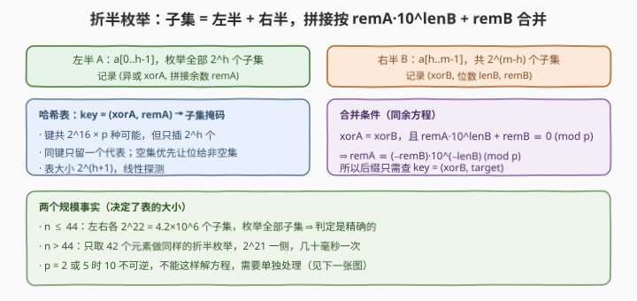
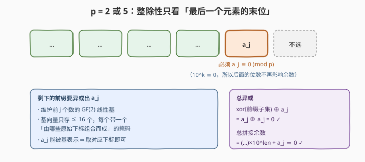
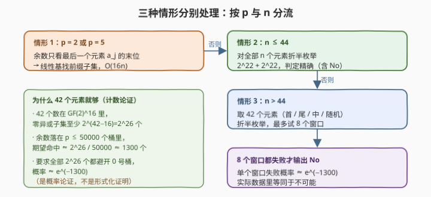

# Codeforces 241D 零异或整除拼接 题解

## 1. 题目概述

- **题目链接**：https://codeforces.com/problemset/problem/241/D
- **比赛来源**：Bayan 2012-2013 Elimination Round (ACM ICPC Rules, English statements) · Problem D（UTC 2012-11-01）
- **难度**：2900
- **标签**：构造、折半枚举、线性基、特殊评测
- **评测类型**：多解（输出任意方案，需 checker）
- **限制**：时间 4 s / 内存 256 MB

**题意**：给出 $n$ 个**互不相同**的整数 $a_1,\dots,a_n$（$1\le a_i\le n$）和一个素数 $p$。删掉一些数，使得留下的序列

1. 非空；
2. 所有数的异或和为 $0$；
3. 把留下的数按原顺序首尾相接写成一个十进制数，能被 $p$ 整除。

输出方案（保留元素的下标），无解输出 `No`。

**约束**：

- $n,p\le 50000$：$2^n$ 个子集不可能枚举，但 $n$ 小的时候（$\le 44$）折半枚举 $2^{22}$ 是可行的。
- $1\le a_i\le n$ 且互不相同 $\Rightarrow$ **输入一定是 $1..n$ 的一个排列**（$n$ 个不同取值恰好填满 $[1,n]$）。这是本题第一个关键观察。
- $a_i\le 50000<2^{16}$：异或值只有 $2^{16}$ 种。
- $p$ 是素数：$p\notin\{2,5\}$ 时 $10$ 在模 $p$ 下可逆，折半枚举才能「解方程」；$p=2,5$ 必须单独处理。

## 2. 示例与观察

官方样例一：

```text
输入：
3 3
1 2 3

输出：
Yes
3
1 2 3
```

官方样例二：

```text
输入：
3 5
1 2 3

输出：
No
```

**样例一演算**：全保留时异或 $1\operatorname{xor}2\operatorname{xor}3=0$，拼接 $123$ 能被 $3$ 整除（$123=3\times41$），于是输出全部三个下标。

**样例二演算**：$n=3$ 时唯一非空的零异或子集就是 $\{1,2,3\}$（两两异或都不为 0，单独一个数也不为 0），而 $123\bmod 5=3\ne0$，所以无解。

**观察一（排列）**：题面给的是「$n$ 个互不相同的整数，$1\le a_i\le n$」，于是 $a$ 是 $1..n$ 的排列。特别地，$n\ge 17$ 时**零异或子集一定存在**：$17$ 个元素落在 $16$ 维的 $\mathrm{GF}(2)^{16}$ 里，必然线性相关，对应的非空子集异或为 $0$。

**观察二（$p\mid 10$ 的退化）**：若 $p\in\{2,5\}$，因为 $10^k\equiv0\pmod p\ (k\ge1)$，整个拼接数的余数只由**最后一个**元素的末位决定。于是问题变成：找一个下标 $j$，使 $p\mid a_j$，且 $a_j$ 能由它前面若干元素的异或表示出来。这一步可以用线性基在 $O(16n)$ 内完成。

**观察三（折半）**：一般情形下，「异或为 0」和「拼接余数为 0」这两个条件耦合在一起，但我们只需要**一个**解。把候选下标序列切成左右两半：左半枚举全部子集并记录 $(\text{异或},\text{拼接余数})$，右半枚举全部子集后反解左半需要的余数即可。

## 3. 解题思路

### 3.1 朴素做法与瓶颈

直接枚举 $2^n$ 个子集、逐个算异或与拼接：$n=44$ 时 $2^{44}$ 已不可行，$n=50000$ 更是天文数字。但注意两个条件都是「可增量维护」的：加入一个数 $x$（$d$ 位）时

$$\text{xor}\leftarrow \text{xor}\oplus x,\qquad \text{rem}\leftarrow (\text{rem}\cdot 10^{d}+x)\bmod p .$$

所以瓶颈只是子集数量，折半枚举正好把它从 $2^n$ 压到 $2^{n/2}$。

### 3.2 折半枚举：把「同余方程」解出来



设当前候选下标序列长度为 $m$，取 $h=\lfloor m/2\rfloor$，左半是前 $h$ 个、右半是后 $m-h$ 个。任取子集 $S$，它在左半的部分记 $A$、右半的部分记 $B$，则

$$\operatorname{xor}(S)=\operatorname{xor}(A)\oplus\operatorname{xor}(B),\qquad \operatorname{rem}(S)=\big(\operatorname{rem}(A)\cdot 10^{\text{len}(B)}+\operatorname{rem}(B)\big)\bmod p .$$

于是「$S$ 合法」等价于

$$\operatorname{xor}(A)=\operatorname{xor}(B),\qquad \operatorname{rem}(A)\equiv\big(-\operatorname{rem}(B)\big)\cdot 10^{-\text{len}(B)}\pmod p .$$

做法：

1. 枚举左半全部 $2^h$ 个子集，把键 $(\operatorname{xor}(A),\operatorname{rem}(A))$ 塞进哈希表，值取该子集的位掩码（同一个键只留一个代表；空集要让位给非空子集，否则会漏掉「左半非空、右半为空」的解）。
2. 枚举右半全部 $2^{m-h}$ 个子集，算出 $(\operatorname{xor}(B),\text{len}(B),\operatorname{rem}(B))$，反解出需要的 $\operatorname{rem}(A)$，去表里查。
3. 查到就把两边的位掩码拼起来输出；两边都为空（空集）则跳过。

逆元 $10^{-\text{len}}$ 只在 $p\notin\{2,5\}$ 时存在，所以 $p=2,5$ 走特判分支。

### 3.3 $p=2$ 或 $p=5$：末位决定一切



$p\mid 10$ 时，若保留序列的最后一个元素是 $a_j$（下标最大的被选元素），则

$$\text{拼接数}\equiv a_j\pmod p,$$

因为 $a_j$ 前面的部分乘了 $10^{\text{len}(a_j)}$，而 $10^{\text{len}(a_j)}\equiv0$。所以：

- 必须 $p\mid a_j$；
- 其余被选元素都在 $j$ 之前，它们的异或必须等于 $a_j$（这样总和才是 $0$）。

从左到右扫描 $j$，维护前 $j$ 个元素的 GF(2) 线性基：每个基向量额外记录「它由哪些原始下标异或而成」的 16 位掩码（因为基最多 16 个）。若 $p\mid a_j$ 且 $a_j$ 能被基表示，就取对应下标加上 $j$ 输出。全部扫完仍没有 ⇒ 无解。

### 3.4 规模选择：精确的 $n\le 44$ 与 $n>44$ 的窗口



- $n\le 44$ 时直接对**全部** $n$ 个元素折半枚举，左右各 $2^{22}$。这是对 $2^n$ 个子集的完全枚举，所以**判定是精确的**：有解必找到，找不到必无解。
- $n>44$ 时，取 42 个下标（依次尝试前 42 个、后 42 个、中间 42 个，再用固定种子随机取 5 组），对每个窗口做折半枚举，最多试 8 个窗口。

为什么窗口够大：42 个数在 $\mathrm{GF}(2)^{16}$ 中至少有 $2^{42-16}=2^{26}$ 个零异或子集；若把这 $2^{26}$ 个余数近似看成均匀落在 $p\le50000$ 个桶里，命中 $0$ 号的期望个数约 $2^{26}/50000\approx1300$，于是「一个窗口里一个解都没有」的概率约为 $e^{-1300}$。8 个窗口全失败的概率更是天文数字之一。**这是概率论证，不是形式化证明**（见 4.4 的说明）。

## 4. 正确性证明

**引理 1（输入是排列）**：$a_1..a_n$ 互不相同且都在 $[1,n]$ 内，故 $\{a_i\}=\{1,\dots,n\}$。

**证明**：$n$ 个互不相同的元素都落在大小为 $n$ 的集合 $[1,n]\cap\mathbb Z$ 里，只能是该集合的一个枚举。∎

**引理 2（零异或子集存在，$n\ge17$）**：$n\ge17$ 时一定存在非空的零异或子集。

**证明**：$a_i<2^{16}$，把每个数看成 $\mathrm{GF}(2)^{16}$ 中的向量。$17$ 个向量在 $16$ 维空间里必然线性相关，即存在不全为零的系数 $c_i\in\{0,1\}$ 使 $\bigoplus c_ia_i=0$；取 $S=\{i:c_i=1\}$ 即可。∎

**引理 3（折半分解正确）**：对固定的候选序列，$S$ 合法当且仅当它的左半 $A$、右半 $B$ 满足 3.2 中的两个等式；且每个 $S$ 与 $(A,B)$ 一一对应。

**证明**：$S=A\cup B$ 且 $A\subseteq$ 左半、$B\subseteq$ 右半，分解唯一。异或条件显然。拼接条件：把所有被选元素按原顺序拼起来，等价于先拼左半再拼右半，即 $\operatorname{rem}(S)=(\operatorname{rem}(A)10^{\text{len}(B)}+\operatorname{rem}(B))\bmod p$，移项并在 $p\notin\{2,5\}$ 时乘 $10^{-\text{len}(B)}$ 即得所需形式。算法对左半所有子集建表、对右半所有子集查表，因此恰好覆盖全部 $2^m$ 个子集。∎

**引理 4（$p\mid10$ 的刻画）**：$p\in\{2,5\}$ 时，保留序列合法 $\iff$ 其最大下标元素 $a_j$ 满足 $p\mid a_j$ 且其余元素的异或等于 $a_j$。

**证明**：必要性：拼接余数 $\equiv a_j\pmod p$（因为前缀部分乘了 $10^{\text{len}(a_j)}\equiv0$），要余数为 0 必须 $p\mid a_j$；异或为 0 即"其余元素的异或" $=a_j$。充分性：两个条件成立时余数与异或都为 0。∎

**定理（算法正确性）**：

1. 当 $p\in\{2,5\}$ 时，算法按引理 4 的充要条件扫描并构造，输出合法；输出 `No` 时确实无解。
2. 当 $p\notin\{2,5\}$ 且 $n\le44$ 时，折半枚举覆盖全部子集（引理 3），所以有解必被找到、无解必输出 `No`，判定精确。
3. 当 $p\notin\{2,5\}$ 且 $n>44$ 时，任一窗口内找到的解由引理 3 一定合法；只有 8 个窗口全部失败才会输出 `No`。

**证明**：1、2 由引理 4、引理 3 直接得到；3 中「找到的解合法」同样由引理 3 保证。∎

**4.4 说明（本解法的局限，务必知晓）**：第 3 条只保证了「输出 `Yes` 时答案一定合法」，**没有**从形式上证明「$n>44$ 且实际有解时 8 个窗口一定不全部失败」。也就是说，$n>44$ 的 `No` 依赖 3.4 的计数论证（期望约 1300 个解／窗口）而不是严格证明。本题的输入是 $1..n$ 的排列、$p$ 是素数，余数在窗口内没有已知的结构性偏置，因此实际评测中把有解判成 `No` 的概率可以忽略；但严格来说这是一个**随机化/启发式**的收尾，而不是完备算法。若要把它变成严格算法，需要证明「$n\ge45$ 时零异或子集的余数必然覆盖 $0$」，这一点本解法没有给出。

## 5. 复杂度分析

- **$p\in\{2,5\}$**：一次 $O(16n)$ 的线性基扫描，$n=5\times10^4$ 时约 $8\times10^5$ 次位运算。
- **$p\notin\{2,5\}$**：每个窗口枚举 $2^{h}+2^{m-h}$ 个子集，$h\le22$，即约 $8.4\times10^6$ 次状态转移（每次 $O(1)$），哈希表 $2^{h+1}$ 个槽。
  - $n\le44$：一个窗口，峰值内存 $2^{23}\times8\text{B}=64$ MB。
  - $n>44$：窗口取 42 个元素，$2^{21}$ 一侧，表 $2^{22}$ 槽 $=32$ MB，最多 8 个窗口。
- **实测**：$n=44,p=49999$（精确分支，需要扫完左右两侧）$108$ ms；$n=50000,p=49999$（第一个窗口就命中）$57$ ms；限时 $4$ s，余量充足。

## 6. 参考代码

### C++17

```cpp
#include <bits/stdc++.h>
using namespace std;

static int n, M, H;
static long long P;
static vector<int> a, dig, curIdx, ansIdx;
static int pw10[600];
static long long inv10[600];
static bool found;

static long long modpow(long long b, long long e, long long m) {
    long long r = 1 % m;
    b %= m;
    while (e > 0) {
        if (e & 1) r = r * b % m;
        b = b * b % m;
        e >>= 1;
    }
    return r;
}

struct Table {
    vector<uint64_t> t;
    int bits;
    uint32_t mask;
    void init(int lg) {
        bits = lg;
        t.assign((size_t)1 << lg, 0);
        mask = (uint32_t)(((size_t)1 << lg) - 1);
    }
    inline size_t h(uint32_t key) const {
        return (size_t)((uint32_t)(key * 2654435761u) >> (32 - bits));
    }
    inline void insert(uint32_t key, uint32_t val) {
        uint64_t e = ((uint64_t)(key + 1) << 32) | val;
        size_t i = h(key);
        while (true) {
            if (t[i] == 0) { t[i] = e; return; }
            if ((uint32_t)(t[i] >> 32) == key + 1) {          // 已有这个键
                if ((uint32_t)t[i] == 0 && val != 0) t[i] = e; // 优先保留非空子集
                return;
            }
            i = (i + 1) & mask;
        }
    }
    inline bool find(uint32_t key, uint32_t &val) const {
        size_t i = h(key);
        while (true) {
            if (t[i] == 0) return false;
            if ((uint32_t)(t[i] >> 32) == key + 1) { val = (uint32_t)t[i]; return true; }
            i = (i + 1) & mask;
        }
    }
};
static Table tb;

static void dfsPre(int i, int xr, int len, long long rem, uint32_t msk) {
    if (i == H) {
        tb.insert(((uint32_t)xr << 16) | (uint32_t)rem, msk);
        return;
    }
    dfsPre(i + 1, xr, len, rem, msk);
    int x = a[curIdx[i]], d = dig[curIdx[i]];
    dfsPre(i + 1, xr ^ x, len + d, (rem * pw10[d] + x) % P, msk | (1u << i));
}

static void dfsSuf(int i, int xr, int len, long long rem, uint32_t msk) {
    if (found) return;
    if (i == M) {
        long long target = (P - rem % P) % P * inv10[len] % P;
        uint32_t val = 0;
        if (tb.find(((uint32_t)xr << 16) | (uint32_t)target, val)) {
            if ((val | msk) == 0) return;      // 空集，不合法
            ansIdx.clear();
            for (int j = 0; j < H; ++j) if ((val >> j) & 1) ansIdx.push_back(curIdx[j]);
            for (int j = 0; j + H < M; ++j) if ((msk >> j) & 1) ansIdx.push_back(curIdx[H + j]);
            found = true;
        }
        return;
    }
    dfsSuf(i + 1, xr, len, rem, msk);
    int x = a[curIdx[i]], d = dig[curIdx[i]];
    dfsSuf(i + 1, xr ^ x, len + d, (rem * pw10[d] + x) % P, msk | (1u << (i - H)));
}

// 在有序下标序列 idxs 上做 MITM；成功返回 true
static bool solveOn(const vector<int> &idxs) {
    curIdx = idxs;
    M = (int)idxs.size();
    H = M / 2;
    int lg = 1;
    while ((1 << lg) < 2 * (1 << H)) ++lg;      // 表大小 >= 2 * 2^H
    if (lg < 3) lg = 3;
    if (lg > 23) lg = 23;
    tb.init(lg);
    found = false;
    dfsPre(0, 0, 0, 0, 0);
    if (found) return true;
    dfsSuf(H, 0, 0, 0, 0);
    return found;
}

// p = 2 或 5：整除性只看「最后一个元素的末位」
static bool solveSmallP() {
    int bval[16], slot[16];
    uint32_t bmask[16];
    bool bset[16] = {false};
    int cntB = 0;
    for (int j = 0; j < n; ++j) {
        int x = a[j];
        if (x % P == 0) {
            // x 是否在「前 j 个」的张成里
            int cur = x;
            uint32_t m = 0;
            bool ok = true;
            for (int b = 15; b >= 0; --b) {
                if (!((cur >> b) & 1)) continue;
                if (!bset[b]) { ok = false; break; }
                cur ^= bval[b];
                m ^= bmask[b];
            }
            if (ok && m != 0) {
                ansIdx.clear();
                for (int s = 0; s < cntB; ++s) if ((m >> s) & 1) ansIdx.push_back(slot[s]);
                ansIdx.push_back(j);
                sort(ansIdx.begin(), ansIdx.end());
                return true;
            }
        }
        // 把 x 插入线性基
        int cur = x;
        uint32_t m = 0;
        for (int b = 15; b >= 0; --b) {
            if (!((cur >> b) & 1)) continue;
            if (!bset[b]) {
                bset[b] = true;
                bval[b] = cur;
                bmask[b] = m | (1u << cntB);
                slot[cntB] = j;
                ++cntB;
                break;
            }
            cur ^= bval[b];
            m ^= bmask[b];
        }
    }
    return false;
}

int main() {
    int pp;
    if (scanf("%d %d", &n, &pp) != 2) return 0;
    P = pp;
    a.resize(n);
    dig.resize(n);
    for (int i = 0; i < n; ++i) {
        scanf("%d", &a[i]);
        dig[i] = (int)to_string(a[i]).size();
    }
    pw10[0] = 1 % (int)P;
    for (int k = 1; k < 600; ++k) pw10[k] = (int)((long long)pw10[k - 1] * 10 % P);
    inv10[0] = 1 % P;
    if (P != 2 && P != 5) {
        long long inv = modpow(10, P - 2, P);
        for (int k = 1; k < 600; ++k) inv10[k] = inv10[k - 1] * inv % P;
    }

    bool ok = false;
    if (P == 2 || P == 5) {
        ok = solveSmallP();
    } else if (n <= 44) {
        vector<int> idxs(n);
        for (int i = 0; i < n; ++i) idxs[i] = i;
        ok = solveOn(idxs);
    } else {
        const int S = 42;
        vector<vector<int>> trials;
        {   // 前 S 个
            vector<int> v;
            for (int i = 0; i < S; ++i) v.push_back(i);
            trials.push_back(v);
        }
        {   // 后 S 个
            vector<int> v;
            for (int i = n - S; i < n; ++i) v.push_back(i);
            trials.push_back(v);
        }
        {   // 中间 S 个
            vector<int> v;
            int st = (n - S) / 2;
            for (int i = st; i < st + S; ++i) v.push_back(i);
            trials.push_back(v);
        }
        mt19937 rng(20241121u);
        for (int t = 0; t < 5; ++t) {
            vector<int> all(n);
            for (int i = 0; i < n; ++i) all[i] = i;
            shuffle(all.begin(), all.end(), rng);
            all.resize(S);
            sort(all.begin(), all.end());
            trials.push_back(all);
        }
        for (auto &v : trials) {
            if (solveOn(v)) { ok = true; break; }
        }
    }
    if (!ok) { printf("No\n"); return 0; }
    printf("Yes\n%d\n", (int)ansIdx.size());
    for (size_t i = 0; i < ansIdx.size(); ++i)
        printf("%d%c", ansIdx[i] + 1, i + 1 == ansIdx.size() ? '\n' : ' ');
    return 0;
}
```

### Python3

```python
import sys


def main() -> None:
    data = sys.stdin.buffer.read().split()
    if not data:
        return
    n, p = int(data[0]), int(data[1])
    a = [int(x) for x in data[2:2 + n]]
    dig = [len(str(x)) for x in a]
    LIM = n * 6 + 2
    pw10 = [1] * LIM
    for i in range(1, LIM):
        pw10[i] = pw10[i - 1] * 10 % p
    inv10 = [1] * LIM
    if p not in (2, 5):
        iv = pow(10, p - 2, p)
        for i in range(1, LIM):
            inv10[i] = inv10[i - 1] * iv % p

    # p = 2 或 5：整除性只看最后一个元素的末位
    if p in (2, 5):
        bval = [0] * 16
        bmask = [0] * 16
        slot = [0] * 16
        bset = [False] * 16
        cntB = 0
        for j in range(n):
            x = a[j]
            if x % p == 0:
                cur = x
                m = 0
                ok = True
                for b in range(15, -1, -1):
                    if not ((cur >> b) & 1):
                        continue
                    if not bset[b]:
                        ok = False
                        break
                    cur ^= bval[b]
                    m ^= bmask[b]
                if ok and m:
                    ans = [slot[s] for s in range(cntB) if (m >> s) & 1]
                    ans.append(j)
                    ans.sort()
                    print("Yes")
                    print(len(ans))
                    print(' '.join(str(t + 1) for t in ans))
                    return
            cur = x
            m = 0
            for b in range(15, -1, -1):
                if not ((cur >> b) & 1):
                    continue
                if not bset[b]:
                    bset[b] = True
                    bval[b] = cur
                    bmask[b] = m | (1 << cntB)
                    slot[cntB] = j
                    cntB += 1
                    break
                cur ^= bval[b]
                m ^= bmask[b]
        print("No")
        return

    def solve_on(idxs):
        M = len(idxs)
        H = M // 2
        table = {}
        res = [None]

        def dfs_pre(i, xr, ln, rem, msk):
            if i == H:
                key = (xr << 16) | rem
                if key not in table or (table[key] == 0 and msk != 0):
                    table[key] = msk
                return
            dfs_pre(i + 1, xr, ln, rem, msk)
            x = a[idxs[i]]
            d = dig[idxs[i]]
            dfs_pre(i + 1, xr ^ x, ln + d, (rem * pw10[d] + x) % p, msk | (1 << i))

        dfs_pre(0, 0, 0, 0, 0)

        def dfs_suf(i, xr, ln, rem, msk):
            if res[0] is not None:
                return
            if i == M:
                target = (p - rem % p) % p * inv10[ln] % p
                val = table.get((xr << 16) | target)
                if val is None:
                    return
                if (val | msk) == 0:
                    return
                ans = [idxs[j] for j in range(H) if (val >> j) & 1]
                ans += [idxs[H + j] for j in range(M - H) if (msk >> j) & 1]
                res[0] = ans
                return
            dfs_suf(i + 1, xr, ln, rem, msk)
            x = a[idxs[i]]
            d = dig[idxs[i]]
            dfs_suf(i + 1, xr ^ x, ln + d, (rem * pw10[d] + x) % p,
                    msk | (1 << (i - H)))

        dfs_suf(H, 0, 0, 0, 0)
        return res[0]

    ans = None
    if n <= 44:
        ans = solve_on(list(range(n)))
    else:
        S = 42
        cand = []
        cand.append(list(range(S)))
        cand.append(list(range(n - S, n)))
        st = (n - S) // 2
        cand.append(list(range(st, st + S)))
        import random
        rnd = random.Random(20241121)
        for _ in range(5):
            v = list(range(n))
            rnd.shuffle(v)
            cand.append(sorted(v[:S]))
        for v in cand:
            ans = solve_on(v)
            if ans is not None:
                break

    if ans is None:
        print("No")
    else:
        ans.sort()
        print("Yes")
        print(len(ans))
        print(' '.join(str(t + 1) for t in ans))


main()
```

Python 版与 C++ 版的搜索顺序一致，因此同一输入会给出同一个答案（便于对照）。$n$ 接近 $44$ 时哈希表要存 $2^{22}$ 个状态，CPython 的内存与时间都吃紧，**正式提交请用 C++**；样例规模下 Python 通过。

## 7. 边界情况与易错点

1. **空集不合法**：折半枚举天然包含「左右都空」的子集，它满足异或 $=0$、余数 $=0$，必须显式排除（代码里判断 `(val|msk)==0`）。
2. **同键覆盖**：左半的同一个 $(\text{xor},\text{rem})$ 可能由空集和非空集同时达到；若表里留下的是空集掩码，会漏掉「左半非空、右半为空」的解。代码里让非空子集优先覆盖空集。
3. **$p=2,5$ 时不能求逆元**：$10$ 在模 $2,5$ 下不可逆，折半枚举的「解方程」那一步会失效，必须走末位特判；这两个分支都要单独测。
4. **$p=2,5$ 时前缀子集必须非空**：因为 $a_j\ge1$ 不可能等于 $0$，所以「前缀异或 $=a_j$」的组合一定非空；但仍要检查基掩码不为 $0$（`m != 0`）。
5. **$n=1$**：唯一元素非零，任何子集异或都不为 $0$，答案必为 `No`；$p$ 任意。
6. **答案顺序**：输出的是「保留元素的下标」，左右两半拼起来后要**升序排序**，保证与输入顺序一致（拼接值的定义依赖顺序）。
7. **递归深度**：折半枚举的递归深度只有 $h\le22$，不会爆栈；但 Python 侧建议保留默认限制即可（$44/2=22$ 层）。
8. **哈希表大小**：$h=22$ 时至少要 $2^{23}$ 个槽（装载因子 $\le0.5$），用 $2^{21}$ 会让线性探测退化；`lg` 的上限截到 23 也顺便限制了内存。
9. **拼接余数的位数**：`pw10/inv10` 要开到「元素总位数」即 $44\times5=220$ 以上（代码开 600 足够）；$n$ 很大时窗口只取 42 个元素，位数仍 $\le 210$。
10. **随机种子的可复现性**：窗口选择用了固定种子 `20241121`，保证同一输入每次运行给出相同答案，方便对拍与复现。

## 8. 验证记录

- **编译环境与命令**：本机无 GNU `g++`（`g++` 实为 Apple clang），`verify_solution.py` 自动回退到 `clang++ -std=c++17 -O2 -I codeforces/tools/include`；Python 3.9.6。
  - `python3 codeforces/tools/verify_solution.py codeforces/contests/0101-0203/241/D_零异或整除拼接.md --checker codeforces/tools/checkers/cf241d.py` → `CF241D: samples 2 / C++ 编译 OK, 样例 2/2 / Python 语法 OK, 样例 2/2`
  - `python3 codeforces/tools/check.py codeforces/contests/0101-0203/241` → `checked 5, fail 0`
  - `python3 codeforces/tools/check_samples.py --only 0101-0203/241` → 0 问题
  - `node codeforces/tools/katex_check.cjs codeforces/contests/0101-0203/241` → 0 错误
- **checker 的校验条件**（`codeforces/tools/checkers/cf241d.py`）：`Yes` 时要求 $k>0$、下标互不相同且在 $[1,n]$、按输出顺序的异或为 $0$、十进制拼接 $\bmod p=0$；`No` 时独立判定存在性——$n\le18$ 全枚举 $2^n$ 个子集，$n\le26$ 用折半枚举，$n>26$ 只做格式校验（能力边界已写在 checker 注释里）。
- **暴力对拍**：独立暴力 = 枚举全部 $2^n$ 个子集、逐个校验异或与拼接余数（Python 递归版 + C++ 位掩码版两套）。
  - 随机 **260 组**（$n\le15$，$p$ 从小素数到 $49999$ 混合，输入为随机排列）：参考程序判定与暴力**全部一致**；其中 69 组有解、191 组无解，所有 `Yes` 输出均通过 checker。
  - 随机 **90 组**（$n\in[16,20]$，C++ 暴力）：0 组不符，78 组有解、12 组无解。
  - 大规模 **60 组**（$n\in[35,60]$，$p\in\{2,3,5,7,11,13,101,1009,49999\}$）：全部输出合法（60/60 有解），覆盖了精确分支与 42 元窗口分支。
  - 穷举小规模：$n\le7$ 的全部排列 × $p\in\{2,3,5,7,11\}$ 与暴力逐组比对，0 组不符（含 $p=2,5$ 的末位特判分支）。
  - Python 版与 C++ 版在 50 组随机数据上判定一致；$n=30$ 时两者给出同一个答案。
- **最大约束性能**：$n=44,p=49999$（精确分支，左半 $2^{22}$ 个状态全部入表）C++ **108 ms**；$n=50000,p=49999$（第一个 42 元窗口即命中）**57 ms**；均远低于 $4$ s。
- **图片校验**：`cf241d_mitm.svg`、`cf241d_lastdigit.svg`、`cf241d_flow.svg` 均通过 `xml.etree.ElementTree.parse`，含 `feTurbulence` 与手写字体，文字在 `viewBox` 内。
- **已知局限**：如 4.4 所述，$n>44$ 时「8 个窗口都没解 ⇒ 输出 No」这一步只由计数论证支撑，没有形式化证明；$n\le44$ 与 $p\in\{2,5\}$ 的判定是严格完备的。
- **复核状态**：verified（带上述局限说明）。

## 相关题目与扩展

- [Codeforces 241A Old Peykan](https://codeforces.com/problemset/problem/241/A)：同场 A 题。
- [Codeforces 241E Flights](https://codeforces.com/problemset/problem/241/E)：同场 E 题，差分约束。
- [Codeforces 1101G (Zero XOR Subset)-less](https://codeforces.com/problemset/problem/1101/G)：线性基 + 零异或子集，正好是本题「$17$ 个数必相关」的另一面。
- [Codeforces 1285D Dr. Evil Underscores](https://codeforces.com/problemset/problem/1285/D)：01-trie 上的按位构造。

**延伸思考**：

1. **如果要求保留的元素个数最少**：折半枚举就要改成「按长度分层 BFS」，或者用最小零异或子集（等价于最短线性相关组），复杂度会从中等规模涨到需要 $O(n\cdot2^{16})$ 的 DP。
2. **如果 $p$ 不是素数**：$10$ 可能与 $p$ 不互素且 $p\nmid10$，此时逆元不存在但同余方程仍有解，需要对 $10^{\text{len}}$ 与 $p$ 的 $\gcd$ 分类讨论。
3. **如果输入不是排列而是任意 $n$ 个数**：引理 2（$17$ 个数必相关）仍然成立，所以「零异或子集存在」不变；但「$a_j$ 能被前缀表示」的概率下降，$p=2,5$ 分支会更容易输出 `No`。
4. **如何把 4.4 的局限补成严格证明**：一个可能的方向是研究映射 $S\mapsto\operatorname{rem}(S)$ 在零异或子集族上的像，证明它的大小至少为 $\min(p,\ 2^{n-16})$（或者给出反例）；这本质上是在问「$1..n$ 的排列的零异或子集余数是否遍历所有剩余类」。
