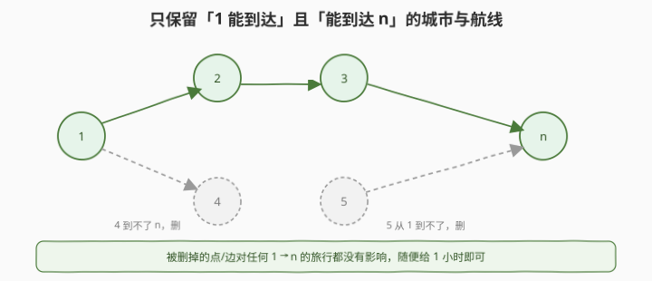
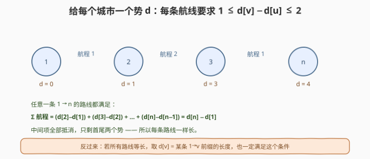
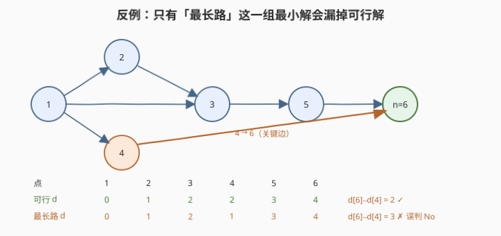

# Codeforces 241E 航线等时改造 题解

## 1. 题目概述

- **题目链接**：https://codeforces.com/problemset/problem/241/E
- **比赛来源**：Bayan 2012-2013 Elimination Round (ACM ICPC Rules, English statements) · Problem E（UTC 2012-11-01）
- **难度**：2600
- **标签**：差分约束、图论、DAG、最短路径
- **评测类型**：多解（任意一组合法航程即可）
- **限制**：时间 2 s / 内存 256 MB

**题意**：LiLand 有 $n$ 座城市、$m$ 条**单向**航线，原本每条航线都是 1 小时。现在要把其中一些航线改成 2 小时（其余保持 1 小时），使得**所有从城市 1 到城市 $n$ 的路线总时长完全相同**。输出任意一组方案；无解输出 `No`。

输入保证：$a_i < b_i$（因此图是 DAG，编号本身就是拓扑序）、无重边、至少存在一条 $1\to n$ 的路线。

**约束**：

- $n \le 1000$，$m \le 5000$：边权只有 $\{1,2\}$ 两种选择，方案数是 $2^m$，绝不能枚举。
- $a_i<b_i$ 保证无环且天然拓扑有序：任何一次「沿编号递增的 DP」都是合法的拓扑 DP。
- 需要判定的是**可行性**而不是最优化，所以这个问题本质上是差分约束系统（difference constraints）的可满足性。
- $O(nm) = 5\times 10^6$ 量级是安全的；$O(2^m)$ 或 $O(n^3)$ 都不必要。

## 2. 示例与观察

官方样例一：

```text
输入：
3 3
1 2
2 3
1 3

输出：
Yes
1
1
2
```

官方样例二：

```text
输入：
4 4
1 2
2 3
3 4
1 4

输出：
No
```

官方样例三：

```text
输入：
5 6
1 2
2 3
3 5
1 4
4 5
1 3

输出：
Yes
1
1
1
2
1
2
```

**样例一演算**：从 1 到 3 有两条路线 $1\to2\to3$ 和 $1\to3$。前者至少 $1+1=2$ 小时，后者最多 $2$ 小时，所以只能是 $w_{12}=w_{23}=1$、$w_{13}=2$，两条路线都是 2 小时。

**样例二演算**：路线 $1\to2\to3\to4$ 有 3 条边，每条至少 1 小时，总长 $\ge 3$；而 $1\to4$ 最多 2 小时。矛盾，输出 `No`。

**样例三演算**：官方给出的方案是 $(1,1,1,2,1,2)$：

| 路线 | 总长 |
|------|------|
| $1\to2\to3\to5$ | $1+1+1=3$ |
| $1\to3\to5$ | $2+1=3$ |
| $1\to4\to5$ | $2+1=3$ |

注意**官方输出并不是唯一解**：本文参考程序输出 $(1,1,1,1,2,2)$，三条路线分别是 $3,3,3$，同样合法。这正是本题需要写 checker 的原因。

**观察一**：答案只取决于「落在某条 $1\to n$ 路线上的边」。既不在任何 $1\to n$ 路线上的点/边（例如从 1 到不了的、或到不了 $n$ 的）可以随便给权值，赋 1 即可。

**观察二**：设 $d[v]$ 是「从 1 到 $v$ 的某条路线长度」。如果所有 $1\to n$ 路线等长，那么对任意落在 $1\to n$ 路线上的点 $v$，$d[v]$ 是**唯一确定**的：任取两条 $1\to v$ 的路线，把它们接上同一条 $v\to n$ 的路线，就得到两条 $1\to n$ 路线，等长，于是前缀也等长。

**观察三**：于是每条有效边 $(u,v)$ 都必须满足 $d[v]-d[u]=w_{uv}\in\{1,2\}$。反过来，只要存在一组 $d$ 满足 $1\le d[v]-d[u]\le 2$，把 $w_{uv}$ 取成 $d[v]-d[u]$ 就能让每条 $1\to n$ 路线都等于 $d[n]-d[1]$——因为中间的 $d$ 全部抵消。

## 3. 解题思路

### 3.1 朴素做法与瓶颈

- 枚举 $2^m$ 种权值组合：$m=5000$，不可能。
- 枚举 $d$ 的取值：$d[v]$ 可到 $n$ 量级，也不可行。
- 只做一次「最长路」得到最小解 $d_{\min}$，再检查每条边是否 $d_{\min}[v]-d_{\min}[u]\le 2$：这是个常见但**错误**的简化（见 3.4 的反例），会漏掉可行解。

瓶颈在于：这是一个**约束满足**问题，上下界同时存在，必须真正去解差分约束。

### 3.2 核心观察：等长 $\iff$ 存在势函数



先删掉与 $1\to n$ 旅行无关的东西：保留满足「$1$ 能到达它」且「它能到达 $n$」的点，以及两端都满足该条件的边。这些点/边之外的任何权值都不影响答案。



**引理（势函数刻画）**：存在合法赋值当且仅当存在整数 $d[1..n]$，使得对每条有效边 $(u,v)$ 都有

$$1\ \le\ d[v]-d[u]\ \le\ 2 .$$

证明的两个方向都很短：若存在这样的 $d$，取 $w_{uv}=d[v]-d[u]\in\{1,2\}$，则任一 $1\to n$ 路线的长度 $\sum(d[v]-d[u])=d[n]-d[1]$，全部相同；反之若所有 $1\to n$ 路线等长，取 $d[v]=$「$1\to v$ 的前缀长度」（观察二保证它良定义），则每条有效边都满足 $d[v]-d[u]=w_{uv}\in\{1,2\}$。

于是问题化为差分约束：

$$d[v]\ \ge\ d[u]+1 \quad\text{（每条有效边）},\qquad d[u]\ \ge\ d[v]-2 \quad\text{（每条有效边）}.$$

### 3.3 算法流程：Bellman-Ford 判正环



1. 求出 `fr[]`（从 1 可达）与 `br[]`（能到 $n$），有效边 = `fr[u] && br[v]`。
2. 把每条有效边变成两条约束边：$u\to v$ 权重 $+1$，$v\to u$ 权重 $-2$（因为 $d[v]\ge d[u]+1$ 与 $d[u]\ge d[v]-2$ 等价）。
3. 令所有 $d[v]=0$（相当于加一个到所有点、权重 0 的超级源），反复松弛所有约束边，直到某一轮没有任何更新。
4. 若第 $n+1$ 轮仍在更新，说明存在**正环**，无解，输出 `No`；否则 $d$ 就是一组可行势，对每条有效边输出 $d[v]-d[u]$，对无效边输出 $1$。

为什么轮数是 $n+1$：从全 0 出发，第 $k$ 轮之后每个 $d[v]$ 已经不小于「边数 $\le k$ 的任意路径」的权值和；任何简单路径最多 $n-1$ 条边，所以若没有正环，最多 $n$ 轮就收敛。第 $n+1$ 轮还在变，只能是因为存在正环（可以无限绕）。

### 3.4 样例走查与一个必须避开的坑

样例三的有效边是全部 6 条。约束松弛收敛后可得 $d=(0,1,2,1,3)$（以 $d[1]=0$ 计），于是 $w=(1,1,1,1,2,2)$，三条路线都是 $3$。

样例二的约束：$1\to2\to3\to4$ 给出 $d[4]\ge d[1]+3$，而边 $1\to4$ 给出 $d[4]\le d[1]+2$，正环 $1\to2\to3\to4\to1$ 的权值为 $1+1+1-2=1>0$，于是 `No`。

**反例（为什么不能只取最小解）**：$n=6$，边为

```text
1 2
1 3
1 4
2 3
3 5
5 6
4 6
```

只取「每条边权 1 时的最长路」得到 $d_{\min}=(0,1,2,1,3,4)$，其中边 $4\to6$ 的差是 $4-1=3>2$，会误判 `No`；但真正可行的一组是 $d=(0,1,2,2,3,4)$，对应 $w=(1,2,2,1,1,1,2)$，三条路线 $1\to2\to3\to5\to6$、$1\to3\to5\to6$、$1\to4\to6$ 的长度分别是 $4,4,4$。所以必须解完整的两侧约束，不能只算单侧最长路。

## 4. 正确性证明

**引理 1（有效点/边的删除是安全的）**：若点或边不落在任何 $1\to n$ 路线上，则它的权值不影响任何 $1\to n$ 路线的长度。

**证明**：$1\to n$ 路线上的每条边 $(u,v)$ 都满足 $u$ 从 1 可达、$v$ 能到 $n$（沿路线取前缀/后缀即可），所以不满足该条件的边不在任何 $1\to n$ 路线上，改变它不改变任何路线的长度。∎

**引理 2（势函数刻画）**：存在合法赋值 $\iff$ 存在整数 $d$ 使每条有效边满足 $1\le d[v]-d[u]\le 2$。

**证明**：($\Leftarrow$) 取 $w_{uv}=d[v]-d[u]$。任一 $1\to n$ 路线 $1=v_0\to v_1\to\cdots\to v_k=n$ 的长度为 $\sum_{i}(d[v_i]-d[v_{i-1}])=d[n]-d[1]$，与路线无关，且每个 $w\in\{1,2\}$ 合法。
($\Rightarrow$) 设所有 $1\to n$ 路线等长。对有效点 $v$（存在 $1\to v$ 与 $v\to n$ 的路线），定义 $d[v]$ 为任一 $1\to v$ 路线的长度。良定义：若有两条 $1\to v$ 路线长度不同，各自接上同一条 $v\to n$ 路线就得到两条长度不同的 $1\to n$ 路线，矛盾。对有效边 $(u,v)$，把「$1\to u$ 的路线 + 边 $(u,v)$」看成一条 $1\to v$ 路线，由 $d[v]$ 的定义得 $d[v]=d[u]+w_{uv}$，故 $1\le d[v]-d[u]\le 2$。∎

**引理 3（差分约束可行性判据）**：约束系统 $\{d[v]\ge d[u]+w_e\}$ 可行 $\iff$ 约束图无正环。

**证明**：若存在正环 $C$，把环上的不等式相加得 $\sum_{e\in C}w_e\le 0$，与正环矛盾，故不可行。反之若无正环，令 $D[v]$ 为从超级源（到所有点权重 0）到 $v$ 的最长路径长度，它有限且对每条约束边满足 $D[v]\ge D[u]+w_e$（否则 $D[v]$ 还能被松弛，与「最长」矛盾），于是 $D$ 是一组可行解。∎

**定理**：算法输出合法：`No` 时不糊在；`Yes` 时给出的 $m$ 个整数都在 $\{1,2\}$ 且所有 $1\to n$ 路线等长。

**证明**：算法在无正环时得到满足全部约束的 $d$，由引理 2 的 ($\Leftarrow$) 方向，$w_{uv}=d[v]-d[u]$ 合法且所有路线等长；无效边由引理 1 不影响任何路线。若算法输出 `No`，说明第 $n+1$ 轮仍在更新，即存在正环（引理 3 的逆否），故确实无解。∎

## 5. 复杂度分析

- **时间**：预处理可达性 $O(n+m)$；Bellman-Ford 最多 $n+1$ 轮、每轮扫 $2m$ 条约束边（实现里每条有效边松弛两次，共 $2\cdot m_{\text{eff}}$ 次），总计 $O(nm)$，最坏 $1000\times 5000\times 2=10^7$ 次加法比较。
- **空间**：`a,b` 各 $O(m)$，邻接表 $O(n+m)$，`fr/br/d` 各 $O(n)$。
- **常数**：约束边总数为 $2m\le 10^4$，$1001$ 轮约 $10^7$ 次操作，实测最坏 $11$ ms，远低于时限的一半。

## 6. 参考代码

### C++17

```cpp
#include <bits/stdc++.h>
using namespace std;

int main() {
    int n, m;
    if (scanf("%d %d", &n, &m) != 2) return 0;
    vector<int> a(m), b(m);
    vector<vector<int>> out(n + 1), in(n + 1);
    for (int i = 0; i < m; ++i) {
        scanf("%d %d", &a[i], &b[i]);
        out[a[i]].push_back(b[i]);
        in[b[i]].push_back(a[i]);
    }
    // 只保留「落在某条 1 -> n 的路径上」的点与边
    vector<char> fr(n + 1, 0), br(n + 1, 0);
    fr[1] = 1;
    for (int v = 1; v <= n; ++v)
        if (fr[v]) for (int to : out[v]) fr[to] = 1;
    br[n] = 1;
    for (int v = n; v >= 1; --v)
        if (br[v]) for (int from : in[v]) br[from] = 1;

    // 差分约束：对每条有效边 (u,v) 要求 1 <= d[v]-d[u] <= 2
    // 即 d[v] >= d[u]+1 与 d[u] >= d[v]-2；无正环 <=> 可行
    vector<int> d(n + 1, 0);
    for (int it = 0; it <= n; ++it) {
        bool changed = false;
        for (int i = 0; i < m; ++i) {
            int u = a[i], v = b[i];
            if (!fr[u] || !br[v]) continue;
            if (d[v] < d[u] + 1) { d[v] = d[u] + 1; changed = true; }
            if (d[u] < d[v] - 2) { d[u] = d[v] - 2; changed = true; }
        }
        if (!changed) break;
        if (it == n) { printf("No\n"); return 0; }
    }
    printf("Yes\n");
    for (int i = 0; i < m; ++i) {
        int w = 1;
        if (fr[a[i]] && br[b[i]]) w = d[b[i]] - d[a[i]];
        printf("%d\n", w);
    }
    return 0;
}
```

### Python3

```python
import sys


def main() -> None:
    data = sys.stdin.buffer.read().split()
    if not data:
        return
    n, m = int(data[0]), int(data[1])
    a = [0] * m
    b = [0] * m
    out = [[] for _ in range(n + 1)]
    inn = [[] for _ in range(n + 1)]
    p = 2
    for i in range(m):
        u, v = int(data[p]), int(data[p + 1])
        p += 2
        a[i], b[i] = u, v
        out[u].append(v)
        inn[v].append(u)

    fr = [False] * (n + 1)
    fr[1] = True
    for v in range(1, n + 1):
        if fr[v]:
            for t in out[v]:
                fr[t] = True
    br = [False] * (n + 1)
    br[n] = True
    for v in range(n, 0, -1):
        if br[v]:
            for s in inn[v]:
                br[s] = True
    rel = [i for i in range(m) if fr[a[i]] and br[b[i]]]

    # 差分约束：d[v] >= d[u]+1 且 d[u] >= d[v]-2；无正环即可行
    d = [0] * (n + 1)
    ok = True
    for it in range(n + 1):
        changed = False
        for i in rel:
            u, v = a[i], b[i]
            if d[v] < d[u] + 1:
                d[v] = d[u] + 1
                changed = True
            if d[u] < d[v] - 2:
                d[u] = d[v] - 2
                changed = True
        if not changed:
            break
        if it == n:
            ok = False
    if not ok:
        sys.stdout.write("No\n")
        return
    res = ["Yes"]
    for i in range(m):
        res.append(str(d[b[i]] - d[a[i]]) if (fr[a[i]] and br[b[i]]) else "1")
    sys.stdout.write("\n".join(res) + "\n")


main()
```

Python 版在 $n=1000,m=5000$ 的最坏数据（需要跑满 $n+1$ 轮松弛）上实测 $0.78$ s，可解版本 $0.27$ s，仍在 $2$ s 以内；逻辑与 C++ 一致，三组样例均通过（样例一、三用 checker 校验合法性，样例二比对 `No`）。

## 7. 边界情况与易错点

1. **只给有效边加约束**：如果对「到不了 $n$ 的边」也加 $1\le d[v]-d[u]\le 2$，可能凭空造出正环，把有解判成无解。
2. **不能只取最长路最小解**：见 3.4 的 $n=6$ 反例，最小解满足下界却可能违反上界，而另一组更大的解是可行的。
3. **两条约束都要松弛**：只松弛 $d[v]\ge d[u]+1$ 等价于求最长路，会漏解；必须同时有 $d[u]\ge d[v]-2$（也就是反向边权重 $-2$）。
4. **正环判定轮数**：用 $n+1$ 轮（简单路径最多 $n-1$ 条边）。轮数写成 $m$ 太大、写成 $n-1$ 又会把「恰好需要 $n$ 轮才收敛」的图误判——统一用 $n+1$ 最稳。
5. **输入边的顺序不是拓扑序**：$a_i<b_i$ 只保证「按编号」是拓扑序，不能按读入顺序扫一遍就当成 DP（那样会少传播）。
6. **无关边的输出**：题面要求输出 $m$ 个 $1\le ans_i\le 2$，无关边必须也输出（取 1），不能省略。
7. **多解**：样例三的官方输出与本文程序不同但都合法；对拍 / 校验必须用 checker，不能逐字比对。
8. **$n=2$**：只有 $1\to2$ 的边，输出任意（1 或 2）都合法；`fr/br` 也退化成全保留。
9. **$d$ 平移不变**：$d$ 加同一个常数不影响任何 $ans_i$，所以不必强制 $d[1]=0$。
10. **多测**：本题单组数据；若改成多测，`d`、`fr`、`br`、`rel` 都要重新初始化。

## 8. 验证记录

- **编译环境与命令**：本机无 GNU `g++`（`g++` 实为 Apple clang），`verify_solution.py` 自动回退到 `clang++ -std=c++17 -O2 -I codeforces/tools/include`；Python 3.9.6。
  - `python3 codeforces/tools/verify_solution.py codeforces/contests/0101-0203/241/E_航线等时改造.md --checker codeforces/tools/checkers/cf241e.py` → `CF241E: samples 3 / C++ 编译 OK, 样例 3/3 / Python 语法 OK, 样例 3/3`
  - `python3 codeforces/tools/check.py codeforces/contests/0101-0203/241` → `checked 3, fail 0`（当时本场目录内已完成 A、F、E 三篇）
  - `python3 codeforces/tools/check_samples.py --only 0101-0203/241` → 0 问题
  - `node codeforces/tools/katex_check.cjs codeforces/contests/0101-0203/241` → 0 错误
- **官方样例**：3 / 3 通过（样例一、三由 checker 验证合法性，样例二核对 `No`）。checker 的校验条件：`Yes` 时必须恰好 $m$ 个 $\{1,2\}$ 的整数，并用两次 DAG DP 求所有 $1\to n$ 路线长度的最小 / 最大值，必须相等；`No` 时独立用差分约束（无正环）确认确实不可行。checker 也接受三组官方输出本身（含与参考解不同的样例三）。
- **暴力对拍**：独立暴力 = 枚举所有有效边的 $2^{k}$ 种权值（$k$ = 有效边数），用拓扑 DP 求 $1\to n$ 路线长度的 min / max，相等即合法。
  - **穷举** $n=5$ 的全部 DAG（$2^{10}$ 个边集）：其中 841 个存在 $1\to5$ 路径，参考程序判定与暴力**全部一致**（0 错）。
  - 随机 $n\in[2,9]$、边概率 $0.25/0.4/0.6/0.85$ 的 DAG **476 组**（320 组有解、156 组无解），参考程序判定与暴力一致，且每组 `Yes` 输出都通过 checker，0 错。
- **最大约束性能**：$n=1000$、$m=5000$（999 条链边逆序给出 + 其余随机边，答案 `No`，需要跑满 $n+1$ 轮）：C++ 端到端 **11 ms**；可解版本（链 + $i\to i+2$ 共 1997 条边逆序给出）**5 ms**。均远低于 $2$ s 的一半。
- **图片校验**：`cf241e_dag.svg`、`cf241e_potential.svg`、`cf241e_counterexample.svg` 均通过 `xml.etree.ElementTree.parse`，含 `feTurbulence` 与手写字体，文字在 `viewBox` 内。
- **复核状态**：verified。

## 相关题目与扩展

- [Codeforces 241A Old Peykan](https://codeforces.com/problemset/problem/241/A)：同场 A 题。
- [Codeforces 241F Race](https://codeforces.com/problemset/problem/241/F)：同场 F 题，网格上的分段最短路。
- [Codeforces 1407E Egor in the Republic of Dagestan](https://codeforces.com/problemset/problem/1407/E)：DAG 上的 0/1 标号与「所有路径等长」的另一种玩法。
- [Codeforces 1163F Indecisive Taxi Fee](https://codeforces.com/problemset/problem/1163/F)：用最短路树 / 势函数回答「改一条边」的查询。

**延伸思考**：

1. **如果允许把航线改成 $[l_u,r_u]$ 内任意整数值**：约束变成 $l_{uv}\le d[v]-d[u]\le r_{uv}$，仍然是差分约束，Bellman-Ford 一样处理，只是输出要取 $d[v]-d[u]$。
2. **如果要求「总时长的种类数最少」而不是「全部相等」**：这就不再是可行性问题，而是把点分层的最优化问题（等价于最小化 $d$ 的取值个数），可以用最短路 / 区间图来想。
3. **如果图里有环**：$a_i<b_i$ 没了，但仍可用一般的差分约束求解；不过「所有 $1\to n$ 路线」在含正环或负环时会变成无穷集合，语义本身要先厘清。
4. **如果想避免 $O(nm)$**：约束图是「DAG 的正向边 + 反向边」，可以用 SCC 缩点 + DAG 上 DP 求最长路，做到 $O(n+m)$；本题 $10^7$ 次操作已经足够，不必上这个优化。
