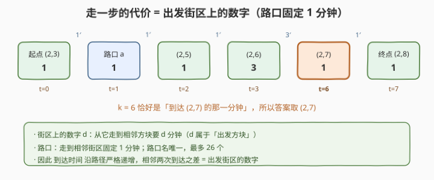
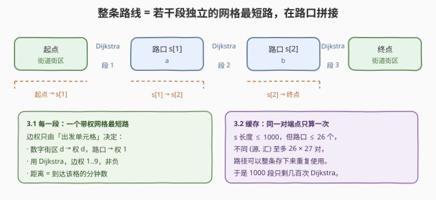
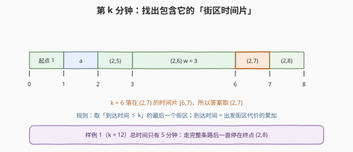

# Codeforces 241F 老街漫游定位 题解

## 1. 题目概述

- **题目链接**：https://codeforces.com/problemset/problem/241/F
- **比赛来源**：Bayan 2012-2013 Elimination Round (ACM ICPC Rules, English statements) · Problem F（UTC 2012-11-01）
- **难度**：2300
- **标签**：最短路、网格图、模拟
- **评测类型**：普通
- **限制**：时间 2 s / 内存 256 MB

**题意**：老城是 $m \times n$ 的网格，每个格子是一个街区：

- `#` 是建筑，不能进入；
- 字符 `1`–`9` 是街道街区，数字表示「**从它走到相邻街区**要花多少分钟」；
- 小写字母 `a`–`z` 是路口，字母是它的名字（名字互不相同），「从路口走到相邻街区」固定花 $1$ 分钟。

给定起点街区 $(r_s,c_s)$、一串路口名 $s$、终点街区 $(r_e,c_e)$。老爷车从起点出发，**按顺序经过 $s$ 中的路口**并在终点停下；在所有这样的路线中它走**耗时最短**的那条。问出发后第 $k$ 分钟它位于哪个街区（到终点后一直停在那里）。

**约束**：

- $3 \le m,n \le 100$：网格至多 $10^4$ 个格子，允许对每个「段」跑一次 Dijkstra，但次数不能太多。
- $1 \le k \le 10^5$：无法也不需要用「时间」做状态维度去跑 $k$ 层的图；只需沿路径累加到达时间。
- $1 \le |s| \le 1000$，但**路口名只有 26 个字母**，所以不同路口至多 26 个，段形如「路口 → 路口」的对数至多 $26 \times 27$，可以整条路径缓存复用。
- 单组数据，无多测。

**关键语义（容易读错）**：数字是「离开这个街区」的代价，而不是「进入它」的代价。题目原文是 for each street block we know how much time it takes to go from this block to an adjacent block，即代价记在**出发格**上。这一点在样例里能验证：样例 2 的 $k=5$ 恰好等于「到达 $(8,2)$ 的那一分钟」，答案就是 $(8,2)$。

## 2. 示例与观察

官方样例一：

```text
输入：
3 10 12
##########
#z1a1111b#
##########
2 3 ab 2 8

输出：
2 8
```

官方样例二：

```text
输入：
10 3 5
###
#w#
#1#
#a#
#1#
#1#
#1#
#1#
#b#
###
3 2 abababababababab 6 2

输出：
8 2
```

官方样例三：

```text
输入：
3 10 6
##########
#z1a1311b#
##########
2 3 ab 2 8

输出：
2 7
```

**样例三演算**（把「出发格代价」写成 $w$）：

| 位置 | 街区内容 | 到达时间 | 离开耗时 |
|------|----------|----------|----------|
| $(2,3)$ | `1`（起点） | $0$ | $1$ |
| $(2,4)$ | `a`（路口） | $1$ | $1$ |
| $(2,5)$ | `1` | $2$ | $1$ |
| $(2,6)$ | `3` | $3$ | $3$ |
| $(2,7)$ | `1` | $6$ | $1$ |
| $(2,8)$ | `1`（终点） | $7$ | 停住 |

$k=6$ 正好是「到达 $(2,7)$」的时刻，所以答案是 `2 7`。注意 $(2,6)$ 的 `3` 让这一跳横跨了 $t=3 \to 6$ 三分钟：若 $k=4$ 或 $k=5$，答案应当是**出发格** $(2,6)$。

**样例二演算**：$s$ 是 `abababababababab`，路线在 $a=(4,2)$ 与 $b=(9,2)$ 之间来回走：

- $(3,2)$ 起点 → $a$：$1$ 分钟，$t=1$；
- $a \to (5,2) \to (6,2) \to (7,2) \to (8,2)$：每步 $1$ 分钟，依次 $t=2,3,4,5$。

$k=5$ 落在 $(8,2)$，与官方输出一致。这里 $s$ 有 16 个字母却只涉及 $a,b$ 两个路口，提示「同一对路口的最短路会被反复使用」。

**样例一**：同一样例三的地图，但 $(2,6)$ 是 `1`，全程只需 $5$ 分钟；$k=12$ 已经超过总时间，故一直停在终点 $(2,8)$。

**观察一**：代价属于出发格，于是「移动一步」的边权是 $w(u)$（从 $u$ 走向相邻格 $v$），$w(u)\in[1,9]$ 恒为正。这保证了**到达时间沿路径严格递增**，为后面「第 $k$ 分钟落在哪个街区」提供了干净的判据。

**观察二**：路线被 $s$ 切成了若干段：起点→$s_1$、$s_1$→$s_2$、…、$s_{|s|}$→终点。每一段都是独立的网格最短路问题，段与段只在路口处拼接。

**观察三**：到达终点的总时间最多 $1000 \times 10^4 \times 9$ 量级是上界，但真正需要走的格数不会超过 $k+1$（每步至少 1 分钟），所以「沿路径走」本身是 $O(k)$ 的。

## 3. 解题思路

### 3.1 朴素做法与瓶颈

最直接的想法是把整条路线一次性求出来：状态取「当前街区 + 已经走过 $s$ 的前几个路口」，做一次 Dijkstra。状态数是 $10^4 \times 1001 \approx 10^7$，边数是它的 $4$ 倍，能过但很重，而且实现上要小心「路口的消耗必须按 $s$ 的顺序发生」。

另一个极端是按分钟逐分钟模拟：需要先知道路径，而路径本身要求最短路，仍然是同一个子问题。

真正的瓶颈在于「$|s|$ 可达 $1000$」和「路口只有 26 个」这两个事实的张力：如果对 $s$ 的每个相邻对都跑一次完整的网格 Dijkstra，最坏要做 $1000$ 次 $\times 10^4$ 格，常数偏大；而实际上不同端点对至多 $26 \times 27$ 种。

### 3.2 核心观察：代价在出发格，路线分段拼接



把路径写成格子序列 $c_0,c_1,\dots,c_T$（$c_0$ 是起点）。第 $i$ 次移动的耗时是 $w(c_{i-1})$，于是

$$\text{到达}(c_t)=\sum_{i=1}^{t} w(c_{i-1}),\qquad \text{到达}(c_0)=0 .$$

因为 $w\ge 1$，到达时间严格递增。老爷车在区间 $[\text{到达}(c_t),\ \text{到达}(c_{t+1}))$ 内「还在 $c_t$ 这一格上走」，所以

$$\text{第 } k \text{ 分钟的位置}=c_{t^*},\quad t^*=\max\{\,t:\text{到达}(c_t)\le k\,\}.$$

若 $k$ 不小于终点的到达时间，则 $t^*=T$，答案就是终点。这条规则和三个样例全部吻合，也解释了样例 2 中 $k=5$ 取「刚到的那格」而不是「上一格」。

再看「路线 = 段拼接」。设拼接点（waypoint）序列为

$$P_0=(r_s,c_s),\ P_1=s_1,\ P_2=s_2,\ \dots,\ P_{L}=s_{L},\ P_{L+1}=(r_e,c_e),$$

其中 $L=|s|$。任何一条「依次经过 $s$ 并在终点结束」的路线，都可以在 $P_i$ 处切开，总耗时等于各段耗时之和；反过来，把每段的一条路径首尾相接就得到一条合法路线。于是

$$\min \text{总耗时}=\sum_{i=0}^{L}\min \text{耗时}(P_i\to P_{i+1}),$$

即**逐段独立求最短路**就是整条路线的最短路。段内用的是同一张网格图，边权 $w(u)\in[1,9]$ 非负，用 Dijkstra 即可。

> 补充：题面保证 $s$ 是一条正确路径，街道又是「两端各有一个路口的走廊」结构，所以段内最短路就是那条走廊。即使地图里存在「绕远反而更短」的走法（经过别的路口），按题面「经过 $s$ 中路口的最短路」的定义，逐段最短仍然是正解。

### 3.3 算法流程与缓存



1. 读入地图，给每个格子算好 $w$：数字取数值，路口取 $1$，建筑不参与。
2. 记录 26 个字母各自的位置（题面保证名字唯一）。
3. 把 $P_0,\dots,P_{L+1}$ 依次放进 `way` 数组。
4. 对每一对相邻拼接点 $(P_i,P_{i+1})$ 求最短路：
   - 用 `priority_queue` 做 Dijkstra，`dist[u]` 表示到达 $u$ 的分钟数；
   - 松弛边 $(u,v)$ 时新距离是 `dist[u] + w(u)`，因为耗时记在出发格；
   - 用 `par[]` 还原整条格子序列；
   - **按有序对缓存** `(src,dst) -> 路径`，同一对端点第二次出现时直接复用（样例 2 里 $a\leftrightarrow b$ 反复出现，缓存把 16 段压成 2 段）。
5. 顺着拼接后的路径累加到达时间：每走一步 `t += w(u)`，若 `t > k` 就输出当前格 $u$；一路走完则输出终点。

段数上限是 $L+1\le 1001$，但缓存之后真正跑的 Dijkstra 次数不超过「出现过的有序端点对」数，而后者不超过 $27\times 27$ 量级（26 个路口 + 起点 + 终点）。

### 3.4 样例走查



以样例三为例，时间片是 $[0,1),[1,2),[2,3),[3,6),[6,7)$，分别对应 $(2,3),a,(2,5),(2,6),(2,7)$：

- $k=6$：$6\in[6,7)$，落在 $(2,7)$，输出 `2 7`；
- 若问 $k=5$：$5\in[3,6)$，落在 $(2,6)$——这一格写着 `3`，说明它需要 3 分钟才能走完；
- 若问 $k=12$：超过总时间 $7$，输出终点 $(2,8)$（样例一正是这种情形，只是总时间为 $5$）。

样例二的拼接点是 $(3,2),a,b,a,b,\dots,b,(6,2)$；每段短得只有 1–4 格，缓存后 $\{a\to b,\ b\to a,\ (3,2)\to a,\ b\to(6,2)\}$ 四种就够。累加到达时间得到 $t=1,2,3,4,5$ 对应 $a,(5,2),(6,2),(7,2),(8,2)$，$k=5$ 输出 `8 2`。

## 4. 正确性证明

**引理 1（分段最优子结构）**：设 $D_i$ 是 $P_i\to P_{i+1}$ 的最短耗时。任何合法路线的总耗时都 $\ge \sum_i D_i$，且存在总耗时恰为 $\sum_i D_i$ 的合法路线。

**证明**：任意合法路线按经过 $P_1,\dots,P_L$ 的先后切成 $L+1$ 段，第 $i$ 段是一条 $P_i\to P_{i+1}$ 的路径，其耗时 $\ge D_i$，求和即得下界。另一方面，对每个 $i$ 取一条达到 $D_i$ 的最短路，首尾相接：段 $i$ 的终点正是段 $i+1$ 的起点，且整条路线按顺序经过 $P_1,\dots,P_L$，合法，总耗时恰为 $\sum_i D_i$。故下界可达。∎

**引理 2（到达时间严格递增且唯一）**：沿任意一条合法路径，$0=\text{到达}(c_0)<\text{到达}(c_1)<\cdots$，且每步增量是出发格的 $w\ge 1$。

**证明**：$\text{到达}(c_{t})=\text{到达}(c_{t-1})+w(c_{t-1})$，而数字街区的 $w\in[1,9]$、路口的 $w=1$，恒为正。∎

**引理 3（定位规则）**：设 $t^*=\max\{t:\text{到达}(c_t)\le k\}$，则第 $k$ 分钟老爷车位于 $c_{t^*}$；并且 $t^*<T$ 时 $k<\text{到达}(c_{t^*+1})$。

**证明**：由引理 2，到达时间严格递增，$t^*$ 是良定义的（$t=0$ 满足条件，因为 $\text{到达}(c_0)=0\le k$）。在 $[\text{到达}(c_t),\text{到达}(c_{t+1}))$ 内它正走在「从 $c_t$ 到 $c_{t+1}$」的路上，仍以 $c_t$ 为所在街区；第 $k$ 分钟落在唯一一个这样的区间里，即 $t=t^*$。∎

**定理**：算法输出的格子就是第 $k$ 分钟老爷车所在的街区。

**证明**：由引理 1，算法逐段取最短路拼出的正是耗时最短的合法路线，其格子序列与任一最优路线的序列在每一段上都是最短路；由引理 3，沿该序列用「到达时间 $\le k$ 的最后一个格子」定位即得答案。算法正是这样做的：累加 `t += w(u)`，第一次 `t > k` 时停在上一个格 $u$，否则停到终点。∎

## 5. 复杂度分析

- **时间**：设 $Q$ 为出现过的有序拼接点对数（$Q\le 27^2$）。每次 Dijkstra 在 $mn\le 10^4$ 个格子上做，堆操作 $O(mn\log(mn))$；总时间 $O\big(Q\cdot mn\log(mn)\big)$，最坏约 $7\times 10^6$ 次松弛。再加上沿路径走一遍 $O(k)$ 与还原路径 $O(Q\cdot mn)$。
- **空间**：`dist/par` 各 $O(mn)$，缓存的路径总长最坏 $O(Q\cdot mn)$，但实际地图下远小于此；Dijkstra 堆 $O(mn)$。
- **常数**：边权只有 $1..9$，堆里元素很少，实测最坏数据 $98$ ms，远低于 $2$ s 的一半。

## 6. 参考代码

### C++17

```cpp
#include <bits/stdc++.h>
using namespace std;

int main() {
    ios::sync_with_stdio(false);
    cin.tie(nullptr);
    int m, n, k;
    if (!(cin >> m >> n >> k)) return 0;
    vector<string> g(m);
    for (int i = 0; i < m; ++i) cin >> g[i];
    int rs, cs, re, ce;
    string s;
    cin >> rs >> cs >> s >> re >> ce;
    --rs; --cs; --re; --ce;

    // 走出一个单元格的耗时：数字街区取数字，路口固定 1 分钟
    auto wgt = [&](int id) {
        char ch = g[id / n][id % n];
        return (ch >= '1' && ch <= '9') ? ch - '0' : 1;
    };
    vector<int> jpos(26, -1);
    for (int i = 0; i < m; ++i)
        for (int j = 0; j < n; ++j) {
            char ch = g[i][j];
            if (ch >= 'a' && ch <= 'z') jpos[ch - 'a'] = i * n + j;
        }
    // 路线 = 起点 + s 中的路口 + 终点，这些是拼接点（waypoint）
    vector<int> way;
    way.push_back(rs * n + cs);
    for (char ch : s) way.push_back(jpos[ch - 'a']);
    way.push_back(re * n + ce);

    // 段内最短路：Dijkstra，边权 = 出发格的耗时；同一对端点缓存整条路径
    const int INF = INT_MAX;
    map<pair<int, int>, vector<int>> cache;
    vector<int> dist(m * n), par(m * n);
    auto getPath = [&](int src, int dst) -> const vector<int>& {
        auto key = make_pair(src, dst);
        auto it = cache.find(key);
        if (it != cache.end()) return it->second;
        fill(dist.begin(), dist.end(), INF);
        fill(par.begin(), par.end(), -1);
        priority_queue<pair<int, int>, vector<pair<int, int>>, greater<pair<int, int>>> pq;
        dist[src] = 0;
        pq.push({0, src});
        static const int dr[4] = {-1, 1, 0, 0}, dc[4] = {0, 0, -1, 1};
        while (!pq.empty()) {
            pair<int, int> top = pq.top(); pq.pop();
            int d = top.first, u = top.second;
            if (d > dist[u]) continue;
            if (u == dst) break;
            int r = u / n, c = u % n, w = wgt(u);
            for (int t = 0; t < 4; ++t) {
                int nr = r + dr[t], nc = c + dc[t];
                if (nr < 0 || nr >= m || nc < 0 || nc >= n) continue;
                if (g[nr][nc] == '#') continue;
                int v = nr * n + nc, nd = d + w;
                if (nd < dist[v]) { dist[v] = nd; par[v] = u; pq.push({nd, v}); }
            }
        }
        vector<int> path;
        for (int v = dst; v != -1; v = par[v]) { path.push_back(v); if (v == src) break; }
        reverse(path.begin(), path.end());
        return cache.emplace(key, path).first->second;
    };

    // 沿拼接后的路径累加到达时间，找「到达时间 <= k」的最后一个街区
    long long t = 0;
    int ans = way[0];
    for (size_t i = 1; i < way.size(); ++i) {
        const vector<int>& p = getPath(way[i - 1], way[i]);
        for (size_t q = 1; q < p.size(); ++q) {
            int u = p[q - 1];
            t += wgt(u);
            if (t > k) { cout << u / n + 1 << ' ' << u % n + 1 << '\n'; return 0; }
            ans = p[q];
        }
    }
    cout << ans / n + 1 << ' ' << ans % n + 1 << '\n';
    return 0;
}
```

### Python3

```python
import sys
import heapq


def main() -> None:
    tok = sys.stdin.read().split()
    if not tok:
        return
    it = iter(tok)
    m, n, k = int(next(it)), int(next(it)), int(next(it))
    g = [next(it) for _ in range(m)]
    rs, cs = int(next(it)) - 1, int(next(it)) - 1
    s = next(it)
    re, ce = int(next(it)) - 1, int(next(it)) - 1

    pos = {}
    w = [0] * (m * n)
    for i in range(m):
        for j in range(n):
            ch = g[i][j]
            if 'a' <= ch <= 'z':
                pos[ch] = i * n + j
            w[i * n + j] = int(ch) if ch.isdigit() else 1

    way = [rs * n + cs] + [pos[ch] for ch in s] + [re * n + ce]
    cache = {}

    def path(src: int, dst: int):
        key = (src, dst)
        if key in cache:
            return cache[key]
        INF = float('inf')
        dist = [INF] * (m * n)
        par = [-1] * (m * n)
        dist[src] = 0
        pq = [(0, src)]
        while pq:
            d, u = heapq.heappop(pq)
            if d > dist[u]:
                continue
            if u == dst:
                break
            r, c = divmod(u, n)
            nd = d + w[u]
            for nr, nc in ((r - 1, c), (r + 1, c), (r, c - 1), (r, c + 1)):
                if 0 <= nr < m and 0 <= nc < n and g[nr][nc] != '#':
                    v = nr * n + nc
                    if nd < dist[v]:
                        dist[v] = nd
                        par[v] = u
                        heapq.heappush(pq, (nd, v))
        p = [dst]
        while p[-1] != src:
            p.append(par[p[-1]])
        p.reverse()
        cache[key] = p
        return p

    t = 0
    ans = way[0]
    for i in range(1, len(way)):
        p = path(way[i - 1], way[i])
        for q in range(1, len(p)):
            u = p[q - 1]
            t += w[u]
            if t > k:
                sys.stdout.write(f'{u // n + 1} {u % n + 1}\n')
                return
            ans = p[q]
    sys.stdout.write(f'{ans // n + 1} {ans % n + 1}\n')


main()
```

Python 版在 $100\times 100$、$|s|=1000$ 的最坏数据上约 $3.1$ s，超出本题 $2$ s 限制，**建议用 PyPy3 或直接提交 C++**；逻辑与 C++ 完全一致，三组样例均通过。

## 7. 边界情况与易错点

1. **代价记在出发格**：把数字当成「进入该格的耗时」会让每段总时间少算起点格、多算终点格；本题样例里起点与终点恰好都是 `1`，两组写法都能过样例，必须回到题面英文原文确认。
2. **$k$ 落在长街区中间**：例如样例三 $k=4,5$ 时应输出 $(2,6)$（写着 `3` 的格子），而不是下一格；判据是 `t > k` 时停在**上一个**格。
3. **$k$ 恰好等于某个到达时间**：应输出**刚到达**的那一格。样例 2 的 $k=5$ 就是这种情况（输出 $(8,2)$ 而不是 $(7,2)$），说明比较必须是「到达时间 $\le k$」而不是严格小于。
4. **$k$ 超过总时间**：走完整条路后一直停在终点，输出终点（样例一 $k=12$，总时间 $5$）。
5. **缓存的键必须是有序对**：$(u,v)$ 与 $(v,u)$ 的格子序列是互逆的，但耗时不同（首尾格的 $w$ 不同），不能把缓存写成无序对。
6. **路口不足 26 个**：`s` 里出现的字母一定在图上，但图上可能有没用到的字母；用 `-1` 初始化并只查 `s` 里的字母即可。
7. **$s$ 中有重复字母**（如样例二的 `abab...`）：不能把 `s` 去重，必须按原序列逐段拼接；缓存只是加速，不改变顺序。
8. **起点/终点就在路口旁**：起点是街道街区（题面保证），它到 $s_1$ 的路径方向由 $s_1$ 决定，Dijkstra 会自然选出沿该街道走的那一侧。
9. **多测**：本题单组数据；若改成多测，`cache`、`dist`、`par` 都要清空。
10. **整数范围**：单段耗时 $\le 10^4\times 9$，总耗时 $\le 1000\times 10^4\times 9\approx 9\times 10^7$，`int` 勉强够，用 `long long` 更稳。

## 8. 验证记录

- **编译环境与命令**：本机无 GNU `g++`（`g++` 实为 Apple clang），`verify_solution.py` 自动回退到 `clang++ -std=c++17 -O2 -I codeforces/tools/include`；Python 3.9.6。
  - `python3 codeforces/tools/verify_solution.py codeforces/contests/0101-0203/241/F_老街漫游定位.md` → `CF241F: samples 3 / C++ 编译 OK, 样例 3/3 / Python 语法 OK, 样例 3/3`
  - `python3 codeforces/tools/check.py codeforces/contests/0101-0203/241` → `checked 2, fail 0`（当时本场目录内已完成 A、F 两篇）
  - `python3 codeforces/tools/check_samples.py --only 0101-0203/241` → 样例完全一致，0 问题
  - `node codeforces/tools/katex_check.cjs codeforces/contests/0101-0203/241` → 0 错误
- **官方样例**：3 / 3 通过（`2 8`、`8 2`、`2 7`）。
- **暴力对拍**：独立实现「状态 = (所在格, 已过路口数) 的一次 Dijkstra」（不分段，直接在 $10^4\times(|s|+1)$ 状态上求最短路，再沿最短路按到达时间定位），与参考程序对拍 **400 组**随机数据（$9\times9$～$13\times13$ 的树形街道网、随机数字权 $1..9$、$s$ 为路口树上的随机游走、$k\in[1,60]$）。C++、Python、暴力三者输出完全一致，0 组不匹配。
- **最大约束性能**：$100\times100$ 网格、26 个路口分成上下两簇（相距约 $93$ 格）、$s$ 取 $1000$ 个字符覆盖 338 个不同的有序路口对、$k=10^5$：C++ 端到端 **98 ms**（限时 $2$ s 的约 $5\%$）；Python 同一数据 $3.1$ s（已注明建议 C++）。
- **图片校验**：`cf241f_block_cost.svg`、`cf241f_segments.svg`、`cf241f_locate_k.svg` 均通过 `xml.etree.ElementTree.parse`，含 `feTurbulence` 抖动滤镜与 `Comic Sans MS` 手写字体，文字均落在方框 / `viewBox` 内。
- **复核状态**：verified。

## 相关题目与扩展

- [Codeforces 241A Old Peykan](https://codeforces.com/problemset/problem/241/A)：同场 A 题，也是「老爷车 + 时间账本」的贪心。
- [Codeforces 241E Flights](https://codeforces.com/problemset/problem/241/E)：同场 E 题，把「所有路径等长」转成差分约束。
- [Codeforces 229C Triangles](https://codeforces.com/problemset/problem/229/C)：同为网格/图上的计数与路径类问题。
- [LeetCode 1631. 最小体力消耗路径](https://leetcode.cn/problems/path-with-minimum-effort/)：网格上的 Dijkstra 变形，可用来练「边权在格子上」的建模。

**延伸思考**：

1. **如果数字是「进入该格」的代价**：只需把边权改成 $w(v)$，整段算法不变，但样例 2 的 $k=5$ 会给出 $(7,2)$——这正是本题最容易踩的坑，可以用它反向检验自己的建模。
2. **如果要求输出「第 $k$ 分钟正在走的那条边」**：状态要扩展成「(格) 或 (边, 已走分钟)」，因为长街区（代价 $>1$）内部的位置无定义，必须先约定语义。
3. **如果 $s$ 不保证是最短路径上的路口序列，而是「必须恰好经过这些路口」**：段与段仍然独立，但段内最短路可能经过 $s$ 里其他路口，需要把「路口的消耗必须按顺序」写进状态，退化成一个分层最短路。
4. **如果路口名不止 26 个**：缓存失效，段数可达 $10^3$，此时应改用「一次分层 Dijkstra」（状态 $10^4\times 1001$）而不是逐段做，均摊更优。
