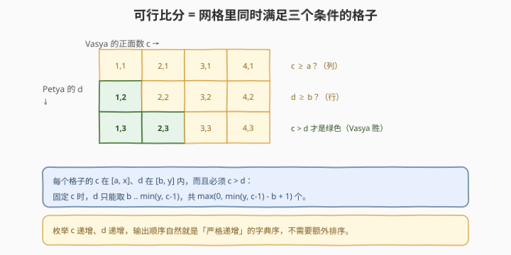
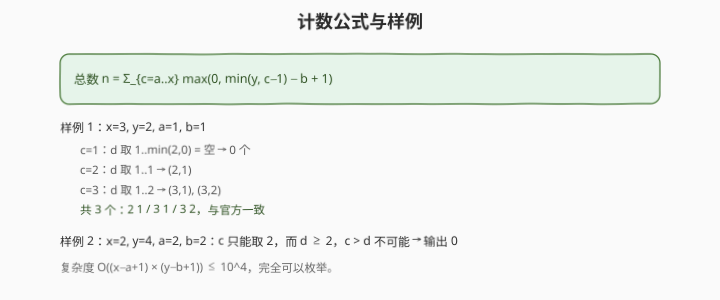

# Codeforces 242A 正面还是反面 题解

## 1. 题目概述

- **题目链接**：https://codeforces.com/problemset/problem/242/A
- **比赛来源**：Codeforces Round 149 (Div. 2) · Problem A（UTC 2012-11-11）
- **难度**：1100
- **标签**：暴力、枚举、实现
- **评测类型**：普通
- **限制**：时间 2 s / 内存 256 MB

**题意**：Petya 和 Vasya 抛硬币，Vasya 抛 $x$ 次、Petya 抛 $y$ 次，每抛到正面得 1 分，反面不得分，得分多者获胜（相同则平局）。Valera 记得：Vasya 至少抛出 $a$ 次正面、Petya 至少抛出 $b$ 次正面，且**最终获胜者是 Vasya**。求所有可能的最终比分 $(c, d)$（Vasya 的正面数 $c$、Petya 的正面数 $d$），按严格递增的字典序输出，第一行先输出个数 $n$。

**约束**：

- $1 \le a \le x \le 100$，$1 \le b \le y \le 100$：候选组合最多 $100 \times 100 = 10^4$ 个，暴力枚举完全可行。
- 输出顺序必须严格递增：按 $(c, d)$ 字典序，即先按 $c$ 升序、$c$ 相同按 $d$ 升序。
- 无解时只输出一行 `0`，后面不能跟任何比分行。

## 2. 示例与观察

官方样例一：

```text
输入：
3 2 1 1

输出：
3
2 1
3 1
3 2
```

官方样例二：

```text
输入：
2 4 2 2

输出：
0
```

**样例一演算**：$x=3, y=2, a=1, b=1$。Vasya 的正面数 $c \in [1,3]$，Petya 的 $d \in [1,2]$，并且 Vasya 要赢需要 $c > d$：

| $c$ | 可行的 $d$ | 比分 |
|-----|-----------|------|
| 1 | 无（$d \ge 1$ 且 $d < 1$） | — |
| 2 | $d = 1$ | (2,1) |
| 3 | $d = 1, 2$ | (3,1)、(3,2) |

共 3 个，与官方一致。

**样例二演算**：$x=2, y=4, a=2, b=2$。$c$ 只能取 2，而 $d \ge 2$，要求 $c > d$ 不可能，输出 0。

自造样例（标注「自造」）：

| 输入 | 输出 | 说明 |
|------|------|------|
| `1 1 1 1` | `0` | 双方都只能得 1 分，平局 |
| `2 1 1 1` | `1`<br>`2 1` | Vasya 两次全中 |
| `100 100 1 1` | 99 个比分 | 最大规模 |

## 3. 解题思路

### 3.1 朴素做法与瓶颈

没有瓶颈：$x, y \le 100$，所有 $(c,d)$ 组合只有 $10^4$ 个。直接双重循环枚举 $c \in [a,x]$、$d \in [b,y]$，保留满足 $c > d$ 的对即可。

### 3.2 核心观察：三个条件



一个比分 $(c, d)$ 合法当且仅当：

1. $a \le c \le x$（Vasya 的正面数在记忆与次数范围内）；
2. $b \le d \le y$（Petya 同理）；
3. $c > d$（Vasya 获胜，不能是平局）。

因为循环先按 $c$ 升序、再按 $d$ 升序，输出的顺序天然就是严格递增的字典序，不需要额外排序。

### 3.3 计数与输出



固定 $c$ 时，$d$ 能取的范围是 $[b, \min(y, c-1)]$，共 $\max(0, \min(y, c-1) - b + 1)$ 个。总数

$$n = \sum_{c=a}^{x} \max\bigl(0,\ \min(y, c-1) - b + 1\bigr).$$

实现上不必真的用公式，直接双重循环枚举并输出即可（$10^4$ 的规模）。

### 3.4 样例走查：样例一

- $c=1$：需要 $d < 1$ 且 $d \ge 1$，没有；
- $c=2$：$d \in [1, \min(2,1)] = \{1\}$ → 输出 `2 1`；
- $c=3$：$d \in [1, \min(2,2)] = \{1,2\}$ → 输出 `3 1`、`3 2`。

## 4. 正确性证明

**引理 1（判定的充分必要性）**：比分 $(c,d)$ 与 Valera 的记忆不矛盾，当且仅当 $a \le c \le x$、$b \le d \le y$、$c > d$。

**证明**：Vasya 抛 $x$ 次，正面数 $c$ 必须满足 $0 \le c \le x$，且记忆要求 $c \ge a$，合并即 $a \le c \le x$；$d$ 同理。获胜者是 Vasya 意味着 Vasya 得分严格多于 Petya（平局不算获胜），即 $c > d$。反过来，满足这三条的一组正面次数显然对应一局与记忆不矛盾的比赛（其余抛掷都是反面）。∎

**引理 2（枚举不漏不重）**：双重循环恰好访问每个满足 $a \le c \le x$、$b \le d \le y$ 的整数对一次，并按 $(c,d)$ 字典序升序访问。

**证明**：外层 $c$ 从 $a$ 递增到 $x$，内层 $d$ 从 $b$ 递增到 $y$，访问的是完整的矩形整数格点集合，每个点一次；按 $c$ 分组、组内按 $d$ 递增，正是字典序。∎

**定理**：算法输出的个数与每个比分都正确，顺序严格递增。

**证明**：由引理 1，算法保留的恰好是所有合法比分；由引理 2，它们被每个访问一次且按字典序输出，故严格递增；`n` 是保留下来的元素个数。∎

## 5. 复杂度分析

- **时间**：$O((x-a+1)(y-b+1)) \le 10^4$，加上输出 $O(n)$，远小于 2 s。
- **空间**：$O(n)$ 存答案（也可以边算边输出，但需要先输出个数，所以先统计或先存）。
- **与时限的关系**：最大规模 $x=y=100$ 时 C++ 端到端约 2 ms。

## 6. 参考代码

### C++17

```cpp
#include <bits/stdc++.h>
using namespace std;

int main() {
    ios::sync_with_stdio(false);
    cin.tie(nullptr);
    int x, y, a, b;
    if (!(cin >> x >> y >> a >> b)) return 0;
    vector<pair<int, int>> out;
    for (int c = a; c <= x; ++c)            // Vasya 的正面数
        for (int d = b; d <= y; ++d)        // Petya 的正面数
            if (c > d) out.push_back({c, d});   // Vasya 必须获胜
    cout << out.size() << '\n';
    for (auto &p : out) cout << p.first << ' ' << p.second << '\n';
    return 0;
}
```

### Python3

```python
import sys


def main() -> None:
    data = sys.stdin.buffer.read().split()
    if not data:
        return
    x, y, a, b = (int(v) for v in data[:4])
    out = [(c, d) for c in range(a, x + 1) for d in range(b, y + 1) if c > d]
    lines = [str(len(out))] + [f"{c} {d}" for c, d in out]
    sys.stdout.write("\n".join(lines) + "\n")


main()
```

## 7. 边界情况与易错点

1. **平局不算 Vasya 获胜**：条件是 $c > d$ 而不是 $c \ge d$；写成 $\ge$ 会把平局也算进去。
2. **下界与上界**：$c$ 从 $a$ 开始（不是 0），到 $x$ 结束；$d$ 从 $b$ 开始，到 $y$ 结束。漏掉 `a`/`b` 会多输出不合法比分。
3. **无解输出**：$n=0$ 时只输出一行 `0`，不要输出空行或后续内容。
4. **顺序**：题目要求严格递增字典序；双重循环（先 $c$ 后 $d$）天然满足，不要先按 $d$ 再按 $c$。
5. **$a = x$ 且 $b = y$**：可能只有 0 个或 1 个比分，注意 `c > d` 的判断。
6. **输出格式**：第一行是个数，之后每个比分一行两个整数，用空格分隔。
7. **数据范围**：$x, y \le 100$，`int` 足够，不需要 64 位。
8. **多测**：本题只有一组输入。

## 8. 验证记录

- **编译环境与命令**：本机无 GNU `g++`，用 `clang++ -std=c++17 -O2 -I codeforces/tools/include` 编译；Python 3.9.6。
  - 题面缓存原缺失（洛谷镜像返回 401），已按 Codeforces 官方页面（`https://codeforces.com/problemset/problem/242/A`）补写 `.cf-meta/statements/CF242A.json`，样例与官方页面逐字一致。
  - `python3 codeforces/tools/verify_solution.py codeforces/contests/0101-0203/242/A_正面还是反面.md` → `CF242A: samples 2 / C++ 编译 OK, 样例 2/2 / Python 语法 OK, 样例 2/2`
  - `check_samples.py --only 0101-0203/242`、`check.py codeforces/contests/0101-0203/242`、`katex_check.cjs` 均 0 问题。
- **官方样例**：2 / 2 通过（`3 / 2 1 / 3 1 / 3 2` 与 `0`）。
- **额外测试与随机对拍**：另写独立暴力（枚举 $c \in [1,x]$、$d \in [1,y]$ 后统一筛选并排序），对 **220 组**随机数据（$x,y \le 20$，随机 $a \le x$、$b \le y$）逐组比对，C++/Python/暴力完全一致。
- **最大约束性能**：$x=y=100$、$a=b=1$ 时 C++ 端到端约 2 ms。
- **图片校验**：`cf242a_scores.svg`、`cf242a_count.svg` 通过 `xml.etree.ElementTree.parse`，含 `feTurbulence` 与手写字体，包围盒未越界。
- **公式校验**：KaTeX 0 错误。
- **复核状态**：verified。

## 相关题目与扩展

- [Codeforces 242B Big Segment](https://codeforces.com/problemset/problem/242/B)：同场 B 题，区间极值。
- [Codeforces 242C King's Path](https://codeforces.com/problemset/problem/242/C)：同场 C 题，BFS。
- [Codeforces 71A Way Too Long Words](https://codeforces.com/problemset/problem/71/A)：最基础的输出格式练习。
- [LeetCode 1221. 分割平衡字符串](https://leetcode.cn/problems/split-a-string-in-balanced-strings/)：简单贪心/计数。

**延伸思考**：

1. **如果要求输出所有可能的「总分差」**：只需输出 $c - d$ 的不同取值，可以在枚举时去重。
2. **如果改为「Vasya 至少赢 2 分」**：把 $c > d$ 换成 $c \ge d + 2$，枚举框架不变。
3. **如果要求按总分降序输出**：先枚举收集再排序，复杂度 $O(n \log n)$，$n \le 10^4$ 完全可行。
4. **如果 $x, y$ 放大到 $10^9$**：需要用计数公式直接算 $n$，且输出本身可能巨大，题目就不可做了——本题的暴力正是依赖 $x,y \le 100$。
