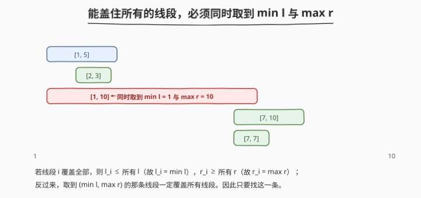
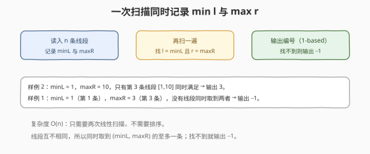

# Codeforces 242B 包含所有线段 题解

## 1. 题目概述

- **题目链接**：https://codeforces.com/problemset/problem/242/B
- **比赛来源**：Codeforces Round 149 (Div. 2) · Problem B（UTC 2012-11-11）
- **难度**：1100
- **标签**：实现、贪心、区间
- **评测类型**：普通
- **限制**：时间 2 s / 内存 256 MB

**题意**：数轴上有 $n$ 条线段 $[l_i, r_i]$。定义线段 $[a,b]$ **覆盖** $[c,d]$ 当且仅当 $a \le c \le d \le b$。问这 $n$ 条线段中是否存在一条覆盖其余所有线段；若存在输出它的编号（按输入顺序 $1 \sim n$），否则输出 $-1$。

输入第一行 $n$，随后 $n$ 行每行 $l_i, r_i$。保证没有两条线段完全相同。

**约束**：

- $n \le 10^5$：$O(n^2)$ 的两两比较是 $10^{10}$，不可接受，必须 $O(n)$ 或 $O(n \log n)$。
- $1 \le l_i \le r_i \le 10^9$：坐标超过 `int` 的一半吗？不超过（$10^9 < 2^{31}-1$），但习惯上仍可用 `int`；本题用 `long long` 也不损失什么。
- 线段互不相同：这保证「同时取到最小左端点与最大右端点」的线段至多一条。

## 2. 示例与观察

官方样例一：

```text
输入：
3
1 1
2 2
3 3

输出：
-1
```

官方样例二：

```text
输入：
6
1 5
2 3
1 10
7 10
7 7
10 10

输出：
3
```

**样例一演算**：三条线段互不包含（$[1,1]$、$[2,2]$、$[3,3]$），没有任何一条能覆盖其余，输出 $-1$。

**样例二演算**：各线段的左端点最小是 $1$（第 1、3 条），右端点最大是 $10$（第 3、4、6 条）。第 3 条是 $[1,10]$，同时取到最小左端点和最大右端点，它覆盖所有其它线段（$[1,5],[2,3]\subset[1,10]$，$[7,10],[7,7],[10,10]\subset[1,10]$），输出 3。

自造样例（标注「自造」）：

| 输入 | 输出 | 说明 |
|------|------|------|
| `1`<br>`5 5` | 1 | 只有一条线段，它覆盖自己 |
| `2`<br>`1 10`<br>`3 4` | 1 | 大线段在前 |
| `2`<br>`3 4`<br>`1 10` | 2 | 大线段在后 |
| `3`<br>`1 5`<br>`2 6`<br>`1 6` | 3 | 只有 [1,6] 同时取到两端 |

**观察**：若线段 $i$ 覆盖所有线段，则对每条 $j$ 都有 $l_i \le l_j$ 与 $r_j \le r_i$，于是 $l_i$ 就是全局最小左端点、$r_i$ 就是全局最大右端点。反过来，如果某条线段满足 $l_i = \min l$ 且 $r_i = \max r$，那么对任意 $j$：$l_i \le l_j \le r_j \le r_i$，它覆盖 $j$。**所以答案就是「同时取到 min l 与 max r」的那条线段**。

## 3. 解题思路

### 3.1 朴素做法与瓶颈

对每条线段 $i$，扫描所有 $j$ 检查 $l_i \le l_j$ 且 $r_j \le r_i$，复杂度 $O(n^2)$。$n = 10^5$ 时是 $10^{10}$ 次比较，2 s 内不可能完成。

### 3.2 核心观察：极值定位



由上一节：候选线段必须同时是「最靠左」与「最靠右」的那条。于是只需一次扫描求出

$$\text{minL} = \min_i l_i,\qquad \text{maxR} = \max_i r_i,$$

再扫描一遍找满足 $l_i = \text{minL}$ 且 $r_i = \text{maxR}$ 的线段。因为线段互不相同，这样的线段至多一条。

### 3.3 算法流程



1. 读入 $n$ 与所有线段，同时统计 `minL`、`maxR`；
2. 再遍历一次，输出第一个满足 `l == minL && r == maxR` 的编号；
3. 若没有，输出 $-1$。

### 3.4 样例走查：样例二

| 步骤 | 线段 | minL | maxR |
|------|------|------|------|
| 1 | [1,5] | 1 | 5 |
| 2 | [2,3] | 1 | 5 |
| 3 | [1,10] | 1 | 10 |
| 4 | [7,10] | 1 | 10 |
| 5 | [7,7] | 1 | 10 |
| 6 | [10,10] | 1 | 10 |

第二遍扫描：第 1 条 $[1,5]$ 的 $r=5\ne10$；第 2 条不满足；第 3 条 $[1,10]$ 满足 → 输出 3。

## 4. 正确性证明

**引理 1（必要性）**：若线段 $i$ 覆盖所有线段，则 $l_i = \min_j l_j$ 且 $r_i = \max_j r_j$。

**证明**：对任意 $j$，覆盖定义给出 $l_i \le l_j \le r_j \le r_i$。于是 $l_i$ 不超过所有左端点，即 $l_i = \min_j l_j$；$r_i$ 不小于所有右端点，即 $r_i = \max_j r_j$。∎

**引理 2（充分性）**：若 $l_i = \min_j l_j$ 且 $r_i = \max_j r_j$，则线段 $i$ 覆盖所有线段。

**证明**：任取 $j$。由定义 $l_i = \min \le l_j$，$r_i = \max \ge r_j$，又 $l_j \le r_j$，故 $l_i \le l_j \le r_j \le r_i$，即 $i$ 覆盖 $j$。∎

**定理**：算法输出正确：存在覆盖线段时输出其编号，否则输出 $-1$。

**证明**：由引理 1、2，存在覆盖线段 $\iff$ 存在 $i$ 同时取到两端极值。算法恰好枚举这样的 $i$。因为题目保证线段互不相同，若存在则唯一（若两条线段都满足，则它们的 $l$ 与 $r$ 都相同，即两条线段相同，矛盾），所以输出编号是唯一的正确答案；不存在时输出 $-1$。∎

## 5. 复杂度分析

- **时间**：$O(n)$，两次线性扫描。$n = 10^5$ 时约 $2 \times 10^5$ 次比较。
- **空间**：$O(n)$ 存线段（也可以边读边只记极值，但要输出编号，需保存 $l, r$）。
- **与时限的关系**：实测 $n = 10^5$ 时 C++ 端到端约 3 ms，Python 约 20 ms，2 s 余量极大。

## 6. 参考代码

### C++17

```cpp
#include <bits/stdc++.h>
using namespace std;

int main() {
    ios::sync_with_stdio(false);
    cin.tie(nullptr);
    int n;
    if (!(cin >> n)) return 0;
    long long minL = LLONG_MAX, maxR = LLONG_MIN;
    vector<long long> L(n), R(n);
    for (int i = 0; i < n; ++i) {
        cin >> L[i] >> R[i];
        minL = min(minL, L[i]);
        maxR = max(maxR, R[i]);
    }
    for (int i = 0; i < n; ++i)
        if (L[i] == minL && R[i] == maxR) { cout << i + 1 << '\n'; return 0; }
    cout << -1 << '\n';
    return 0;
}
```

### Python3

```python
import sys


def main() -> None:
    data = sys.stdin.buffer.read().split()
    if not data:
        return
    n = int(data[0])
    segs = [(int(data[1 + 2 * i]), int(data[2 + 2 * i])) for i in range(n)]
    min_l = min(a for a, _ in segs)
    max_r = max(b for _, b in segs)
    for i, (a, b) in enumerate(segs, 1):
        if a == min_l and b == max_r:
            sys.stdout.write(f"{i}\n")
            return
    sys.stdout.write("-1\n")


main()
```

## 7. 边界情况与易错点

1. **$n = 1$**：唯一的线段覆盖自己，应输出 $1$；代码天然正确，但要保证没有把「至少两条」当作前提。
2. **输出编号是 1-based**：题目按输入顺序从 1 开始编号；C++ 循环下标从 0 开始，输出时要 `i + 1`。
3. **坐标范围**：$l_i, r_i \le 10^9$，在 `int` 内，但极值初始化要用足够大/小的数（`LLONG_MAX/LLONG_MIN` 或 `INT_MAX/INT_MIN`）。
4. **多条线段取到极值**：可能有多条线段取到 `minL`，也可能有多条取到 `maxR`，但**同时**取到两者的至多一条（线段互不相同）；只要找到那一条即可，不能只比较 `l` 或只比较 `r`。
5. **线段可以退化**：$l_i = r_i$ 是合法输入；退化线段同样可能成为覆盖者（例如 $n=1$ 时），不要特判排除。
6. **`r` 与 `l` 混淆**：极值是「最小左端点」与「最大右端点」，不是最小左端点与最小右端点。
7. **快速 I/O**：$n = 10^5$ 行输入，用 `cin` 关闭同步或 `buffer.read()`；本机 libc++ 的 `cin` 较慢，但 2 s 内仍绰绰有余。

## 8. 验证记录

- **编译环境与命令**：本机无 GNU `g++`，用 `clang++ -std=c++17 -O2 -I codeforces/tools/include`（本地 `bits/stdc++.h` 兼容头）编译；Python 3.9.6。
  - `python3 codeforces/tools/verify_solution.py codeforces/contests/0101-0203/242/B_包含所有线段.md` → `CF242B: samples 2 / C++ 编译 OK, 样例 2/2 / Python 语法 OK, 样例 2/2`
  - `python3 codeforces/tools/check_samples.py --only 0101-0203/242`、`python3 codeforces/tools/check.py codeforces/contests/0101-0203/242`、`node codeforces/tools/katex_check.cjs codeforces/contests/0101-0203/242` 均 0 问题。
- **官方样例**：2 / 2 通过（`-1` 与 `3`）。
- **额外测试与随机对拍**：另写独立暴力（对每条线段检查是否包含所有线段，$O(n^2)$ 全部两两比较），与 C++、Python 在 **240 组**随机数据（$n \le 12$、坐标 $\le 15$、线段互不相同）上逐组比对，全部一致。
- **最大约束性能**：$n = 10^5$ 时 C++ 端到端约 3 ms，Python 约 20 ms。
- **图片校验**：`cf242b_cover.svg`、`cf242b_flow.svg` 通过 `xml.etree.ElementTree.parse`，含 `feTurbulence` 与手写字体，包围盒未越界。
- **公式校验**：KaTeX 对该篇 0 错误。
- **复核状态**：verified。

## 相关题目与扩展

- [Codeforces 242A Heads or Tails](https://codeforces.com/problemset/problem/242/A)：同场 A 题（本题面缓存缺失，见交付说明）。
- [Codeforces 242C King's Path](https://codeforces.com/problemset/problem/242/C)：同场 C 题，网格 BFS。
- [Codeforces 242E XOR on Segment](https://codeforces.com/problemset/problem/242/E)：同场 E 题，按位线段树。
- [LeetCode 1288. 删除被覆盖区间](https://leetcode.cn/problems/remove-covered-intervals/)：区间包含关系的经典处理，先排序再扫描。
- [Codeforces 1A Theatre Square](https://codeforces.com/problemset/problem/1/A)：最基础的实现题。

**延伸思考**：

1. **如果要求输出所有能覆盖全部线段的线段**：由引理 1、2，这样的线段必须同时取到两端极值，因此至多一条（线段互不相同时）。
2. **如果去掉「线段互不相同」的保证**：可能有多条完全相同的覆盖线段，输出任意一条编号即可。
3. **如果线段是开区间**：覆盖定义变成 $a \le c < d \le b$ 之类的变体，极值判据不变，只是相等的边界要重新讨论。
4. **如果改成「用最少的线段覆盖整条数轴」**：那就变成经典区间覆盖贪心（按右端点排序），与本题「找一条包含全部」完全不同。
