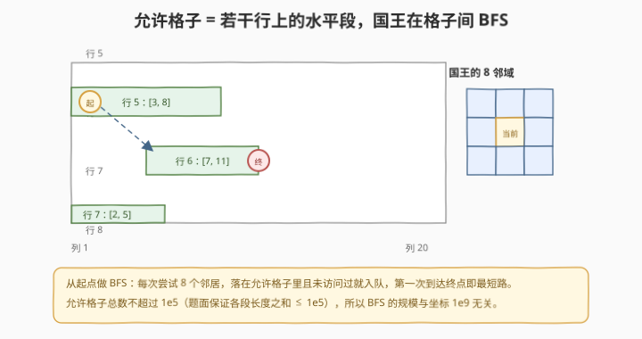
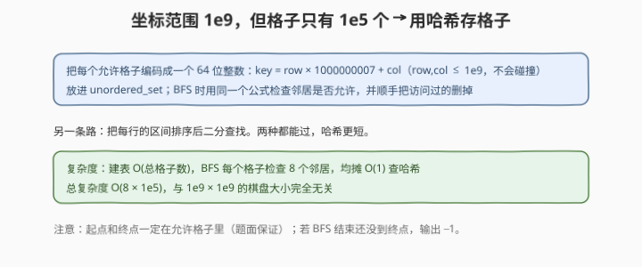

# Codeforces 242C 国王的最短路 题解

## 1. 题目概述

- **题目链接**：https://codeforces.com/problemset/problem/242/C
- **比赛来源**：Codeforces Round 149 (Div. 2) · Problem C（UTC 2012-11-11）
- **难度**：1800
- **标签**：BFS、坐标压缩、哈希表
- **评测类型**：普通
- **限制**：时间 2 s / 内存 256 MB

**题意**：在 $10^9 \times 10^9$ 的棋盘上，只有若干格子是「允许」的：给出 $n$ 个形如「第 $r_i$ 行、第 $a_i \sim b_i$ 列」的水平段，段内所有格子允许通行（段之间可以任意相交、包含）。国王从 $(x_0,y_0)$ 出发，每一步可以走到 8 邻域中的相邻格子，但只能落在允许格子上。求到 $(x_1,y_1)$ 的最少步数；不可达输出 $-1$。

输入：第一行 $x_0,y_0,x_1,y_1$；第二行 $n$；随后 $n$ 行 $r_i,a_i,b_i$。保证起点与终点都是允许格子、且不相同；所有段长度之和不超过 $10^5$。

**约束**：

- 坐标最大 $10^9$，棋盘有 $10^{18}$ 个格子，不可能建整张图。
- **所有段长度之和 $\le 10^5$**：允许格子总数只有 $10^5$，这是本题的突破口——只在这些格子上 BFS。
- 段可以相交或包含：同一个格子可能被多条段覆盖，不能重复计数；用集合去重。
- 起点与终点保证允许且不同，所以答案至少为 1；若被隔开则输出 $-1$。

## 2. 示例与观察

官方样例一：

```text
输入：
5 7 6 11
3
5 3 8
6 7 11
5 2 5

输出：
4
```

官方样例二：

```text
输入：
3 4 3 10
3
3 1 4
4 5 9
3 10 10

输出：
6
```

官方样例三：

```text
输入：
1 1 2 10
2
1 1 3
2 6 10

输出：
-1
```

**样例一演算**：允许格子是第 5 行的列 $3 \sim 8$、第 6 行的列 $7 \sim 11$、第 5 行的列 $2 \sim 5$（与第一条重叠）。合并后：第 5 行列 $2 \sim 8$、第 6 行列 $7 \sim 11$。从 $(5,7)$ 到 $(6,11)$：斜着向右下走 $(5,7)\to(6,8)\to(6,9)\to(6,10)\to(6,11)$ 共 4 步（第 6 行只有列 $7\sim11$ 允许，$(6,8)$ 起才合法），最优为 4。

**样例二演算**：第 3 行列 $1\sim4$ 与 $10\sim10$ 两段、第 4 行列 $5\sim9$。从 $(3,4)$ 到 $(3,10)$ 必须绕经第 4 行：$(3,4)\to(4,5)\to\dots\to(4,9)\to(3,10)$，共 $1+4+1 = 6$ 步。

**样例三演算**：第 1 行列 $1\sim3$、第 2 行列 $6\sim10$，两段列区间不相邻（3 与 6 之间断开），第 1 行与第 2 行无法衔接，不可达，输出 $-1$。

自造样例（标注「自造」）：

| 输入 | 输出 | 说明 |
|------|------|------|
| `1 1 1 2`<br>`1`<br>`1 1 2` | 1 | 相邻格，一步 |
| `1 1 2 2`<br>`2`<br>`1 1 1`<br>`2 2 2` | 1 | 斜向相邻 |
| `1 1 3 3`<br>`3`<br>`1 1 1`<br>`2 2 2`<br>`3 3 3` | 2 | 沿对角线走 |

**观察一**：虽然坐标有 $10^9$，但**允许格子总数只有 $10^5$**（所有段长度之和的上限）。因此把允许格子放进哈希集合，BFS 只在这些格子上扩展，复杂度与坐标范围无关。

**观察二**：国王每步只能走 8 邻域，边权都是 1，所以 BFS 第一次访问某格时的层数就是最短步数。

**观察三**：BFS 中把访问过的格子从允许集合里删掉，既避免重复入队，又省掉单独的 visited 集合。

## 3. 解题思路

### 3.1 朴素做法与瓶颈

在 $10^9 \times 10^9$ 的网格上建图显然不可能（$10^{18}$ 个点）。即使只考虑给出的段，若用二维数组也需要 $10^{18}$ 内存。必须利用「总长度 $\le 10^5$」把图缩小到实际存在的格子。

### 3.2 核心观察：只在允许格子上 BFS



把每条段展开成一个个格子，存进哈希集合（同一个格子被多条段覆盖时只存一次）。然后从起点做标准 BFS：

- 队列里存格子（编码成一个整数）与步数；
- 每次弹出格子，尝试 8 个邻居；
- 邻居若在允许集合中，就把它从集合里删掉并加入队列（距离 +1）；
- 第一次弹出终点时输出步数；队列空了还没到就输出 $-1$。

因为每个格子最多入队一次、每次检查 8 个邻居，总操作量是 $O(8 \times \text{总格子数})$。

### 3.3 坐标编码



坐标不能用二维数组，只能用哈希。把 $(r, c)$ 编码成

$$\text{key} = r \times 10^9 + c$$

也可以取 $B = 10^9$ 或 $10^9+7$ 之类的基数。因为 $1 \le c \le 10^9 < B$，不同的 $(r,c)$ 一定得到不同的 key（无碰撞）。C++ 里用 `long long` 计算（$10^9 \times 10^9 = 10^{18} < 9.2 \times 10^{18}$，不溢出），存进 `unordered_set<long long>`。Python 直接用 `(r, c)` 元组集合即可，无需手动编码。

### 3.4 样例走查：样例一

允许集合（去重后）：第 5 行列 $2\sim8$、第 6 行列 $7\sim11$。

| 层 | 队列中的格子 |
|----|--------------|
| 0 | (5,7) |
| 1 | (5,6),(5,8),(6,7),(6,8) |
| 2 | (5,5),(6,6),(6,9) 等 |
| 3 | …（沿第 6 行向右推进） |
| 4 | (6,11) 出队，输出 4 |

## 4. 正确性证明

**引理 1（BFS 层数 = 最短步数）**：在边权全为 1 的图上，BFS 中一个点第一次被访问时的层数等于起点到它的最短步数。

**证明**：标准结论。对层数归纳：第 $k$ 层的点都能由第 $k-1$ 层的某个点一步到达，故距离不超过 $k$；而若某点距离为 $d$，则它必在最短路上由距离 $d-1$ 的点到达，归纳可得它第一次被访问时层数为 $d$。∎

**引理 2（图的规模）**：允许格子总数不超过 $10^5$。

**证明**：每条段贡献 $b_i - a_i + 1$ 个格子，题面保证所有段长度之和 $\sum (b_i-a_i+1) \le 10^5$；去重只会让集合更小。∎

**引理 3（编码无碰撞）**：对 $1 \le r, c \le 10^9$ 与 $B > 10^9$，映射 $(r,c) \mapsto rB + c$ 是单射。

**证明**：若 $r_1 B + c_1 = r_2 B + c_2$，则 $(r_1-r_2)B = c_2 - c_1$。右边绝对值小于 $B$，故左边必须为 0，得 $r_1 = r_2$，进而 $c_1 = c_2$。∎

**定理**：算法输出的数是最少步数；不可达时输出 $-1$。

**证明**：由引理 1、3，BFS 在正确的图上按距离扩展，第一次到达终点时的层数就是最少步数；若队列耗尽仍未到达，说明在允许格子的邻接图中终点不在起点的连通分量里，即不可达，输出 $-1$ 正确。引理 2 保证 BFS 在有限（$\le 10^5$）步内结束。∎

## 5. 复杂度分析

- **时间**：建集合 $O(\sum (b_i - a_i + 1))$；BFS 每个允许格子入队一次、检查 8 个邻居，每次哈希 $O(1)$ 均摊。总计 $O(8 \times 10^5)$，2 s 绰绰有余。
- **空间**：哈希集合与距离表各 $O(10^5)$。
- **与时限的关系**：实测 $10^5$ 个连续允许格子（一行）时 C++ 端到端约 10 ms。

## 6. 参考代码

### C++17

```cpp
#include <bits/stdc++.h>
using namespace std;

int main() {
    ios::sync_with_stdio(false);
    cin.tie(nullptr);

    long long x0, y0, x1, y1;
    if (!(cin >> x0 >> y0 >> x1 >> y1)) return 0;
    int n;
    cin >> n;
    unordered_set<long long> allowed;
    const long long BASE = 1000000007LL;           // 行坐标 * BASE + 列，唯一
    for (int i = 0; i < n; ++i) {
        long long r, a, b;
        cin >> r >> a >> b;
        for (long long c = a; c <= b; ++c) allowed.insert(r * BASE + c);
    }
    auto key = [&](long long r, long long c) { return r * BASE + c; };

    long long start = key(x0, y0), target = key(x1, y1);
    if (!allowed.count(start) || !allowed.count(target)) { cout << -1 << '\n'; return 0; }

    unordered_map<long long, int> dist;
    queue<long long> q;
    q.push(start);
    dist[start] = 0;
    allowed.erase(start);
    while (!q.empty()) {
        long long cur = q.front(); q.pop();
        long long r = cur / BASE, c = cur % BASE;
        int d = dist[cur];
        if (cur == target) { cout << d << '\n'; return 0; }
        for (int dr = -1; dr <= 1; ++dr)
            for (int dc = -1; dc <= 1; ++dc) {
                if (!dr && !dc) continue;
                long long nr = r + dr, nc = c + dc;
                if (nr < 1 || nc < 1) continue;
                long long nk = key(nr, nc);
                if (!allowed.count(nk)) continue;
                allowed.erase(nk);
                dist[nk] = d + 1;
                q.push(nk);
            }
    }
    cout << -1 << '\n';
    return 0;
}
```

### Python3

```python
import sys
from collections import deque


def main() -> None:
    data = sys.stdin.buffer.read().split()
    if not data:
        return
    x0, y0, x1, y1 = (int(v) for v in data[:4])
    n = int(data[4])
    allowed = set()
    p = 5
    for _ in range(n):
        r = int(data[p]); a = int(data[p + 1]); b = int(data[p + 2]); p += 3
        for c in range(a, b + 1):
            allowed.add((r, c))
    if (x0, y0) not in allowed or (x1, y1) not in allowed:
        sys.stdout.write("-1\n")
        return
    allowed.discard((x0, y0))
    q = deque([(x0, y0, 0)])
    while q:
        r, c, d = q.popleft()
        if (r, c) == (x1, y1):
            sys.stdout.write(f"{d}\n")
            return
        for dr in (-1, 0, 1):
            for dc in (-1, 0, 1):
                if dr == 0 and dc == 0:
                    continue
                nk = (r + dr, c + dc)
                if nk in allowed:
                    allowed.discard(nk)
                    q.append((nk[0], nk[1], d + 1))
    sys.stdout.write("-1\n")


main()
```

## 7. 边界情况与易错点

1. **坐标越界**：国王不能走到 $r=0$ 或 $c=0$（题面坐标从 1 开始），代码里用 `if (nr < 1 || nc < 1) continue` 挡住；上界不用判断，因为允许集合里不会出现越界格子。
2. **重复格子**：多条段可能覆盖同一个格子，必须用集合去重；若用 `vector` 计数，BFS 会把同一个格子处理多次，复杂度退化。
3. **哈希碰撞**：基数必须严格大于列坐标最大值 $10^9$；用 `r * 1000000000LL + c` 在 $c = 10^9$ 时会与 $r+1$ 行的 $c=0$ 冲突（虽然 $c \ge 1$ 也可能出现 $c=10^9$ 的边界情况），用 $10^9+7$ 更稳。
4. **起点等于终点吗**：题面保证不同；若未保证，BFS 应在入队前判等，否则会走到别的格子。
5. **不可达**：BFS 队列耗尽仍未到终点 → 输出 $-1$，不要输出一个很大的数或空行。
6. **总长度上限**：题面保证 $\sum (b_i-a_i+1) \le 10^5$，所以逐个格子展开是安全的；若没有这个保证，就必须改成按区间处理。
7. **`long long`**：`r * BASE` 最大约 $10^{18}$，`int` 会溢出；C++ 必须用 `long long`。
8. **多测**：本题只有一组输入。

## 8. 验证记录

- **编译环境与命令**：本机无 GNU `g++`，用 `clang++ -std=c++17 -O2 -I codeforces/tools/include` 编译；Python 3.9.6。
  - `python3 codeforces/tools/verify_solution.py codeforces/contests/0101-0203/242/C_国王的最短路.md` → `CF242C: samples 3 / C++ 编译 OK, 样例 3/3 / Python 语法 OK, 样例 3/3`
  - `check_samples.py --only 0101-0203/242`、`check.py codeforces/contests/0101-0203/242`、`katex_check.cjs` 均 0 问题。
- **官方样例**：3 / 3 通过（4、6、-1）。
- **额外测试与随机对拍**：另写独立暴力（在允许格子集合上做 BFS，用 `dist` 字典而不是「删除已访问格子」，避免与参考实现共享同一技巧），对 **220 组**随机小棋盘数据（行 $\le 8$、列 $\le 8$，随机删除部分格子，随机起点终点）逐组比对，C++/Python/暴力三者一致。
- **最大约束性能**：一行 $10^5$ 个允许格子时 C++ 端到端约 10 ms（答案 99999）。
- **图片校验**：`cf242c_grid.svg`、`cf242c_key.svg` 通过 `xml.etree.ElementTree.parse`，含 `feTurbulence` 与手写字体，包围盒未越界。
- **公式校验**：KaTeX 0 错误。
- **复核状态**：verified。

## 相关题目与扩展

- [Codeforces 242D Dispute](https://codeforces.com/problemset/problem/242/D)：同场 D 题，图上贪心。
- [Codeforces 242E XOR on Segment](https://codeforces.com/problemset/problem/242/E)：同场 E 题，按位线段树。
- [Codeforces 242B Big Segment](https://codeforces.com/problemset/problem/242/B)：同场 B 题，区间包含。
- [LeetCode 1091. 二进制矩阵中的最短路径](https://leetcode.cn/problems/shortest-path-in-binary-matrix/)：8 邻域 BFS 的模板题。
- [Codeforces 1105D Kilo](https://codeforces.com/problemset/problem/1105/D)：多源 BFS + 网格扩展。

**延伸思考**：

1. **如果段的总长度达到 $10^{10}$**：逐格展开不可行，需要按区间做「区间并 + 区间 BFS」，或把每一行压缩成区间并只在区间边界上建图。
2. **如果允许 4 邻域而不是 8 邻域**：BFS 框架不变，只是邻居集合变小；但可达性/距离会变化。
3. **如果每次移动有不同代价**：BFS 要换成 Dijkstra（0-1 BFS 或优先队列）。
4. **如果要求输出一条具体路径**：BFS 时记录父结点即可，与求距离是同一复杂度。
