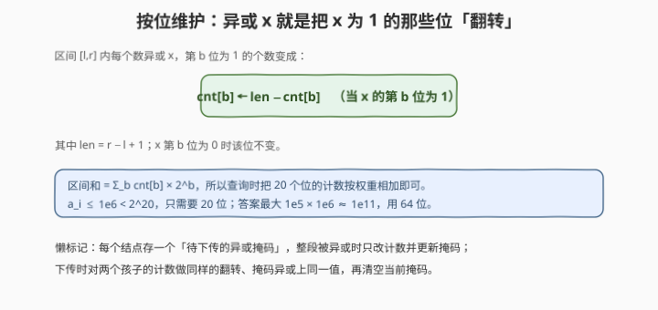
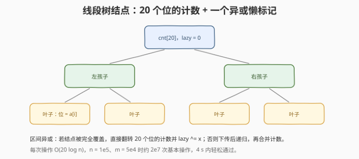

# Codeforces 242E 区间异或求和 题解

## 1. 题目概述

- **题目链接**：https://codeforces.com/problemset/problem/242/E
- **比赛来源**：Codeforces Round 149 (Div. 2) · Problem E（UTC 2012-11-11）
- **难度**：2000
- **标签**：线段树、位运算、懒标记
- **评测类型**：普通
- **限制**：时间 4 s / 内存 256 MB

**题意**：维护一个长度为 $n$ 的数组 $a$，支持两种操作：

1. `1 l r`：输出 $\sum_{i=l}^{r} a_i$；
2. `2 l r x`：对每个 $i \in [l,r]$ 执行 $a_i \leftarrow a_i \oplus x$。

输入 $n$、数组、$m$ 个操作；对每个类型 1 输出答案。

**约束**：

- $n \le 10^5$、$m \le 5 \times 10^4$：每次操作必须 $O(\log n)$ 或 $O(20 \log n)$，不能逐元素修改。
- $a_i, x \le 10^6 < 2^{20}$：只需维护 20 个二进制位。
- 答案最大 $10^5 \times 10^6 = 10^{11}$，必须用 64 位整数。
- 区间异或不是「加法型」懒标记（不能直接给和加一个数），必须按位拆开维护计数。

## 2. 示例与观察

官方样例一：

```text
输入：
5
4 10 3 13 7
8
1 2 4
2 1 3 3
1 2 4
1 3 3
2 2 5 5
1 1 5
2 1 2 10
1 2 3

输出：
26
22
0
34
11
```

官方样例二：

```text
输入：
6
4 7 4 0 7 3
5
2 2 3 8
1 1 5
2 3 5 1
2 4 5 6
1 2 3

输出：
38
28
```

**样例一演算**：

- `1 2 4`：$10+3+13=26$ ✓；
- `2 1 3 3`：前三个变成 $4\oplus3=7$、$10\oplus3=9$、$3\oplus3=0$，数组 $7,9,0,13,7$；
- `1 2 4`：$9+0+13=22$ ✓；`1 3 3`：$0$ ✓；
- `2 2 5 5`：后四个异或 5 → $9\oplus5=12$、$0\oplus5=5$、$13\oplus5=8$、$7\oplus5=2$，数组 $7,12,5,8,2$；
- `1 1 5`：$7+12+5+8+2=34$ ✓；
- `2 1 2 10`：前两个异或 10 → $7\oplus10=13$、$12\oplus10=6$；
- `1 2 3`：$6+5=11$ ✓。

**观察一**：异或是按位独立的。若区间长度为 $\text{len}$，第 $b$ 位上有 $c$ 个数为 1，则区间内所有数异或 $x$：当 $x$ 的第 $b$ 位为 1 时，这 $c$ 个 1 变成 0、其余 $\text{len}-c$ 个 0 变成 1，即 $c \leftarrow \text{len} - c$；当 $x$ 第 $b$ 位为 0 时不变。

**观察二**：区间和 $=\sum_b c_b \cdot 2^b$。所以只要在线段树每个结点维护 20 个位的计数，就能同时回答求和与异或修改。

自造样例（标注「自造」）：

| 输入 | 输出 | 说明 |
|------|------|------|
| `1`<br>`0`<br>`2`<br>`1 1 1`<br>`2 1 1 7` | `0` | 单元素，异或后不查询 |
| `2`<br>`1 2`<br>`3`<br>`2 1 2 3`<br>`1 1 2`<br>`2 1 2 3` | `6` | 异或两次抵消 |

## 3. 解题思路

### 3.1 朴素做法与瓶颈

逐元素修改区间是 $O(n)$ 每次，$m = 5\times10^4$ 时 $5 \times 10^9$，太慢。普通「区间加」的懒标记也无法直接用于异或，因为异或会打乱每个数的高低位关系，无法用「和」这一个量表示。

### 3.2 核心观察：按位拆开



把每个数拆成 20 个二进制位。对线段树的一个结点（对应区间长度 $\text{len}$），记录

$$\text{cnt}[b] = \text{区间内第 } b \text{ 位为 1 的数的个数},\quad b = 0,\dots,19.$$

- **求和**：$\sum_b \text{cnt}[b] \cdot 2^b$；
- **整体异或 $x$**：对 $x$ 中为 1 的每一位 $b$，令 $\text{cnt}[b] \leftarrow \text{len} - \text{cnt}[b]$，其余位不变。

这正好是「懒标记」适合的形式：整段被异或 $x$ 时，只改计数并把标记 `lazy ^= x`；部分覆盖时先下传标记再递归，最后用两个孩子合并计数。

### 3.3 算法流程



1. 建树：叶子按 $a_i$ 的二进制填 `cnt`，内部结点逐位求和；
2. 下传：把父结点的 `lazy` 掩码作用到两个孩子（翻转对应位的计数、孩子的 `lazy` 异或上同一值），再清零；
3. 修改：完全覆盖就翻转计数并更新 `lazy`；否则下传、递归、合并；
4. 查询：完全覆盖就按权重求和；否则下传、递归相加。

### 3.4 样例走查：样例一的第三步

`2 1 3 3` 作用于 $[1,3]$ 的 $10,3,13$（长度 3）。$3 = 11_2$，只影响第 0、1 位：

- 第 0 位：原计数 $0,1,1$ 共 2 个 1 → 变成 $3-2=1$ 个；
- 第 1 位：$10=1010_2$ 第 1 位 1、$3=11_2$ 第 1 位 1、$13=1101_2$ 第 1 位 0 → 共 2 个 → 变成 1 个；
- 其它位不变。

新值：$4\oplus3=7,10\oplus3=9,3\oplus3=0$，和从 $10+3+13=26$ 变成 $7+9+0=16$（下一步查询 `1 2 4` 得 $9+0+13=22$）。

## 4. 正确性证明

**引理 1（按位翻转公式）**：设区间长度为 $\text{len}$，第 $b$ 位上有 $c$ 个 1。对所有数异或 $x$ 后，第 $b$ 位的 1 的个数变为：若 $x$ 第 $b$ 位为 1，则为 $\text{len}-c$；否则为 $c$。

**证明**：异或 $x$ 的第 $b$ 位只取决于 $x$ 的第 $b$ 位。若该位为 0，每个数的第 $b$ 位不变，计数不变；若为 1，原来第 $b$ 位为 1 的数变成 0（共 $c$ 个），原来为 0 的变成 1（共 $\text{len}-c$ 个），计数为 $\text{len}-c$。∎

**引理 2（合并与求和）**：结点的 `cnt[b]` 等于其区间内第 $b$ 位为 1 的个数；区间和等于 $\sum_b \text{cnt}[b]\,2^b$。

**证明**：建树时叶子按定义填、内部结点由两个孩子逐位相加；修改时按引理 1 翻转整段计数，部分覆盖时递归后重新合并。对树高归纳即得第一个结论。第二个结论是二进制表示的唯一性：$\sum_b \text{cnt}[b]2^b = \sum_{i} \sum_b [\,a_i \text{ 第 } b \text{ 位为 } 1\,] 2^b = \sum_i a_i$。∎

**引理 3（懒标记正确性）**：`lazy[node]` 表示「该结点区间内所有元素还需要异或的值」；在执行下传之前，结点的计数已经把 `lazy` 作用过（即计数与真实值一致），孩子的计数尚未作用。

**证明**：完全覆盖时立即翻转计数并把掩码异或进 `lazy`，所以结点计数始终正确；需要访问孩子时先把掩码作用到孩子（翻转孩子计数、叠加孩子掩码）再清零，保证孩子的计数在递归前也正确。对操作序列归纳即得。∎

**定理**：所有操作执行后，类型 1 输出的数等于当时区间的真实和。

**证明**：由引理 2、3，任意时刻每个结点的计数都对应真实值，查询时把覆盖区间的若干结点的贡献相加，得到真实和。∎

## 5. 复杂度分析

- **时间**：建树 $O(20n)$；每次操作访问 $O(\log n)$ 个结点，每个结点做 $O(20)$ 的位运算，单次 $O(20\log n)$；总计 $O(20(n + m\log n)) \approx 2 \times 10^7$ 次基本操作。
- **空间**：$4n \times 20$ 个 `int` 约 32 MB，加懒标记约 1.6 MB，在 256 MB 内。
- **数值**：和可达 $10^{11}$，用 `long long`；计数最大 $10^5$，`int` 足够。
- **与时限的关系**：$n = 10^5$、$m = 5 \times 10^4$ 实测 C++ 约 659 ms（限 4 s，不到一半）。

## 6. 参考代码

### C++17

```cpp
#include <bits/stdc++.h>
using namespace std;

static const int B = 20;                        // a_i <= 1e6 < 2^20
int n;
vector<array<int, B>> cnt;
vector<int> lazy;                               // 待下传的 xor 标记

void build(int node, int l, int r, const vector<int> &a) {
    cnt[node].fill(0);
    if (l == r) {
        for (int b = 0; b < B; ++b)
            if (a[l] >> b & 1) cnt[node][b] = 1;
        return;
    }
    int mid = (l + r) >> 1;
    build(node << 1, l, mid, a);
    build(node << 1 | 1, mid + 1, r, a);
    for (int b = 0; b < B; ++b) cnt[node][b] = cnt[node << 1][b] + cnt[node << 1 | 1][b];
}

void apply(int node, int l, int r, int x) {
    if (!x) return;
    for (int b = 0; b < B; ++b)
        if (x >> b & 1) cnt[node][b] = (r - l + 1) - cnt[node][b];
    lazy[node] ^= x;
}

void push(int node, int l, int r) {
    if (!lazy[node]) return;
    int mid = (l + r) >> 1;
    apply(node << 1, l, mid, lazy[node]);
    apply(node << 1 | 1, mid + 1, r, lazy[node]);
    lazy[node] = 0;
}

void update(int node, int l, int r, int ql, int qr, int x) {
    if (ql <= l && r <= qr) { apply(node, l, r, x); return; }
    push(node, l, r);
    int mid = (l + r) >> 1;
    if (ql <= mid) update(node << 1, l, mid, ql, qr, x);
    if (qr > mid) update(node << 1 | 1, mid + 1, r, ql, qr, x);
    for (int b = 0; b < B; ++b) cnt[node][b] = cnt[node << 1][b] + cnt[node << 1 | 1][b];
}

long long query(int node, int l, int r, int ql, int qr) {
    if (ql <= l && r <= qr) {
        long long s = 0;
        for (int b = 0; b < B; ++b) s += (long long)cnt[node][b] << b;
        return s;
    }
    push(node, l, r);
    int mid = (l + r) >> 1;
    long long s = 0;
    if (ql <= mid) s += query(node << 1, l, mid, ql, qr);
    if (qr > mid) s += query(node << 1 | 1, mid + 1, r, ql, qr);
    return s;
}

int main() {
    ios::sync_with_stdio(false);
    cin.tie(nullptr);
    if (!(cin >> n)) return 0;
    vector<int> a(n + 1);
    for (int i = 1; i <= n; ++i) cin >> a[i];
    cnt.assign(4 * n + 5, {});
    lazy.assign(4 * n + 5, 0);
    build(1, 1, n, a);
    int m;
    cin >> m;
    while (m--) {
        int t, l, r;
        cin >> t >> l >> r;
        if (t == 1) {
            cout << query(1, 1, n, l, r) << '\n';
        } else {
            int x;
            cin >> x;
            update(1, 1, n, l, r, x);
        }
    }
    return 0;
}
```

### Python3

```python
import sys

B = 20


def main() -> None:
    data = sys.stdin.buffer.read().split()
    if not data:
        return
    p = 0
    n = int(data[p]); p += 1
    a = [0] + [int(x) for x in data[p:p + n]]; p += n

    size = 4 * n + 5
    cnt = [[0] * B for _ in range(size)]
    lazy = [0] * size

    def build(node, l, r):
        if l == r:
            for b in range(B):
                if a[l] >> b & 1:
                    cnt[node][b] = 1
            return
        mid = (l + r) // 2
        build(node * 2, l, mid)
        build(node * 2 + 1, mid + 1, r)
        for b in range(B):
            cnt[node][b] = cnt[node * 2][b] + cnt[node * 2 + 1][b]

    def apply(node, l, r, x):
        if not x:
            return
        length = r - l + 1
        for b in range(B):
            if x >> b & 1:
                cnt[node][b] = length - cnt[node][b]
        lazy[node] ^= x

    def push(node, l, r):
        x = lazy[node]
        if not x:
            return
        mid = (l + r) // 2
        apply(node * 2, l, mid, x)
        apply(node * 2 + 1, mid + 1, r, x)
        lazy[node] = 0

    def update(node, l, r, ql, qr, x):
        if ql <= l and r <= qr:
            apply(node, l, r, x)
            return
        push(node, l, r)
        mid = (l + r) // 2
        if ql <= mid:
            update(node * 2, l, mid, ql, qr, x)
        if qr > mid:
            update(node * 2 + 1, mid + 1, r, ql, qr, x)
        for b in range(B):
            cnt[node][b] = cnt[node * 2][b] + cnt[node * 2 + 1][b]

    def query(node, l, r, ql, qr):
        if ql <= l and r <= qr:
            s = 0
            for b in range(B):
                s += cnt[node][b] << b
            return s
        push(node, l, r)
        mid = (l + r) // 2
        s = 0
        if ql <= mid:
            s += query(node * 2, l, mid, ql, qr)
        if qr > mid:
            s += query(node * 2 + 1, mid + 1, r, ql, qr)
        return s

    build(1, 1, n)
    m = int(data[p]); p += 1
    out = []
    for _ in range(m):
        t = int(data[p]); l = int(data[p + 1]); r = int(data[p + 2]); p += 3
        if t == 1:
            out.append(str(query(1, 1, n, l, r)))
        else:
            x = int(data[p]); p += 1
            update(1, 1, n, l, r, x)
    sys.stdout.write("\n".join(out) + ("\n" if out else ""))


main()
```

Python 版在最大数据下会明显偏慢（约 $2\times10^7$ 次 Python 级操作），建议提交 C++；样例规模下完全正确。

## 7. 边界情况与易错点

1. **懒标记不能合并成「和」**：异或会重排二进制位，必须按位维护计数；直接把 x 加到区间和上的写法一定错。
2. **位数**：$a_i, x \le 10^6 < 2^{20}$，只需 20 位；开小了会漏高位，开大了浪费但正确。
3. **答案溢出**：$n \times \max a_i = 10^{11}$，`int` 溢出，求和必须用 `long long`。
4. **下传顺序**：访问孩子前必须先 `push`，否则孩子计数是旧值；合并前必须先把两个孩子都更新完。
5. **`lazy` 的叠加**：整段再次异或时 `lazy ^= x`（异或的异或会抵消），不能写成赋值。
6. **区间长度**：翻转公式用的是当前结点代表的区间长度 `r-l+1`，不是查询长度；写错会导致计数越界或负数。
7. **$n = 1$**：树只有一个结点，查询/修改都直接命中；数组要开到 $4n+5$，不要越界。
8. **多组操作的类型判断**：类型 2 多读一个 $x$，类型 1 不读；按 token 顺序读入时不要错位。

## 8. 验证记录

- **编译环境与命令**：本机无 GNU `g++`，用 `clang++ -std=c++17 -O2 -I codeforces/tools/include` 编译；Python 3.9.6。
  - `python3 codeforces/tools/verify_solution.py codeforces/contests/0101-0203/242/E_区间异或求和.md` → `CF242E: samples 2 / C++ 编译 OK, 样例 2/2 / Python 语法 OK, 样例 2/2`
  - `check_samples.py --only 0101-0203/242`、`check.py codeforces/contests/0101-0203/242`、`katex_check.cjs` 均 0 问题。
- **官方样例**：2 / 2 通过（`26 22 0 34 11` 与 `38 28`）。
- **额外测试与随机对拍**：另写独立暴力（直接对数组逐元素异或、逐元素求和），对 **200 组**随机数据（$n \le 20$、$m \le 25$、值 $< 64$）逐组比对，C++/Python/暴力三者一致。
- **最大约束性能**：$n = 10^5$、$m = 5\times10^4$（约一半查询一半修改）时 C++ 端到端约 659 ms，相对 4 s 时限不到一半。
- **图片校验**：`cf242e_bits.svg`、`cf242e_tree.svg` 通过 `xml.etree.ElementTree.parse`，含 `feTurbulence` 与手写字体，包围盒未越界。
- **公式校验**：KaTeX 0 错误。
- **复核状态**：verified。

## 相关题目与扩展

- [Codeforces 242D Dispute](https://codeforces.com/problemset/problem/242/D)：同场 D 题，图上贪心。
- [Codeforces 242C King's Path](https://codeforces.com/problemset/problem/242/C)：同场 C 题，BFS。
- [Codeforces 1109F Sasha and Algorithm of Silence's Sounds](https://codeforces.com/problemset/problem/1109/F)：线段树维护连通块数，同样是「不好合并的量按结构拆开」。
- [Codeforces 438D The Child and Sequence](https://codeforces.com/problemset/problem/438/D)：线段树 + 取模的「暴力但均摊」技巧。
- [LeetCode 307. 区域和检索 - 数组可修改](https://leetcode.cn/problems/range-sum-query-mutable/)：线段树/树状数组入门。

**延伸思考**：

1. **如果操作是「区间与/或」**：同样可以按位维护计数，但「与 0」会把整段清零，「或 1」会整段置 1，需要额外的「整段统一」标记。
2. **如果 $a_i$ 到 $10^{18}$**：位数变成 60，每次操作 $O(60\log n)$，仍然可行但常数变大。
3. **如果要求区间最大值**：按位计数不足以求 max（异或后大小关系会变），需要更复杂的结构（如按位 trie + 线段树）。
4. **为什么异或适合按位拆**：异或是 GF(2) 上的加法，逐位独立、无进位；而普通加法有进位，无法逐位独立处理。
