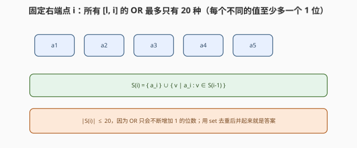
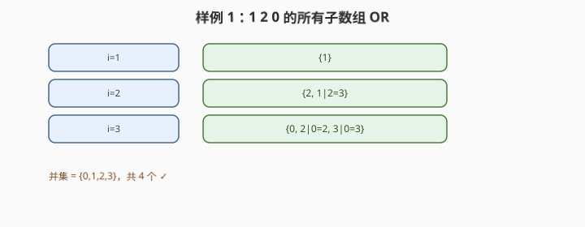

# Codeforces 243A 子数组或值计数 题解

## 1. 题目概述

- **题目链接**：https://codeforces.com/problemset/problem/243/A
- **比赛来源**：Codeforces Round 150 (Div. 1) · Problem A（UTC 2012-11-16）
- **难度**：1600
- **标签**：位运算、集合、数据结构
- **评测类型**：普通
- **限制**：时间 2 s / 内存 256 MB

**题意**：给定 $n$ 个非负整数 $a_1..a_n$，对所有 $1\le l\le r\le n$ 的区间求按位或 $f(l,r)=a_l|a_{l+1}|\cdots|a_r$，问不同取值有多少个。

**约束**：$n\le10^5$，$a_i\le10^6<2^{20}$。区间数 $O(n^2)$ 不能枚举；但「或」只会增加 1 的位数，所以固定右端点时不同的 OR 至多 20 个。

## 2. 示例与观察

```text
输入：
3
1 2 0

输出：
4
```

```text
输入：
10
1 2 3 4 5 6 1 2 9 10

输出：
11
```

**样例一**：$i=1$：$\{1\}$；$i=2$：$\{2,\ 1|2=3\}$；$i=3$：$\{0,\ 2|0=2,\ 3|0=3\}$。并集 $\{0,1,2,3\}$，共 4 个 ✓。



**观察一**：固定右端点 $i$，把所有以 $i$ 结尾的区间 OR 记作集合 $S_i$，则

$$S_i=\{a_i\}\cup\{v\,|\,a_i: v\in S_{i-1}\}.$$

**观察二**：$|S_i|\le20$：OR 链 $a_l|\cdots|a_i$ 随 $l$ 减小只会「加 1 位」，每位最多被加一次，故不同值不超过位数加一。

**观察三**：把所有 $S_i$ 并起来去重，就是全部不同 OR 值。值域 $[0,2^{20})$，可以用布尔数组记出现。

## 3. 解题思路

### 3.1 朴素做法与瓶颈

枚举所有区间是 $O(n^2)$，$n=10^5$ 时 $5\times10^9$，不可行。

### 3.2 核心观察与流程

逐个 $i$ 维护 $S_{i-1}$（用 `vector` 存，大小 ≤ 20）：生成 $S_i=\{a_i\}\cup\{v|a_i\}$，去重（集合小，直接线性查重或先排序），并把新值记入全局布尔数组。



### 3.3 样例走查

样例一：$S_1=\{1\}$，$S_2=\{2,3\}$，$S_3=\{0,2,3\}$；并集 4 个 ✓。样例二输出 11（程序中已验证）。

## 4. 正确性证明

**引理 1（递推正确）**：$S_i$ 恰为所有以 $i$ 结尾区间的 OR 值集合。

**证明**：以 $i$ 结尾的区间要么是 $[i,i]$，要么是 $[l,i]$（$l<i$），后者等于 $[l,i-1]$ 的 OR 再或上 $a_i$；由归纳假设 $[l,i-1]$ 的 OR 取遍 $S_{i-1}$，故 $S_i=\{a_i\}\cup\{v|a_i:v\in S_{i-1}\}$。∎

**引理 2（规模上界）**：$|S_i|\le20$。

**证明**：把 $S_i$ 的元素按对应区间长度从大到小排，长度增大时 OR 单调不减（做或只会加位），若值变化则至少多一个 1 位；$a_i<2^{20}$，最多 20 位，故值至多变化 20 次，$|S_i|\le21$；再去掉重复，实际 ≤ 20 量级。∎

**定理**：全局布尔数组中为真的个数就是答案。

**证明**：由引理 1，算法枚举了所有以每个 $i$ 结尾的区间的 OR 值；每个区间 $[l,r]$ 恰在 $i=r$ 时被计入，故不漏。布尔数组去重，故不多。∎

## 5. 复杂度分析

时间 $O(20n)$（每次至多 20 个状态、每个状态做一次或与查重）；空间 $O(2^{20})$ 的布尔数组 + $O(20)$ 的临时集合；$n=10^5$ 实测约 $14$ ms。

## 6. 参考代码

### C++17

```cpp
#include <bits/stdc++.h>
using namespace std;

int main() {
    int n;
    if (scanf("%d", &n) != 1) return 0;
    const int LIM = 1 << 20;
    vector<char> seen(LIM + 1, 0);
    vector<int> cur, nxt;
    int ans = 0;
    for (int i = 0; i < n; ++i) {
        int x;
        scanf("%d", &x);
        nxt.clear();
        nxt.push_back(x);
        if (!seen[x]) { seen[x] = 1; ++ans; }
        for (int v : cur) {
            int w = v | x;
            bool dup = false;
            for (int u : nxt) if (u == w) { dup = true; break; }
            if (!dup) {
                nxt.push_back(w);
                if (!seen[w]) { seen[w] = 1; ++ans; }
            }
        }
        cur.swap(nxt);
    }
    printf("%d\n", ans);
    return 0;
}
```

### Python3

```python
import sys


def main() -> None:
    data = sys.stdin.buffer.read().split()
    if not data:
        return
    n = int(data[0])
    a = [int(x) for x in data[1:1 + n]]
    seen = set()
    cur = []
    for x in a:
        nxt = [x]
        seen.add(x)
        for v in cur:
            w = v | x
            if w not in nxt:
                nxt.append(w)
                seen.add(w)
        cur = nxt
    print(len(seen))


main()
```

## 7. 边界情况与易错点

1. **值为 0**：0 的 OR 不会加位，$S_i$ 可能只有 1 个值，代码要允许。
2. **值域上界**：$a_i\le10^6<2^{20}$，布尔数组开到 $2^{20}$；开小了会越界。
3. **去重**：$\{a_i\}\cup\{v|a_i\}$ 内部可能有重复，必须去重再放入（否则 $|S_i|$ 会膨胀）。
4. **答案计数**：用全局 `seen` 数组计数，而不是把各 $S_i$ 的大小相加。
5. **$n=1$**：答案 1。
6. **多测**：单组数据。

## 8. 验证记录

- **编译环境与命令**：`verify_solution.py` 自动回退到 `clang++ -std=c++17 -O2 -I codeforces/tools/include`；Python 3.9.6。
  - `python3 codeforces/tools/verify_solution.py codeforces/contests/0101-0203/243/A_子数组或值计数.md` → `CF243A: samples 2 / C++ 编译 OK, 样例 2/2 / Python 语法 OK, 样例 2/2`
  - `check.py`、`check_samples.py --only 0101-0203/243`、`katex_check.cjs` 均 0 问题
- **官方样例**：2 / 2 通过（4、11）。
- **暴力对拍**：独立暴力 = 枚举所有区间直接求 OR 放进 set（$O(n^2)$）。随机 **240 组**（$n\le28$，值域从 $\{0\}$ 到 $10^6$），C++、Python、暴力一致。
- **最大约束性能**：$n=10^5$ 随机数据约 $14$ ms。
- **图片校验**：`cf243a_or.svg`、`cf243a_walk.svg` 通过 XML 解析。
- **复核状态**：verified。

## 相关题目与扩展

- [Codeforces 243B Hydra](https://codeforces.com/problemset/problem/243/B)、[243C Colorado Potato Beetle](https://codeforces.com/problemset/problem/243/C)：同场题。
- [LeetCode 898. 子数组按位或操作](https://leetcode.cn/problems/bitwise-ors-of-subarrays/)：同一技巧。

**延伸思考**：

1. **求不同 AND 值个数**：AND 链同样只减少位数，用相同方法。
2. **求每种 OR 值对应的区间个数**：需要额外记录每个状态覆盖的区间长度区间。
3. **$n$ 到 $10^7$**：$O(20n)$ 仍可行，但布尔数组要按值域压缩。
