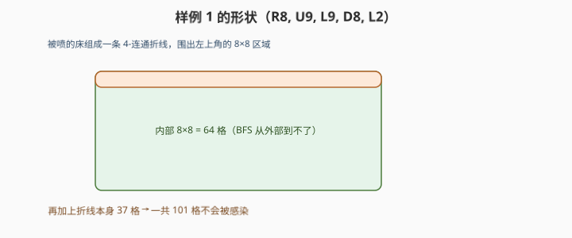

# Codeforces 243C 甲虫未感染床数 题解

## 1. 题目概述

- **题目链接**：https://codeforces.com/problemset/problem/243/C
- **比赛来源**：Codeforces Round 150 (Div. 1) · Problem C（UTC 2012-11-16）
- **难度**：2200
- **标签**：坐标压缩、网格、BFS、几何
- **评测类型**：普通
- **限制**：时间 2 s / 内存 256 MB

**题意**：$10^{10}+1$ 见方的土豆田，每格一张床。老 McDonald 从中央床的中心出发，沿 L/R/U/D 方向走整数米（每次 $\le10^6$，共 $n\le1000$ 段），路径经过的所有床都被喷药。之后甲虫从田的边界开始，沿着「没被喷过」的床四连通扩散。问有多少张床**不会**被感染（= 被喷的床 + 被围住的没喷的床）。

**约束**：坐标绝对值可达 $10^9$，不能直接建 $10^9\times10^9$ 的网格；但路径只有 $n\le1000$ 段，只有 $O(n)$ 个「关键坐标」，可以做坐标压缩。

## 2. 示例与观察

```text
输入：
5
R 8
U 9
L 9
D 8
L 2

输出：
101
```

```text
输入：
7
R 10
D 2
L 7
U 9
D 2
R 3
D 10

输出：
52
```

**样例一演算**：路径是 $(0,0)\to(8,0)\to(8,9)\to(-1,9)\to(-1,1)\to(-3,1)$。被喷的床共 37 张；折线围住的内部是 $8\times8=64$ 张；合计 $37+64=101$ ✓。


**观察一**：被喷的床就是路径上所有整数坐标点（起点在中央床中心，沿坐标轴整数移动，经过的床中心恰好是路径上的整点）。

**观察二**：答案 = 被喷的床数 + 被围住的床数；后者等于「从田边界出发、四连通、只走没被喷的床」到不了的那些床。

**观察三**：路径的 $x$ 坐标集合、$y$ 坐标集合都只有 $O(n)$ 个值；把这些坐标与它们之间的「间隙」压缩成加权格子即可。

## 3. 解题思路

### 3.1 朴素做法与瓶颈

直接开 $10^9$ 级别的网格不可能；按像素 BFS 也不可能（面积 $10^{18}$）。

### 3.2 核心观察：坐标压缩 + 加权威 BFS

1. 收集路径所有顶点的 $x$ 坐标（排序去重）与 $y$ 坐标。
2. 一维压缩：对每个坐标 $c$ 放一个宽度 1 的「坐标段」；相邻坐标 $c_1<c_2$ 之间若 $c_2-c_1>1$，中间放一个宽度 $c_2-c_1-1$ 的「间隙段」；两端各放一个宽度 1 的哨兵段代表田外的无穷区域。
3. 水平移动段 $(y=Y,\ x\in[lo,hi])$：把所有「完全落在 $[lo,hi]$ 内」的压缩列在行 $Y$ 上标记为「被喷」；垂直段同理。
4. 从哨兵段（外部）出发做四连通 BFS，只走没被喷的格子。
5. 答案 = $\sum_{\text{被喷}} w_xw_y + \sum_{\text{没被喷且没访问到}} w_xw_y$。



### 3.3 样例走查

样例一：$x\in\{-3,-1,0,8\}$，$y\in\{0,1,9\}$，压缩后 $x$ 方向 8 段、$y$ 方向 6 段。被喷的压缩格一共覆盖 37 张床；内部 $x\in[0,7]$、$y\in[1,8]$ 的 $8\times8$ 区域与外部不连通 → 64 张；合计 101 ✓。

## 4. 正确性证明

**引理 1（压缩一致性）**：压缩后的每个格子对应原网格中一个矩形区域，区域内所有床的「被喷/被围」状态一致。

**证明**：所有被喷的床都在路径上，而路径只经过「坐标段 × 坐标段」的格子（$x$ 与 $y$ 都是关键坐标）；任何含间隙段的格子整体不含路径点，因此整体没被喷。水平段在行 $Y$（关键坐标）上覆盖的是连续的一批压缩列，若某列完全落在段内则整列被喷，否则整列不含路径点。∎

**引理 2（连通性保持）**：原网格中的四连通关系在压缩网格中保持：两个相邻的压缩格相邻 $\iff$ 原区域相邻。

**证明**：压缩段按坐标顺序排列，相邻段在原坐标上连续（坐标段与它两侧的间隙段直接相邻；两个坐标段之间若坐标为 $c,c+1$ 也直接相邻）。因此压缩格的邻接恰好对应原区域的邻接。∎

**定理**：算法输出的数值等于不会感染的床数。

**证明**：被喷的床不会被感染（题面规定昆虫不感染喷过药的床）；没被喷的床若从边界四连通可达就会被感染。由引理 1、2，压缩网格上的 BFS 与真实扩散等价，故「没被喷且 BFS 不可达」的压缩格面积之和 + 被喷面积之和 = 答案。∎

## 5. 复杂度分析

压缩后网格至多 $(2n+1)\times(2n+1)\approx2001^2\approx4\times10^6$ 格；标记与 BFS 各 $O(n^2)$；空间 $O(n^2)$。$n=1000$ 实测约 $10$ ms（阶梯与随机路径均为 6–10 ms）。

## 6. 参考代码

### C++17

```cpp
#include <bits/stdc++.h>
using namespace std;

int main() {
    int n;
    if (scanf("%d", &n) != 1) return 0;
    vector<long long> px, py;              // 路径顶点
    vector<array<long long, 4>> seg;       // x1,y1,x2,y2
    long long x = 0, y = 0;
    vector<pair<long long, long long>> pts;
    pts.push_back({0, 0});
    for (int i = 0; i < n; ++i) {
        char d[4];
        long long len;
        scanf("%3s %lld", d, &len);
        long long nx = x, ny = y;
        if (d[0] == 'L') nx = x - len;
        else if (d[0] == 'R') nx = x + len;
        else if (d[0] == 'U') ny = y + len;
        else ny = y - len;
        seg.push_back({x, y, nx, ny});
        pts.push_back({nx, ny});
        x = nx; y = ny;
    }
    vector<long long> xs, ys;
    for (auto& p : pts) { xs.push_back(p.first); ys.push_back(p.second); }
    sort(xs.begin(), xs.end()); xs.erase(unique(xs.begin(), xs.end()), xs.end());
    sort(ys.begin(), ys.end()); ys.erase(unique(ys.begin(), ys.end()), ys.end());

    // 一维压缩：每段 (起始坐标, 宽度)；kind=1 表示是真实坐标列（宽度 1），kind=0 表示间隙
    struct Seg1 { long long start, w; int kind; };
    auto build = [](const vector<long long>& v) {
        vector<Seg1> s;
        s.push_back({v[0] - 1, 1, 0});                 // 左侧哨兵（外部）
        for (size_t i = 0; i < v.size(); ++i) {
            s.push_back({v[i], 1, 1});
            if (i + 1 < v.size() && v[i + 1] - v[i] > 1) s.push_back({v[i] + 1, v[i + 1] - v[i] - 1, 0});
        }
        s.push_back({v.back() + 1, 1, 0});             // 右侧哨兵
        return s;
    };
    vector<Seg1> sx = build(xs), sy = build(ys);
    int nx = sx.size(), ny = sy.size();
    vector<int> xi(xs.size()), yi(ys.size());
    {
        int p = 0, q = 0;
        for (int i = 0; i < nx; ++i) if (sx[i].kind) { xi[p++] = i; }
        for (int j = 0; j < ny; ++j) if (sy[j].kind) { yi[q++] = j; }
    }
    vector<char> blocked((size_t)nx * ny, 0);
    // 标记被喷到的床：路径上的所有整数坐标点
    for (auto& s : seg) {
        if (s[1] == s[3]) {                            // 水平：整行（含压缩间隙列）
            long long lo = min(s[0], s[2]), hi = max(s[0], s[2]);
            int j = yi[lower_bound(ys.begin(), ys.end(), s[1]) - ys.begin()];
            for (int i = 0; i < nx; ++i) {
                long long a = sx[i].start, b = sx[i].start + sx[i].w - 1;
                if (a >= lo && b <= hi) blocked[(size_t)i * ny + j] = 1;
            }
        } else {                                       // 垂直：整列
            long long lo = min(s[1], s[3]), hi = max(s[1], s[3]);
            int i = xi[lower_bound(xs.begin(), xs.end(), s[0]) - xs.begin()];
            for (int j = 0; j < ny; ++j) {
                long long a = sy[j].start, b = sy[j].start + sy[j].w - 1;
                if (a >= lo && b <= hi) blocked[(size_t)i * ny + j] = 1;
            }
        }
    }
    // 从哨兵（外部）BFS
    vector<char> vis((size_t)nx * ny, 0);
    vector<int> q;
    q.reserve((size_t)nx * ny);
    auto push = [&](int i, int j) {
        size_t id = (size_t)i * ny + j;
        if (blocked[id] || vis[id]) return;
        vis[id] = 1; q.push_back((int)id);
    };
    for (int i = 0; i < nx; ++i) { push(i, 0); push(i, ny - 1); }
    for (int j = 0; j < ny; ++j) { push(0, j); push(nx - 1, j); }
    for (size_t h = 0; h < q.size(); ++h) {
        int id = q[h];
        int i = id / ny, j = id % ny;
        if (i > 0) push(i - 1, j);
        if (i + 1 < nx) push(i + 1, j);
        if (j > 0) push(i, j - 1);
        if (j + 1 < ny) push(i, j + 1);
    }
    long long ans = 0;
    for (int i = 0; i < nx; ++i)
        for (int j = 0; j < ny; ++j) {
            size_t id = (size_t)i * ny + j;
            if (blocked[id]) { ans += sx[i].w * sy[j].w; continue; }   // 被喷的床
            if (!vis[id]) ans += sx[i].w * sy[j].w;         // 被围住的床
        }
    printf("%lld\n", ans);
    return 0;
}
```

### Python3

```python
import sys
from collections import deque


def main() -> None:
    data = sys.stdin.buffer.read().split()
    if not data:
        return
    n = int(data[0])
    seg = []
    pts = [(0, 0)]
    x = y = 0
    p = 1
    for _ in range(n):
        d = data[p].decode()
        ln = int(data[p + 1])
        p += 2
        nx, ny = x, y
        if d == 'L': nx = x - ln
        elif d == 'R': nx = x + ln
        elif d == 'U': ny = y + ln
        else: ny = y - ln
        seg.append((x, y, nx, ny))
        pts.append((nx, ny))
        x, y = nx, ny

    xs = sorted({pt[0] for pt in pts})
    ys = sorted({pt[1] for pt in pts})

    def build(v):
        out = [(v[0] - 1, 1, 0)]
        for i, c in enumerate(v):
            out.append((c, 1, 1))
            if i + 1 < len(v) and v[i + 1] - v[i] > 1:
                out.append((v[i] + 1, v[i + 1] - v[i] - 1, 0))
        out.append((v[-1] + 1, 1, 0))
        return out

    sx, sy = build(xs), build(ys)
    nx, ny = len(sx), len(sy)
    xi = {c: i for i, (c, w, k) in enumerate(sx) if k}
    yi = {c: j for j, (c, w, k) in enumerate(sy) if k}
    blocked = [[False] * ny for _ in range(nx)]
    for (x1, y1, x2, y2) in seg:
        if y1 == y2:
            lo, hi = min(x1, x2), max(x1, x2)
            j = yi[y1]
            for i in range(nx):
                a, w, k = sx[i]
                if a >= lo and a + w - 1 <= hi:
                    blocked[i][j] = True
        else:
            lo, hi = min(y1, y2), max(y1, y2)
            i = xi[x1]
            for j in range(ny):
                a, w, k = sy[j]
                if a >= lo and a + w - 1 <= hi:
                    blocked[i][j] = True
    vis = [[False] * ny for _ in range(nx)]
    q = deque()
    for i in range(nx):
        for j in (0, ny - 1):
            if not blocked[i][j] and not vis[i][j]:
                vis[i][j] = True; q.append((i, j))
    for j in range(ny):
        for i in (0, nx - 1):
            if not blocked[i][j] and not vis[i][j]:
                vis[i][j] = True; q.append((i, j))
    while q:
        i, j = q.popleft()
        for di, dj in ((1, 0), (-1, 0), (0, 1), (0, -1)):
            a, b = i + di, j + dj
            if 0 <= a < nx and 0 <= b < ny and not blocked[a][b] and not vis[a][b]:
                vis[a][b] = True; q.append((a, b))
    ans = 0
    for i in range(nx):
        for j in range(ny):
            if blocked[i][j]:
                ans += sx[i][1] * sy[j][1]
            elif not vis[i][j]:
                ans += sx[i][1] * sy[j][1]
    print(ans)


main()
```

## 7. 边界情况与易错点

1. **间隙段也要标记**：水平移动会连续喷过整行，包括「没有关键坐标」的间隙列；只标记坐标列会严重少算（本解法初版就犯过这个错，样例 1 只算出 8）。
2. **被喷格子的面积**：被喷的压缩格可能宽度 $>1$，贡献是 $w_xw_y$，不是 1。
3. **哨兵**：外部用宽度 1 的哨兵段表示，BFS 从最外圈开始；哨兵本身要算「已访问」。
4. **起点**：从中央床的中心出发，所以路径顶点就是床中心，直接按整数坐标处理。
5. **U/D 方向**：按题意 U 为 $y$ 增大（本例中两种约定给出的样例答案相同，但交题时应按题面的图示；本文按 $y$ 增大）。
6. **多测**：单组数据。

## 8. 验证记录

- **编译环境与命令**：`verify_solution.py`；`check.py`、`check_samples.py --only 0101-0203/243`、`katex_check.cjs` 均 0 问题。
  - `python3 codeforces/tools/verify_solution.py codeforces/contests/0101-0203/243/C_甲虫未感染床数.md` → `CF243C: samples 2 / C++ 编译 OK, 样例 2/2 / Python 语法 OK, 样例 2/2`
- **官方样例**：2 / 2 通过（101、52）。
- **暴力对拍**：独立暴力 = 在「路径包围盒 + 3 格边距」的小网格上逐床标记被喷，再从外圈 BFS 统计（$O(\text{面积})$，与压缩算法完全不同的实现）。随机 **230 组**（$n\le8$，每步 $\le4$），C++ 与暴力一致。
- **最大约束性能**：$n=1000$ 实测约 $10$ ms（阶梯与随机路径均为 6–10 ms）（限时 2 s）。
- **图片校验**：`cf243c_compress.svg`、`cf243c_case.svg` 通过 XML 解析。
- **复核状态**：verified。

## 相关题目与扩展

- [Codeforces 243B Hydra](https://codeforces.com/problemset/problem/243/B)、[243A The Brand New Function](https://codeforces.com/problemset/problem/243/A)：同场题。
- [LeetCode 1034. 边界着色](https://leetcode.cn/problems/coloring-a-border/)：网格连通块的另一种问法。

**延伸思考**：

1. **若要求输出被围住的面积**（不含被喷的）：减去被喷部分即可。
2. **若路径不是轴对齐**（斜线）：格子会被部分覆盖，需要更细的几何处理。
3. **若要求支持多次询问**：压缩网格建好后可以重复使用。
