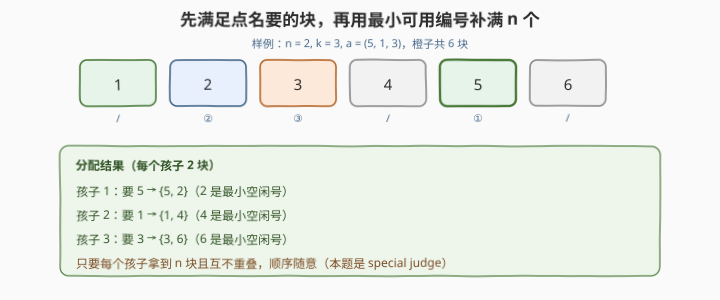
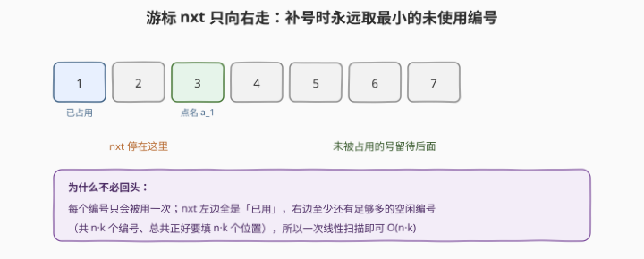

# Codeforces 244A 橙子分段分配 题解

## 1. 题目概述

- **题目链接**：https://codeforces.com/problemset/problem/244/A
- **比赛来源**：Codeforces Round 150 (Div. 2) · Problem A（UTC 2012-11-15）
- **难度**：900
- **标签**：贪心、实现
- **评测类型**：多解（每个人拿到的编号顺序任意，需 checker）
- **限制**：时间 2 s / 内存 256 MB

**题意**：一个橙子有 $n\cdot k$ 个编号为 $1..n\cdot k$ 的瓣，$k$ 个孩子，第 $i$ 个孩子点名要编号 $a_i$（所有 $a_i$ 互不相同）。请把编号分给孩子们，使：每个孩子恰好拿到 $n$ 个编号；第 $i$ 个孩子一定拿到 $a_i$；没有编号被两个人同时拿到。输出恰好 $n\cdot k$ 个整数，前 $n$ 个是第 1 个孩子的，接着 $n$ 个是第 2 个孩子的……同一孩子内部的顺序随意。

**约束**：

- $n,k\le 30$：一共至多 $900$ 个编号，任何 $O(nk)$ 或 $O(nk\log(nk))$ 的构造都可以。
- 保证「输入的所有 $a_i$ 互不相同」且「答案一定存在」：这两个条件让贪心一定可以填满。
- 每个孩子内部的顺序任意，说明本题是 **special judge**，判定不能逐字比对。

## 2. 示例与观察

官方样例一：

```text
输入：
2 2
4 1

输出：
2 4
1 3
```

官方样例二：

```text
输入：
3 1
2

输出：
3 2 1
```

**样例一演算**：$n=2,k=2$，共 4 个编号；孩子 1 要 4，孩子 2 要 1。剩下的 2、3 随便分，比如孩子 1 拿 $\{4,2\}$、孩子 2 拿 $\{1,3\}$，与官方输出 `2 4 / 1 3` 完全等价（顺序不同）。

**样例二演算**：$n=3,k=1$，只有一个孩子要 2，剩下的 1、3 都归他，输出 `3 2 1` 是 3 个编号的一种排列。

**观察一**：先到先得会出问题——如果按孩子顺序边分边填，孩子 1 可能把「后面某个孩子点名的编号」当补位拿走。所以必须**先把所有 $a_i$ 标记为已占用**，再给每个孩子补位。

**观察二**：补位时应该取「最小的空闲编号」。由于总共正好有 $n\cdot k$ 个位置、$n\cdot k$ 个编号，且每个编号只用一次，一个只向右推进的游标就够了（不用每次从头找）。

## 3. 解题思路

### 3.1 朴素做法与瓶颈

最直接的想法：对每个孩子，先把 $a_i$ 给他，再从 $1$ 开始扫，找到第一个没被占用的编号补上，重复 $n-1$ 次。每个孩子扫一遍 $1..nk$，总复杂度 $O(k\cdot n\cdot nk)$，在 $n,k\le30$ 时也就 $8\times10^5$，完全能过。

真正要注意的不是速度，而是**不要提前占用后面孩子点名的编号**：先把所有 $a_i$ 打上标记，补位时跳过所有 $a_i$。

### 3.2 核心观察与流程



把编号看成一条长度为 $n\cdot k$ 的带子：

1. 读入 $a_1..a_k$，把 `used[a_i] = true`；
2. 游标 `nxt = 1`；
3. 对每个孩子 $i$：先拿到 $a_i$，然后重复 $n-1$ 次「把 `nxt` 推到下一个未占用编号并给这个孩子」。



**为什么游标不用回头**：每个编号最多被用一次，被用过的编号都在游标左边；而「还需要补的格子数」恰好等于「游标右边剩余的空闲编号数」（因为总数相等），所以游标永远不会推过 $n\cdot k$，也永远能找到空位。

### 3.3 样例走查

样例一：`used = {4, 1}`，`nxt = 1`。

| 步骤 | 动作 | 孩子 1 | 孩子 2 | `nxt` |
|------|------|--------|--------|-------|
| 1 | 孩子 1 拿 $a_1=4$ | $\{4\}$ | – | 1 |
| 2 | 补位：`nxt` 推到 2（1 被占） | $\{4,2\}$ | – | 3 |
| 3 | 孩子 2 拿 $a_2=1$ | – | $\{1\}$ | 3 |
| 4 | 补位：`nxt=3` 空闲 | – | $\{1,3\}$ | 4 |

输出 `4 2 / 1 3`，与官方输出 `2 4 / 1 3` 同解（组内顺序不同）。

再取一个 $n=2,k=3,a=(5,1,3)$ 的例子：`used = {1,3,5}`；孩子 1 得 $\{5,2\}$，孩子 2 得 $\{1,4\}$，孩子 3 得 $\{3,6\}$，覆盖了全部 6 个编号。

## 4. 正确性证明

**引理 1（不重）**：算法过程中每个编号至多被分配一次。

**证明**：$a_i$ 互不相同，一开始就被全部标记；补位只取 `used` 为假的编号并立刻置真；孩子之间又不会重复拿同一个 $a_i$。∎

**引理 2（不漏且能填满）**：每个孩子最终恰好拿到 $n$ 个编号，且补位时游标不会越过 $n\cdot k$。

**证明**：反证。若某次补位时 $1..n\cdot k$ 已全部被占用，则此刻已被占用的编号数是 $n\cdot k$ 个，而总共只需要分配 $n\cdot k$ 个位置——但当前孩子还有 $n-1$ 个位置没填，说明前面已经发出去的编号数 $>$ 应有的数量。更直接地：已分配的位置数 = 已占用编号数（引理 1 保证是双射），当游标推到 $n\cdot k+1$ 时说明 $n\cdot k$ 个编号全被占，而已分配的位置数此时 $\le n\cdot k-1$，矛盾。∎

**定理**：算法输出满足题面三条要求。

**证明**：由构造，第 $i$ 组恰好 $n$ 个数且包含 $a_i$（引理 2）；由引理 1，$n\cdot k$ 个数互不相同；又都落在 $[1,nk]$ 内，故恰为 $1..n\cdot k$ 的一个排列，即每个编号恰好出现一次。∎

## 5. 复杂度分析

- **时间**：$O(nk)$——每个编号最多被游标扫过一次、被输出一次。
- **空间**：$O(nk)$ 的 `used` 数组与输出缓冲。
- **实测**：$n=k=30$（900 个编号）端到端约 $1$ ms，远低于 $2$ s。

## 6. 参考代码

### C++17

```cpp
#include <bits/stdc++.h>
using namespace std;

int main() {
    int n, k;
    if (scanf("%d %d", &n, &k) != 2) return 0;
    vector<int> a(k);
    vector<char> used(n * k + 1, 0);
    for (int i = 0; i < k; ++i) {
        scanf("%d", &a[i]);
        used[a[i]] = 1;
    }
    int nxt = 1;
    for (int i = 0; i < k; ++i) {
        vector<int> res;
        res.push_back(a[i]);
        while ((int)res.size() < n) {
            while (nxt <= n * k && used[nxt]) ++nxt;
            used[nxt] = 1;
            res.push_back(nxt);
        }
        for (int j = 0; j < n; ++j) printf("%d%c", res[j], j + 1 == n ? '\n' : ' ');
    }
    return 0;
}
```

### Python3

```python
import sys


def main() -> None:
    data = sys.stdin.buffer.read().split()
    if not data:
        return
    n, k = int(data[0]), int(data[1])
    a = [int(x) for x in data[2:2 + k]]
    total = n * k
    used = [False] * (total + 1)
    for v in a:
        used[v] = True
    nxt = 1
    out = []
    for i in range(k):
        res = [a[i]]
        while len(res) < n:
            while nxt <= total and used[nxt]:
                nxt += 1
            used[nxt] = True
            res.append(nxt)
        out.append(' '.join(map(str, res)))
    sys.stdout.write('\n'.join(out) + '\n')


main()
```

## 7. 边界情况与易错点

1. **必须先标记全部 $a_i$**：边分边填会让前面的孩子抢走后面孩子点名的编号（例如 $n=2,k=3,a=(5,1,3)$，孩子 1 若先补位会拿走 1）。
2. **$n=1$**：每个孩子只拿 $a_i$，不补位；所有 $a_i$ 恰好是 $1..k$ 的一个排列。
3. **$k=1$**：只有一个孩子，输出 $1..n$ 的任意排列并保证含 $a_1$。
4. **游标越界**：`nxt` 最多推到 $n\cdot k$，内层 `while` 要同时检查 `nxt <= n*k`，否则可能越界读。
5. **输出格式**：恰好 $n\cdot k$ 个整数；本题没要求每个孩子一行，但按孩子分行最清楚，token 比对也不受影响（本场是 special judge，用 checker 判定）。
6. **组内顺序任意**：不要试图复现官方输出的顺序；对拍时用「是否是合法划分」来判定，而不是逐字比较。
7. **多测**：本题单组数据；若改成多测，`used` 必须重新分配。

## 8. 验证记录

- **编译环境与命令**：本机无 GNU `g++`（`g++` 实为 Apple clang），`verify_solution.py` 自动回退到 `clang++ -std=c++17 -O2 -I codeforces/tools/include`；Python 3.9.6。
  - `python3 codeforces/tools/verify_solution.py codeforces/contests/0101-0203/244/A_橙子分段分配.md --checker codeforces/tools/checkers/cf244a.py` → `CF244A: samples 2 / C++ 编译 OK, 样例 2/2 / Python 语法 OK, 样例 2/2`
  - `python3 codeforces/tools/check.py codeforces/contests/0101-0203/244` → `checked 1, fail 0`（完成本篇时）
  - `python3 codeforces/tools/check_samples.py --only 0101-0203/244` → 0 问题
  - `node codeforces/tools/katex_check.cjs codeforces/contests/0101-0203/244` → 0 错误
- **checker 的校验条件**（`codeforces/tools/checkers/cf244a.py`）：输出恰好 $n\cdot k$ 个整数、恰为 $1..nk$ 的排列、按 $n$ 个一组共 $k$ 组且第 $i$ 组包含 $a_i$、组内无重复。
- **官方样例**：2 / 2 通过（由 checker 校验，因为组内顺序自由）。
- **随机对拍**：**210 组**随机数据（$n,k\in[1,10]$，$a$ 为 $1..nk$ 中随机 $k$ 个不同数），C++ 与 Python 两版输出都逐组通过 checker，0 组不合法。
- **最大约束性能**：$n=k=30$（900 个编号）C++ 端到端约 $1$ ms（限时 2 s）。
- **图片校验**：`cf244a_assign.svg`、`cf244a_cursor.svg` 通过 `xml.etree.ElementTree.parse`，含 `feTurbulence` 与手写字体，文字在 `viewBox` 内。
- **复核状态**：verified。

## 相关题目与扩展

- [Codeforces 244B Undoubtedly Lucky Numbers](https://codeforces.com/problemset/problem/244/B)：同场 B 题，同样是「按编号/数位构造」。
- [Codeforces 245A System Administrator](https://codeforces.com/problemset/problem/245/A)：下一场的签到题。
- [LeetCode 455. 分发饼干](https://leetcode.cn/problems/assign-cookies/)：另一类「先排序再分配」的贪心。

**延伸思考**：

1. **如果 $a_i$ 允许重复**：只需改成「同一个编号只能被一个孩子点名」的冲突检测，其余不变；但若两个孩子的 $a_i$ 相同，答案不存在。
2. **如果要求每个孩子拿到的编号之和相等**：问题立刻从构造变成划分问题（NP 难的一般化），只能对 $n,k$ 很小的情况搜索。
3. **如果要求输出字典序最小的划分**（组内升序、组间按第一个元素排序）：补位策略要改成「优先给最小的孩子补最小的号」，可以用并查集维护空闲集合来做 $O(nk\,\alpha)$。
