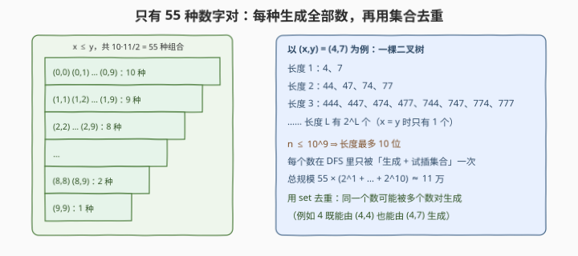
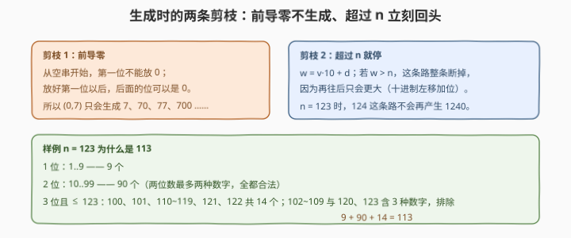

# Codeforces 244B 毫无疑问的幸运数 题解

## 1. 题目概述

- **题目链接**：https://codeforces.com/problemset/problem/244/B
- **比赛来源**：Codeforces Round 150 (Div. 2) · Problem B（UTC 2012-11-15）
- **难度**：1600
- **标签**：暴力、DFS、位掩码
- **评测类型**：普通
- **限制**：时间 2 s / 内存 256 MB

**题意**：称正整数 $a$ 是「毫无疑问的幸运数」，如果存在两个数字 $x,y\ (0\le x,y\le 9)$，使 $a$ 的十进制表示（无前导零）只由 $x,y$ 组成（允许只用到其中一个）。给定 $n\le 10^9$，求 $1..n$ 中有多少个这样的数。

**约束**：

- $n\le 10^9$：$n$ 本身只有 10 位，因此「用两种数字生成」的候选总量极小——每个数字对至多生成 $2^1+\dots+2^{10}\approx 2046$ 个数，$55$ 个数字对合计约 $11$ 万，可以直接暴力生成。
- 逐个数检查 $1..n$ 是 $O(n\cdot10)=10^{10}$，不可行。
- 生成会产生**重复**（同一个数可能被多个数字对生成，例如 $4$ 可由 $(4,4)$、$(4,7)$ 生成），必须用集合去重后计数。

## 2. 示例与观察

官方样例一：

```text
输入：
10

输出：
10
```

官方样例二：

```text
输入：
123

输出：
113
```

**样例一演算**：$1..10$ 里每个数最多用两种数字：$1..9$ 各一种，$10$ 用 $\{1,0\}$，所以 10 个全算，输出 `10`。

**样例二演算**：

- 1 位：$1..9$，9 个；
- 2 位：$10..99$，任一个两位数最多两种数字，90 个全合法；
- 3 位且 $\le123$：$100,101,110\text{–}119,121,122$ 共 14 个合法；$102$–$109$（含三种数字）、$120$（$\{1,2,0\}$）、$123$ 不合法。

合计 $9+90+14=113$，与官方输出一致。

**观察一**：判断条件只跟「这个数用到了哪些数字」有关。一个数合法 $\iff$ 它用到的数字种类数 $\le 2$。

**观察二**：与其枚举数、不如枚举**数字对** $(x,y)$，把所有只由 $x,y$ 组成的数生成出来。因为位数最多 10，这个枚举总量是常数级。

**观察三**：不同数字对会生成同一个数（$4$ 属于 $(4,4)$、$(4,7)$、$(0,4)$……），所以答案不是「各数字对答案之和」，而是**并集**的大小——必须去重。

## 3. 解题思路

### 3.1 朴素做法与瓶颈

对 $i=1..n$ 提取数位、统计不同数字个数，$O(10n)$。$n=10^9$ 时是 $10^{10}$ 次操作，完全不可行。

注意到「合法数」的稀疏性：它们必须只用两种数字，数量大约 $O(55\cdot 2^{10})$，远小于 $n$。所以应当**由数字生成数**，而不是检查数。

### 3.2 核心观察：枚举数字对 + DFS 生成



由于「用到的数字集合」是 $\{x,y\}$ 且 $\{x,y\}$ 与 $\{y,x\}$ 等价，只需枚举 $0\le x\le y\le 9$，共 $55$ 种。

对每个数字对，从空串开始逐位追加 $x$ 或 $y$，得到所有长度 $\le10$ 的候选：

- 长度 1：$x,y$ 两个（若 $x=y$ 只有一个）；
- 长度 $L$：$2^L$ 个（$x=y$ 时 $1$ 个）。

把每个生成的数插入 `set<long long>`（若 $\le n$），最后输出 `set.size()`。



两个细节：

1. **前导零**：从空串追加数字时，若当前值还是 $0$（空串）且要追加的是 $0$，跳过。这样 $(0,7)$ 生成的是 $7,70,77,700,\dots$，不会生成 $07$。
2. **上界剪枝**：若 $v\cdot10+d>n$，这条路直接断掉——十进制追加只会让它更大。

### 3.3 样例走查

$n=10$：$(0,1)$ 生成 $1,10$；$(1,1)$ 生成 $1,11(>10)$；$(2,2)\dots(9,9)$ 生成 $2..9$；其余数字对生成的数要么 $>10$ 要么重复。集合并集 $=\{1,\dots,10\}$，共 10 个。

$n=123$：一位数 $1..9$；两位数全部 $10..99$；三位数只有 $100,101,110..119,121,122$ 生成时不超过 $123$。并集大小 $113$。

## 4. 正确性证明

**引理 1（覆盖性）**：任何合法数都会被某个数字对 $(x,y)$ 的 DFS 生成。

**证明**：设 $a\le n$ 合法，其数字集合为 $D$，$|D|\le2$。取 $x=\min D$、$y=\max D$（$|D|=1$ 时 $x=y$），则 $0\le x\le y\le9$，且 $a$ 的每一位都属于 $\{x,y\}$。DFS 按位枚举所有 $\{x,y\}$ 串（长度 $\le10$，首位非零），必然枚举到 $a$ 的数字串；又因为 $a\le n$，路径上每个前缀都 $\le a\le n$，不会被上界剪枝切断。故 $a$ 被生成。∎

**引理 2（可靠性）**：DFS 生成的每个数都合法。

**证明**：生成的数只用到 $x,y$ 两种数字（首位非零），且被插入集合时已检查 $\le n$，故它属于 $1..n$ 且合法。∎

**引理 3（不重不漏）**：`set` 的大小恰好等于 $1..n$ 中合法数的个数。

**证明**：由引理 1，每个合法数至少被插入一次；由引理 2，插入的都是合法数；`set` 自动去重，故元素个数等于合法数个数。∎

**定理**：输出 `set.size()` 即所求答案。

**证明**：直接由引理 3。∎

## 5. 复杂度分析

- **时间**：$55$ 个数字对，每个至多 $\sum_{L=1}^{10}2^L\approx2046$ 次生成，共约 $1.1\times10^5$ 次；每次是一次 `set` 插入（$O(\log)$）。总计远小于 $10^6$。
- **空间**：`set` 中至多约 $10^5$ 个数。
- **实测**：$n=10^9$ 端到端约 $5$ ms（答案 $40744$），限时 2 s。

## 6. 参考代码

### C++17

```cpp
#include <bits/stdc++.h>
using namespace std;

int main() {
    long long n;
    if (scanf("%lld", &n) != 1) return 0;
    set<long long> seen;
    for (int x = 0; x <= 9; ++x)
        for (int y = x; y <= 9; ++y) {
            // 只用数字 x、y 生成所有 <= n 的正整数
            vector<long long> cur{0};
            for (int len = 1; len <= 10; ++len) {
                vector<long long> nxt;
                for (long long v : cur)
                    for (int d : {x, y}) {
                        if (v == 0 && d == 0) continue;   // 前导零
                        long long w = v * 10 + d;
                        if (w <= n) { nxt.push_back(w); seen.insert(w); }
                    }
                cur.swap(nxt);
                if (cur.empty()) break;
            }
        }
    printf("%zu\n", seen.size());
    return 0;
}
```

### Python3

```python
import sys


def main() -> None:
    data = sys.stdin.buffer.read().split()
    if not data:
        return
    n = int(data[0])
    seen = set()
    for x in range(10):
        for y in range(x, 10):
            cur = [0]
            for _ in range(10):
                nxt = []
                for v in cur:
                    for d in (x, y):
                        if v == 0 and d == 0:
                            continue
                        w = v * 10 + d
                        if w <= n:
                            nxt.append(w)
                            seen.add(w)
                cur = nxt
                if not cur:
                    break
    print(len(seen))


main()
```

## 7. 边界情况与易错点

1. **去重**：同一个数可能被多个数字对生成（$4\in(4,4)\cap(4,7)$），各数字对分头计数会重复，必须用集合。
2. **前导零**：$07$ 不是合法表示；DFS 里「当前为空且追加 0」要跳过，否则会把 $7$ 重复生成成 $07$（在数值上等价，但会引入多余路径）。
3. **长度上限**：$n\le10^9$ 有 10 位（$10^9$ 本身），循环长度必须到 $10$，写成 $9$ 会漏掉 $10^9$ 这类数（若它合法）。
4. **$x=y$**：数字对内部两个分支相同，会重复生成同一个数（$44\to444$ 两次），集合去重可以吸收；`x<=y` 的枚举也让 $(4,7)$ 与 $(7,4)$ 不会重复跑。
5. **$n$ 很小**（如 $n=1$）：只有 $1$ 合法，答案 $1$；上界剪枝要正确地把 $2..9$ 砍掉。
6. **用 `long long`**：$v\cdot10+d$ 在 $n$ 附近可能到 $10^{10}$，`int` 溢出。
7. **多测**：单组数据；若多测，`seen` 要清空。

## 8. 验证记录

- **编译环境与命令**：本机无 GNU `g++`（`g++` 实为 Apple clang），`verify_solution.py` 自动回退到 `clang++ -std=c++17 -O2 -I codeforces/tools/include`；Python 3.9.6。
  - `python3 codeforces/tools/verify_solution.py codeforces/contests/0101-0203/244/B_毫无疑问的幸运数.md` → `CF244B: samples 2 / C++ 编译 OK, 样例 2/2 / Python 语法 OK, 样例 2/2`
  - `python3 codeforces/tools/check.py codeforces/contests/0101-0203/244` → `checked 2, fail 0`
  - `python3 codeforces/tools/check_samples.py --only 0101-0203/244` → 0 问题
  - `node codeforces/tools/katex_check.cjs codeforces/contests/0101-0203/244` → 0 错误
- **官方样例**：2 / 2 通过（10、113）。
- **暴力对拍**：独立暴力 = 对 $i=1..n$ 提取数位、统计不同数字个数 $\le2$ 的计数（C++ 实现，$O(10n)$）。随机 **220 组**（$n$ 从 $1..60$、$1..3000$、$1..2\times10^5$ 三档随机），与参考程序逐组一致，0 组不符。
- **最大约束性能**：$n=10^9$：C++ 端到端约 $5$ ms，答案 $40744$（限时 2 s）。
- **图片校验**：`cf244b_pairs.svg`、`cf244b_prune.svg` 通过 `xml.etree.ElementTree.parse`，含 `feTurbulence` 与手写字体，文字在 `viewBox` 内。
- **复核状态**：verified。

## 相关题目与扩展

- [Codeforces 244A Dividing Orange](https://codeforces.com/problemset/problem/244/A)：同场 A 题。
- [Codeforces 96B Lucky Numbers (easy)](https://codeforces.com/problemset/problem/96/B)：只由 4、7 构成的「幸运数」，本题的一般化。
- [LeetCode 902. 最大为 N 的数字组合](https://leetcode.cn/problems/numbers-at-most-n-given-digit-set/)：按位生成 + 上界剪枝的同款思想。

**延伸思考**：

1. **如果要求「恰好」两种数字**（不能只用一种）：答案就是上面的并集减去「只含一种数字」的数（$1..9$ 与 $11,22,\dots$ 这类），可以 O(1) 修正。
2. **如果 $n$ 大到 $10^{18}$**：位数变 18，每个数字对生成 $2^{18}$，$55$ 对约 $1.4\times10^7$，仍然可行；再大就要改成数位 DP。
3. **如果允许 $k$ 种数字**：枚举 $\binom{10}{k}$ 个数字子集，每个生成 $k^L$ 个候选，$k=3$ 时约 $120\times 3^{10}\approx7\times10^6$，依然可暴力；$k\ge4$ 就该上数位 DP 了。
