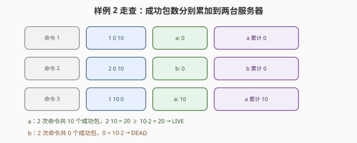
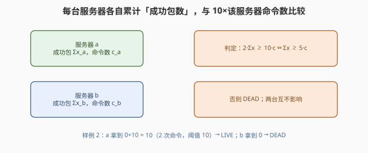

# Codeforces 245A 服务器存活判定 题解

## 1. 题目概述

- **题目链接**：https://codeforces.com/problemset/problem/245/A
- **比赛来源**：CROC-MBTU 2012, Elimination Round (ACM-ICPC) · Problem A（UTC 2012-11-19）
- **难度**：800
- **标签**：实现
- **评测类型**：普通
- **限制**：时间 2 s / 内存 256 MB

**题意**：有两台服务器 $a,b$。执行 $n$ 条 `ping` 命令，第 $i$ 条命令用 $t_i\in\{1,2\}$ 指明目标是 $a$ 还是 $b$，并给出 $x_i$（成功送达的包数）与 $y_i$（丢失的包数），满足 $x_i+y_i=10$（每次 ping 正好发 10 个包）。对每台服务器，若「成功送达的包数」不少于「发给它的包总数的一半」，它就是 `LIVE`，否则 `DEAD`。

**约束**：

- $n\le1000$：直接线性扫描即可，$O(n)$ 时间。
- 每次固定发 10 个包，因此「一半」等价于 $2\cdot\Sigma x\ge10\cdot c$，即 $\Sigma x\ge5c$（$c$ 是发给该服务器的命令条数）——全是整数运算，不需要浮点。
- 输入保证两台服务器都至少被 ping 过一次，所以两边都必然有定义，不存在「没数据」的特判。

## 2. 示例与观察

官方样例一：

```text
输入：
2
1 5 5
2 6 4

输出：
LIVE
LIVE
```

官方样例二：

```text
输入：
3
1 0 10
2 0 10
1 10 0

输出：
LIVE
DEAD
```

**样例一演算**：$a$ 只被 ping 了 1 次，成功 5 个，$5\ge5$ → `LIVE`；$b$ 被 ping 1 次，成功 6 个，$6\ge5$ → `LIVE`。

**样例二演算**：见下图。$a$ 两次命令分别成功 0、10 个，合计 10，而阈值是 $5\times2=10$，$10\ge10$ → `LIVE`；$b$ 两次命令都成功 0 个，$0<10$ → `DEAD`。



**观察一**：判定是按服务器**分别累计**的，两台服务器互不影响；不能把两台的成功包数加在一起。

**观察二**：「至少一半」这一条件不需要浮点：设某台服务器被 ping 了 $c$ 次，总发包数 $10c$，条件是 $2\Sigma x\ge10c$。用乘法比较可以完全避免精度问题。

## 3. 解题思路

### 3.1 朴素做法与瓶颈

按题意模拟：读入每条命令，把 $x_i$ 累加到对应服务器的成功总数，同时把该服务器的命令数加一；最后对两台服务器分别比较。$n\le1000$，这一步只有几千次加法——本题没有真正的瓶颈，重点是把「一半」写成整数比较。

### 3.2 核心观察



对服务器 $s\in\{a,b\}$，令

$$X_s=\sum_{i:\,t_i=s}x_i,\qquad C_s=\#\{i:t_i=s\}.$$

则 $s$ 存活 $\iff 2X_s\ge10C_s$。因为每次命令固定发 10 个包，总发包数就是 $10C_s$，而「至少一半送达」即 $X_s\ge\frac{10C_s}{2}$；两边乘 2 后全为整数。

### 3.3 样例走查

样例二的三条命令：

| 命令 | 目标 | $x$ | $y$ | $X_a$ | $C_a$ | $X_b$ | $C_b$ |
|------|------|-----|-----|-------|-------|-------|-------|
| 1 | $a$ | 0 | 10 | 0 | 1 | 0 | 0 |
| 2 | $b$ | 0 | 10 | 0 | 1 | 0 | 1 |
| 3 | $a$ | 10 | 0 | 10 | 2 | 0 | 1 |

判定：$a$：$2\times10=20\ge10\times2=20$ → `LIVE`；$b$：$2\times0=0<10\times1$ → `DEAD`。

## 4. 正确性证明

**引理 1（判定式等价）**：对任意服务器，$X_s\ge\frac{10C_s}{2}\iff 2X_s\ge10C_s$。

**证明**：两边同乘 2（正数，不等号方向不变）。∎

**引理 2（累计正确）**：算法结束时 $X_s,C_s$ 恰好是「发给 $s$ 的成功包总数」与「发给 $s$ 的命令条数」。

**证明**：对每条命令做一次「对应服务器 $X{+}{=}x$、$C{+}{=}1$」，由归纳法即得。∎

**定理**：算法输出的 `LIVE`/`DEAD` 与题面定义一致。

**证明**：由引理 1、2，输出恰好判定 $X_s\ge\frac{10C_s}{2}$，这正是题面「至少一半的包成功送达」的定义。∎

## 5. 复杂度分析

- **时间**：$O(n)$，每条命令常数次加法与比较。
- **空间**：$O(1)$（4 个计数器）。
- **实测**：$n=1000$ 端到端约 $2$ ms（含进程启动），限时 2 s。

## 6. 参考代码

### C++17

```cpp
#include <bits/stdc++.h>
using namespace std;

int main() {
    int n;
    if (scanf("%d", &n) != 1) return 0;
    int ok[3] = {0, 0, 0}, cnt[3] = {0, 0, 0};
    for (int i = 0; i < n; ++i) {
        int t, x, y;
        scanf("%d %d %d", &t, &x, &y);
        ok[t] += x;
        ++cnt[t];
    }
    for (int t = 1; t <= 2; ++t)
        printf("%s\n", ok[t] * 2 >= 10 * cnt[t] ? "LIVE" : "DEAD");
    return 0;
}
```

### Python3

```python
import sys


def main() -> None:
    data = sys.stdin.buffer.read().split()
    if not data:
        return
    n = int(data[0])
    got = [0, 0, 0]
    cnt = [0, 0, 0]
    p = 1
    for _ in range(n):
        t, x, y = int(data[p]), int(data[p + 1]), int(data[p + 2])
        p += 3
        got[t] += x
        cnt[t] += 1
    for t in (1, 2):
        print("LIVE" if got[t] * 2 >= 10 * cnt[t] else "DEAD")


main()
```

## 7. 边界情况与易错点

1. **恰好一半**：$X_s=5C_s$ 时必须算 `LIVE`（样例二第一台就是 $10=10$ 的等号情形），比较要用 $\ge$ 而不是 $>$。
2. **不能合并两台的数据**：判定是逐服务器的，把 $x_i$ 全加起来会得到完全错误的结论。
3. **不要用浮点**：`x >= 10.0*cnt/2` 在 $c$ 很大时可能有精度问题，用 $2X\ge10C$ 的整数比较。
4. **$y_i$ 完全用不上**：$x_i+y_i=10$ 保证了两者一致，只需要 $x$；但读入时三个整数都要读，否则会错位。
5. **输入保证两台都被 ping 过**：无需处理「$C_s=0$」；若题目改成可能出现，则应按「没有数据」另行约定（本题不会）。
6. **多测**：单组数据；若多测，`ok/cnt` 要清零。
7. **输出大小写**：必须是全大写 `LIVE`/`DEAD`。

## 8. 验证记录

- **编译环境与命令**：本机无 GNU `g++`（`g++` 实为 Apple clang），`verify_solution.py` 自动回退到 `clang++ -std=c++17 -O2 -I codeforces/tools/include`；Python 3.9.6。
  - `python3 codeforces/tools/verify_solution.py codeforces/contests/0101-0203/245/A_服务器存活判定.md` → `CF245A: samples 2 / C++ 编译 OK, 样例 2/2 / Python 语法 OK, 样例 2/2`
  - `python3 codeforces/tools/check.py codeforces/contests/0101-0203/245` → `checked 1, fail 0`（完成本篇时）
  - `python3 codeforces/tools/check_samples.py --only 0101-0203/245` → 0 问题
  - `node codeforces/tools/katex_check.cjs codeforces/contests/0101-0203/245` → 0 错误
- **官方样例**：2 / 2 通过（`LIVE/LIVE`、`LIVE/DEAD`）。
- **暴力对拍**：独立实现（按「总发包数 $10c$ 与成功数 $2X$ 比较」逐台判定）与参考程序对拍 **240 组**随机数据（$n\in[2,12]$，每条命令随机目标与 $x\in[0,10]$，并强制两台至少各出现一次），0 组不符。
- **最大约束性能**：$n=1000$ 端到端约 $2$ ms（限时 2 s）。
- **图片校验**：`cf245a_alive.svg`、`cf245a_walk.svg` 通过 `xml.etree.ElementTree.parse`，含 `feTurbulence` 与手写字体，文字在 `viewBox` 内。
- **复核状态**：verified。

## 相关题目与扩展

- [Codeforces 245B Internet Address](https://codeforces.com/problemset/problem/245/B)：同场 B 题，字符串还原。
- [Codeforces 244A Dividing Orange](https://codeforces.com/problemset/problem/244/A)：上一场的签到题。
- [LeetCode 1344. 时钟指针的夹角](https://leetcode.cn/problems/angle-between-hands-of-a-clock/)：同样是「先累加再与阈值比较」的小模拟。

**延伸思考**：

1. **如果每次 ping 的包数不同**（第 $i$ 次发 $p_i$ 个）：判定变成 $2X_s\ge\sum_{i:t_i=s}p_i$，累加时同时记总量即可，仍然是 $O(n)$。
2. **如果要求「连续 $k$ 次命令内」的存活率**：需要滑动窗口维护 $X$ 与 $C$，变成双指针。
3. **如果阈值是「严格大于一半」**：把 $\ge$ 改成 $>$，注意等号情形的判定会翻转（样例二第一台就会变成 `DEAD`）。
