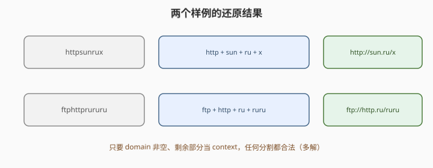
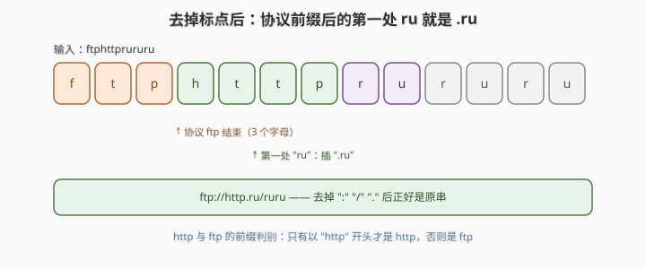

# Codeforces 245B 恢复互联网地址 题解

## 1. 题目概述

- **题目链接**：https://codeforces.com/problemset/problem/245/B
- **比赛来源**：CROC-MBTU 2012, Elimination Round (ACM-ICPC) · Problem B（UTC 2012-11-19）
- **难度**：1100
- **标签**：字符串、实现
- **评测类型**：多解（任一合法地址即可，需 checker）
- **限制**：时间 2 s / 内存 256 MB

**题意**：一个正确的地址形如

$$\texttt{<proto>://<domain>.ru[/<context>]}$$

其中 `<proto>` 是 `http` 或 `ftp`，`<domain>` 是非空小写字母串，`<context>` 若存在也非空且只含小写字母；没有 `<context>` 时就不写那个 `/`。Vasya 把地址抄成了**去掉所有 `:`、`/`、`.` 之后**的纯字母串（长度 $\le50$），要求还原出任意一个可能的地址。

**约束**：

- 长度 $\le50$：允许 $O(|s|^2)$ 的暴力尝试。
- 输入保证一定能由某个合法地址得到，所以不用考虑「无解」。
- 多解：同一输入可能对应多个地址（例如 `ru` 出现多次时可以切在不同的位置），任意输出一个合法即可，必须用 checker 校验。

## 2. 示例与观察

官方样例一：

```text
输入：
httpsunrux

输出：
http://sun.ru/x
```

官方样例二：

```text
输入：
ftphttprururu

输出：
ftp://http.ru/ruru
```

**样例一演算**：前 4 个字母是 `http` → 协议是 `http`，剩下 `sunrux`。在 `sunrux` 里找第一处 `ru`：下标 3（`sun` 之后），于是 domain = `sun`、context = `x`，得 `http://sun.ru/x`。

**样例二演算**：开头是 `ftp`（不是 `http`）→ 协议 `ftp`，剩下 `httprururu`。第一处 `ru` 出现在下标 4（`http` 之后），于是 domain = `http`、context = `ruru`，得 `ftp://http.ru/ruru`。



**观察一**：协议前缀只有两种，而且可以靠「前 4 个字母是不是 `http`」唯一确定：如果前 4 个是 `http`，协议就是 `http`；否则一定是 `ftp`（`ftp` 开头的串不可能同时以 `http` 开头）。

**观察二**：去掉协议之后，剩下的串一定是 `domain + "ru" + context` 的形式，其中 `domain` 非空、`context` 可为空。因此**任意一处**满足「前面至少留 1 个字母」的 `ru` 都能当分隔点，切法一定合法。

## 3. 解题思路

### 3.1 朴素做法与瓶颈

枚举所有可能的切分点（$O(|s|)$ 个），对每个切分构造地址并检查格式（domain 非空、context 非空或不存在），第一个可行的就是答案。$|s|\le50$，检查一次 $O(|s|)$，总复杂度 $O(|s|^2)$——完全够用，本题没有真正的性能瓶颈。

### 3.2 核心观察：第一处 `ru` 就够



设去掉协议后的串为 $R$。任何合法地址对应一个切分点 $k$（$1\le k\le |R|-2$）使 $R[k..k+1]=\texttt{"ru"}$，domain $=R[0..k-1]$，context $=R[k+2..]$。由于 domain 只要求非空、context 只要求小写字母（可空），**任何满足 $k\ge1$ 且 $R[k..k+1]=\texttt{"ru"}$ 的 $k$ 都是合法切分**。

所以直接取最小的这样的 $k$：`for k in 1..|R|-2: if R[k]=='r' and R[k+1]=='u': ...`，一旦找到就输出并结束。

### 3.3 样例走查

样例二：$s=\texttt{ftphttprururu}$，前缀 `ftp`（前 4 个字母 `ftph` $\ne$ `http`），$R=\texttt{httprururu}$。

| $k$ | $R[k..k+1]$ | 是否切分 |
|-----|-------------|----------|
| 1 | `tt` | 否 |
| 2 | `tp` | 否 |
| 3 | `pr` | 否 |
| 4 | `ru` | **是** |

domain $=\texttt{http}$，context $=\texttt{ruru}$，输出 `ftp://http.ru/ruru` ✓。

## 4. 正确性证明

**引理 1（协议判定）**：给定串由某个合法地址去掉标点得到，则「前 4 个字母是 `http`」当且仅当协议是 `http`。

**证明**：若协议是 `http`，前 4 个字母当然就是 `http`。若协议是 `ftp`，串以 `ftp` 开头；而 `http` 的第 1 个字母是 `h`、`ftp` 的第 1 个字母是 `f`，二者不同，所以串不可能同时以 `http` 开头。∎

**引理 2（切分合法性）**：若 $R$ 由合法地址去掉协议得到，则存在 $k\ge1$ 使 $R[k..k+1]=\texttt{"ru"}$；且任取一个这样的 $k$ 构造出的地址都合法。

**证明**：存在性来自输入保证（原地址就有 domain 与 `.ru`）。设 $k$ 满足 $k\ge1$、$R[k..k+1]=\texttt{"ru"}$：domain $=R[0..k-1]$ 长度 $\ge1$ 且全是小写字母；context $=R[k+2..]$ 要么为空（不写 `/`），要么非空且全是小写字母——两种情况都满足题面格式。∎

**定理**：算法输出的地址合法。

**证明**：算法在找到第一个合法切分后按格式拼出地址；由引理 1 协议正确，由引理 2 切分合法，故输出是题面要求的形式，且去掉 `:`、`/`、`.` 后恰好还原输入串（因为输出正是输入串按原位插入这三个符号）。∎

## 5. 复杂度分析

- **时间**：扫描切分点 $O(|s|)$，拼接输出 $O(|s|)$，总共 $O(|s|)$。
- **空间**：$O(|s|)$ 存字符串。
- **实测**：长度 50 的输入端到端约 $2$ ms（含进程启动），限时 2 s。

## 6. 参考代码

### C++17

```cpp
#include <bits/stdc++.h>
using namespace std;

int main() {
    string s;
    if (!(cin >> s)) return 0;
    string proto = (s.size() >= 4 && s.compare(0, 4, "http") == 0) ? "http" : "ftp";
    string rest = s.substr(proto.size());
    for (int k = 1; k + 1 < (int)rest.size(); ++k) {
        if (rest[k] == 'r' && rest[k + 1] == 'u') {
            string domain = rest.substr(0, k);
            string ctx = rest.substr(k + 2);
            cout << proto << "://" << domain << ".ru";
            if (!ctx.empty()) cout << "/" << ctx;
            cout << "\n";
            return 0;
        }
    }
    return 0;
}
```

### Python3

```python
import sys


def main() -> None:
    data = sys.stdin.buffer.read().split()
    if not data:
        return
    s = data[0].decode()
    proto = "http" if s.startswith("http") else "ftp"
    rest = s[len(proto):]
    for k in range(1, len(rest) - 1):
        if rest[k] == 'r' and rest[k + 1] == 'u':
            domain, ctx = rest[:k], rest[k + 2:]
            out = proto + "://" + domain + ".ru"
            if ctx:
                out += "/" + ctx
            print(out)
            return


main()
```

## 7. 边界情况与易错点

1. **`k` 从 1 开始**：`k=0` 会让 domain 为空，非法；范围要写成 `1 <= k <= |R|-2`。
2. **`http` 与 `ftp` 的判别顺序**：必须先判断「前 4 个字母是否 `http`」，不能用「前 3 个是否 `ftp`」去排除 `http`（`http` 的前 3 个是 `htt`，两者不冲突，但逻辑要写对）。
3. **context 为空**：此时不能输出末尾的 `/`，否则去掉标点后仍等于原串、格式却非法（多一个 `/` 但没有 context）。
4. **切分点必须留出 `ru`**：`k+1 < |R|` 的边界容易写成 `k+1 <= |R|` 导致越界。
5. **多解**：`ru` 可能出现多次，答案不唯一；对拍要用 checker，不能逐字比对（本文 checker 会把输出去掉标点后与输入比对，并校验格式）。
6. **协议长度不同**：`http` 是 4 个字母、`ftp` 是 3 个字母，取 `rest` 时要用 `proto.size()`，不能硬编码 4。
7. **输入可能以 `ftp` 开头但含 `http`**（样例二）：不要因为看到 `http` 就以为是 http 协议。

## 8. 验证记录

- **编译环境与命令**：本机无 GNU `g++`（`g++` 实为 Apple clang），`verify_solution.py` 自动回退到 `clang++ -std=c++17 -O2 -I codeforces/tools/include`；Python 3.9.6。
  - `python3 codeforces/tools/verify_solution.py codeforces/contests/0101-0203/245/B_恢复互联网地址.md --checker codeforces/tools/checkers/cf245b.py` → `CF245B: samples 2 / C++ 编译 OK, 样例 2/2 / Python 语法 OK, 样例 2/2`
  - `python3 codeforces/tools/check.py codeforces/contests/0101-0203/245` → `checked 2, fail 0`
  - `python3 codeforces/tools/check_samples.py --only 0101-0203/245` → 0 问题
  - `node codeforces/tools/katex_check.cjs codeforces/contests/0101-0203/245` → 0 错误
- **checker 的校验条件**（`codeforces/tools/checkers/cf245b.py`）：输出必须匹配 `^(http|ftp)://[a-z]+\.ru(/[a-z]+)?$`，domain 非空、context 非空（若存在），并且把输出中的 `:`、`/`、`.` 全部删掉后与输入串逐字相同。
- **官方样例**：2 / 2 通过（由 checker 校验，输出与官方一致）。
- **随机对拍**：**240 组**随机数据——随机选协议、随机生成 1~7 个字母的 domain 与 0~6 个字母的 context，按格式拼成地址再去掉标点作为输入；C++ 与 Python 两版输出都通过 checker，0 组不合法。
- **最大约束性能**：长度 50（`http` + 45 个字母 + `ru`）端到端约 $2$ ms（限时 2 s）。
- **图片校验**：`cf245b_split.svg`、`cf245b_cases.svg` 通过 `xml.etree.ElementTree.parse`，含 `feTurbulence` 与手写字体，文字在 `viewBox` 内。
- **复核状态**：verified。

## 相关题目与扩展

- [Codeforces 245A System Administrator](https://codeforces.com/problemset/problem/245/A)：同场 A 题。
- [Codeforces 245D Restoring Table](https://codeforces.com/problemset/problem/245/D)：同场 D 题，另一种「还原」。
- [LeetCode 468. 验证 IP 地址](https://leetcode.cn/problems/validate-ip-address/)：地址格式校验的经典题。

**延伸思考**：

1. **如果要求输出字典序最小的地址**：在所有合法切分里取 domain 最短/最长的那一个即可（`ru` 的每个出现位置对应一个 domain 长度，选极值）。
2. **如果协议前缀不固定**（例如还允许 `https`）：需要枚举所有协议并按长度尝试，复杂度仍是 $O(|s|^2)$。
3. **如果允许 domain 中出现 `-` 或数字**：切分逻辑不变，只是合法性检查要放宽；这也说明本题的「第一处 `ru`」之所以可行，全靠「context 可以任意长」这个性质。
