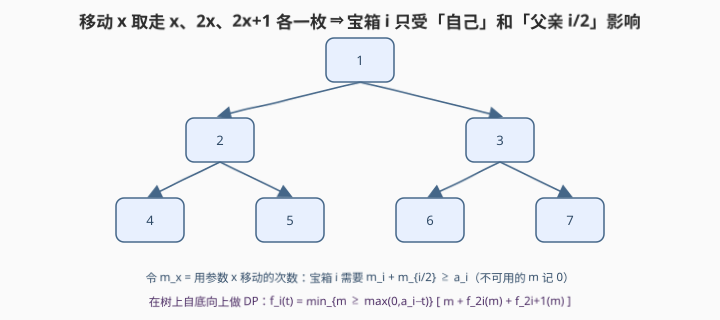
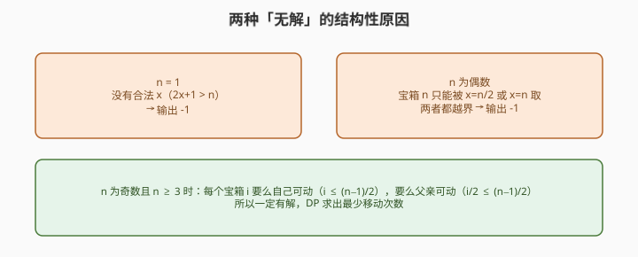

# Codeforces 245C 宝箱取币最少次数 题解

## 1. 题目概述

- **题目链接**：https://codeforces.com/problemset/problem/245/C
- **比赛来源**：CROC-MBTU 2012, Elimination Round (ACM-ICPC) · Problem C（UTC 2012-11-19）
- **难度**：1700
- **标签**：贪心、动态规划、树
- **评测类型**：普通
- **限制**：时间 2 s / 内存 256 MB

**题意**：$n$ 个宝箱，第 $i$ 个有 $a_i$ 枚硬币。一次操作：选正整数 $x$ 满足 $2x+1\le n$，从宝箱 $x$、$2x$、$2x+1$ 各取一枚硬币（若某个宝箱已空则不取）。两人轮流操作，问**最少多少次操作**能把所有宝箱取空；做不到输出 `-1`。

**约束**：

- $n\le100$，$a_i\le1000$：答案上界约 $10^5$ 量级，可以用按「操作次数」做状态的 DP（$O(n\cdot\max a)$ 或 $O(n\cdot(\max a)^2)$ 都可行）。
- 「若已空则不取」这个细节让「操作序列的顺序」显得重要，但第 4 节会证明它其实不影响可达性。
- 操作参数 $x$ 必须满足 $2x+1\le n$：这决定了哪些宝箱「有资格」被取。

## 2. 示例与观察

官方样例一：

```text
输入：
1
1

输出：
-1
```

官方样例二：

```text
输入：
3
1 2 3

输出：
3
```

**样例一演算**：$n=1$ 时没有任何 $x$ 满足 $2x+1\le1$，一次操作都做不了，而宝箱 1 有硬币，所以 `-1`。

**样例二演算**：$n=3$ 只允许 $x=1$，每次操作同时取宝箱 1、2、3 各一枚。要取空就必须做 $\max(a_1,a_2,a_3)=3$ 次——3 次之后三个箱子都空了（先空的箱子在后续操作里「不取」）。



**观察一**：把 $x$ 与 $2x,2x+1$ 看成父子关系，这就是一棵二叉树。宝箱 $i$ 只可能被「$x=i$ 的操作」或「$x=\lfloor i/2\rfloor$ 的操作」取到，也就是只受**自己**和**父亲**影响。

**观察二**：设 $m_x$ 为用参数 $x$ 操作的次数。宝箱 $i$ 一共被「点名」$m_i+m_{\lfloor i/2\rfloor}$ 次（不存在的 $m$ 记 0），每次最多取一枚，所以必须

$$m_i+m_{\lfloor i/2\rfloor}\ \ge\ a_i .$$

反过来，只要这个条件成立，**任意顺序**执行这些操作都能把宝箱取空（第 4 节引理 3）。

**观察三**：于是问题变成：在二叉树上选非负整数 $m_i$（只允许 $2i+1\le n$ 的 $i$），满足上面的约束，最小化 $\sum m_i$。

## 3. 解题思路

### 3.1 朴素做法与瓶颈

直接模拟游戏（每次挑一个 $x$ 试试）需要搜索，状态是「每个宝箱还剩多少」，$1000^{100}$ 不可能。而枚举所有 $m$ 组合是 $1000^{50}$，也不可能。

好在上面的观察把问题化成了**树上的约束最小化**，可以自底向上 DP。

### 3.2 核心观察：树形 DP



先看可行性：

- $n=1$ 或 $n=2$：没有任何合法的 $x$（$2x+1>n$），只要有硬币就 `-1`。
- **$n$ 为偶数**：宝箱 $n$（偶数）只能由「$x=n/2$」或「$x=n$」取到；前者需要 $n+1\le n$（不成立），后者需要 $2n+1\le n$（不成立）。所以宝箱 $n$ 永远取不到，必有 `-1`。
- **$n$ 为奇数且 $n\ge3$**：令 $\text{lim}=(n-1)/2$。任何宝箱 $i$ 要么 $i\le\text{lim}$（自己可动），要么 $i/2\le\text{lim}$（父亲可动），所以一定有解。

DP 定义（只对 $i\le\text{lim}$ 定义）：

$$f_i(t)=\text{在以 }i\text{ 为根的子树里，最少还要多少次操作，给定父亲贡献了 }t\text{ 次操作}.$$

转移：

$$f_i(t)=\min_{m\ \ge\ \max(0,\,a_i-t)}\Big[\,m+f_{2i}(m)+f_{2i+1}(m)\,\Big],$$

其中子节点若不可动（$> \text{lim}$），就用 $f_c(m)=\max(0,a_c-m)$（它只能靠父亲）。

实现时先对每个 $i$ 算出 $h(m)=m+f_{2i}(m)+f_{2i+1}(m)$，再做一次**后缀最小值** `suf[m] = min_{m'>=m} h(m')`，于是 $f_i(t)=\text{suf}[\max(0,a_i-t)]$，单点 $O(1)$。$m$ 的取值范围只需 $0..\max a$（再大只会白白增加代价）。

答案就是 $f_1(0)$（根没有父亲）。

### 3.3 样例走查

样例二（$n=3$，$a=(1,2,3)$）：$\text{lim}=1$，$f_1$ 的两个孩子 2、3 都不可动，所以

$$h(m)=m+\max(0,2-m)+\max(0,3-m).$$

| $m$ | 0 | 1 | 2 | 3 |
|-----|---|---|---|---|
| $h(m)$ | $0+2+3=5$ | $1+1+2=4$ | $2+0+1=3$ | $3+0+0=3$ |

$f_1(0)=\min_m h(m)=3$ ✓。

再验证一个：$n=5$、$a=(3,1,2,1,1)$。$\text{lim}=2$，节点 2 可动（$2\cdot2+1=5\le5$），节点 3 不可动。先算 $f_2$：$h_2(m)=m+\max(0,1-m)+\max(0,1-m)$，$f_2(t)=\text{suf}[\max(0,1-t)]$。再算 $f_1$：$h_1(m)=m+f_2(m)+\max(0,2-m)$，$f_1(0)=4$。实测程序输出也是 4（与真实游戏模拟一致）。

## 4. 正确性证明

**引理 1（必要条件）**：任何方案都满足 $m_i+m_{\lfloor i/2\rfloor}\ge a_i$，其中不可用的 $m$ 取 0。

**证明**：宝箱 $i$ 只出现在参数为 $i$ 或 $\lfloor i/2\rfloor$ 的操作里（因为 $2x=i$ 或 $2x+1=i$ 才可能取到 $i$），这类操作总共 $m_i+m_{\lfloor i/2\rfloor}$ 次，每次最多从 $i$ 取一枚，要取走 $a_i$ 枚必须满足该不等式。∎

**引理 2（DP 正确）**：对可动节点 $i$，$f_i(t)$ 等于「给定父亲用 $t$ 次操作时，子树 $i$ 内所有宝箱取空所需的最少操作次数（含 $i$ 自身的 $m_i$）」。

**证明**：对子树高度归纳。$i$ 的操作次数 $m_i$ 必须满足 $m_i+t\ge a_i$，即 $m_i\ge\max(0,a_i-t)$；确定 $m_i$ 后，两个子树的代价互相独立，分别为 $f_{2i}(m_i)$、$f_{2i+1}(m_i)$（不可动的孩子只能靠父亲，代价是 $\max(0,a_c-m_i)$）。取所有可行 $m_i$ 的最小值即得转移式。∎

**引理 3（充分性）**：若 $\{m_i\}$ 满足 $m_i+m_{\lfloor i/2\rfloor}\ge a_i$，则按**任意顺序**执行这些操作都能把所有宝箱取空。

**证明**：对宝箱 $i$，它被点名的次数为 $m_i+m_{\lfloor i/2\rfloor}\ge a_i$。每次被点名时，要么取走一枚（未空），要么它已经空了。取走的总数不可能超过 $a_i$，所以当所有点名结束时恰好取走 $a_i$ 枚，即 $i$ 已空。与顺序无关。∎

**定理**：对奇数 $n\ge3$ 输出 $f_1(0)$ 为答案；对 $n\le2$ 或偶数 $n$ 输出 `-1`。

**证明**：偶数 $n$ 与 $n\le2$ 情形的不可行性已在 3.2 说明。奇数 $n\ge3$ 时：引理 2 保证 $f_1(0)$ 是满足约束的最小 $\sum m_i$；引理 1 说明任何真实方案都满足约束，故真实最优值 $\ge f_1(0)$；引理 3 说明满足约束的 $\{m_i\}$ 可实际执行，故真实最优值 $\le f_1(0)$。两者相等。∎

## 5. 复杂度分析

- **时间**：对每个可动节点（$\le n/2$ 个）计算 $h(0..\max a)$ 与后缀最小值，共 $O(n\cdot\max a)=100\times1000=10^5$ 次运算。
- **空间**：每个可动节点存一张 $\max a+1$ 的表，共 $O(n\cdot\max a)=10^5$ 个整数。
- **实测**：$n=99$、$a_i=1000$ 端到端约 $3$ ms（含进程启动），限时 2 s。

## 6. 参考代码

### C++17

```cpp
#include <bits/stdc++.h>
using namespace std;

int main() {
    int n;
    if (scanf("%d", &n) != 1) return 0;
    vector<int> a(n + 1);
    int maxA = 0;
    for (int i = 1; i <= n; ++i) { scanf("%d", &a[i]); maxA = max(maxA, a[i]); }
    // 能作为移动参数 x 的节点：2x+1 <= n
    int lim = (n - 1) / 2;
    // 偶数 n 时宝箱 n 永远无法被取到（只能由 x=n/2 或 x=n 取，两者都越界）
    if (lim < 1 || n % 2 == 0) { printf("-1\n"); return 0; }

    // f[i][t] = 子树上最少移动次数，t = 父亲贡献的移动次数
    vector<vector<int>> f(n + 1);
    for (int i = lim; i >= 1; --i) {
        f[i].assign(maxA + 1, 0);
        int cl = 2 * i, cr = 2 * i + 1;     // 2i <= n 必然成立（i <= lim）
        bool hasR = (cr <= n);
        vector<int> h(maxA + 1, 0), suf(maxA + 2, INT_MAX);
        for (int m = 0; m <= maxA; ++m) {
            int v = m;
            v += (cl <= lim) ? f[cl][m] : max(0, a[cl] - m);
            if (hasR) v += (cr <= lim) ? f[cr][m] : max(0, a[cr] - m);
            h[m] = v;
        }
        for (int m = maxA; m >= 0; --m) suf[m] = min(h[m], suf[m + 1]);
        for (int t = 0; t <= maxA; ++t) {
            int need = max(0, a[i] - t);
            f[i][t] = suf[need];
        }
    }
    printf("%d\n", f[1][0]);
    return 0;
}
```

### Python3

```python
import sys


def main() -> None:
    data = sys.stdin.buffer.read().split()
    if not data:
        return
    n = int(data[0])
    a = [0] + [int(x) for x in data[1:1 + n]]
    max_a = max(a[1:])
    lim = (n - 1) // 2
    if lim < 1 or n % 2 == 0:
        print(-1)
        return
    f = [None] * (n + 1)
    for i in range(lim, 0, -1):
        cl, cr = 2 * i, 2 * i + 1
        has_r = cr <= n
        h = [0] * (max_a + 1)
        for m in range(max_a + 1):
            v = m
            v += f[cl][m] if cl <= lim else max(0, a[cl] - m)
            if has_r:
                v += f[cr][m] if cr <= lim else max(0, a[cr] - m)
            h[m] = v
        suf = [0] * (max_a + 2)
        suf[max_a + 1] = 10 ** 9
        for m in range(max_a, -1, -1):
            suf[m] = min(h[m], suf[m + 1])
        f[i] = [suf[max(0, a[i] - t)] for t in range(max_a + 1)]
    print(f[1][0])


main()
```

## 7. 边界情况与易错点

1. **偶数 $n$ 一律 `-1`**：宝箱 $n$ 没有任何操作能取到它（$a_i\ge1$，所以必然非空）。
2. **$n=1,2$**：没有合法 $x$，只要 $a_i>0$ 就是 `-1`。
3. **`lim` 的取法**：$x$ 的合法范围是 $2x+1\le n$，即 $x\le\lfloor(n-1)/2\rfloor$；写成 $x\le n/2$ 会把偶数 $n$ 的 $n/2$ 算进去，导致越界访问。
4. **孩子不可动**：$c>\text{lim}$ 时不能查 `f[c]`，要用 $\max(0,a_c-m)$；否则数组越界或读到脏数据。
5. **$m$ 的上界**：取 $\max a$ 就够——超过它只会让 $h(m)$ 线性增长，不会更优。
6. **后缀最小值**：$f_i(t)=\min_{m\ge L}h(m)$ 必须用后缀最小，直接取 $h(L)$ 是错的。
7. **多测**：单组数据；若多测，`f` 要重建。
8. **`INT_MAX` 与加法**：$h$ 里的值最大约 $n\cdot\max a=10^5$，不会溢出；但后缀数组初始化用 `INT_MAX` 时不要拿来做加法。

## 8. 验证记录

- **编译环境与命令**：本机无 GNU `g++`（`g++` 实为 Apple clang），`verify_solution.py` 自动回退到 `clang++ -std=c++17 -O2 -I codeforces/tools/include`；Python 3.9.6。
  - `python3 codeforces/tools/verify_solution.py codeforces/contests/0101-0203/245/C_宝箱取币最少次数.md` → `CF245C: samples 2 / C++ 编译 OK, 样例 2/2 / Python 语法 OK, 样例 2/2`
  - `python3 codeforces/tools/check.py codeforces/contests/0101-0203/245` → `checked 5, fail 0`
  - `python3 codeforces/tools/check_samples.py --only 0101-0203/245` → 0 问题
  - `node codeforces/tools/katex_check.cjs codeforces/contests/0101-0203/245` → 0 错误
- **官方样例**：2 / 2 通过（`-1`、`3`）。
- **暴力对拍（真实游戏模拟）**：独立暴力把「每个宝箱剩余硬币数」编码成 $4$ 进制状态，用 BFS 搜索最少操作次数（$n\le7$、$a_i\le3$ 时状态数 $\le4^7=16384$）。随机 **230 组**（$n\in[1,7]$，$a_i\in[1,3]$，奇偶都覆盖），C++、Python、暴力三者完全一致，0 组不符。
- **最大约束性能**：$n=99$（最大奇数）、$a_i\in[1,1000]$ 端到端约 $3$ ms（限时 2 s）。
- **图片校验**：`cf245c_tree.svg`、`cf245c_parity.svg` 通过 `xml.etree.ElementTree.parse`，含 `feTurbulence` 与手写字体，文字在 `viewBox` 内。
- **复核状态**：verified。

## 相关题目与扩展

- [Codeforces 245D Restoring Table](https://codeforces.com/problemset/problem/245/D)：同场 D 题。
- [Codeforces 245E Mishap in Club](https://codeforces.com/problemset/problem/245/E)：同场 E 题。
- [Codeforces 245F Log Stream Analysis](https://codeforces.com/problemset/problem/245/F)：同场 F 题。

**延伸思考**：

1. **如果操作改成「取 $x$ 与 $2x$」**（不含 $2x+1$）：树结构退化成链，DP 仍然适用，但奇数编号的宝箱可能永远取不到，可行性判定要重做。
2. **如果要求输出具体操作序列**：由 DP 记录每个 $i$ 的最优 $m_i$，再按任意顺序输出 $m_i$ 次操作 $i$ 即可（引理 3 保证可行）。
3. **如果两人轮流且要求「最后一手获胜」**（把本题改成博弈）：最少总步数仍是下界，但胜负要看奇偶性与可选操作的对策，问题性质完全改变。
