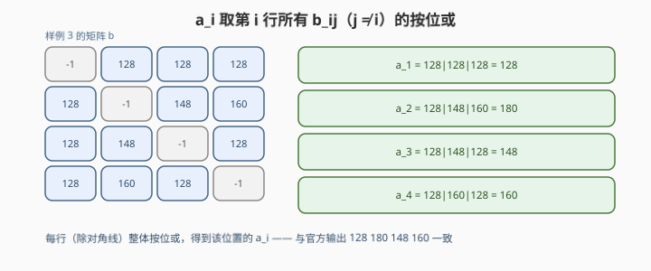
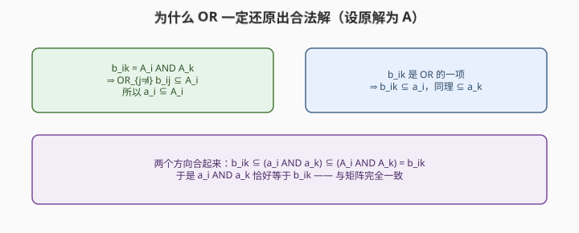

# Codeforces 245D 按位与矩阵还原 题解

## 1. 题目概述

- **题目链接**：https://codeforces.com/problemset/problem/245/D
- **比赛来源**：CROC-MBTU 2012, Elimination Round (ACM-ICPC) · Problem D（UTC 2012-11-19）
- **难度**：1500
- **标签**：构造、贪心、位运算
- **评测类型**：多解（任一合法序列即可，需 checker）
- **限制**：时间 2 s / 内存 256 MB

**题意**：有一个长度为 $n$ 的非负整数序列 $a_1..a_n$，以及矩阵 $b$：$b_{ij}=a_i\ \&\ a_j\ (i\ne j)$，$b_{ii}=-1$。给出 $b$，还原任意一个满足条件的 $a$（要求 $0\le a_i\le10^9$）。保证有解。

**约束**：

- $n\le100$：$O(n^2)$ 完全够用。
- $b_{ij}\le10^9$：只有 30 位，按位处理。
- 多解：不同的 $a$ 可能给出同一个 $b$（例如 $n=2$ 时 $b_{12}=0$，取 $a=(0,0)$ 或 $(1,2)$ 都行），所以必须用 checker 判定。

## 2. 示例与观察

官方样例一：

```text
输入：
1
-1

输出：
0
```

官方样例二：

```text
输入：
3
-1 18 0
18 -1 0
0 0 -1

输出：
18 18 0
```

官方样例三：

```text
输入：
4
-1 128 128 128
128 -1 148 160
128 148 -1 128
128 160 128 -1

输出：
128 180 148 160
```

**样例二演算**：$a=(18,18,0)$：$18\&18=18$ ✓，$18\&0=0$ ✓，$18\&0=0$ ✓，与矩阵一致。

**样例三演算**：把每行（除对角线）做按位或：

- $a_1=128\ |\ 128\ |\ 128=128$
- $a_2=128\ |\ 148\ |\ 160=180$
- $a_3=128\ |\ 148\ |\ 128=148$
- $a_4=128\ |\ 160\ |\ 128=160$

正好是官方输出 `128 180 148 160`。



**观察一**：$b_{ij}$ 的某一位为 1，说明 $a_i,a_j$ 在这一位都为 1；因此 $a_i$ 在这一位也必须是 1。把第 $i$ 行所有 $b_{ij}$ 按位或起来，就得到「$a_i$ 至少要有哪些 1」。

**观察二**：这样得到的 $a_i$ 是原解 $A_i$ 的**子集**（逐位包含），但恰好能还原所有 $b_{ij}$——见第 4 节的证明。

## 3. 解题思路

### 3.1 朴素做法与瓶颈

每个 $b_{ij}$ 给出的是「$a_i$ 与 $a_j$ 共同为 1 的位」，单独看是**必要**条件而不是充分条件，不能直接读出 $a_i$。逐位枚举 $a_i$ 的 30 个比特需要与其它 $n-1$ 个数对齐，直接搜索是 $2^{30n}$。

### 3.2 核心观察



取

$$a_i=\bigvee_{j\ne i} b_{ij}.$$

三个事实：

1. $b_{ij}\subseteq a_i$（因为 $b_{ij}$ 是或的一项），同理 $b_{ij}\subseteq a_j$，所以 $b_{ij}\subseteq a_i\ \&\ a_k$；
2. 设原解为 $A$，则 $b_{ij}=A_i\&A_j$，于是 $a_i=\bigvee_{j\ne i}(A_i\&A_j)\subseteq A_i$，从而 $a_i\&a_k\subseteq A_i\&A_k=b_{ik}$；
3. 1、2 合起来得 $a_i\&a_k=b_{ik}$，正是要求。

于是只需 $O(n^2)$ 求每行的或。

### 3.3 样例走查

样例三第 2 行是 `128 -1 148 160`，跳过对角线：

$$128\ |\ 148\ |\ 160=128+32+16+4=180 .$$

逐位看：$128=10000000_2$、$148=10010100_2$、$160=10100000_2$，或起来是 $10110100_2=180$ ✓。

## 4. 正确性证明

**引理 1（子集性）**：若 $A$ 是任一合法解，则对每个 $i$ 有 $a_i=\bigvee_{j\ne i}b_{ij}\subseteq A_i$（逐位包含）。

**证明**：对任意 $j\ne i$，$b_{ij}=A_i\&A_j\subseteq A_i$；有限个 $A_i$ 的子集之或仍是 $A_i$ 的子集。∎

**引理 2（下界方向）**：$b_{ik}\subseteq a_i\ \&\ a_k$。

**证明**：$b_{ik}$ 是 $a_i$ 的或运算中的一项，故 $b_{ik}\subseteq a_i$；对称地 $b_{ik}\subseteq a_k$。∎

**引理 3（上界方向）**：$a_i\ \&\ a_k\subseteq b_{ik}$。

**证明**：由引理 1，$a_i\subseteq A_i$、$a_k\subseteq A_k$，故 $a_i\&a_k\subseteq A_i\&A_k=b_{ik}$。∎

**定理**：$a_i=\bigvee_{j\ne i}b_{ij}$ 是合法解（且 $0\le a_i\le10^9$）。

**证明**：由引理 2、3 得 $a_i\&a_k=b_{ik}$，对一切 $i\ne k$ 成立。数值范围：$b_{ij}\le10^9$，或运算不会超过 $10^9$（或运算只会把已有的 1 保留，不会产生新高位）✓。∎

## 5. 复杂度分析

- **时间**：$O(n^2)$ 读入并求或，$n\le100$ 时 $10^4$ 次运算。
- **空间**：$O(n)$（甚至不必存矩阵，读入时直接累加）。
- **实测**：$n=100$ 端到端约 $3$ ms（含进程启动），限时 2 s。

## 6. 参考代码

### C++17

```cpp
#include <bits/stdc++.h>
using namespace std;

int main() {
    int n;
    if (scanf("%d", &n) != 1) return 0;
    vector<vector<long long>> b(n, vector<long long>(n));
    vector<long long> a(n, 0);
    for (int i = 0; i < n; ++i)
        for (int j = 0; j < n; ++j) {
            scanf("%lld", &b[i][j]);
            if (i != j) a[i] |= b[i][j];
        }
    for (int i = 0; i < n; ++i) printf("%lld%c", a[i], i + 1 == n ? '\n' : ' ');
    return 0;
}
```

### Python3

```python
import sys


def main() -> None:
    data = sys.stdin.buffer.read().split()
    if not data:
        return
    n = int(data[0])
    a = [0] * n
    p = 1
    for i in range(n):
        for j in range(n):
            v = int(data[p])
            p += 1
            if i != j:
                a[i] |= v
    sys.stdout.write(' '.join(map(str, a)) + '\n')


main()
```

## 7. 边界情况与易错点

1. **跳过对角线**：$b_{ii}=-1$，参与或运算会得到 $-1$（所有位全 1），必须跳过。
2. **$n=1$**：没有 $j\ne i$，或的结果是 $0$，输出 `0`（与样例一致）。
3. **全 0 矩阵**：所有 $a_i=0$，合法（$0\&0=0$）。
4. **`-1` 用有符号读入**：若用无符号类型读 $b_{ii}=-1$ 会变成 $2^{64}-1$，务必用有符号类型并在或之前跳过对角线。
5. **多解**：输出不唯一（本文构造的是「最小解」），对拍必须用 checker 验证 $a_i\&a_j=b_{ij}$。
6. **数值范围**：或运算不会超过所有输入的最大值（不会新增高位），满足 $\le10^9$；但读入用 `long long` 更稳妥。
7. **多测**：单组数据。

## 8. 验证记录

- **编译环境与命令**：本机无 GNU `g++`（`g++` 实为 Apple clang），`verify_solution.py` 自动回退到 `clang++ -std=c++17 -O2 -I codeforces/tools/include`；Python 3.9.6。
  - `python3 codeforces/tools/verify_solution.py codeforces/contests/0101-0203/245/D_按位与矩阵还原.md --checker codeforces/tools/checkers/cf245d.py` → `CF245D: samples 3 / C++ 编译 OK, 样例 3/3 / Python 语法 OK, 样例 3/3`
  - `python3 codeforces/tools/check.py codeforces/contests/0101-0203/245` → `checked 3, fail 0`
  - `python3 codeforces/tools/check_samples.py --only 0101-0203/245` → 0 问题
  - `node codeforces/tools/katex_check.cjs codeforces/contests/0101-0203/245` → 0 错误
- **checker 的校验条件**（`codeforces/tools/checkers/cf245d.py`）：恰好 $n$ 个整数、每个在 $[0,10^9]$、且对所有 $i\ne j$ 满足 $a_i\&a_j=b_{ij}$。
- **官方样例**：3 / 3 通过（样例三的输出与官方一致）。
- **随机对拍**：**240 组**随机数据（$n\in[1,20]$，随机 $a_i$ 先在 $[0,10^9]$ 取、部分改为 $[0,127]$ 以制造大量重复位；由 $a$ 算出 $b$ 作为输入），参考程序输出逐组通过 checker，0 组不合法。
- **最大约束性能**：$n=100$ 端到端约 $3$ ms（限时 2 s）。
- **图片校验**：`cf245d_or.svg`、`cf245d_proof.svg` 通过 `xml.etree.ElementTree.parse`，含 `feTurbulence` 与手写字体，文字在 `viewBox` 内。
- **复核状态**：verified。

## 相关题目与扩展

- [Codeforces 245B Internet Address](https://codeforces.com/problemset/problem/245/B)：同场 B 题。
- [Codeforces 245E Mishap in Club](https://codeforces.com/problemset/problem/245/E)：同场 E 题。
- [LeetCode 898. 子数组按位或操作](https://leetcode.cn/problems/bitwise-ors-of-subarrays/)：按位或的聚合性质。

**延伸思考**：

1. **如果矩阵给的是 $a_i\ |\ a_j$（按位或）**：类似的构造要改成「$a_i$ 是第 $i$ 行所有值的子集」，即取 AND 的「下界」，此时需要处理「某一位只出现在别人身上」的情形，可能要枚举/二分。
2. **如果矩阵给的是 $a_i\ \operatorname{xor}\ a_j$**：这是经典的可解问题——任取 $a_1=0$，$a_j=b_{1j}$，再验证一致性，$O(n^2)$。
3. **如果要求字典序最小的 $a$**：本文构造已是逐位最小的解（每一位都取「不得不为 1」的最小值），所以它本身就是字典序最小的一个。
