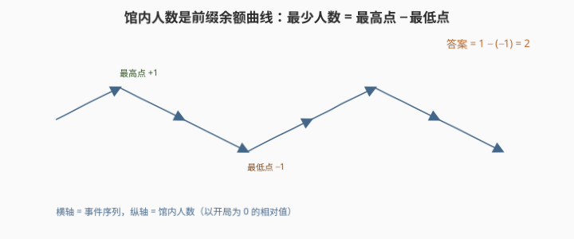
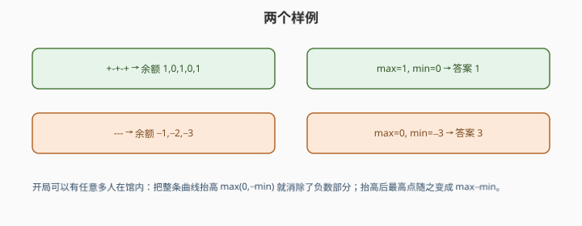

# Codeforces 245E 俱乐部最少人数 题解

## 1. 题目概述

- **题目链接**：https://codeforces.com/problemset/problem/245/E
- **比赛来源**：CROC-MBTU 2012, Elimination Round (ACM-ICPC) · Problem E（UTC 2012-11-19）
- **难度**：1400
- **标签**：贪心、实现
- **评测类型**：普通
- **限制**：时间 2 s / 内存 256 MB

**题意**：Polycarpus 记录了俱乐部所有进出的流水账：`+` 表示有人进来，`-` 表示有人出去，事件严格按时间顺序发生（不会同时发生），长度 $\le300$。他不知道换班开始时馆里有几个人、结束时还剩几个。每个人可以任意次进出。求他**最少**见过多少个不同的人。

**约束**：

- 串长 $\le300$：任何 $O(L^2)$ 的模拟都够用。
- 「同一个人可以多次进出」是关键：出去过的人可以再进来，不必算作新人。
- 开局人数未知（可以是 $0..\infty$），这给了我们「抬高曲线」的自由。

## 2. 示例与观察

官方样例一：

```text
输入：
+-+-+

输出：
1
```

官方样例二：

```text
输入：
---

输出：
3
```

**样例一演算**：一个人反复进出，序列正好是「进、出、进、出、进」，只需要 1 个人。

**样例二演算**：三次「出去」而期间没有人进来，说明这三个人在换班开始前就在馆里，最少 3 人。



**观察一**：只看「馆内人数的变化量」。令 `bal` 为前缀余额（`+1`/`-1` 累加，从 0 开始）。若开局有 $I_0$ 人，则任意时刻馆内人数 $=I_0+\text{bal}$，必须 $\ge0$，所以 $I_0\ge-\min\text{bal}$。

**观察二**：所用的不同人数至少是「馆内人数的历史最大值」——因为每个在馆内的人都被见过。取 $I_0=-\min\text{bal}$（若 $\min\text{bal}\ge0$ 则取 0）时，最大值恰为 $\max\text{bal}-\min\text{bal}$，且这个人数是可行的。

**观察三**：于是答案就是 $\max\text{bal}-\min\text{bal}$（把 `bal=0` 也计入前缀，所以 $\min\le0\le\max$）。

## 3. 解题思路

### 3.1 朴素做法与瓶颈

暴力想法：枚举总人数 $P$，再判断是否存在一种「谁进谁出」的安排。$P$ 最多 $L\le300$，对每个 $P$ 做一次可达性 DP 是 $O(L^2)$，总 $O(L^3)$——也能过。但我们有更直接的公式。

### 3.2 核心观察：把「人数」看成可以上下平移的曲线



设 $b_0=0$，$b_t=\sum_{i\le t}(\pm1)$ 是前 $t$ 个事件后的余额。若开局有 $I_0$ 人，则第 $t$ 个事件之后馆内有 $I_0+b_t$ 人。

- **下界**：任何时刻馆内人数 $\ge0$，于是 $I_0\ge-\min_t b_t$。
- **上界/目标**：总人数 $P$ 必须不小于任意时刻的馆内人数，故 $P\ge I_0+\max_t b_t$。取最小可行的 $I_0=\max(0,-\min b)$，得 $P\ge\max(0,-\min b)+\max b$。由于 $b_0=0$，有 $\min b\le0\le\max b$，所以这个下界就是 $\max b-\min b$。

**构造**：取 $I_0=-\min b$、总人数 $P=\max b-\min b$。按事件顺序处理：遇到 `+`，从「当前在外面的人」里挑一个进来（外面人数 $=P-(\text{馆内})>0$，因为馆内即将变成 $\le P$）；遇到 `-`，让馆内任意一个人出去（馆内人数 $\ge1$，因为事件前 $I_0+b>0$）。每个事件都能执行，且用到的人不超过 $P$。

### 3.3 样例走查

样例一 `+-+-+`：$b=(1,0,1,0,1)$，$\min=0$、$\max=1$，答案 $1-0=1$。

样例二 `---`：$b=(-1,-2,-3)$，$\min=-3$、$\max=0$，答案 $0-(-3)=3$。

再看 `+-`：$b=(1,0)$，$\min=0,\max=1$ → 1（一个人进出）。

再看的 `-+`：$b=(-1,0)$，$\min=-1,\max=0$ → 1（一个人先出去再进来）。

## 4. 正确性证明

**引理 1（下界）**：任何合法场景所用人数 $P\ge\max b-\min b$。

**证明**：设开局有 $I_0$ 人。时刻 $t$ 馆内人数为 $I_0+b_t\ge0$，故 $I_0\ge-\min b$；而馆内人数不能超过总人数，故 $P\ge I_0+\max b\ge-\min b+\max b$。∎

**引理 2（可达）**：取 $I_0=-\min b$（若 $\min b>0$ 则取 $0$，此时 $\max b-\min b$ 仍等于 $I_0+\max b$）与 $P=\max b-\min b$，存在一种安排使每个事件都合法。

**证明**：按时间顺序处理。归纳假设：处理完前 $t$ 个事件时，馆内恰好有 $I_0+b_t$ 人，且总人数 $\le P$。
- 遇 `+`：需要有人在馆外，馆外人数 $=P-(I_0+b_t)$。事件后馆内为 $I_0+b_t+1\le I_0+\max b=P$，故馆外人数 $\ge1$，可以进人。
- 遇 `-`：需要馆内有人，事件前馆内为 $I_0+b_t\ge I_0+\min b\ge0$；而 `-` 事件意味着 $\min$ 之后的余额会更低，具体地 $I_0+b_t\ge1$（因为 $b_t\ge\min b$ 且 $I_0=-\min b$，若 $b_t=\min b$ 则 $I_0+b_t=0$，但此时不可能是 `-`，否则 $b_{t+1}<b_t=\min b$ 矛盾）。故可以出人。
每一步都不超过 $P$，归纳成立。∎

**定理**：答案等于 $\max b-\min b$。

**证明**：引理 1 给出下界，引理 2 给出达到下界的构造，故最小人数就是 $\max b-\min b$。∎

## 5. 复杂度分析

- **时间**：$O(L)$，一次扫描维护余额与极值。
- **空间**：$O(1)$。
- **实测**：$L=300$ 端到端约 $2$ ms（限时 2 s）。

## 6. 参考代码

### C++17

```cpp
#include <bits/stdc++.h>
using namespace std;

int main() {
    string s;
    if (!(cin >> s)) return 0;
    int bal = 0, mn = 0, mx = 0;
    for (char c : s) {
        bal += (c == '+') ? 1 : -1;
        mn = min(mn, bal);
        mx = max(mx, bal);
    }
    printf("%d\n", mx - mn);
    return 0;
}
```

### Python3

```python
import sys


def main() -> None:
    data = sys.stdin.buffer.read().split()
    if not data:
        return
    s = data[0].decode()
    bal = mn = mx = 0
    for c in s:
        bal += 1 if c == '+' else -1
        mn = min(mn, bal)
        mx = max(mx, bal)
    print(mx - mn)


main()
```

## 7. 边界情况与易错点

1. **`bal=0` 也要计入极值**：初始余额 0 是一个真实时刻，所以 `mn=mx=0` 初始化；否则 `+` 这样的输入会算错。
2. **只出现 `+`**：$b$ 一路升高，$\min=0$，答案 $=\max$（每个进入的人都不出去，只能是不同的人）。
3. **只出现 `-`**：$b$ 一路降低，$\max=0$，答案 $=-\min$（都在开局前就在馆里）。
4. **不要把「进出次数」当成人数**：一个人可以反复进出，样例一就是 5 个事件只用 1 个人。
5. **「最大同时在场」不等于答案**：答案由两个量共同决定——开局人数 $I_0\ge-\min b$ 与峰值 $I_0+\max b$；写成 $\max b-\min b$ 才不会漏掉「先负后正」的曲线（例如 `-+` 需要 1 人、`--++` 需要 2 人）。
6. **多测**：单组数据。
7. **输入只有一行**：用 `cin >> s` 或按 token 读即可，注意串里没有空格。

## 8. 验证记录

- **编译环境与命令**：本机无 GNU `g++`（`g++` 实为 Apple clang），`verify_solution.py` 自动回退到 `clang++ -std=c++17 -O2 -I codeforces/tools/include`；Python 3.9.6。
  - `python3 codeforces/tools/verify_solution.py codeforces/contests/0101-0203/245/E_俱乐部最少人数.md` → `CF245E: samples 2 / C++ 编译 OK, 样例 2/2 / Python 语法 OK, 样例 2/2`
  - `python3 codeforces/tools/check.py codeforces/contests/0101-0203/245` → `checked 4, fail 0`
  - `python3 codeforces/tools/check_samples.py --only 0101-0203/245` → 0 问题
  - `node codeforces/tools/katex_check.cjs codeforces/contests/0101-0203/245` → 0 错误
- **官方样例**：2 / 2 通过（1、3）。
- **暴力对拍**：独立暴力 = 对 $P=1,2,\dots$ 依次做「馆内人数」的可达性 DP（开局人数可为 $0..P$，`+` 要求馆内 $<P$，`-` 要求馆内 $>0$），第一个可行的 $P$ 即答案。随机 **260 组**（长度 $1..40$），与参考程序逐组一致，0 组不符。
- **最大约束性能**：长度 300 端到端约 $2$ ms（限时 2 s）。
- **图片校验**：`cf245e_balance.svg`、`cf245e_cases.svg` 通过 `xml.etree.ElementTree.parse`，含 `feTurbulence` 与手写字体，文字在 `viewBox` 内。
- **复核状态**：verified。

## 相关题目与扩展

- [Codeforces 245D Restoring Table](https://codeforces.com/problemset/problem/245/D)：同场 D 题。
- [Codeforces 245C Game with Coins](https://codeforces.com/problemset/problem/245/C)：同场 C 题。
- [LeetCode 122. 买卖股票的最佳时机 II](https://leetcode.cn/problems/best-time-to-buy-and-sell-stock-ii/)：同为「前缀差 / 极值」型贪心。

**延伸思考**：

1. **如果要求每个人最多进出 $k$ 次**：曲线除了不能为负，还要限制「用人数换次数」，答案会变成关于 $k$ 的分段函数。
2. **如果同时记录进出的具体身份**（给出每次是谁）：问题退化为直接统计不同身份个数。
3. **如果事件可能同时发生**（`+-` 同时）：顺序不再唯一，要取所有合法拓扑序下的最小值，等于把 `` `-+` `` 与 `` `+-` `` 视为同一事件对。
