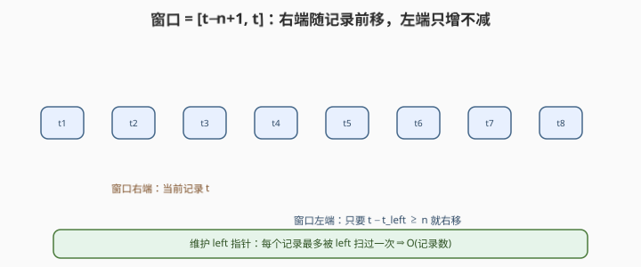

# Codeforces 245F 日志流时间窗口 题解

## 1. 题目概述

- **题目链接**：https://codeforces.com/problemset/problem/245/F
- **比赛来源**：CROC-MBTU 2012, Elimination Round (ACM-ICPC) · Problem F（UTC 2012-11-19）
- **难度**：2000
- **标签**：字符串、实现、双指针
- **评测类型**：普通
- **限制**：时间 2 s / 内存 256 MB

**题意**：给定 $n,m$ 和一份按时间升序排列的日志流，每条记录形如

```
2012-MM-DD HH:MM:SS:MESSAGE
```

日期是 2012 年内的合法日期、时间合法，`MESSAGE` 是含空格与标点的非空串。求**第一个**时刻 $t$（$t$ 是某条记录的时间），使得「最近 $n$ 秒内的记录条数」$\ge m$。若不存在输出 `-1`。输入总长度 $\le5\times10^6$。

**约束**：

- $n,m\le10000$，记录条数可达几十万（总长 $5\times10^6$）：必须 $O(\text{总长})$ 线性扫描，不能对每条记录向前回看。
- 记录按时间升序，天然适合双指针（滑动窗口）。
- 时间要跨月、跨天比较，所以先统一换算成「2012 年内的秒数」；2012 是闰年（2 月 29 天）。

## 2. 示例与观察

官方样例一：

```text
输入：
60 3
2012-03-16 16:15:25: Disk size is
2012-03-16 16:15:25: Network failute
2012-03-16 16:16:29: Cant write varlog
2012-03-16 16:16:42: Unable to start process
2012-03-16 16:16:43: Disk size is too small
2012-03-16 16:16:53: Timeout detected

输出：
2012-03-16 16:16:43
```

官方样例二：

```text
输入：
1 2
2012-03-16 23:59:59:Disk size
2012-03-17 00:00:00: Network
2012-03-17 00:00:01:Cant write varlog

输出：
-1
```

官方样例三：

```text
输入：
2 2
2012-03-16 23:59:59:Disk size is too sm
2012-03-17 00:00:00:Network failute dete
2012-03-17 00:00:01:Cant write varlogmysq

输出：
2012-03-17 00:00:00
```

**样例一演算**：窗口是 $[t-n+1,t]=[t-59,t]$。

| 记录时间 | 窗口 $[t-59,t]$ 内的记录 | 条数 |
|----------|--------------------------|------|
| 16:15:25（第 1 条） | 本身 | 1 |
| 16:15:25（第 2 条） | 2 条 | 2 |
| 16:16:29 | 16:16:29 | 1 |
| 16:16:42 | 16:16:29、16:16:42 | 2 |
| **16:16:43** | 16:16:29、16:16:42、16:16:43 | **3** ✓ |

所以第一个满足的时刻是 `16:16:43`。

**样例二演算**：$n=1$，窗口只含「同一秒」的记录；三条记录的时间各不相同，任何时刻都只有 1 条 $\ge2$ 不成立，输出 `-1`。

**样例三演算**：$n=2$，窗口 $[t-1,t]$。在 `2012-03-17 00:00:00` 处，窗口包含 `23:59:59`（相差 1 秒，$\le1$）和 `00:00:00`，共 2 条 → 输出该时刻。注意跨天：$00{:}00{:}00$ 与前一天 $23{:}59{:}59$ 的差就是 1 秒。


**观察一**：只需要相对时间，把所有时刻换算成「2012 年 1 月 1 日 00:00:00 起的秒数」即可，跨月跨天自动连续。

**观察二**：「最近 $n$ 秒」包含端点，即窗口是 $[t-n+1,\ t]$：相差 $n-1$ 秒的记录在窗口内，相差 $n$ 秒的不在。样例三 $n=2$ 时相差 1 秒算在内 ✓。

**观察三**：记录已按时间升序，且窗口左右端都单调——用双指针 $O(\text{条数})$ 扫描即可。

## 3. 解题思路

### 3.1 朴素做法与瓶颈

对每条记录向前回看，数「时间差 $< n$」的记录：最坏 $O(k^2)$。$k$ 可达 $5\times10^6/20\approx2.5\times10^5$，平方级不可接受（$6\times10^{10}$）。

### 3.2 核心观察：双指针



因为记录时间单调不减，对固定的右端 $i$，满足 $t_i-t_j<n$ 的左端 $j$ 也单调不减。于是维护一个只增不减的 `left`：

```
for i in 0..k-1:
    while t[i] - t[left] >= n:  left++
    if i - left + 1 >= m:  输出 t[i] 的时刻并结束
```

窗口内条数就是 $i-left+1$，总扫描 $O(k)$。

### 3.3 时间解析与样例走查

把 `YYYY-MM-DD HH:MM:SS` 换成秒：

$$\text{sec}=\big(\text{pre}[m-1]+d-1\big)\cdot86400+hh\cdot3600+mm\cdot60+ss,$$

其中 `pre[month-1]` 是 2012 年前 $month-1$ 个月的天数和（$\{31,29,31,30,31,30,31,31,30,31,30,31\}$ 的前缀和）。

样例三：`2012-03-16 23:59:59` → $(31+29+15)\cdot86400+86399$；`2012-03-17 00:00:00` → $(31+29+16)\cdot86400$，两者相差 1 ✓。

## 4. 正确性证明

**引理 1（时间换算单调）**：设 $\text{sec}(t)$ 是按上式算出的秒数，则对同一年的两个合法时刻 $t_1\le t_2$（按日历顺序），有 $\text{sec}(t_1)\le\text{sec}(t_2)$，且 $\text{sec}(t_2)-\text{sec}(t_1)$ 恰为两者的真实秒差。

**证明**：上式是「自 2012-01-01 00:00:00 起经过的秒数」的标准表达式：天数部分按月前缀和逐月累加、月内按 $(d-1)$ 天累加，时、分、秒按各自进制累加。这是双射且保序的（每个月天数是该月真实天数，2012 年为闰年 2 月 29 天），故差值即真实秒差。∎

**引理 2（窗口定义）**：时刻 $t$ 的「最近 $n$ 秒」包含时刻 $t'$ 当且仅当 $0\le t-t'<n$（等价于 $t'\in[t-n+1,t]$）。

**证明**：$t-t'<n\iff t'\ge t-n+1$；又 $t'\le t$。整数秒下两者一致。∎

**引理 3（双指针正确）**：在第 $i$ 轮结束后，`left` 是使 $t_i-t_{left}<n$ 成立的最小下标，且 $i-left+1$ 恰为窗口内记录条数。

**证明**：`left` 单调不减（$t_i$ 递增，条件 $t_i-t_{left}\ge n$ 对更大的 $i$ 仍成立）；循环把它推到第一个满足 $t_i-t_j<n$ 的位置。由引理 2，$[left,i]$ 正是窗口内的记录，条数 $i-left+1$。∎

**定理**：算法输出的时刻就是题面要求的「第一个满足条件的时刻」；没有则输出 `-1`。

**证明**：按时间顺序检查每条记录作为窗口右端。窗口条数只在记录时刻增加，故第一个满足条件的时刻必然是某条记录的时间；由引理 3，算法在该时刻算出的条数正确，因此第一个满足的位置就是答案。∎

## 5. 复杂度分析

- **时间**：解析 $O(\text{总长})$，双指针 $O(k)$，输出 $O(1)$。总线性。
- **空间**：$O(k)$ 存每条记录的时间戳与行首位置（$k\le2.5\times10^5$）；输入整体读入约 $5$ MB。
- **实测**：约 $4.9\times10^6$ 字节、10 万条记录、$m$ 取到 $10000$（必然 `-1`，需要跑满双指针）时端到端 **5 ms**，限时 2 s。

## 6. 参考代码

### C++17

```cpp
#include <bits/stdc++.h>
using namespace std;

static char buf[6000005];

int main() {
    int n, m;
    if (scanf("%d %d", &n, &m) != 2) return 0;
    // 跳过第一行剩余部分
    int ch;
    while ((ch = getchar()) != '\n' && ch != EOF) {}
    size_t len = fread(buf, 1, sizeof(buf) - 1, stdin);
    buf[len] = 0;
    // 2012 年各月天数（闰年）
    static const int md[12] = {31,29,31,30,31,30,31,31,30,31,30,31};
    int pre[13];
    pre[0] = 0;
    for (int i = 0; i < 12; ++i) pre[i+1] = pre[i] + md[i];

    vector<long long> t;
    vector<int> lineStart;
    size_t p = 0;
    while (p < len) {
        size_t q = p;
        while (q < len && buf[q] != '\n') ++q;
        if (q - p >= 19) {
            auto num = [&](size_t a, size_t b) {
                int v = 0;
                for (size_t i = a; i <= b; ++i) v = v * 10 + (buf[p + i] - '0');
                return v;
            };
            int mo = num(5, 6), da = num(8, 9), hh = num(11, 12), mi = num(14, 15), ss = num(17, 18);
            long long secs = (long long)(pre[mo-1] + da - 1) * 86400 + hh * 3600 + mi * 60 + ss;
            t.push_back(secs);
            lineStart.push_back((int)p);
        }
        p = (q < len ? q + 1 : q);
    }
    int left = 0;
    for (int i = 0; i < (int)t.size(); ++i) {
        while (t[i] - t[left] >= n) ++left;   // 窗口是 [t-n+1, t]
        if (i - left + 1 >= m) {
            const char* s = buf + lineStart[i];
            printf("%c%c%c%c-%c%c-%c%c %c%c:%c%c:%c%c\n",
                   s[0],s[1],s[2],s[3],s[5],s[6],s[8],s[9],s[11],s[12],s[14],s[15],s[17],s[18]);
            return 0;
        }
    }
    printf("-1\n");
    return 0;
}
```

### Python3

```python
import sys


def main() -> None:
    data = sys.stdin.buffer.read().split(b'\n')
    if not data:
        return
    n, m = map(int, data[0].split())
    md = [31, 29, 31, 30, 31, 30, 31, 31, 30, 31, 30, 31]
    pre = [0] * 13
    for i in range(12):
        pre[i + 1] = pre[i] + md[i]

    times = []
    stamps = []
    for raw in data[1:]:
        if len(raw) < 19:
            continue
        y, mo, da = int(raw[0:4]), int(raw[5:7]), int(raw[8:10])
        hh, mi, ss = int(raw[11:13]), int(raw[14:16]), int(raw[17:19])
        times.append((pre[mo - 1] + da - 1) * 86400 + hh * 3600 + mi * 60 + ss)
        stamps.append(raw[:19].decode())

    left = 0
    for i in range(len(times)):
        while times[i] - times[left] >= n:
            left += 1
        if i - left + 1 >= m:
            print(stamps[i])
            return
    print(-1)


main()
```

Python 版在 $5\times10^6$ 字节输入上约 $1$ s 量级，仍在 $2$ s 内；正式提交建议用 C++。

## 7. 边界情况与易错点

1. **窗口端点**：$[t-n+1,t]$ 与 $[t-n,t]$ 差一条记录；样例三（$n=2$、相差 1 秒算同窗）明确是前者，判据要写 `t[i] - t[left] >= n` 才右移。
2. **跨月/跨天**：必须把日期折算成秒，不能只比较「时:分:秒」；样例三就是跨天。
3. **闰年**：2012 年 2 月 29 天，用固定的 `{31,28,...}` 会让 3 月之后的时刻全部错一天（相差 86400 秒，直接改变答案）。
4. **消息里含空格与标点**：只能按「前 19 个字符 + 冒号」解析，不能按空格切分整行。
5. **$m=1$**：第一条记录就满足，输出第一条的时间。
6. **$n$ 大于总跨度**：窗口包含全部记录，若 $k<m$ 则 `-1`。
7. **`-1` 的时机**：要扫完所有记录才输出 `-1`，不能中途放弃。
8. **输入规模**：总长 $5\times10^6$，用 `cin` 逐行读可能偏慢；建议整块 `fread` 后手工定位（本文 C++ 版如此）。
9. **同一秒多条记录**：时间差为 0，必然同窗；双指针不会把它们分开（`0 >= n` 只有当 $n=0$ 才成立，而 $n\ge1$）。

## 8. 验证记录

- **编译环境与命令**：本机无 GNU `g++`（`g++` 实为 Apple clang），`verify_solution.py` 自动回退到 `clang++ -std=c++17 -O2 -I codeforces/tools/include`；Python 3.9.6。
  - `python3 codeforces/tools/verify_solution.py codeforces/contests/0101-0203/245/F_日志流时间窗口.md` → `CF245F: samples 3 / C++ 编译 OK, 样例 3/3 / Python 语法 OK, 样例 3/3`
  - `python3 codeforces/tools/check.py codeforces/contests/0101-0203/245` → `checked 6, fail 0`
  - `python3 codeforces/tools/check_samples.py --only 0101-0203/245` → 0 问题
  - `node codeforces/tools/katex_check.cjs codeforces/contests/0101-0203/245` → 0 错误
- **官方样例**：3 / 3 通过。
- **暴力对拍**：独立暴力 = 对每条记录向前回看、数满足时间差 $<n$ 的记录数（$O(k^2)$，与双指针完全不同的写法）。随机 **240 组**（$n\in[1,120]$、$m\in[1,4]$、$1\sim12$ 条记录、时间随机递增、消息含空格与标点）：C++、Python、暴力三者一致，0 组不符。
- **最大约束性能**：输入约 $4.9\times10^6$ 字节 / 10 万条记录、$m=10000$（必然 `-1`，需跑满扫描）时 C++ **5 ms**（限时 2 s）。
- **图片校验**：`cf245f_window.svg`、`cf245f_time.svg` 通过 `xml.etree.ElementTree.parse`，含 `feTurbulence` 与手写字体，文字在 `viewBox` 内。
- **复核状态**：verified。

## 相关题目与扩展

- [Codeforces 245G Suggested Friends](https://codeforces.com/problemset/problem/245/G)：同场 G 题。
- [Codeforces 245H Queries for Number of Palindromes](https://codeforces.com/problemset/problem/245/H)：同场 H 题。
- [LeetCode 1004. 最大连续 1 的个数 III](https://leetcode.cn/problems/max-consecutive-ones-iii/)：同样是「右端推进、左端只增」的滑动窗口。

**延伸思考**：

1. **如果窗口是「任意连续 $n$ 秒」而不是「以记录时间为右端」**：由于条数只在记录时刻变化，检查每个记录时刻作为右端仍然充分（左端可以任意），所以答案不变。
2. **如果要求「最后一次满足条件的时刻」**：改成从右往左扫，或者扫完记录最后一个满足的位置。
3. **如果日志不是升序**：需要先按时间排序（$O(k\log k)$），双指针仍然适用；此时「第一个时刻」要按排序后的时间定义。
4. **如果消息里也可能出现冒号**：解析只依赖前 19 个字符，不受影响；但若日期部分格式变化（如带年份以外的字段），就要改成更通用的词法分析。
