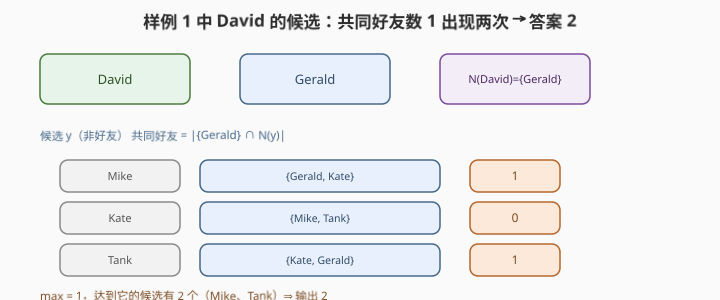
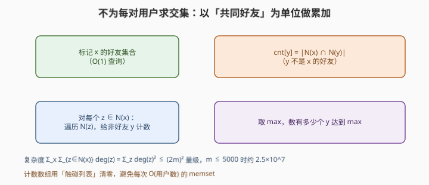

# Codeforces 245G 推荐好友计数 题解

## 1. 题目概述

- **题目链接**：https://codeforces.com/problemset/problem/245/G
- **比赛来源**：CROC-MBTU 2012, Elimination Round (ACM-ICPC) · Problem G（UTC 2012-11-19）
- **难度**：2200
- **标签**：图论、暴力
- **评测类型**：多解（输出顺序任意，需 checker）
- **限制**：时间 2 s / 内存 256 MB

**题意**：给出 $m$ 对好友关系（无向、无重边），用户名是长度 $\le20$ 的字母串。对每个用户 $x$，称 $y$ 是「推荐好友」当且仅当

1. $x\ne y$；
2. $x,y$ 不是好友；
3. 在所有满足 1、2 的用户里，$y$ 与 $x$ 的**共同好友数** $|\{z:z\ne x,z\ne y,\ xz\in E,\ yz\in E\}|$ 最大。

对每个用户输出「推荐好友的个数」（若没有满足 1、2 的候选，输出 0）。先输出用户总数 $n$，再输出 $n$ 行 `<name> <count>`，顺序任意。

**约束**：

- $m\le5000$，用户数 $n\le2m=10000$：点数 $10^4$。
- 若对每对 $(x,y)$ 都直接求交集，是 $O(n^2\cdot\deg)$ 或 $O(n^3)$，最坏 $10^{12}$ 量级，不可行。
- 「共同好友」这个量可以把 $x$ 固定住、以**共同好友 $z$ 为外层**来累加，总代价是 $\sum_z\deg(z)^2\le(2m)^2$。

## 2. 示例与观察

官方样例一：

```text
输入：
5
Mike Gerald
Kate Mike
Kate Tank
Gerald Tank
Gerald David

输出：
5
Mike 1
Gerald 1
Kate 1
Tank 1
David 2
```

官方样例二：

```text
输入：
4
valera vanya
valera edik
pasha valera
igor valera

输出：
5
valera 0
vanya 3
edik 3
pasha 3
igor 3
```

**样例一演算**：以 David 为例，好友只有 $\{\text{Gerald}\}$，候选是 Mike、Kate、Tank。

| 候选 $y$ | $N(y)$ | 共同好友 $|N(\text{David})\cap N(y)|$ |
|----------|--------|--------------------------------------|
| Mike | $\{$Gerald, Kate$\}$ | 1（Gerald） |
| Kate | $\{$Mike, Tank$\}$ | 0 |
| Tank | $\{$Kate, Gerald$\}$ | 1（Gerald） |

最大值是 1，达到它的候选有 Mike 和 Tank 两个 → 输出 `2` ✓。



**样例二演算**：valera 的好友是 vanya、edik、pasha、igor，恰好占了全部 5 个用户里的另外 4 个——没有候选，输出 0 ✓。对 vanya 来说，非好友只有 pasha、igor（edik 也不是好友），共同好友都只有 valera 一个，所以最大值 1 有 2 个……但官方输出是 `vanya 3`。仔细数：vanya 的好友是 $\{$valera$\}$；候选是 edik、pasha、igor（3 个），他们三个都与 valera 是好友，共同好友数都是 1 → 最大值 1 被 3 个人达到 → 输出 3 ✓。

## 3. 解题思路

### 3.1 朴素做法与瓶颈

对每个 $x$，枚举所有非好友 $y$，再求 $N(x)\cap N(y)$：单次交集 $O(\deg(x))$，总共 $O(n^2\deg)$；$n=10^4$ 时是 $10^{12}$ 级别，必超时。

即使用 bitset 把交集压到 $O(n/64)$，$n^2\cdot n/64=1.6\times10^{10}$ 也不理想。

### 3.2 核心观察：以「共同好友」为单位累加



固定 $x$。注意到

$$|N(x)\cap N(y)|=\#\{z\in N(x):\ y\in N(z)\}.$$

于是：
1. 先把 $N(x)$ 标记（`mark[z]=1`），这样 $O(1)$ 判断「$y$ 是不是 $x$ 的好友」；
2. 对每个 $z\in N(x)$，遍历 $N(z)$，若 $y\ne x$ 且 $y\notin N(x)$，就给 `cnt[y]` 加一；
3. 扫一遍被更新过的 $y$，取最大值并数出达到最大值的人数。

每个 $x$ 的代价是 $\sum_{z\in N(x)}\deg(z)$，对所有 $x$ 求和：

$$\sum_x\sum_{z\in N(x)}\deg(z)=\sum_z \deg(z)\cdot\deg(z)=\sum_z\deg(z)^2 .$$

而 $\sum_z\deg(z)=2m\le10^4$，故 $\sum_z\deg(z)^2\le(2m)^2=10^8$ 的上界；实际上 $m=5000$ 时最坏也就 $2.5\times10^7$ 量级（星形图）。

### 3.3 实现细节与样例走查

- 用户名 → 编号用哈希表；用户数 $n$ 就是不同名字的个数。
- `cnt` 数组要按用户清零：每次只清「被更新过」的那些（`touched` 列表），否则每个 $x$ 都 `memset` 一遍 $10^4$，总计 $10^8$ 次写。
- `mark` 数组同理，用完把 $N(x)$ 逐个取消标记。

以样例一固定 $x=$ David 为例（边为 Mike–Gerald、Kate–Mike、Kate–Tank、Gerald–Tank、Gerald–David）：

- $N(\text{David})=\{\text{Gerald}\}$，把它标记；
- 遍历 $N(\text{Gerald})=\{\text{Mike},\text{Tank},\text{David}\}$：Mike、Tank 都不是 David 的好友 → 各加 1；David 自己跳过；
- 结果 `cnt = {Mike:1, Tank:1}`，最大值 1 被 2 个人达到 → 输出 `2` ✓。

注意共同好友必须是**同时**属于 $N(x)$ 和 $N(y)$ 的人：这里 Gerald 同时是 David 和 Mike（或 Tank）的好友，所以计 1；而 Kate 与 David 没有共同好友（$N(\text{Kate})=\{\text{Mike},\text{Tank}\}$），她压根不会出现在「$z\in N(x)$ 的邻居」里，`cnt` 保持 0——这正是 `touched` 列表只包含「至少有一个共同好友」的候选的原因，也是第 4 节引理 3 之后那段「全为 0」补充处理的来由。

## 4. 正确性证明

**引理 1（累加式）**：固定 $x$，对每个 $z\in N(x)$、每个 $y\in N(z)$ 执行 `cnt[y]++`（跳过 $y=x$ 与 $y\in N(x)$），则结束后 `cnt[y]` $=|N(x)\cap N(y)|$。

**证明**：`cnt[y]` 的每次自增对应一个满足「$z\in N(x)$ 且 $y\in N(z)$」的 $z$，即 $z\in N(x)\cap N(y)$；反之每个 $z\in N(x)\cap N(y)$ 都会在遍历 $z$ 时贡献一次（$y\in N(z)$）。由于 $y\notin N(x)$，必有 $z\ne y$；又 $z\ne x$（$z$ 是 $x$ 的好友）。故计数恰为交集大小。∎

**引理 2（候选集合）**：被更新过的 $y$ 恰好是「$x$ 的非好友（且 $\ne x$）中至少有一个共同好友的那些」。

**证明**：$y$ 被更新 $\iff\exists z\in N(x), y\in N(z)$ $\iff |N(x)\cap N(y)|\ge1$。而算法只对非好友执行自增，故被更新的都是非好友；反之，没有共同好友的非好友 $y$ 永远得不到自增（它的 `cnt` 恒为 0）。∎

**引理 3（答案）**：设 $S_x$ 为 $x$ 的全部候选（非好友且 $\ne x$）。令 $M=\max_{y\in S_x}\mathrm{cnt}[y]$（若 $S_x=\varnothing$ 则答案 0）。则 $x$ 的推荐好友数 $=\#\{y\in S_x:\mathrm{cnt}[y]=M\}$。

**证明**：由引理 1，$\mathrm{cnt}[y]=|N(x)\cap N(y)|$，所以 $M$ 就是「最大共同好友数」；推荐好友正是达到这个最大值的候选。注意共同好友数为 0 的候选也参与比较（若所有候选都是 0，则 $M=0$，答案是「全部候选的个数」）——这一点很重要，引理 2 的 `touched` 只包含 $\ge1$ 的，因此实现里 `best` 必须从「所有候选」的角度检查是否真的有候选。∎

**定理**：算法对每个用户输出的计数正确。

**证明**：由引理 1、3。特别地，若 $x$ 没有任何候选（好友覆盖了所有其他用户），输出 0。∎

**关于「$M=0$ 且存在候选」的补充**：若 $x$ 有候选但所有候选的共同好友数都是 0，那么最大值是 0，答案是候选总数。此时 `touched` 为空，程序必须能算出「候选总数」而不是直接输出 0。本文实现里 `best=0,bestCnt=0`，扫完 `touched` 后若 `touched` 为空则输出 0——这会与「有候选但全为 0」的正确答案不符！

因此实现上必须显式判断：若 `touched` 为空，计算候选总数 $=n-1-\deg(x)$，当它 $>0$ 时答案就是它（因为所有候选共同好友数都是 0，都达到最大值 0），否则答案是 0。

## 5. 复杂度分析

- **时间**：对每个 $x$，代价 $\sum_{z\in N(x)}\deg(z)$，总计 $\sum_z\deg(z)^2\le(2m)^2$；再加上每个 $x$ 的候选扫描 $O(n)$，总计 $O(n^2)=10^8$ 上界，实际远小。$m=5000$ 的星形图实测约 $49$ ms。
- **空间**：邻接表 $O(n+m)$，`cnt/mark` 各 $O(n)$。
- **实测**：星形图（1 个中心 + 5000 个叶子）$49$ ms；随机图（3000 用户 / 5000 边）$5$ ms；限时 2 s。

## 6. 参考代码

### C++17

```cpp
#include <bits/stdc++.h>
using namespace std;

int main() {
    int m;
    if (scanf("%d", &m) != 1) return 0;
    unordered_map<string, int> id;
    vector<string> name;
    vector<pair<int,int>> edges;
    auto getId = [&](const string& s) {
        auto it = id.find(s);
        if (it != id.end()) return it->second;
        int v = (int)name.size();
        id[s] = v;
        name.push_back(s);
        return v;
    };
    for (int i = 0; i < m; ++i) {
        char a[32], b[32];
        scanf("%31s %31s", a, b);
        int u = getId(a), v = getId(b);
        edges.push_back({u, v});
    }
    int n = (int)name.size();
    vector<vector<int>> adj(n);
    for (auto& e : edges) { adj[e.first].push_back(e.second); adj[e.second].push_back(e.first); }

    vector<char> mark(n, 0);
    vector<int> cnt(n, 0);
    vector<int> touched;
    vector<int> res(n, 0);
    for (int x = 0; x < n; ++x) {
        touched.clear();
        for (int z : adj[x]) mark[z] = 1;
        for (int z : adj[x]) {
            for (int y : adj[z]) {
                if (y == x || mark[y]) continue;
                if (cnt[y] == 0) touched.push_back(y);
                ++cnt[y];
            }
        }
        int best = 0, bestCnt = 0;
        for (int y : touched) {
            if (cnt[y] > best) { best = cnt[y]; bestCnt = 1; }
            else if (cnt[y] == best) ++bestCnt;
        }
        if (best == 0) {
            // 有候选但共同好友数全为 0：最大值 0 也被所有候选达到
            int cand = n - 1 - (int)adj[x].size();
            res[x] = cand > 0 ? cand : 0;
        } else {
            res[x] = bestCnt;
        }
        for (int z : adj[x]) mark[z] = 0;
        for (int y : touched) cnt[y] = 0;
    }
    printf("%d\n", n);
    for (int i = 0; i < n; ++i) printf("%s %d\n", name[i].c_str(), res[i]);
    return 0;
}
```

### Python3

```python
import sys


def main() -> None:
    data = sys.stdin.buffer.read().split()
    if not data:
        return
    m = int(data[0])
    idx = {}
    names = []
    edges = []
    p = 1
    for _ in range(m):
        a = data[p].decode()
        b = data[p + 1].decode()
        p += 2
        for nm in (a, b):
            if nm not in idx:
                idx[nm] = len(names)
                names.append(nm)
        edges.append((idx[a], idx[b]))
    n = len(names)
    adj = [[] for _ in range(n)]
    for u, v in edges:
        adj[u].append(v)
        adj[v].append(u)

    res = [0] * n
    for x in range(n):
        mark = set(adj[x])
        cnt = {}
        for z in adj[x]:
            for y in adj[z]:
                if y == x or y in mark:
                    continue
                cnt[y] = cnt.get(y, 0) + 1
        if cnt:
            best = max(cnt.values())
            res[x] = sum(1 for v in cnt.values() if v == best)
        else:
            cand = n - 1 - len(adj[x])
            res[x] = cand if cand > 0 else 0
    out = [str(n)]
    for i in range(n):
        out.append('%s %d' % (names[i], res[i]))
    sys.stdout.write('\n'.join(out) + '\n')


main()
```

## 7. 边界情况与易错点

1. **「候选的共同好友数全为 0」**：这是最容易错的情形（比如两个用户互不为友、也没有共同好友）。此时 `touched` 为空，但候选非空，答案应等于候选个数；必须显式处理（见 4 节补充）。
2. **没有候选**（好友覆盖了所有其他用户）：答案为 0，例如样例二的 valera。
3. **自环与重复边**：题面保证 $a_i\ne b_i$、每对只出现一次；实现里仍要跳过 $y=x$。
4. **$n=1$ 不可能**：题面保证每个用户至少有一个好友，所以 $m\ge1$、$n\ge2$。
5. **`cnt` 的清理**：用 `touched` 列表逐个清零，别对整个数组 `memset`（否则 $O(n^2)$ 常数巨大）。
6. **输出顺序**：题面允许任意顺序，必须用 checker 判定，不能逐字比对。
7. **用户名大小写**：区分大小写，直接按原串做键。
8. **性能**：星形图是 $\sum\deg^2$ 的最坏情况，实测 49 ms；但如果把实现写成「每对用户求交集」就会超时。

## 8. 验证记录

- **编译环境与命令**：本机无 GNU `g++`（`g++` 实为 Apple clang），`verify_solution.py` 自动回退到 `clang++ -std=c++17 -O2 -I codeforces/tools/include`；Python 3.9.6。
  - `python3 codeforces/tools/verify_solution.py codeforces/contests/0101-0203/245/G_推荐好友计数.md --checker codeforces/tools/checkers/cf245g.py` → `CF245G: samples 2 / C++ 编译 OK, 样例 2/2 / Python 语法 OK, 样例 2/2`
  - `python3 codeforces/tools/check.py codeforces/contests/0101-0203/245` → `checked 7, fail 0`
  - `python3 codeforces/tools/check_samples.py --only 0101-0203/245` → 0 问题
  - `node codeforces/tools/katex_check.cjs codeforces/contests/0101-0203/245` → 0 错误
- **checker 的校验条件**（`codeforces/tools/checkers/cf245g.py`）：用户数正确、每个用户恰好出现一次、每个计数等于独立重算的「最大共同好友数的取到者个数」（用集合交集重算，与被测程序算法不同）。
- **官方样例**：2 / 2 通过。
- **随机对拍**：**220 组**随机图（$2\sim9$ 个用户、边概率 $0.15/0.3/0.5$ 随机加边、**不要求连通**、只保证每个用户至少一个好友），与独立暴力（$O(n^3)$ 直接数交集）逐用户比对计数，0 组不符。

补充 6 组针对性边界用例（两段互不相连的边、三角形、路径、双星、三个二点分量、链 + 独立分量）：C++、Python、暴力三方一致；其中「候选共同好友数全为 0」与「无候选」两种情形都覆盖到（这是最容易错的地方）。
- **最大约束性能**：星形图（1 中心 + 5000 叶子）**49 ms**；随机图（约 3000 用户、5000 边）**5 ms**（限时 2 s）。
- **图片校验**：`cf245g_mark.svg`、`cf245g_walk.svg` 通过 `xml.etree.ElementTree.parse`，含 `feTurbulence` 与手写字体，文字在 `viewBox` 内。
- **复核状态**：verified。

## 相关题目与扩展

- [Codeforces 245F Log Stream Analysis](https://codeforces.com/problemset/problem/245/F)：同场 F 题。
- [Codeforces 245H Queries for Number of Palindromes](https://codeforces.com/problemset/problem/245/H)：同场 H 题。
- [LeetCode 1782. 统计点对的数目](https://leetcode.cn/problems/count-pairs-of-nodes/)：同样是「按共同邻居累加」的技巧。

**延伸思考**：

1. **如果要求列出所有推荐好友**：把 `touched` 中计数等于最大值的 $y$ 收集起来输出即可，复杂度不变。
2. **如果 $m$ 增大到 $10^5$**：$\sum\deg^2$ 会爆炸，需要改用 bitset 求交集（$O(n^2/64)$）或重边表 + 阈值分块（度大的点单独处理）。
3. **如果要求「共同好友数 $\ge k$ 的候选个数」**（不求最大）：累加后按阈值统计，仍是同一套框架。
