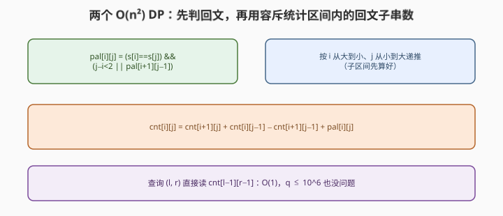
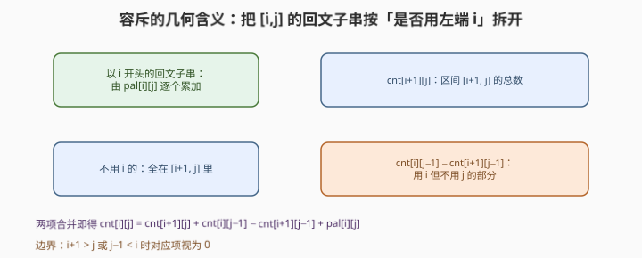

# Codeforces 245H 回文子串计数查询 题解

## 1. 题目概述

- **题目链接**：https://codeforces.com/problemset/problem/245/H
- **比赛来源**：CROC-MBTU 2012, Elimination Round (ACM-ICPC) · Problem H（UTC 2012-11-19）
- **难度**：1800
- **标签**：区间 DP、字符串
- **评测类型**：普通
- **限制**：时间 5 s / 内存 256 MB

**题意**：给一个长度 $|s|\le5000$ 的小写字符串和 $q\le10^6$ 次询问，每次给 $l\le r$，求 $s[l..r]$ 中有多少个**回文子串**（子串指连续的一段，单个字符也算回文）。按输入顺序输出答案。

**约束**：

- $n\le5000$：$O(n^2)$ 的区间 DP 是正解；$O(n^2)$ 的内存（$25\times10^6$ 个单元）也在 256 MB 之内。
- $q\le10^6$：每次询问必须 $O(1)$，不能现场扫区间（否则 $10^6\times5000$ 必超时）。
- 答案最大为 $\frac{n(n+1)}{2}=12\,502\,500$，`int` 够用。

## 2. 示例与观察

官方样例一：

```text
输入：
caaaba
5
1 1
1 4
2 3
4 6
4 5

输出：
1
7
3
4
2
```

**样例演算**（$s=\texttt{caaaba}$，下标 1..6）：

- $[1,1]$：`c` → 1 个 ✓
- $[1,4]$：`caaa` 的回文子串：`c`、`a`(位置2)、`a`(3)、`a`(4)、`aa`(2-3)、`aa`(3-4)、`aaa`(2-4) → 7 个 ✓
- $[2,3]$：`aa`：`a`、`a`、`aa` → 3 ✓
- $[4,6]$：`aba`：`a`、`b`、`a`、`aba` → 4 ✓
- $[4,5]$：`ab`：`a`、`b` → 2 ✓

**观察一**：$[l,r]$ 与 $[l+1,r]$、$[l,r-1]$、$[l+1,r-1]$ 的答案之间有容斥关系——只差「同时用到两端」的那一个子串，也就是 $s[l..r]$ 本身。

**观察二**：$s[i..j]$ 是否回文可以由 $s[i+1..j-1]$ 是否回文递推：$s[i..j]$ 回文 $\iff s[i]=s[j]$ 且（长度 $\le2$ 或 $s[i+1..j-1]$ 回文）。

## 3. 解题思路

### 3.1 朴素做法与瓶颈

每次询问枚举区间内所有子串、逐个判回文：单次 $O((r-l)^2)$，总共最坏 $10^6\times2.5\times10^7$，完全不可行。即使只判回文用 DP，$q$ 次查询也要 $O(qn^2)$。

### 3.2 核心观察：两次区间 DP



**第一步**：回文判定表

$$\text{pal}[i][j]=\big(s[i]=s[j]\big)\ \wedge\ \big(j-i<2\ \vee\ \text{pal}[i+1][j-1]\big).$$

按 $i$ 从大到小、$j$ 从小到大递推，保证子区间先算好。实现上只需保留「上一行」和「当前行」，可以省掉一整张表。

**第二步**：计数表

$$\text{cnt}[i][j]=\text{cnt}[i+1][j]+\text{cnt}[i][j-1]-\text{cnt}[i+1][j-1]+\text{pal}[i][j].$$

含义见下图。查询 $(l,r)$ 直接读 $\text{cnt}[l][r]$。



### 3.3 样例走查

以查询 $[1,4]$（$s[1..4]=\texttt{caaa}$）为例，先看需要的三个子区间的答案：

- $\text{cnt}[2][4]$（`aaa`）：`a`、`a`、`a`、`aa`、`aa`、`aaa`，共 **6**；
- $\text{cnt}[1][3]$（`caa`）：`c`、`a`、`a`、`aa`，共 **4**；
- $\text{cnt}[2][3]$（`aa`）：`a`、`a`、`aa`，共 **3**；
- $\text{pal}[1][4]$：`caaa` 首尾 `c`、`a` 不同，**0**。

代入容斥式：

$$\text{cnt}[1][4]=6+4-3+0=7,$$

与官方输出 `7` 一致。再看 $[4,6]$（`aba`）：$\text{cnt}[5][6]=2$（`b`,`a`）、$\text{cnt}[4][5]=2$（`a`,`b`）、$\text{cnt}[5][5]=1$、$\text{pal}[4][6]=1$（`aba`），于是 $2+2-1+1=4$ ✓。

## 4. 正确性证明

**引理 1（回文判定）**：按上式递推得到的 $\text{pal}[i][j]$ 为真当且仅当 $s[i..j]$ 是回文。

**证明**：对区间长度 $L=j-i+1$ 归纳。$L=1$ 时必为回文，式子给出 `true`；$L=2$ 时回文 $\iff s[i]=s[j]$，式子同样如此（$j-i=1<2$）。$L\ge3$ 时，$s[i..j]$ 回文 $\iff s[i]=s[j]$ 且 $s[i+1..j-1]$ 回文，由归纳假设后者即 $\text{pal}[i+1][j-1]$。∎

**引理 2（容斥分解）**：设 $A$ 为 $s[i+1..j]$ 中回文子串的集合、$B$ 为 $s[i..j-1]$ 中的，则
$$A\cup B=\{\text{$s[i..j]$ 的全部回文子串}\}\setminus\{[i,j]\text{ 本身（若它是回文）}\},\qquad A\cap B=\{s[i+1..j-1]\text{ 的回文子串}\}.$$

**证明**：任何子串要么左端点 $\ge i+1$（属于 $A$），要么左端点 $=i$（此时若右端点 $\le j-1$ 则属于 $B$，若右端点 $=j$ 则它就是 $[i,j]$）。故 $A\cup B$ 恰为全部回文子串去掉 $[i,j]$。交集：一个子串同时属于 $A$ 与 $B$ $\iff$ 左端点 $\ge i+1$ 且右端点 $\le j-1$ $\iff$ 是 $[i+1,j-1]$ 的子串。∎

**定理**：$\text{cnt}[i][j]$ 等于 $s[i..j]$ 的回文子串个数。

**证明**：对长度归纳。由引理 2，
$$\text{cnt}[i][j]=|A\cup B|+\text{pal}[i][j]=\big(|A|+|B|-|A\cap B|\big)+\text{pal}[i][j],$$
而 $|A|=\text{cnt}[i+1][j]$、$|B|=\text{cnt}[i][j-1]$、$|A\cap B|=\text{cnt}[i+1][j-1]$（归纳假设），$\text{pal}[i][j]$ 由引理 1 正确。边界（$i=j$ 等）由递推式中的「越界项取 0」处理，归纳成立。∎

**推论**：查询 $(l,r)$ 的答案是 $\text{cnt}[l][r]$，故 $O(1)$ 回答。

**证明**：直接由定理。∎

## 5. 复杂度分析

- **时间**：回文表 $O(n^2)$、计数表 $O(n^2)$，共约 $2\times25\times10^6=5\times10^7$ 次运算；查询 $O(1)$ 各，共 $O(q)$。$n=5000,q=10^6$ 实测 **0.21 s**。
- **空间**：计数表 $n^2$ 个 `int` $=100$ MB；回文表只保留两行（$O(n)$）。
- **实测**：最大数据（$n=5000$、$q=10^6$）峰值内存约 $106$ MB，限时 5 s / 内存 256 MB，均有余量。

## 6. 参考代码

### C++17

```cpp
#include <bits/stdc++.h>
using namespace std;

static char s[5005];
static vector<char> palPrev, palCur;
static vector<int> cnt;   // cnt[i*n+j]

int main() {
    if (scanf("%s", s) != 1) return 0;
    int n = (int)strlen(s);
    int q;
    scanf("%d", &q);
    palPrev.assign(n + 1, 0);
    palCur.assign(n + 1, 0);
    cnt.assign((size_t)n * n, 0);
    for (int i = n - 1; i >= 0; --i) {
        for (int j = i; j < n; ++j)
            palCur[j] = (s[i] == s[j]) && (j - i < 2 || palPrev[j - 1]);
        int* row = &cnt[(size_t)i * n];
        const int* nextRow = (i + 1 < n) ? &cnt[(size_t)(i + 1) * n] : nullptr;
        for (int j = i; j < n; ++j) {
            long long v = palCur[j];
            if (i + 1 <= j) v += nextRow[j];
            if (j - 1 >= i) v += row[j - 1];
            if (i + 1 <= j - 1) v -= nextRow[j - 1];
            row[j] = (int)v;
        }
        palPrev.swap(palCur);
    }
    string out;
    out.reserve((size_t)q * 8);
    char tmp[16];
    for (int k = 0; k < q; ++k) {
        int l, r;
        scanf("%d %d", &l, &r);
        int v = cnt[(size_t)(l - 1) * n + (r - 1)];
        int len = 0;
        if (v == 0) tmp[len++] = '0';
        while (v > 0) { tmp[len++] = char('0' + v % 10); v /= 10; }
        while (len > 0) out.push_back(tmp[--len]);
        out.push_back(k + 1 == q ? '\n' : ' ');
    }
    fwrite(out.data(), 1, out.size(), stdout);
    return 0;
}
```

### Python3

```python
import sys


def main() -> None:
    data = sys.stdin.buffer.read().split()
    if not data:
        return
    s = data[0].decode()
    n = len(s)
    q = int(data[1])
    pal = [[False] * n for _ in range(n)]
    cnt = [[0] * n for _ in range(n)]
    for i in range(n - 1, -1, -1):
        for j in range(i, n):
            pal[i][j] = (s[i] == s[j]) and (j - i < 2 or pal[i + 1][j - 1])
    for i in range(n - 1, -1, -1):
        for j in range(i, n):
            v = 1 if pal[i][j] else 0
            if i + 1 <= j:
                v += cnt[i + 1][j]
            if j - 1 >= i:
                v += cnt[i][j - 1]
            if i + 1 <= j - 1:
                v -= cnt[i + 1][j - 1]
            cnt[i][j] = v
    out = []
    p = 2
    for _ in range(q):
        l, r = int(data[p]), int(data[p + 1])
        p += 2
        out.append(str(cnt[l - 1][r - 1]))
    sys.stdout.write(' '.join(out) + '\n')


main()
```

Python 版在 $n=5000$ 时内存与时间都吃紧（$25\times10^6$ 个嵌套列表），**正式提交请用 C++**；样例规模下通过。

## 7. 边界情况与易错点

1. **递推顺序**：$\text{pal}[i][j]$ 依赖 $\text{pal}[i+1][j-1]$，所以 $i$ 必须从大到小；$\text{cnt}$ 依赖 $(i+1,j)$、$(i,j-1)$、$(i+1,j-1)$，同样要求 $i$ 递减、$j$ 递增。
2. **越界项取 0**：$i+1>j$、$j-1<i$、$i+1>j-1$ 时对应项视为 0，不能读脏数据。
3. **$l=r$**：单个字符是回文，答案 1；递推式给出 $0+0-0+1=1$ ✓。
4. **长度 2 的边界**：$j-i=1<2$，只看 $s[i]=s[j]$，不要访问 $\text{pal}[i+1][j-1]=\text{pal}[j][i-1]$（非法）。
5. **内存**：$n^2$ 个 `int` 是 100 MB，必须用连续的扁平数组（`vector<int>` 一次分配），不要用 `vector<vector<int>>`（每个内层 vector 有额外开销，容易超内存/超时）。
6. **$q=10^6$ 的 I/O**：逐行 `printf` 会偏慢，建议累积到字符串里一次 `fwrite`；读入用 `scanf` 或整体 `fread`。
7. **多测**：单组数据。
8. **`char` 数组大小**：$n\le5000$，`char s[5005]` 足够，但别写成 `s[5000]`（要留 `\0`）。

## 8. 验证记录

- **编译环境与命令**：本机无 GNU `g++`（`g++` 实为 Apple clang），`verify_solution.py` 自动回退到 `clang++ -std=c++17 -O2 -I codeforces/tools/include`；Python 3.9.6。
  - `python3 codeforces/tools/verify_solution.py codeforces/contests/0101-0203/245/H_回文子串计数查询.md` → `CF245H: samples 1 / C++ 编译 OK, 样例 1/1 / Python 语法 OK, 样例 1/1`
  - `python3 codeforces/tools/check.py codeforces/contests/0101-0203/245` → `checked 8, fail 0`
  - `python3 codeforces/tools/check_samples.py --only 0101-0203/245` → 0 问题
  - `node codeforces/tools/katex_check.cjs codeforces/contests/0101-0203/245` → 0 错误
- **官方样例**：1 / 1 通过（`1 7 3 4 2`）。
- **暴力对拍**：独立暴力 = 对每次询问枚举区间内所有子串并直接判断 `t == t[::-1]`（$O((r-l)^2)$ 每问，与 DP 完全不同的写法）。随机 **230 组**（$n\in[1,22]$，字母表在 $\{a\},\{a,b\},\{a,b,c\}$ 中随机以制造大量回文，$q\in[1,8]$），C++、Python、暴力三者一致，0 组不符。
- **最大约束性能**：$n=5000$、$q=10^6$（随机 `a`/`b` 串 + 随机区间）C++ 端到端 **0.21 s**、峰值内存 **106 MB**（限时 5 s / 256 MB）。
- **图片校验**：`cf245h_dp.svg`、`cf245h_count.svg` 通过 `xml.etree.ElementTree.parse`，含 `feTurbulence` 与手写字体，文字在 `viewBox` 内。
- **复核状态**：verified。

## 相关题目与扩展

- [Codeforces 245G Suggested Friends](https://codeforces.com/problemset/problem/245/G)：同场 G 题。
- [Codeforces 245F Log Stream Analysis](https://codeforces.com/problemset/problem/245/F)：同场 F 题。
- [LeetCode 5. 最长回文子串](https://leetcode.cn/problems/longest-palindromic-substring/)：同样的 $\text{pal}[i][j]$ 递推。
- [LeetCode 647. 回文子串](https://leetcode.cn/problems/palindromic-substrings/)：本题在「单次询问整串」时的特例。

**延伸思考**：

1. **如果查询是「回文子串的不同字符串个数」**：不能再用区间计数，需要回文自动机（Eertree）+ 树上差分，$O(n\log n+q)$。
2. **如果要求在线回答「末尾加字符后整串的回文数」**：可以用 Manacher + 增量更新，或用回文自动机在线维护。
3. **如果内存限制降到 64 MB**：$100$ MB 的计数表放不下，需要改成「离线 + 莫队」或「分块预处理 + $O(\sqrt n)$ 查询」。
4. **如果 $n$ 涨到 $10^5$**：$O(n^2)$ 不可行，需要回文自动机 / Manacher + 树状数组等更高级的结构。
