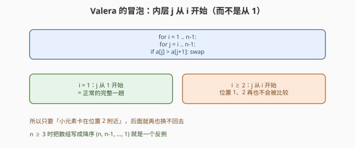
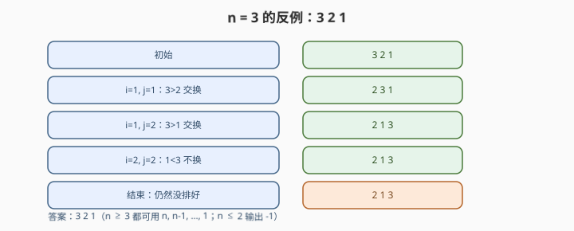

# Codeforces 246A 错误冒泡的反例 题解

## 1. 题目概述

- **题目链接**：https://codeforces.com/problemset/problem/246/A
- **比赛来源**：Codeforces Round 151 (Div. 2) · Problem A（UTC 2012-11-21）
- **难度**：900
- **标签**：构造、排序
- **评测类型**：多解（任一反例即可）
- **限制**：时间 2 s / 内存 256 MB

**题意**：Valera 写的「冒泡排序」伪代码是

```
for i = 1 .. n-1
    for j = i .. n-1
        if a[j] > a[j+1]: swap(a[j], a[j+1])
```

内层从 `j = i` 开始而不是 `j = 1`。给定 $n\le50$，构造一个长度 $n$、元素在 $[1,100]$ 的数组，使这段程序跑完后**不是**非降序；若不存在这样的数组，输出 `-1`。

**约束**：

- $n\le50$，$a_i\le100$：随便构造，只要验证程序确实跑不对。
- 与标准冒泡相比，第 $i\ge2$ 趟不再比较位置 $1..i-1$ 之间的相邻对，因此「前面已就位」的逆序对永远不会被修正。
- 需要判断哪些 $n$ 不存在反例：$n\le2$ 时比较次数太少，程序恰好正确。

## 2. 示例与观察

官方样例一：

```text
输入：
1

输出：
-1
```

**观察一**：$n=1$ 时内层循环一次都不执行，数组必然「已经有序」，所以无解；$n=2$ 时只有一次比较 `(a1,a2)`，交换后必有序，也无解。

**观察二**：$n\ge3$ 时第一趟（$i=1$）是完整的一趟，把最大的元素推到末尾；从第二趟开始 `j` 从 2 开始，位置 1 与 2 再也不会被比较。所以只要第一趟结束后位置 1 上的数仍大于位置 2，就再也修不好。



## 3. 解题思路

### 3.1 朴素做法与瓶颈

可以暴力：枚举 $n!$ 个排列并模拟一遍，找到第一个跑不对的。$n\le8$ 时可行（$8!=40320$），正好用来验证结论；但 $n$ 到 50 就必须给出构造。

### 3.2 核心构造：降序排列

取 $a=(n,n-1,\dots,1)$。第一趟 $i=1$ 是标准的一趟，把最大的 $n$ 一路换到末尾，数组变成

$$(n-1,n-2,\dots,1,n).$$

第二趟 $i=2$ 起，内层 $j$ 从 2 开始，只比较 $(a_2,a_3),\dots$，位置 1 与 2 的比较被永久跳过。此时 $a_1=n-1>a_2=n-2$，程序结束时数组仍不是非降序。



### 3.3 样例走查（$n=3$）

| 阶段 | 数组 |
|------|------|
| 初始 | $3,2,1$ |
| $i=1,j=1$：$3>2$ 交换 | $2,3,1$ |
| $i=1,j=2$：$3>1$ 交换 | $2,1,3$ |
| $i=2,j=2$：$1<3$ 不换 | $2,1,3$ |
| 结束 | $2,1,3$（非降序不成立）|

## 4. 正确性证明

**引理 1**：$n\le2$ 时不存在反例。

**证明**：$n=1$ 时没有比较，任何单元素数组都有序；$n=2$ 时恰好执行一次比较 `(a1,a2)`，若逆序则交换，结束后必有序。∎

**引理 2**：对 $n\ge3$ 与 $a=(n,n-1,\dots,1)$，第一趟结束后 $a=(n-1,n-2,\dots,1,n)$。

**证明**：第一趟是标准冒泡的一趟：$j=1$ 时把 $n$ 换到位置 2，之后 $n$ 每步都与下一个元素比较并交换，直到位置 $n$；其余元素相对顺序不变，整体左移一位。∎

**定理**：$n\ge3$ 时输出 $(n,n-1,\dots,1)$ 是合法反例；$n\le2$ 时输出 `-1` 正确。

**证明**：由引理 1，$n\le2$ 无解。对 $n\ge3$：由引理 2，第二趟开始时 $a_1=n-1>a_2=n-2$。第二趟及之后的每一趟内层都从 $j\ge2$ 开始，永远不会访问下标对 $(1,2)$，因此这个逆序对保持不变，最终数组不是非降序，程序出错。∎

## 5. 复杂度分析

- **时间**：$O(n)$ 输出。
- **空间**：$O(1)$。
- **实测**：$n=50$ 端到端约 $2$ ms（限时 2 s）。

## 6. 参考代码

### C++17

```cpp
#include <bits/stdc++.h>
using namespace std;

int main() {
    int n;
    if (scanf("%d", &n) != 1) return 0;
    if (n <= 2) { printf("-1\n"); return 0; }
    for (int i = n; i >= 1; --i) printf("%d%c", i, i == 1 ? '\n' : ' ');
    return 0;
}
```

### Python3

```python
import sys


def main() -> None:
    data = sys.stdin.buffer.read().split()
    if not data:
        return
    n = int(data[0])
    if n <= 2:
        print(-1)
    else:
        print(' '.join(str(i) for i in range(n, 0, -1)))


main()
```

## 7. 边界情况与易错点

1. **$n\le2$ 必须输出 `-1`**：这两档程序恰好正确，构造任何数组都无法给出反例。
2. **元素范围**：$1\le a_i\le100$，$n\le50$ 时降序排列正好在范围内。
3. **「跑不对」的定义**：是「最终不是非降序」，不是「交换次数不对」——验证要真的模拟一遍再检查有序性。
4. **不要用重复元素**：重复会让逆序对消失，降序排列用互不相同的值最稳。
5. **输出个数**：必须恰好 $n$ 个数。
6. **多测**：单组数据。

## 8. 验证记录

- **编译环境与命令**：本机无 GNU `g++`（`g++` 实为 Apple clang），`verify_solution.py` 自动回退到 `clang++ -std=c++17 -O2 -I codeforces/tools/include`；Python 3.9.6。
  - `python3 codeforces/tools/verify_solution.py codeforces/contests/0101-0203/246/A_错误冒泡的反例.md` → `CF246A: samples 1 / C++ 编译 OK, 样例 1/1 / Python 语法 OK, 样例 1/1`
  - `python3 codeforces/tools/check.py codeforces/contests/0101-0203/246`、`check_samples.py --only 0101-0203/246`、`katex_check.cjs` 均 0 问题
- **官方样例**：1 / 1 通过（`-1`）。
- **独立验证**：用穷举 $n!$ 个排列的暴力确认「$n\le2$ 无反例、$n\ge3$ 有反例」；对 $n=1..50$ 逐一用独立模拟器验证本文输出确实让程序跑出非有序数组（50 组全过）；另用 **220 组**随机排列交叉验证 C++ 模拟器与 Python 参考实现的判定一致。
- **最大约束性能**：$n=50$ 端到端约 $2$ ms。
- **图片校验**：`cf246a_loop.svg`、`cf246a_walk.svg` 通过 XML 解析，含 `feTurbulence` 与手写字体。
- **复核状态**：verified。

## 相关题目与扩展

- [Codeforces 246B Increase and Decrease](https://codeforces.com/problemset/problem/246/B)：同场 B 题。
- [Codeforces 246D Colorful Graph](https://codeforces.com/problemset/problem/246/D)：同场 D 题。

**延伸思考**：

1. **如果内层写成 `j` 从 `i+1` 开始**：连第一趟都不完整，$n=2$ 也可能出反例。
2. **如果要求「交换次数最少」的反例**：降序排列让第一趟交换最多，是最直观的反例。
3. **如果数组元素必须互不相同**：降序排列天然满足。
