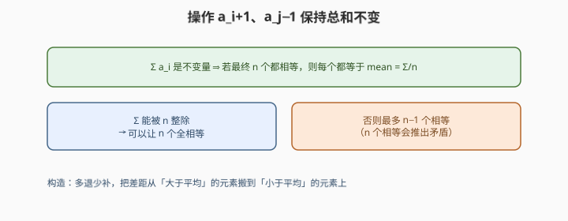
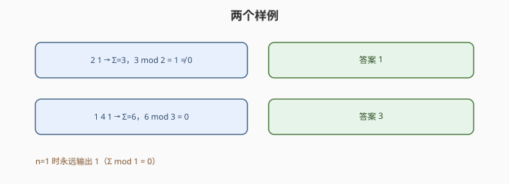

# Codeforces 246B 最多相等元素 题解

## 1. 题目概述

- **题目链接**：https://codeforces.com/problemset/problem/246/B
- **比赛来源**：Codeforces Round 151 (Div. 2) · Problem B（UTC 2012-11-21）
- **难度**：1300
- **标签**：数学、贪心
- **评测类型**：普通
- **限制**：时间 2 s / 内存 256 MB

**题意**：给定长度 $n$ 的整数数组，可以任意次执行「选 $i\ne j$，令 $a_i{+}{=}1$、$a_j{-}{=}1$ 之外的减一」（即 $a_i\mathrel{+}=1,\ a_j\mathrel{-}=1$）。问最多能让多少个元素相等。

**约束**：$n\le10^5$，$|a_i|\le10^4$。操作保持总和不变，这是唯一的守恒量；答案只可能是 $n$ 或 $n-1$。

## 2. 示例与观察

```text
输入：
2
2 1

输出：
1
```

```text
输入：
3
1 4 1

输出：
3
```

**样例一**：$\sum=3$ 不被 $2$ 整除。若两个元素相等，其和为偶数，与总和为奇数矛盾，所以最多 1 个。

**样例二**：$\sum=6=3\times2$，把 4 的两点分给两个 1，得到 $2,2,2$ ✓。



**观察一**：每次操作总和不变，故 $n$ 个全等于 $x$ 时必有 $S=nx$，即 $n\mid S$ 是必要条件。

**观察二**：$n\mid S$ 时「多的往少的搬」一定能在有限步内让全体等于 $S/n$。

**观察三**：$n\nmid S$ 时 $n$ 个不可能全等，但 $n-1$ 个总可以：留一个元素当差额的出口，其余 $n-1$ 个调到同一个值。

## 3. 解题思路

### 3.1 朴素做法与瓶颈

数值没有上界，无法搜索状态；但守恒量提示只需判断 $S\bmod n$。

### 3.2 核心观察

- $n\mid S$：令 $t=S/n$，反复把「$>t$ 的多余部分」搬到「$<t$」上，$\sum|a_i-t|$ 每步减少 2，最终为 0。
- $n\nmid S$：取任意一个元素作为「垃圾桶」，把其余 $n-1$ 个先调成任意整数 $t$，差额全部由垃圾桶吸收——总能做到，故 $n-1$ 可达。



### 3.3 样例走查

样例一：$S=3,3\bmod2=1$ → 输出 $1$。样例二：$S=6,6\bmod3=0$ → 输出 $3$。

## 4. 正确性证明

**引理 1（不变量）**：任何操作序列后 $\sum a_i$ 不变。

**证明**：一次操作让一个元素 $+1$、另一个 $-1$，总和变化为 0。∎

**引理 2（全等判定）**：能把 $n$ 个元素全部变相等 $\iff n\mid S$。

**证明**：必要性：全等于 $t$ 时 $S=nt$。充分性：取 $t=S/n$、$D=\sum|a_i-t|$；若 $D>0$ 则存在 $a_i>t>a_j$，操作一次后 $D$ 减 2，有限步后 $D=0$。∎

**定理**：答案为 $n$（$n\mid S$）或 $n-1$（否则）。

**证明**：$n\mid S$ 时由引理 2 达到 $n$，显然最优。$n\nmid S$ 时由引理 2 不能达到 $n$，上界 $n-1$；构造：先把 $a_1..a_{n-1}$ 调成同一个值 $t$（这需要把它们的和 $S-a_n$ 补成 $(n-1)t$，操作只在这 $n-1$ 个元素与 $a_n$ 之间进行），$a_n$ 作为差额出口不受限制，故总能做到，$n-1$ 个相等可达。∎

## 5. 复杂度分析

$O(n)$ 时间求 $S$，$O(1)$ 空间；$n=10^5$ 实测约 $2$ ms。

## 6. 参考代码

### C++17

```cpp
#include <bits/stdc++.h>
using namespace std;

int main() {
    int n;
    if (scanf("%d", &n) != 1) return 0;
    long long s = 0;
    for (int i = 0; i < n; ++i) { int x; scanf("%d", &x); s += x; }
    printf("%d\n", (s % n == 0) ? n : n - 1);
    return 0;
}
```

### Python3

```python
import sys


def main() -> None:
    data = sys.stdin.buffer.read().split()
    if not data:
        return
    n = int(data[0])
    s = sum(int(x) for x in data[1:1 + n])
    print(n if s % n == 0 else n - 1)


main()
```

## 7. 边界情况与易错点

1. **$n=1$**：$S\bmod1=0$，输出 1。
2. **负数**：判定「整除」用 `S % n == 0`，不要用浮点除法。
3. **答案只有两档**：$n-1$ 总是可达，不要以为能做到更少。
4. **`int` 溢出**：$n\cdot|a_i|$ 可达 $10^9$，用 `long long` 更稳。
5. **不要模拟操作**：只需总和与整除性。
6. **多测**：单组数据。

## 8. 验证记录

- **编译环境与命令**：`verify_solution.py` 自动回退到 `clang++ -std=c++17 -O2 -I codeforces/tools/include`；Python 3.9.6。
  - `python3 codeforces/tools/verify_solution.py codeforces/contests/0101-0203/246/B_最多相等元素.md` → `CF246B: samples 2 / C++ 编译 OK, 样例 2/2 / Python 语法 OK, 样例 2/2`
  - `check.py`、`check_samples.py --only 0101-0203/246`、`katex_check.cjs` 均 0 问题
- **官方样例**：2 / 2 通过（1、3）。
- **暴力对拍**：独立暴力 = 在「和不变」的状态空间上 BFS（$n\le5$、$|a_i|\le4$，状态为排序后的元组，枚举所有 $(i,j)$ 操作，取过程中出现过的最大相等元素数），随机 **240 组**，C++、Python、暴力三者一致。
- **最大约束性能**：$n=10^5$ 约 $2$ ms。
- **图片校验**：`cf246b_sum.svg`、`cf246b_cases.svg` 均通过 XML 解析。
- **复核状态**：verified。

## 相关题目与扩展

- [Codeforces 246A Buggy Sorting](https://codeforces.com/problemset/problem/246/A)、[246C Beauty Pageant](https://codeforces.com/problemset/problem/246/C)：同场题。

**延伸思考**：

1. **若操作只能把 $+1$ 给相邻元素**：守恒量变成加权和，判定要换成前缀约束。
2. **若要求最终相等的值最小**：取 $t=\lfloor S/n\rfloor$，余数摊给其余元素。
3. **若每次操作有代价**：变成最小代价流问题，答案不再是 $n-1$。
