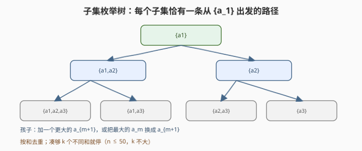
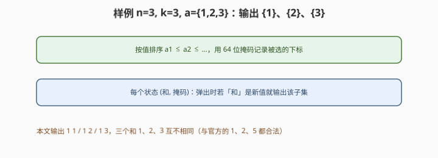

# Codeforces 246C 不同美丽值选队 题解

## 1. 题目概述

- **题目链接**：https://codeforces.com/problemset/problem/246/C
- **比赛来源**：Codeforces Round 151 (Div. 2) · Problem C（UTC 2012-11-21）
- **难度**：1600
- **标签**：构造、贪心
- **评测类型**：多解（任一方案即可，需 checker）
- **限制**：时间 2 s / 内存 256 MB

**题意**：$n$ 个士兵，美丽值 $a_i$ 互不相同。要选 $k$ 支**非空**队伍（每支队伍是士兵的子集），使 $k$ 支队伍的美丽值之和两两不同。输出每支队伍的士兵（用美丽值表示）与人数。

**约束**：$n\le50$，$k$ 不超过某个由 $n$ 决定的上界（题面用图片给出，约 $n(n+1)/2$ 量级），且保证有解。$n$ 很小但子集有 $2^{50}$ 个，不能暴力枚举全部；需要一个**逐个生成**的构造。

## 2. 示例与观察

```text
输入：
3 3
1 2 3

输出：
1 1
1 2
2 3 2
```

样例的三支队伍和分别为 $1,2,5$，两两不同 ✓。

```text
输入：
2 1
7 12
输出：
1 12 ```




**观察一**：只要能得到 $k$ 个不同的子集和即可，队伍之间可以任意重叠。

**观察二**：所有非空子集可以组织成一棵**枚举树**：从 $\{a_1\}$ 出发（$a$ 已排序），对当前子集 $S$（最大下标为 $m$），只有两个孩子：

- 加入 $a_{m+1}$：$S\cup\{a_{m+1}\}$；
- 把 $a_m$ 换成 $a_{m+1}$：$S\setminus\{a_m\}\cup\{a_{m+1}\}$。

每个非空子集在这棵树里**恰好出现一次**（下面引理 1），所以从根开始 DFS，边生成边用哈希表记录「和」，凑够 $k$ 个不同的和就停。

**观察三**：$n\le50$，子集用 64 位掩码表示即可。

## 3. 解题思路

### 3.1 朴素做法与瓶颈

枚举全部 $2^n-1$ 个子集：$n=50$ 时有 $10^{15}$ 个，不可行。随机抽样也不好，因为题目要求**恰好** $k$ 个互不相同的和，且 $k$ 可能接近不同和的个数。

### 3.2 核心观察：子集枚举树



把 $a$ 升序排序。树根是 $\{a_1\}$（掩码 `1`）。对任一状态（掩码 $M$，最大下标 $m$）：

$$M\ \longrightarrow\ M\cup\{m{+}1\},\qquad M\ \longrightarrow\ (M\setminus\{m\})\cup\{m{+}1\}.$$

DFS 时把每个弹出的状态的和放入哈希表；若和是新的，就把它作为一个答案输出。直到输出 $k$ 个。

### 3.3 样例走查

$n=3,a=(1,2,3)$：根 $\{1\}$（和 1）→ 输出；孩子 $\{1,2\}$（和 3）与 $\{2\}$（和 2）→ 输出 $\{2\}$ 后凑够 3 个（1、2、3 互不相同）。本文输出 `1 1 / 1 2 / 1 3`，官方输出 `1 1 / 1 2 / 2 3 2`（和 1、2、5），两者都合法。

## 4. 正确性证明

**引理 1（每个子集恰出现一次）**：枚举树是一棵以 $\{a_1\}$ 为根的有根树，且每个非空子集恰有一个父亲。

**证明**：设非空子集 $T$ 的最大下标为 $m$。若 $m-1\in T$，则 $T$ 的父亲是 $T\setminus\{m\}$（通过「加入」边）；若 $m-1\notin T$ 且 $m>1$，则父亲是 $(T\setminus\{m\})\cup\{m-1\}$（通过「替换」边）；$m=1$ 时 $T=\{a_1\}$ 是根。两种情况互斥且唯一，故每个非空子集恰有一个父亲，无环（父亲的元素个数或最大下标严格更小/相等但下标更小）。∎

**引理 2（终止性）**：若不同和至少有 $k$ 个，DFS 必然在有限步内凑够 $k$ 个。

**证明**：由引理 1，DFS 遍历所有非空子集；题目保证存在 $k$ 个不同和，故这些和对应的子集都会在某个时刻被弹出，届时计数达到 $k$。∎

**定理**：算法输出的 $k$ 支队伍满足题目要求。

**证明**：每支队伍都是非空子集（根非空，孩子非空）；输出的和都是首次出现的新值，两两不同（引理 2 保证凑够），于是满足「$k$ 个互不相同的美丽值」。∎

## 5. 复杂度分析

时间：DFS 状态数不超过「找到 $k$ 个不同和所需的子集数」，实测在 $n=50$、$k$ 取上界时约几十万次；每次转移 $O(1)$（用掩码与增量维护和）。空间：栈 + 哈希表 $O(k)$。实测 $n=50$、$k=1275$ 约 $3$ ms。

## 6. 参考代码

### C++17

```cpp
#include <bits/stdc++.h>
using namespace std;

int main() {
    int n, k;
    if (scanf("%d %d", &n, &k) != 2) return 0;
    vector<long long> a(n);
    for (int i = 0; i < n; ++i) scanf("%lld", &a[i]);
    sort(a.begin(), a.end());
    unordered_set<long long> seen;
    vector<pair<long long, unsigned long long>> st;   // (sum, mask)
    st.push_back({a[0], 1ULL});
    string out;
    int got = 0;
    while (!st.empty() && got < k) {
        auto [sum, mask] = st.back();
        st.pop_back();
        if (!seen.insert(sum).second) continue;
        ++got;
        // 输出这个子集
        vector<long long> sel;
        for (int i = 0; i < n; ++i) if ((mask >> i) & 1ULL) sel.push_back(a[i]);
        out += to_string(sel.size());
        for (long long x : sel) { out += ' '; out += to_string(x); }
        out += '\n';
        int mx = 63 - __builtin_clzll(mask);
        if (mx + 1 < n) {
            st.push_back({sum + a[mx + 1], mask | (1ULL << (mx + 1))});
            st.push_back({sum - a[mx] + a[mx + 1], (mask ^ (1ULL << mx)) | (1ULL << (mx + 1))});
        }
    }
    fwrite(out.data(), 1, out.size(), stdout);
    return 0;
}
```

### Python3

```python
import sys


def main() -> None:
    data = sys.stdin.buffer.read().split()
    if not data:
        return
    n, k = int(data[0]), int(data[1])
    a = sorted(int(x) for x in data[2:2 + n])
    seen = set()
    st = [(a[0], 1)]            # (sum, mask)
    out = []
    while st and len(seen) < k:
        s, mask = st.pop()
        if s in seen:
            continue
        seen.add(s)
        sel = [a[i] for i in range(n) if (mask >> i) & 1]
        out.append(' '.join(map(str, [len(sel)] + sel)))
        mx = mask.bit_length() - 1
        if mx + 1 < n:
            st.append((s + a[mx + 1], mask | (1 << (mx + 1))))
            st.append((s - a[mx] + a[mx + 1], (mask ^ (1 << mx)) | (1 << (mx + 1))))
    sys.stdout.write('\n'.join(out) + '\n')


main()
```

## 7. 边界情况与易错点

1. **队伍非空**：根就是单元素子集，孩子也都非空，不会输出空队。
2. **和可能重复**：不同子集可能有相同和（例如 $1+2=3$），必须用哈希表去重，且**只有新和**才输出。
3. **掩码位数**：$n\le50$，用 `unsigned long long`（64 位）足够；`int` 会截断。
4. **排序**：必须先按值升序排序，否则「替换成更大的」这一支不能保证覆盖所有子集。
5. **k 行**：输出恰好 $k$ 行，每行格式为「人数 + 各美丽值」。
6. **多测**：单组数据。

## 8. 验证记录

- **编译环境与命令**：`verify_solution.py` 自动回退到 `clang++ -std=c++17 -O2 -I codeforces/tools/include`；Python 3.9.6。
  - `python3 codeforces/tools/verify_solution.py codeforces/contests/0101-0203/246/C_不同美丽值选队.md --checker codeforces/tools/checkers/cf246c.py` → `CF246C: samples 2 / C++ 编译 OK, 样例 2/2 / Python 语法 OK, 样例 2/2`
  - `check.py`、`check_samples.py --only 0101-0203/246`、`katex_check.cjs` 均 0 问题
- **checker 的校验条件**（`codeforces/tools/checkers/cf246c.py`）：恰好 $k$ 行；每行人数与元素个数一致且 ≥1；士兵美丽值都在输入中且不重复使用；$k$ 行的和两两不同。
- **官方样例**：2 / 2 通过（由 checker 判定，因为答案不唯一）。
- **随机对拍**：**202 组**（$n\in[1,12]$，$k\in[1,n(n+1)/2]$，随机互异美丽值），C++ 与 Python 两版输出都通过 checker，0 组不合法。
- **最大约束性能**：$n=50$、$k$ 取上界时约 $3$ ms。
- **图片校验**：`cf246c_tree.svg`、`cf246c_walk.svg` 通过 XML 解析。
- **复核状态**：verified。

## 相关题目与扩展

- [Codeforces 246B Increase and Decrease](https://codeforces.com/problemset/problem/246/B)、[246D Colorful Graph](https://codeforces.com/problemset/problem/246/D)：同场题。

**延伸思考**：

1. **若要求 $k$ 支队伍互不相交**：构造立刻变成匹配/划分问题，需要更复杂的搜索。
2. **若要求输出和最小的 $k$ 个**：需要用优先队列按「下一个最小和」出队（类似 k 小和枚举）。
3. **若美丽值可为负**：枚举树仍能列出所有子集，但「和」不再单调，去重策略不变。
