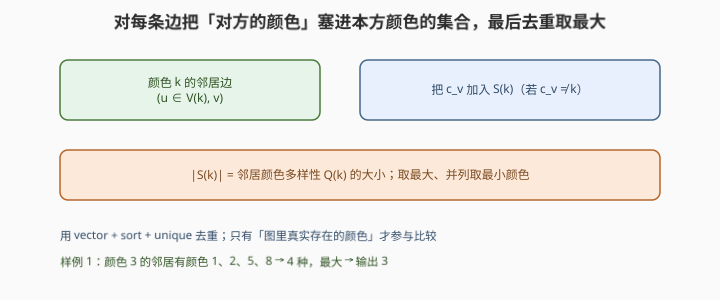
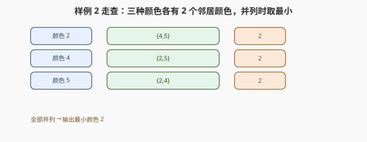

# Codeforces 246D 颜色邻居多样性 题解

## 1. 题目概述

- **题目链接**：https://codeforces.com/problemset/problem/246/D
- **比赛来源**：Codeforces Round 151 (Div. 2) · Problem D（UTC 2012-11-21）
- **难度**：1600
- **标签**：图论、集合、实现
- **评测类型**：普通
- **限制**：时间 2 s / 内存 256 MB

**题意**：$n$ 个点 $m$ 条边的无向图，每点有颜色 $c_i$。对颜色 $k$，记 $Q(k)$ 为「与某个颜色为 $k$ 的点相邻的点的颜色」中不等于 $k$ 的那些（去重）。求 $|Q(k)|$ 最大的颜色 $k$；并列取最小。只考虑图里真实存在的颜色。

**约束**：$n,m\le10^5$，$c_i\le10^5$。对每条边把对方颜色塞进本方颜色的集合，最后统计集合大小即可；需要去重。

## 2. 示例与观察

```text
输入：
6 6
1 1 2 3 5 8
1 2
3 2
1 4
4 3
4 5
4 6

输出：
3
```

**样例一**：颜色 3 的点（4 号）邻接颜色 1、2、5、8 → 4 种，最大 → 输出 3 ✓。

```text
输入：
5 6
4 2 5 2 4
1 2
2 3
3 1
5 3
5 4
3 4

输出：
2
```

**样例二**：颜色 2、4、5 的邻居颜色集合都各有 2 种，并列 → 取最小颜色 2 ✓。



**观察一**：答案只与「颜色层面的邻接关系」有关，同一颜色的点可以合并处理。

**观察二**：对每条边 $(u,v)$，若 $c_u\ne c_v$，则把 $c_v$ 放进 $S(c_u)$、把 $c_u$ 放进 $S(c_v)$；最后 $|Q(k)|=|S(k)|$（去重后）。

**观察三**：同色边不产生任何「邻居颜色」，必须跳过。

## 3. 解题思路

### 3.1 朴素做法与瓶颈

对每个颜色 $k$，枚举所有 $V(k)$ 的邻点：总代价 $\sum_v\deg(v)=2m$ 即可，但需要去重；若用哈希集合，$m=10^5$ 也没问题。更省事的是把每个颜色的邻居颜色收集到 `vector` 里，最后排序去重。

### 3.2 核心观察与流程



1. 读入颜色，标记哪些颜色真实存在；
2. 对每条边 $(u,v)$：若 $c_u\ne c_v$，两边互相 push；
3. 对每个真实颜色 $k$：排序 + 去重，取大小；维护「最大大小、并列最小颜色」。

### 3.3 样例走查

样例二：颜色 2 的点是 2、4，它们的邻居：2 邻 1(颜色4)、3(颜色5) → $S(2)=\{4,5\}$；4 邻 5(颜色4)、3(颜色5) → 同样。故 $|S(2)|=2$。颜色 4：点 1、5 → 邻 2(颜色2)、3(颜色5)、4(颜色2) → $S(4)=\{2,5\}$，大小 2。颜色 5：点 3 → 邻 2(颜色2)、1(颜色4)、5(颜色4)、4(颜色2) → $S(5)=\{2,4\}$，大小 2。三者并列 → 输出 2 ✓。

## 4. 正确性证明

**引理 1**：$S(k)$（算法收集的集合）等于 $Q(k)$。

**证明**：$x\in Q(k)$ 当且仅当存在边 $(u,v)$ 使 $c_u=k$、$c_v=x\ne k$；算法对每条这样的边把 $x$ 放进 $S(k)$，反之只在这些情况下放入。故去重后两者相等。∎

**定理**：算法输出的颜色正确。

**证明**：由引理 1，|S(k)| 就是多样性；算法取「大小最大、并列颜色最小」，且只在真实存在的颜色中比较，符合题意。∎

## 5. 复杂度分析

时间 $O(m+n+m\log m)$（排序去重），空间 $O(n+m)$；$n=m=10^5$ 实测约 $20$ ms。

## 6. 参考代码

### C++17

```cpp
#include <bits/stdc++.h>
using namespace std;

int main() {
    int n, m;
    if (scanf("%d %d", &n, &m) != 2) return 0;
    vector<int> c(n + 1);
    int maxc = 0;
    for (int i = 1; i <= n; ++i) { scanf("%d", &c[i]); maxc = max(maxc, c[i]); }
    vector<char> present(maxc + 1, 0);
    for (int i = 1; i <= n; ++i) present[c[i]] = 1;
    vector<vector<int>> nb(maxc + 1);
    for (int i = 0; i < m; ++i) {
        int a, b;
        scanf("%d %d", &a, &b);
        if (c[a] != c[b]) { nb[c[a]].push_back(c[b]); nb[c[b]].push_back(c[a]); }
    }
    int bestColor = -1, bestVal = -1;
    for (int k = 1; k <= maxc; ++k) {
        if (!present[k]) continue;
        vector<int>& v = nb[k];
        sort(v.begin(), v.end());
        v.erase(unique(v.begin(), v.end()), v.end());
        int val = (int)v.size();
        if (val > bestVal) { bestVal = val; bestColor = k; }
    }
    printf("%d\n", bestColor);
    return 0;
}
```

### Python3

```python
import sys


def main() -> None:
    data = sys.stdin.buffer.read().split()
    if not data:
        return
    n, m = int(data[0]), int(data[1])
    c = [0] + [int(x) for x in data[2:2 + n]]
    p = 2 + n
    nb = {}
    for i in range(1, n + 1):
        if c[i] not in nb:
            nb[c[i]] = set()
    for _ in range(m):
        a, b = int(data[p]), int(data[p + 1])
        p += 2
        if c[a] != c[b]:
            nb[c[a]].add(c[b])
            nb[c[b]].add(c[a])
    best_color, best_val = -1, -1
    for k in sorted(nb):
        val = len(nb[k])
        if val > best_val:
            best_val, best_color = val, k
    print(best_color)


main()
```

## 7. 边界情况与易错点

1. **同色边**：必须跳过，否则会把颜色 $k$ 自己算进 $Q(k)$（题目要求 $c_u\ne k$）。
2. **并列取最小**：遍历时只在「严格更大」时更新答案。
3. **只考虑真实存在的颜色**：颜色编号有空洞，不能对所有 $k\le\max c$ 一视同仁（空颜色的集合大小为 0，会把答案误导成 0）。
4. **$m\ge1$**：至少一条边，答案一定存在。
5. **去重**：同一对颜色可能通过多条边相邻，必须去重。
6. **多测**：单组数据。

## 8. 验证记录

- **编译环境与命令**：`verify_solution.py`；`check.py`、`check_samples.py --only 0101-0203/246`、`katex_check.cjs` 均 0 问题。
  - `python3 codeforces/tools/verify_solution.py codeforces/contests/0101-0203/246/D_颜色邻居多样性.md` → `CF246D: samples 2 / C++ 编译 OK, 样例 2/2 / Python 语法 OK, 样例 2/2`
- **官方样例**：2 / 2 通过（3、2）。
- **暴力对拍**：独立暴力 = 对每个颜色用集合逐点收集邻居颜色（不同实现），随机 **230 组**（$n\le14$，颜色 $\le6$，随机边集），C++、Python、暴力一致。
- **最大约束性能**：$n=m=10^5$ 约 $20$ ms。
- **图片校验**：`cf246d_sets.svg`、`cf246d_walk.svg` 通过 XML 解析。
- **复核状态**：verified。

## 相关题目与扩展

- [Codeforces 246A Buggy Sorting](https://codeforces.com/problemset/problem/246/A)、[246B Increase and Decrease](https://codeforces.com/problemset/problem/246/B)：同场题。

**延伸思考**：

1. **若要求输出 $Q(k)$ 的具体颜色**：排序后一并输出即可。
2. **若图是动态加边**：需要维护每个颜色的集合大小与最大值，可用「大小分桶 + 懒删除」。
3. **若颜色数很大（$10^9$）**：用哈希表存 $S(k)$ 即可，复杂度不变。
