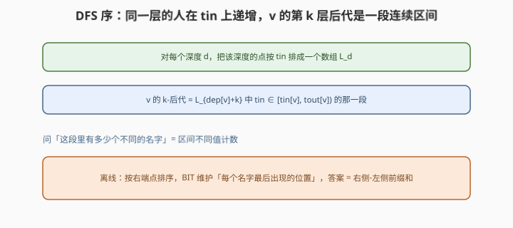
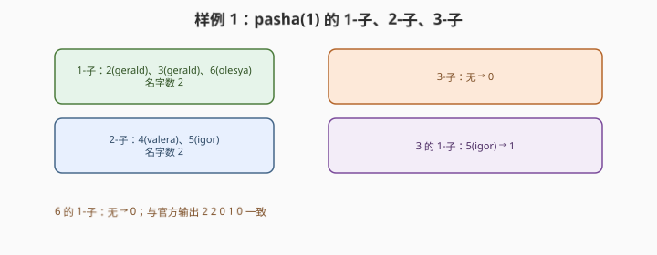

# Codeforces 246E 后代名字去重查询 题解

## 1. 题目概述

- **题目链接**：https://codeforces.com/problemset/problem/246/E
- **比赛来源**：Codeforces Round 151 (Div. 2) · Problem E（UTC 2012-11-21）
- **难度**：2400
- **标签**：树、DFS 序、离线、树状数组
- **评测类型**：普通
- **限制**：时间 3 s / 内存 256 MB

**题意**：森林（每人至多一个父亲），每人有一个名字（可重名）。$m$ 次询问 $(v,k)$：求 $v$ 的所有 $k$-后代（与 $v$ 距离恰为 $k$ 的后代）中**不同名字**的个数。

**约束**：$n,m\le10^5$。每次询问不能暴力遍历子树（最坏 $O(nm)$），需要 $O((n+m)\log n)$ 的预处理 + 离线。

## 2. 示例与观察

```text
输入：
6
pasha 0
gerald 1
gerald 1
valera 2
igor 3
olesya 1
5
1 1
1 2
1 3
3 1
6 1

输出：
2
2
0
1
0
```

```text
输入：
6
valera 0
valera 1
valera 1
gerald 0
valera 4
kolya 4
7
1 1
1 2
2 1
2 2
4 1
5 1
6 1
输出：
1
0
0
0
2
0
0```

**样例演算**：1 的 1-后代是 2(gerald)、3(gerald)、6(olesya) → 2 个不同名字 ✓；1 的 2-后代是 4(valera)、5(igor) → 2 ✓；1 的 3-后代没有 → 0 ✓；3 的 1-后代是 5(igor) → 1 ✓；6 的 1-后代没有 → 0 ✓。



**观察一**：$k$-后代 = 深度恰为 $\text{dep}[v]+k$ 且落在 $v$ 子树内的点。

**观察二**：按深度把点分桶，每个桶内按 DFS 入序 `tin` 排序；则「$v$ 的 $k$-后代」恰好是第 $\text{dep}[v]+k$ 桶里 `tin` 落在 $[tin_v, tout_v)$ 的**连续一段**。

**观察三**：于是问题变成：若干个「数组上区间内不同值的个数」查询，可以离线：按右端点排序 + 树状数组维护「每个值最后一次出现的位置」。

## 3. 解题思路

### 3.1 朴素做法与瓶颈

对每个询问遍历子树收集该深度的点再数不同名字：最坏 $O(n)$ 每问。

### 3.2 核心观察与流程



1. 迭代 DFS：算 `tin[v]`（时间戳）、`tout[v]`（子树结束的时间戳）、`dep[v]`；同时把点按深度压入 `by_depth[dep[v]]`（DFS 顺序即 `tin` 递增）。
2. 对询问 $(v,k)$：$d=\text{dep}[v]+k$；若 $d$ 超过最大深度 → 答案 0；否则在 `by_depth[d]` 上二分出 $[L,R]$（`tin` 在 $[tin_v,tout_v)$ 内），把 $(L,R,\text{询问编号})$ 挂到深度 $d$ 上。
3. 对每个深度：把该深度的询问按 $R$ 排序，用一个 BIT 扫描该深度的序列，维护「每个名字最后一次出现的位置」：遇到位置 $p$ 时，若该名字上次在 $p'$，在 BIT 上 $-1$，再在 $p$ 上 $+1$；然后回答所有 $R=p$ 的询问：$\text{sum}(R)-\text{sum}(L-1)$。

### 3.3 样例走查

样例一：深度 1 的点是 2(gerald)、3(gerald)、6(olesya)（按 tin 顺序），询问 $(1,1)$ 对应整段 → 不同名字 2 ✓；深度 2 的点是 4(valera)、5(igor) → 询问 $(1,2)$ 得 2 ✓；深度 3 无点 → 0 ✓。

## 4. 正确性证明

**引理 1（区间化）**：对任意 $v,k$，$v$ 的 $k$-后代在 `by_depth[dep[v]+k]` 中恰好是下标连续的一段。

**证明**：DFS 序下子树对应 `tin` 的连续区间 $[tin_v,tout_v)$；`by_depth[d]` 按 `tin` 升序排列，故其中 `tin` 落在该区间的元素构成连续段。$v$ 的 $k$-后代 $\iff$ 深度为 $\text{dep}[v]+k$ 且在 $v$ 子树内，故正是这段。∎

**引理 2（离线去重正确）**：对固定深度，BIT 在每个右端点 $R$ 处，第 $i$ 位为 1 当且仅当 $i$ 是「名字 $val_i$ 在 $[0..R]$ 中最后一次出现」的位置；于是 $\text{sum}(R)-\text{sum}(L-1)$ 等于 $[L,R]$ 中不同名字的个数。

**证明**：扫描时每遇到新位置就把同一名字的旧位置清零、新位置置 1，故每个名字在 $[0..R]$ 中至多有一个 1，且恰在它最后出现的位置；区间 $[L,R]$ 内某名字出现 $\iff$ 它的最后出现位置 $\ge L$，因此计数正确。∎

**定理**：算法对每个询问输出正确答案。

**证明**：由引理 1，询问被正确转成深度桶上的区间；由引理 2，该区间的不同名字数被正确计算；两者合起来就是 $k$-后代的不同名字数。∎

## 5. 复杂度分析

- DFS 与分桶 $O(n)$；二分离散 $O(\log n)$ 每问；离线 BIT $O((n+m)\log n)$。
- 空间 $O(n+m)$。
- 实测：$n=m=10^5$（星形与链形两种极端）分别约 $39$ ms 与 $45$ ms。

## 6. 参考代码

### C++17

```cpp
#include <bits/stdc++.h>
using namespace std;

struct BIT {
    vector<int> t;
    int n;
    void init(int n_) { n = n_; t.assign(n + 1, 0); }
    void add(int i, int v) { for (++i; i <= n; i += i & (-i)) t[i] += v; }
    int sum(int i) const { int s = 0; for (++i; i > 0; i -= i & (-i)) s += t[i]; return s; }   // [0..i]
};

int main() {
    int n;
    if (scanf("%d", &n) != 1) return 0;
    vector<int> par(n + 1), nm(n + 1);
    vector<vector<int>> ch(n + 1);
    vector<int> roots;
    unordered_map<string, int> idmap;
    for (int i = 1; i <= n; ++i) {
        char buf[32];
        int r;
        scanf("%31s %d", buf, &r);
        auto it = idmap.find(buf);
        if (it == idmap.end()) { int nid = (int)idmap.size(); idmap[buf] = nid; nm[i] = nid; }
        else nm[i] = it->second;
        par[i] = r;
        if (r == 0) roots.push_back(i);
        else ch[r].push_back(i);
    }
    // 迭代 DFS：tin/tout/depth，并按深度收集节点（DFS 序）
    vector<int> tin(n + 1), tout(n + 1), dep(n + 1, 0);
    vector<vector<int>> byDepth;
    vector<pair<int, int>> st;            // (node, state) state=0 进入, 1 退出
    for (int i = (int)roots.size() - 1; i >= 0; --i) st.push_back({roots[i], 0});
    int timer = 0;
    while (!st.empty()) {
        auto pr = st.back();
        st.pop_back();
        int v = pr.first, state = pr.second;
        if (state == 0) {
            tin[v] = timer++;
            if ((int)byDepth.size() <= dep[v]) byDepth.resize(dep[v] + 1);
            byDepth[dep[v]].push_back(v);
            st.push_back({v, 1});
            for (int i = (int)ch[v].size() - 1; i >= 0; --i) {
                dep[ch[v][i]] = dep[v] + 1;
                st.push_back({ch[v][i], 0});
            }
        } else {
            tout[v] = timer;
        }
    }
    int m;
    scanf("%d", &m);
    vector<int> ans(m, 0);
    // 按深度分组查询： (L, R, index)
    vector<vector<array<int, 3>>> qs(byDepth.size());
    for (int q = 0; q < m; ++q) {
        int v, k;
        scanf("%d %d", &v, &k);
        long long d = (long long)dep[v] + k;
        if (d >= (long long)byDepth.size()) { ans[q] = 0; continue; }
        const vector<int>& list = byDepth[d];
        int L = (int)(lower_bound(list.begin(), list.end(), tin[v],
                  [&](int a, int b) { return tin[a] < b; }) - list.begin());
        int R = (int)(lower_bound(list.begin(), list.end(), tout[v],
                  [&](int a, int b) { return tin[a] < b; }) - list.begin()) - 1;
        if (L > R) { ans[q] = 0; continue; }
        qs[d].push_back({L, R, q});
    }
    BIT bit;
    vector<int> lastPos(idmap.size(), -1);
    for (size_t d = 0; d < byDepth.size(); ++d) {
        if (qs[d].empty()) continue;
        sort(qs[d].begin(), qs[d].end(), [](const array<int,3>& a, const array<int,3>& b) { return a[1] < b[1]; });
        int sz = (int)byDepth[d].size();
        bit.init(sz);
        for (auto& l : lastPos) l = -1;
        int p = -1;
        for (auto& qu : qs[d]) {
            while (p < qu[1]) {
                ++p;
                int c = nm[byDepth[d][p]];
                if (lastPos[c] >= 0) bit.add(lastPos[c], -1);
                lastPos[c] = p;
                bit.add(p, 1);
            }
            ans[qu[2]] = bit.sum(qu[1]) - (qu[0] > 0 ? bit.sum(qu[0] - 1) : 0);
        }
    }
    for (int i = 0; i < m; ++i) printf("%d%c", ans[i], i + 1 == m ? '\n' : ' ');
    return 0;
}
```

### Python3

```python
import sys


def main() -> None:
    data = sys.stdin.buffer.read().split()
    if not data:
        return
    n = int(data[0])
    name = [''] * (n + 1)
    par = [0] * (n + 1)
    ch = [[] for _ in range(n + 1)]
    p = 1
    ids = {}
    nm = [0] * (n + 1)
    for i in range(1, n + 1):
        s = data[p].decode()
        r = int(data[p + 1])
        p += 2
        par[i] = r
        if s not in ids:
            ids[s] = len(ids)
        nm[i] = ids[s]
        if r:
            ch[r].append(i)

    tin = [0] * (n + 1)
    tout = [0] * (n + 1)
    dep = [0] * (n + 1)
    by_depth = []
    timer = 0
    st = []
    for i in range(n, 0, -1):
        if par[i] == 0:
            st.append((i, 0))
    while st:
        v, state = st.pop()
        if state == 0:
            tin[v] = timer
            timer += 1
            d = dep[v]
            while len(by_depth) <= d:
                by_depth.append([])
            by_depth[d].append(v)
            st.append((v, 1))
            for w in reversed(ch[v]):
                dep[w] = d + 1
                st.append((w, 0))
        else:
            tout[v] = timer

    m = int(data[p])
    p += 1
    ans = [0] * m
    qs = [[] for _ in range(len(by_depth))]
    import bisect
    for q in range(m):
        v = int(data[p]); k = int(data[p + 1]); p += 2
        d = dep[v] + k
        if d >= len(by_depth):
            continue
        lst = by_depth[d]
        tins = [tin[x] for x in lst]
        L = bisect.bisect_left(tins, tin[v])
        R = bisect.bisect_left(tins, tout[v]) - 1
        if L > R:
            continue
        qs[d].append((R, L, q))

    for d, lst in enumerate(by_depth):
        if not qs[d]:
            continue
        sz = len(lst)
        bit = [0] * (sz + 1)

        def add(i, val):
            i += 1
            while i <= sz:
                bit[i] += val
                i += i & (-i)

        def pref(i):
            s = 0
            i += 1
            while i > 0:
                s += bit[i]
                i -= i & (-i)
            return s

        qs[d].sort()
        last = {}
        cur = -1
        tins = [tin[x] for x in lst]
        for R, L, qi in qs[d]:
            while cur < R:
                cur += 1
                c = nm[lst[cur]]
                if c in last:
                    add(last[c], -1)
                last[c] = cur
                add(cur, 1)
            ans[qi] = pref(R) - (pref(L - 1) if L > 0 else 0)
    sys.stdout.write(' '.join(map(str, ans)) + '\n')


main()
```

## 7. 边界情况与易错点

1. **深度的上界**：$d=\text{dep}[v]+k$ 可能超过最大深度，必须先判空再二分。
2. **区间为空**：$L>R$ 时答案为 0。
3. **森林**：可能有多个根（$r_i=0$），DFS 要遍历所有根；`tin` 连续分配即可。
4. **重名**：名字要离散化成 id 再比较（字符串直接比较在 C++ 里也不慢，但用 id 更稳）。
5. **递归深度**：$n=10^5$ 的链会爆栈，必须写迭代 DFS。
6. **查询顺序**：输出要按输入顺序，离线处理时用编号回填。
7. **多测**：单组数据。

## 8. 验证记录

- **编译环境与命令**：`verify_solution.py`；`check.py`、`check_samples.py --only 0101-0203/246`、`katex_check.cjs` 均 0 问题。
  - `python3 codeforces/tools/verify_solution.py codeforces/contests/0101-0203/246/E_后代名字去重查询.md` → `CF246E: samples 2 / C++ 编译 OK, 样例 2/2 / Python 语法 OK, 样例 2/2`
- **官方样例**：2 / 2 通过。
- **暴力对拍**：独立暴力 = 对每个询问沿子树 BFS 收集该深度的点并统计不同名字（$O(n)$ 每问）。随机 **240 组**（$n\le28$，名字集合随机 $\le6$ 种，$m\le15$），C++、Python、暴力一致。
- **最大约束性能**：星形（全在深度 1）与链形（深度 $10^5$）两种极端，$n=m=10^5$，分别约 $39$ ms / $45$ ms（限时 3 s）。
- **图片校验**：`cf246e_range.svg`、`cf246e_walk.svg` 通过 XML 解析。
- **复核状态**：verified。

## 相关题目与扩展

- [Codeforces 246D Colorful Graph](https://codeforces.com/problemset/problem/246/D)、[246C Beauty Pageant](https://codeforces.com/problemset/problem/246/C)：同场题。
- [Codeforces 600E Lomsat gelral](https://codeforces.com/problemset/problem/600/E)：子树众数（DSU on tree 经典题）。

**延伸思考**：

1. **若询问是「$k$-祖先」**：可以用倍增直接跳。
2. **若要求在线**：改用可持久化线段树，$O(\log n)$ 每问。
3. **若名字还要输出具体是哪些**：需要额外记录每个「最后出现位置」对应的名字。
