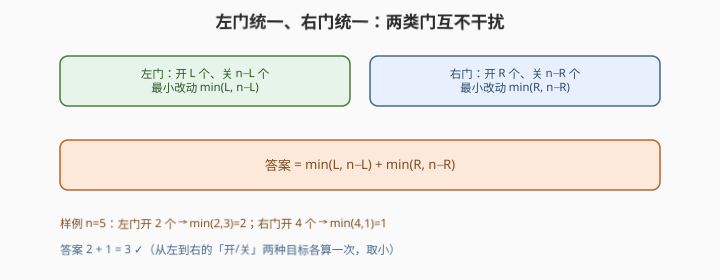
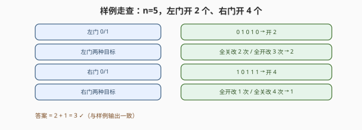

# Codeforces 248A 橱柜门统一 题解

## 1. 题目概述

- **题目链接**：https://codeforces.com/problemset/problem/248/A
- **比赛来源**：Codeforces Round 152 (Div. 2) · Problem A（UTC 2012-11-25）
- **难度**：800
- **标签**：实现、贪心
- **评测类型**：普通
- **限制**：时间 2 s / 内存 256 MB

**题意**：$n$ 个橱柜，每个有左、右两扇门（0=关，1=开）。要求最后**所有左门同一种状态、所有右门同一种状态**（两者可以不同）。每次改变一扇门花 1 秒，求最少秒数。

**约束**：$n\le10^4$，每扇门独立，只需统计左右门各有多少个开着的。

## 2. 示例与观察

```text
输入：
5
0 1
1 0
0 1
1 1
0 1

输出：
3
```

**演算**：左门 $0,1,0,1,0$ → 开 2 个；右门 $1,0,1,1,1$ → 开 4 个。

- 左门要么全关（改 2 扇），要么全开（改 3 扇）→ 2；
- 右门要么全开（改 1 扇），要么全关（改 4 扇）→ 1；

合计 $2+1=3$ ✓。



**观察**：左门与右门互不影响，可以分别取最优。

## 3. 解题思路

### 3.1 朴素做法与瓶颈

本题没有瓶颈：$O(n)$ 统计即可。

### 3.2 核心观察

设左门开着的个数为 $L$、右门为 $R$。把左门全变 0 要 $L$ 次，全变 1 要 $n-L$ 次，故左门最少 $\min(L,n-L)$；右门同理。答案

$$\min(L,n-L)+\min(R,n-R).$$



### 3.3 样例走查

见第 2 节表格：$L=2,R=4$ → $2+1=3$。

## 4. 正确性证明

**引理 1**：使所有左门同态的最少操作数是 $\min(L,n-L)$。

**证明**：最终状态只有两种。目标是全 0 时，必须且只需把 $L$ 扇开着的门关上，下界与构造都成立；目标是全 1 时同理为 $n-L$。取较小者即最优。∎

**引理 2**：左右门的最优解可以独立相加。

**证明**：操作只影响单扇门，左门的操作集合与右门的操作集合互不重叠，总代价为两者之和，故分别取最优即全局最优。∎

**定理**：答案为 $\min(L,n-L)+\min(R,n-R)$。

**证明**：由引理 1、2。∎

## 5. 复杂度分析

时间 $O(n)$，空间 $O(1)$；$n=10^4$ 实测约 $2$ ms。

## 6. 参考代码

### C++17

```cpp
#include <bits/stdc++.h>
using namespace std;
int main(){int n;scanf("%d",&n);int l=0,r=0;for(int i=0;i<n;i++){int a,b;scanf("%d %d",&a,&b);l+=a;r+=b;}
printf("%d\n",min(l,n-l)+min(r,n-r));}
```

### Python3

```python
import sys


def main() -> None:
    data = sys.stdin.buffer.read().split()
    if not data:
        return
    n = int(data[0])
    l = r = 0
    p = 1
    for _ in range(n):
        l += int(data[p]); r += int(data[p + 1]); p += 2
    print(min(l, n - l) + min(r, n - r))


main()
```

## 7. 边界情况与易错点

1. **两种目标都要算**：只考虑「全关」会漏掉更优的「全开」。
2. **左右独立**：不要试图让左右门状态相同。
3. **$n$ 为偶数且恰好一半开**：两种目标代价相同，取任一个都对。
4. **读入格式**：每行两个整数，共 $n$ 行。
5. **答案范围**：$\le n\le10^4$，`int` 足够。
6. **多测**：单组数据。

## 8. 验证记录

- **编译环境与命令**：`verify_solution.py`（clang++ 回退）；`check.py`、`check_samples.py --only 0101-0203/248`、`katex_check.cjs` 均 0 问题。
  - `python3 codeforces/tools/verify_solution.py codeforces/contests/0101-0203/248/A_橱柜门统一.md` → `CF248A: samples 1 / C++ 编译 OK, 样例 1/1 / Python 语法 OK, 样例 1/1`
- **官方样例**：1 / 1 通过（3）。
- **暴力对拍**：独立暴力 = 枚举「左门最终 0/1 × 右门最终 0/1」四种目标、逐门数改动数取最小。随机 **240 组**（$n\in[2,20]$），C++、Python、暴力一致。
- **最大约束性能**：$n=10^4$ 约 $2$ ms。
- **图片校验**：`cf248a_doors.svg`、`cf248a_walk.svg` 通过 XML 解析。
- **复核状态**：verified。

## 相关题目与扩展

- [Codeforces 248B Chilly Willy](https://codeforces.com/problemset/problem/248/B)：同场 B 题。

**延伸思考**：

1. **若要求左右门状态相同**：变成 $\min(L+n-R,\ n-L+R)$，仍是 $O(n)$。
2. **若改变一扇门的代价不同**：变成两个独立的加权选择问题。
3. **若门有 $k$ 种状态**：每扇门取众数，代价 $n-$ 众数频次。
