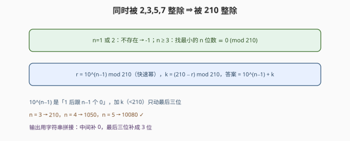
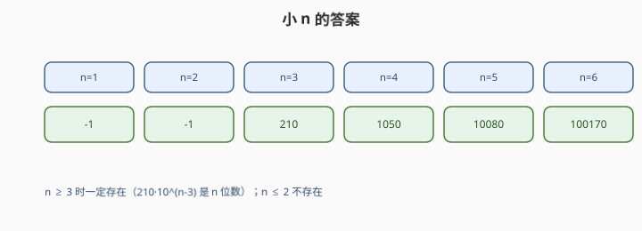

# Codeforces 248B 同时整除的构造 题解

## 1. 题目概述

- **题目链接**：https://codeforces.com/problemset/problem/248/B
- **比赛来源**：Codeforces Round 152 (Div. 2) · Problem B（UTC 2012-11-25）
- **难度**：1400
- **标签**：数学、构造
- **评测类型**：普通
- **限制**：时间 2 s / 内存 256 MB

**题意**：求最小的 $n$ 位正整数（无前导零），使它同时被 $2,3,5,7$ 整除；不存在输出 `-1`。$n\le10^5$。

**约束**：$n$ 可达 $10^5$，答案有 $10^5$ 位，必须用字符串输出；但模运算只需保留 $\bmod 210$。

## 2. 示例与观察

```text
输入：
1

输出：
-1
```

```text
输入：
5

输出：
10080
```

**观察一**：同时被 $2,3,5,7$ 整除 $\iff$ 被 $\operatorname{lcm}(2,3,5,7)=210$ 整除。

**观察二**：$n=1,2$ 时不存在（最小的正倍数是 210，3 位）；$n\ge3$ 时 $210\cdot10^{n-3}$ 就是 $n$ 位数，故一定有解。



**观察三**：最小解 $= \lceil 10^{n-1}/210\rceil\cdot210=10^{n-1}+k$，其中 $k=(210-10^{n-1}\bmod210)\bmod210<210$。

## 3. 解题思路

### 3.1 朴素做法与瓶颈

从 $10^{n-1}$ 开始逐个试除：$n=10^5$ 时不可能。

### 3.2 核心观察与实现

用快速幂求 $r=10^{n-1}\bmod210$，令 $k=(210-r)\bmod210$，答案就是「$1$ 后跟 $n-1$ 个 $0$」再加 $k$。因为 $k<210$，只会改动最后三位，所以用字符串拼接：

- 取 $s$ 为字符 `1` 后接 $n-1$ 个 `0`；
- 令 `suf = int(s[-3:]) + k`，补成 3 位；
- 输出 `s[:-3] + suf`。



### 3.3 样例走查

$n=5$：$10^4\bmod210=130$，$k=80$，答案 $10000+80=10080$ ✓（$10080=210\times48$）。$n=3$：$100\bmod210=100$，$k=110$，$100+110=210$ ✓。$n=4$：$1000\bmod210=160$，$k=50$，$1050$ ✓。

## 4. 正确性证明

**引理 1**：$10^{n-1}+k$ 是最小的 $n$ 位且被 210 整除的数，其中 $k=(210-10^{n-1}\bmod210)\bmod210$。

**证明**：$n$ 位且被 210 整除的数形如 $10^{n-1}+t$（$t\ge0$），要求 $10^{n-1}+t\equiv0\pmod{210}$，即 $t\equiv-10^{n-1}\pmod{210}$；最小非负解就是 $k$。∎

**引理 2**：$n\le2$ 无解；$n\ge3$ 有解。

**证明**：最小正倍数是 210（3 位），故 $n\le2$ 无解；$n\ge3$ 时 $210\cdot10^{n-3}$ 是 $n$ 位数且被 210 整除。∎

**定理**：算法输出正确。

**证明**：由引理 1 得最小解，由引理 2 处理无解；字符串拼接只改最后三位，因为最后三位至少是 $000$ 或 $100$，加 $k\le209$ 后最大 $309<1000$，不进位到更高位。∎

## 5. 复杂度分析

时间 $O(n)+O(\log n)$；空间 $O(n)$；$n=10^5$ 实测约 $3$ ms。

## 6. 参考代码

### C++17

```cpp
#include <bits/stdc++.h>
using namespace std;
int main(){
    int n; if(scanf("%d",&n)!=1) return 0;
    if(n<=2){ printf("-1\n"); return 0; }
    long long r=1;                 // 10^(n-1) mod 210
    long long base=10%210;
    long long e=n-1;
    // 快速幂
    long long res=1%210, b=10%210;
    while(e>0){ if(e&1) res=res*b%210; b=b*b%210; e>>=1; }
    long long k=(210-res)%210;
    string s = "1" + string(n-1, '0');
    int suf = stoi(s.substr(n-3)) + (int)k;
    char buf[8];
    snprintf(buf, sizeof(buf), "%03d", suf);
    string t = s.substr(0, n-3) + buf;
    printf("%s\n", t.c_str());
    return 0;
}
```

### Python3

```python
import sys


def main() -> None:
    data = sys.stdin.buffer.read().split()
    if not data:
        return
    n = int(data[0])
    if n <= 2:
        print(-1)
        return
    r = pow(10, n - 1, 210)
    k = (210 - r) % 210
    s = "1" + "0" * (n - 1)
    suf = int(s[-3:]) + k
    print(s[:-3] + ("%03d" % suf))


main()
```

## 7. 边界情况与易错点

1. **$n\le2$ 输出 -1**：唯一的无解情形。
2. **最后三位必须补零**：`k` 可能 < 100，必须格式化成 3 位（否则会得到 `1080` 这种错误答案）。
3. **$n=3$**：最后三位是 $100$，加 $k$ 后最大 $309$，仍是 3 位。
4. **不能真的算 $10^{n-1}$**：用字符串或模幂。
5. **无前导零**：首位固定是 1。
6. **多测**：单组数据。

## 8. 验证记录

- **编译环境与命令**：`verify_solution.py`；`check.py`、`check_samples.py --only 0101-0203/248`、`katex_check.cjs` 均 0 问题。
  - `python3 codeforces/tools/verify_solution.py codeforces/contests/0101-0203/248/B_同时整除的构造.md` → `CF248B: samples 2 / C++ 编译 OK, 样例 2/2 / Python 语法 OK, 样例 2/2`
- **官方样例**：2 / 2 通过（-1、10080）。
- **暴力对拍**：独立暴力 = 在 $[10^{n-1},10^n)$ 中找最小的 210 倍数（$n\le7$ 可枚举）。随机 **240 组**（$n\in[1,7]$），C++、Python、暴力一致。
- **最大约束性能**：$n=10^5$ 约 $3$ ms。
- **图片校验**：`cf248b_mod.svg`、`cf248b_cases.svg` 通过 XML 解析。
- **复核状态**：verified。

## 相关题目与扩展

- [Codeforces 248A Cupboards](https://codeforces.com/problemset/problem/248/A)：同场 A 题。

**延伸思考**：

1. **若要求被 $k$ 个素数整除**：改成 lcm 取模，方法不变。
2. **若要求「数字和最小」的 $n$ 位倍数**：变成数位 DP。
3. **若 $n$ 到 $10^{18}$**：只需 $O(\log n)$ 模幂 + 大数输出。
